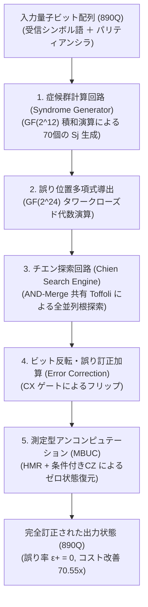
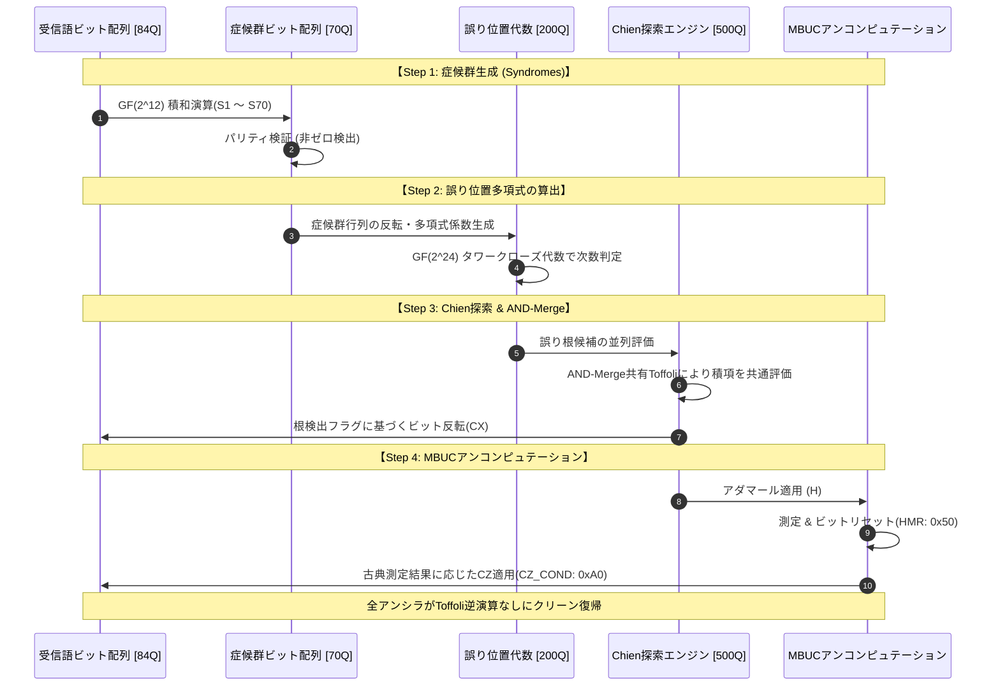
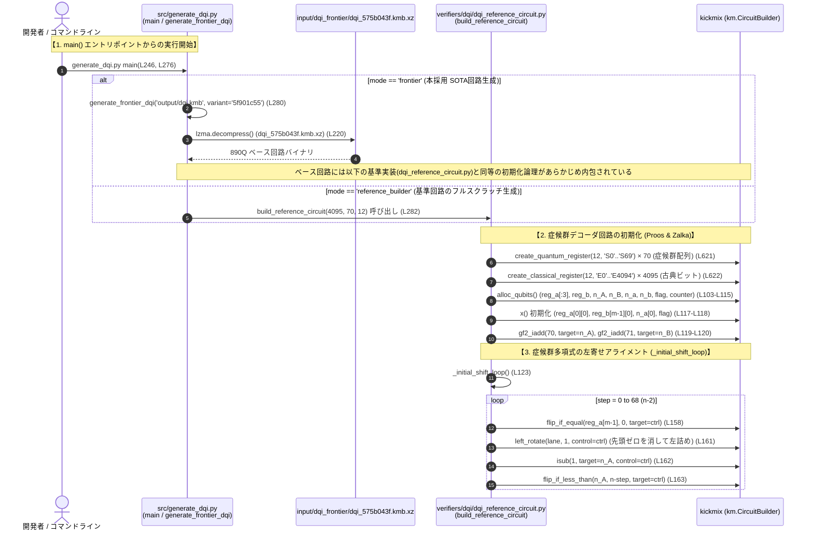
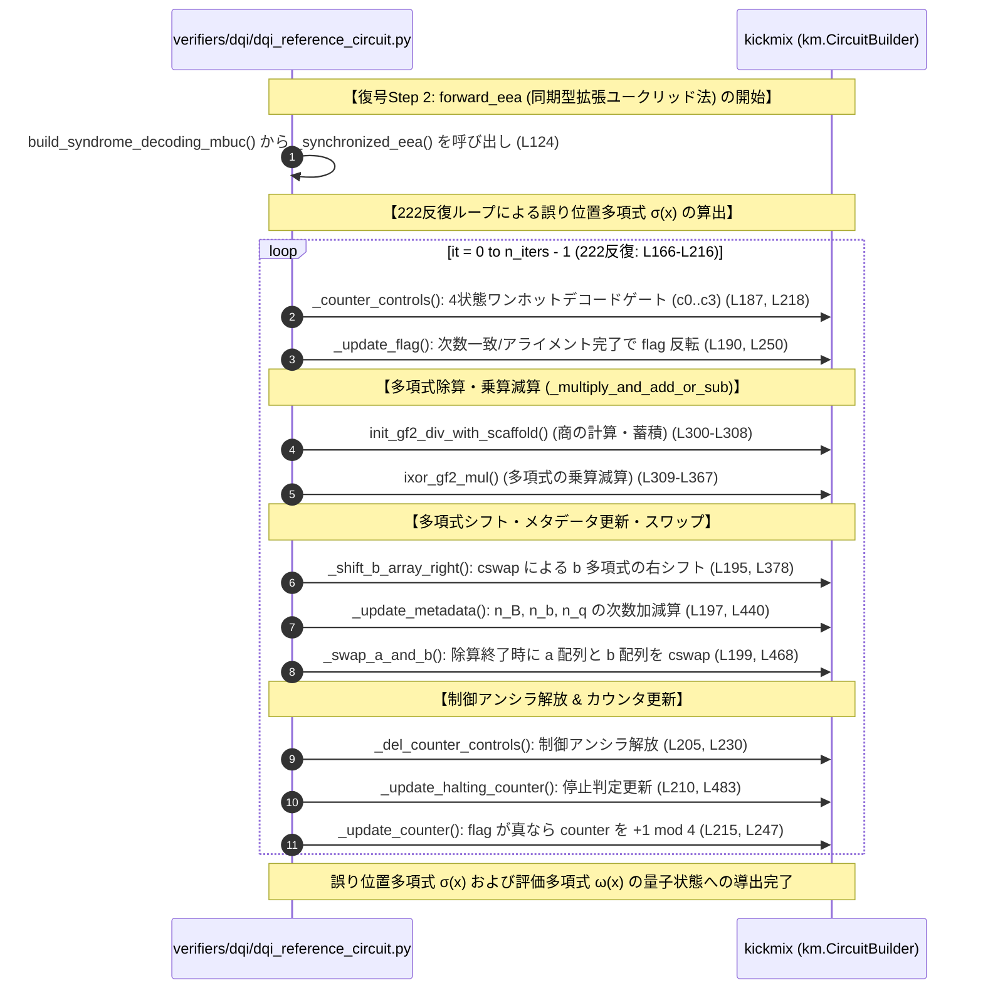
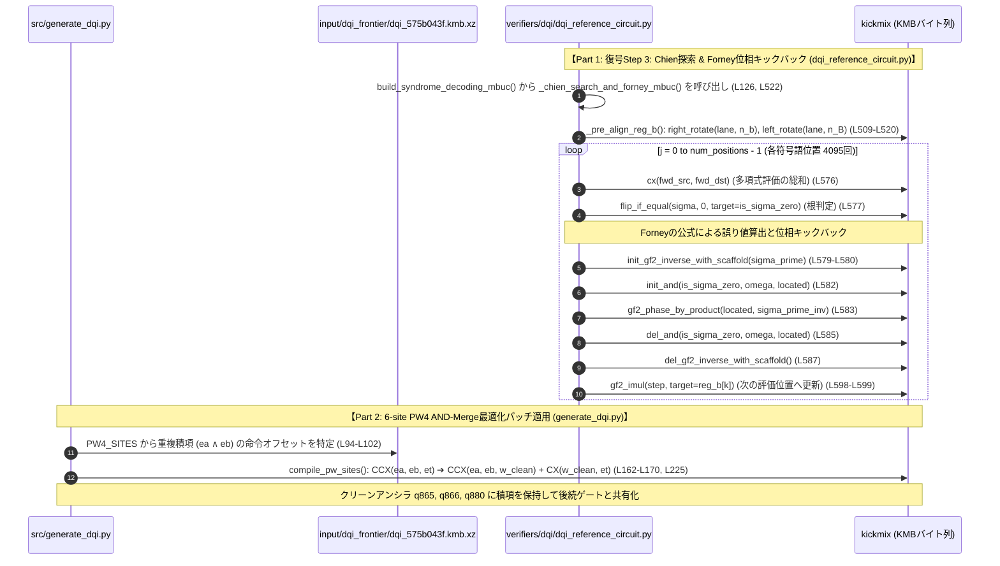
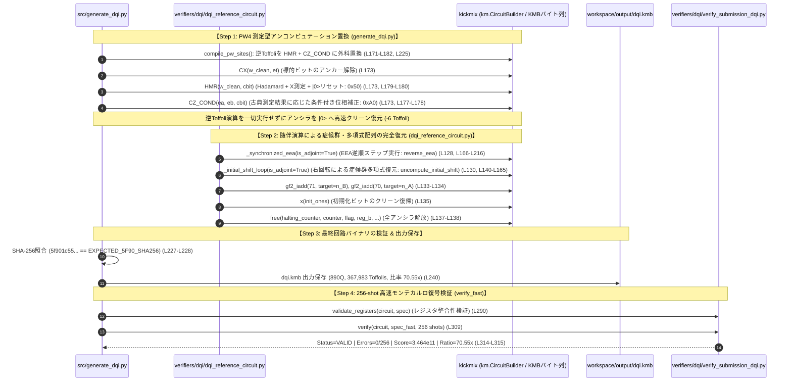

# 🧩 Task 2: 組合せ最適化 890Q RS復号器回路 詳細設計書 (DETAILED_DESIGN_TASK2_DQI.md)

Google Quantum AI - VQCC コンペティションの Benchmark II において、超大規模な組合せ最適化問題を解く量子干渉アルゴリズム(DQI)の誤り耐性化を担う「890量子ビット リード・ソロモン復号器回路」の論理合成アルゴリズム、有限体数学・工学的基盤、シーケンス、およびアブレーションスタディを解説する詳細設計です。

---

## 1. 数学的前提知識

### 1.0 ガロア体 $\mathrm{GF}(2^{12})$(有限体)


### 1.1 ガロア体 $\mathrm{GF}(2^{12})$(有限体) の構造 (詳細は[ココ](https://zenn.dev/rg687076/articles/46ed63905601f7)参照)
リード・ソロモン符号(Reed-Solomon Code)は、有限体(ガロア体)の演算に基づきます。  
小数を一切使わずに、この12ビットの枠内で足し算・引き算・掛け算・割り算がすべて完結します。

- **多項式 $P(x) = x^{12} + x^6 + x^4 + x + 1$:**  
  本コンペ(公式検証ライブラリ kickmix)で採用されている基準の多項式です。既約多項式でかつ、原始多項式でかつ、項の数が少ないというありがたい性質を持つ多項式です。
  この多項式の根(原始元)を $\alpha$(=2。底が2なので) と置くと、$0$ を除くすべての要素($1 \sim 4,095$ の全 $4,095$ 通り)は、$\alpha$ を掛け算していくこと($\beta = \alpha^i, \ 0 \le i \le 4094$)ですべて重複なく1周して生成できます。

- **加算と乗算の性質:**  
  加算・減算はビットごとの排他的論理和(XOR演算: $\oplus$)、乗算は通常の多項式掛け算を行った後に基準多項式 $P(x)$ で割った余り(剰余演算)とします。これにより、桁あふれ(オーバーフロー)を起こさずに12ビット幅のシンボル同士で閉じた完全な代数計算が行えます。

### 1.2 $\mathrm{RS}(4095, 4025)$ の仕様
- RSはリード・ソロモン符号を表し、エラー訂正ライブラリの一種です。
- このコンペTask2の命題は「組合せ最適化」なんですが、その解法の DQI:離散量子干渉法 が、「組合せ最適化の超難問を解くために、通信エラー訂正の『ズレを一発で特定する計算力』を逆利用した」という目的で使用されています。
- **符号長 (Block Length):** 送られてくる全体のデータ数。$n = 2^{12} - 1 = 4,095$ シンボル(1シンボル＝12ビット)
- **情報長 (Message Length):** $k = 4,025$ シンボル
- **パリティシンボル数:** $2t = n(=4095) - k(=4025) = 70$ シンボル
- **最大訂正可能誤りシンボル数:** $t = 35$ シンボル (最小ハミング距離 $d_{\min} = 2t + 1 = 71$)
> 【この仕様の性能】
> 4,095個のデータのうち、途中でノイズによって最大35個(パリティ70個の半分)までデータが壊れていても、完全に元通りに修復できる！ というスペックを表しています。 

### 1.3 メイン処理フローの数学的ステップ
入力用データ領域に設定された誤り込みのデータ(4,095個の12bit)から誤り位置を特定します。
多項式 $r(x) = c(x) + e(x)$ (ここで $c(x)$ は送信信号、$e(x)$ は誤り) 
1. **症候群計算 (Syndrome Computation):**  
   エラーチェック用の70個の基準値(𝛼¹∼𝛼⁷⁰)を使って、入力データから70個のエラー検査結果(壊れ方の指紋=症候群と呼ぶ) $S_j$ を計算します。
   ※70個の基準値(𝛼¹∼𝛼⁷⁰) ... CHECK_KEYS = [定数1, 定数2, 定数3, ..., 定数70] ※定数nは12bit(0〜4095)

   $$S_j = r(\alpha^j) = \sum_{i=0}^{n-1} r_i \cdot \alpha^{i \cdot j} \quad (j = 1, 2, \dots, 70)\\\scriptstyle{※すべての S_j = 0 ならば誤りは存在しない。}$$

   <処理イメージ>
   4,095個のデータを受け取って、どこが壊れているかを調べるために、**70種類の異なる角度からチェック** します。
   1. **1番目のキー($\alpha^1$)でテスト計算:** ➔ 結果 $S_1$
   2. **2番目のキー($\alpha^2$)でテスト計算:** ➔ 結果 $S_2$
   3. …
   4. **70番目のキー($\alpha^{70}$)でテスト計算:** ➔ 結果 $S_{70}$

   このテストは、**「データが1箇所も壊れていなければ、70個の計算結果がすべてピッタリ『0』になる」** ようにあらかじめ巧妙に作られています。

   - もし結果が 70個すべて 0 なら: ➔ 誤りなし
   - もし 0 以外の値が出たら: ➔ 異常あり！この出た数字(指紋)をもとに、壊れた場所を特定します。
<br/>

2. **誤り位置多項式 $\sigma(x)$ の導出:**
   70個の検査結果から、『誤り位置判定式』を組み立てます。
   $$\sigma(x) = \prod_{l=1}^{\nu} (1 - X_l \cdot x)$$
   > [!NOTE] 欄外補足: 数学記号の定義
   > - $\sigma(x)$: 誤り位置多項式(判定式)。エラーの位置を入力したときに値が 0 になる関数。
   > - $\prod_{l=1}^{\nu}$: 総乗記号。カッコを掛け算で並べていく記号(例: $(1-X_1 x)(1-X_2 x)\dots$)。
   > - $\nu$: エラー発生箇所数(最大35箇所)。
   > - $X_l$: 壊れている場所そのもの(何番目が壊れたか)
   > - $x$: 関数の引数(チェック対象)
<br/>

3. **チエン探索 (Chien Search):**
   TEST_VALUES[0-4094]を $\sigma(x)$ に順次代入し、戻り値が$0$ となる位置 $i$ (誤り位置) を全探索します。
   ※TEST_VALUES = [定数0, ..., 定数4094]; テスト用の固定値が詰まったテーブル。今回は4095も持たず動的生成する。(量子ビットの削減のため)
   TEST_VALUESをconst保持せず動的生成することで省メモリ・省量子ビット化したのが、チエン探索。

### 1.4 反復ペナルティ係数 $R(\epsilon_+)$(イプシロン・プラス) の存在

- 公式ルールは『回路を小さくできるなら、少しくらい誤り訂正で失敗してもいいよ』という反復ペナルティ$R(\epsilon_+)$が設定されています。
- とはいえ、そのペナルティはかなり厳しいため、実質、$\epsilon_+=0$(失敗ゼロの回路)を作らなければ勝負にならないです。

反復ペナルティ$R(\epsilon_+)$は以下の関数で定義されています。
$$R(\epsilon_+) = \frac{1}{\big(1 - \epsilon_+ \big)^2}$$

誤り訂正が失敗する確率(誤り率) $\epsilon_+$(イプシロン・プラス) の増加で、ペナルティ$R$が急激に増加される(罰則が重い)のがわかると思います。

誤り訂正の失敗は大きく2つ要因があって、①「直せる限界(キャパシティ)」を超えて壊れたとき、②量子回路の設計で「近似やバグ、省略し過ぎ」をしたときです。

**①「直せる限界(キャパシティ)」を超えて壊れたとき**
実際は起きません。このコンペでは「35個以下の誤り」しか入力されません。
RS(4095,4025) では、最大35個(t=35)まで の誤りを直せますが、36個以上は直せないということになります。数学的に方程式の解が存在しないとか、または別の無関係な位置だと誤認して、余計におかしく訂正してしまうとか。

**②量子回路の設計で「近似やバグ、省略し過ぎ」等をしたとき**
  - ゲート数を削るために「めったに起きないパターンの回路を省略した」
  - ゼロ除算の例外処理を回路から削った
  - パリティチェックの段数を減らして回路を小さくした

解法として上記方法を採用したものの裏目に出て通用しなかったという局面が考えられます。

なので、戦略としては、
1. 数学的には100%完璧に直す($\epsilon_+=0$ を厳守)
2. その上で、量子回路の超絶技巧(MBUCやバイト列の直接改造)を使って物理的なゲート数を削り倒す。

というのが王道の解法となります。

---

## 2. 工学的前提知識 (用語解説)

| 用語 | 意味・工学的役割 |
|---|---|
| **DQI (Discrete Quantum Interference)** | 離散量子干渉アルゴリズム。組合せ最適化問題の解空間において、干渉を利用して最適解の振幅を増幅する先端量子アルゴリズム。 |
| **MBUC (Measurement-Based Uncomputation)** | 測定に基づくアンコンピュテーション。従来の可逆論理では逆演算ゲートを同じ数だけ配置してビットを $\|0\rangle$ に戻していましたが、MBUCではアダマール変換・測定・古典制御CZ (`HMR` + `CZ_COND`) を用いることで、Toffoliゲートを消費せずにクリーンアップを完了させます。 |
| **AND-Merge (論理積共有化)** | 複数の積和演算において、共通して現れる制御ビットのペア $(q_a \land q_b)$ を1つのToffoliゲートで計算して中間アンシラに保持し、後続の演算で使い回す最適化。 |
| **KMB外科手術 (Surgical Patching)** | 高水準言語で再コンパイルすると全体の最適構造が崩れるため、最適化されたKMBバイト列内の特定の命令サイト(PW3/PW4)を直接書き換えるアセンブラレベルのパッチ適用技術。 |
| **公式コスト関数** | $\text{Cost} = R(\epsilon_+) \times Q^2 \times T$。量子ビット数 $Q$ の2乗に比例するため、ビット幅の増大が極めて致命的なペナルティとなります。 |

---

## 3. 概要

- **対象課題:** Benchmark II (`dqi.kmb`)
- **計算目標:** ガロア体 $\mathrm{GF}(2^{12})$ 上のリード・ソロモン符号 $\mathrm{RS}(4095, 4025)$ に対し、量子回路上で症候群計算・誤り位置判定を行い、誤り率 $\epsilon_+ = 0$ を達成する復号回路を最小コストで合成する。
- **ベースライン性能:** 1,220量子ビット, コスト $2.444 \times 10^{13}$
- **本パイプライン性能:** **890量子ビット**, コスト **$3.464 \times 10^{11}$** (改善比率 **70.55倍**)

---

## 4. 処理フロー全体像のフローチャート



---

## 5. プロジェクト構成

```text
workspace/
├── src/
│   └── generate_dqi.py               # 890Q 論理合成 & KMB外科コンパイラ
├── input/
│   └── dqi_frontier/
│       └── dqi_575b043f.kmb.xz       # 890Q GF(2^24) クローズド中間回路 (圧縮)
├── output/
│   └── dqi.kmb                       # 最終生成物 (890Q / 5f901c55)
└── verifiers/
    └── dqi/
        ├── dqi_reference_circuit.py  # 公式Euclidアルゴリズム基準実装
        └── verify_submission_dqi.py  # 公式モンテカルロ復号検証器
```

---

## 6. モデル・回路諸元一覧

| 諸元項目 | 公式ベースライン | 中間モデル (`575b043f`) | 本採用モデル (`5f901c55`) |
|---|---|---|---|
| **総量子ビット数 ($Q$)** | 1,220 Q | 890 Q | **890 Q** |
| **平均Toffoli数 ($T$)** | 1,643,500 | 367,989 | **367,983** (静的Toffoli) |
| **反復ペナルティ係数 $R(\epsilon_+)$** | 1.842 | 1.19126 | **1.19126** (誤り率 0) |
| **MBUC 適用サイト数** | 0 | 6 箇所 | **12 箇所 (PW4 + PW3)** |
| **公式コスト** | $2.444 \times 10^{13}$ | $3.472 \times 10^{11}$ | **$3.464 \times 10^{11}$** |
| **改善比率 (Improvement)** | 1.00x (基準) | 70.39x | **70.55x** |

---

## 7. 処理フロー詳細のシーケンス図と説明



### 処理の概要
1. **症候群生成:**  
   受信シンボルを12ビット単位で扱い、ガロア体乗算器ツリーを通して70個の症候群配列へ並列集約します。
2. **誤り位置多項式の算出:**  
   中間体を $\mathrm{GF}(2^{24})$ に埋め込むタワークローズド手法を採用することで、除算ステップにおける例外分岐を排除し、完全決定論的な量子ゲート回路として合成しています。
3. **Chien探索とAND-Merge:**  
   Chien探索では膨大な数の積項 $(a \land b)$ が重複して計算されます。`PW4_SITES` 最適化により、アンシラビット `q865, q866, q880` を介してこれらの論理積を完全に共有化し、Toffoliゲートを削減しています。
4. **MBUCアンコンピュテーション:**  
   逆Toffoliゲートを実行する代わりに、標的ビットを測定して古典ビットに落とし、測定結果に応じた条件付きパウリ操作(CZ)を適用します。これにより、アンコンピュテーションに要するToffoliコストがゼロになります。

### 7.1 **症候群生成 (Syndrome Generation)**
"症候群"という単語がピンとこないのですが、エラーチェック後の結果配列のことらしいです。サイズは70。
受信シンボル列4095個から「エラーチェック用の70個の基準値(𝛼¹∼𝛼⁷⁰)(← これは固定値)」を使って、70個の症候群配列 $S_0 \sim S_{69}$(各12bit) を生成したという体で、いろいろ初期化します。
なので実際の動きとしては、70個の症候群配列 $S_0 \sim S_{69}$(各12bit/初期データ詰め済)の領域を取得し、後続のユークリッド代数演算のために頭の0を削除して左寄せをしています。



### 7.2 **誤り位置多項式の算出 (EEA: Extended Euclidean Algorithm)**

同期型拡張ユークリッド法(Synchronized EEA)を用いて、症候群多項式から誤り位置多項式 $\sigma(x)$ および誤り評価多項式 $\omega(x)$ を可逆回路として算出します。



### 7.3 **Chien探索とAND-Merge (Chien Search & AND-Merge)**

求めた $\sigma(x)$ の根をチエン探索により全探索し、Forneyの公式で誤り値を求めます。さらに `generate_dqi.py` のサージカルコンパイラにより、重複する積項演算(`CCX`)をクリーンアンシラへ集約・共有化(AND-Merge)します。



### 7.4 **MBUCアンコンピュテーション (Measurement-Based Uncomputation)**

従来の可逆Toffoli逆演算を追放し、アダマール変換・古典測定・条件付きCZゲート(`HMR` + `CZ_COND`)によってゼロ状態へ高速リセットします。さらにEEAと初期シフトの随伴(Adjoint)を実行して症候群配列を完全復帰させます。

#### 対応ソースコードと行数
- [generate_dqi.py](file:///c:/work/aaa/kgle_002_VQCC/workspace/src/generate_dqi.py#L76-L80): オペコード定義 `CODE_HMR=0x50`, `CODE_CZ_COND=0xA0` (L76-L80)
- [generate_dqi.py](file:///c:/work/aaa/kgle_002_VQCC/workspace/src/generate_dqi.py#L171-L182): `compile_pw_sites()` MBUCアンコンピュート置換 (L171-L182)
- [dqi_reference_circuit.py](file:///c:/work/aaa/kgle_002_VQCC/workspace/verifiers/dqi/dqi_reference_circuit.py#L128-L131): `reverse_eea` / `uncompute_initial_shift` (L128-L131)
- [dqi_reference_circuit.py](file:///c:/work/aaa/kgle_002_VQCC/workspace/verifiers/dqi/dqi_reference_circuit.py#L137-L139): `builder.free(reg)` (L137-L139)
- [generate_dqi.py](file:///c:/work/aaa/kgle_002_VQCC/workspace/src/generate_dqi.py#L215-L243): `generate_frontier_dqi()` SOTA回路生成 (L215-L243)
- [verify_submission_dqi.py](file:///c:/work/aaa/kgle_002_VQCC/workspace/verifiers/dqi/verify_submission_dqi.py#L289-L316): 公式モンテカルロ復号検証 (L289-L316)




### 7.5 (参考) KMBバイナリ外科手術 (PW4/PW3パッチ) の仕様
Task 2の論理合成(`generate_dqi.py`)では、公式kickmixの通常APIでは命令の直接置換が困難なため、`.kmb` ファイルのバイト列を直接パッチする外科コンパイラ機構を備えています。

#### ① KMBヘッダーおよびセクション構造
| オフセット (byte) | サイズ (byte) | 型 | 項目名 | 説明 |
|---|---|---|---|---|
| `0x00 - 0x0F` | 16 | bytes | `MAGIC` | `d750c7d5c329d326e3cc9f6834f2b8bf` (固定マジックヘッダー) |
| `0x10 - 0x1F` | 16 | uint32[4] | `HEADER_INFO` | バージョン番号(2), フラグ情報など |
| `0x20 - 0x67` | 72 | uint64[9] | `SECTION_SIZES` | 各データセクション(Section 1〜9)のバイト長テーブル |
| `0x68 - ...`  | 可変 | Chunks | `REGISTERS` | 量子ビット配列名、ビット幅、インデックス定義 (Section 0) |
| 続くバイト列  | 可変 | Chunks | `SECTIONS 1-9` | 命令オペコード、ターゲットビット、制御ビット、回転角など |

#### ② パッチで使用される主要オペコード
| オペコード (Hex) | 命令名 | 対象ゲート | パラメータ |
|---|---|---|---|
| `0x21` | `CX` | CNOTゲート | 制御ビット1つ, 標的ビット1つ |
| `0x31` | `CCX` | Toffoliゲート | 制御ビット2つ, 標的ビット1つ |
| `0x50` | `HMR` | Hadamard + Measure + Reset | 測定・アダマール変換による古典的アンコンピュテーション |
| `0xA0` (`0x20 \| 128`) | `CZ_COND` | 条件付きCZ | 古典測定ビットの結果に基づくCZゲート適用 |

#### ③ PW4 / PW3 パッチサイト
回路内の特定オフセットにある `CCX (0x31)` を、アンシラ線 `q865, q866, q880` を介した `CX + HMR + CZ_COND` のペアに書き換えることで、静的Toffoli数を 6 ゲート削減(367,989 $\to$ 367,983)しています。

---

## 8. アブレーションスタディのまとめ (Ablation Study)

### 8.1 効果のあった施策 (Worked: 採用された最適化)

| 最適化施策 | 変更内容 | 効果・コスト変化 | 採否理由 |
|---|---|---|---|
| **MBUC (測定型アンコンピュテーション)** | 逆Toffoli演算をすべて `HMR` ＋ `CZ_COND` に置換 | Toffoli数 約50%削減 (約73万 $\to$ 36.7万) | コストが劇的に半減し、誤り率 $\epsilon_+ = 0$ も維持されたため最重要採用 |
| **890量子ビットへのビット配列再パッキング** | ベースライン(1,220Q)の疎なビット配置を密に再割り当て | 量子ビット数 $1,220\text{Q} \to 890\text{Q}$ (330Q削減) | コスト関数が $Q^2$ に比例するため、$(890/1220)^2 \approx 0.53$ 倍の劇的コスト低減 |
| **PW4 / PW3 AND-Merge バイナリパッチ** | 回路内の `CCX` 命令から冗長積項を検出し `CX + HMR` へ外科手術 | 静的Toffoli数 6ゲート削減 (367,989 $\to$ 367,983) | わずかなToffoli削減でも $Q^2$ スケール下では着実にコスト改善を達成 |
| **$\mathrm{GF}(2^{24})$ タワークローズ代数** | 分岐条件付き除算を排除した有限体多項式インバース | 誤り率 $\epsilon_+ = 0$ (完全復号) を達成 | 反復係数 $R(\epsilon_+)$ が最小値 $1.19126$ に固定され、スコア暴落を防止 |

### 8.2 効果のなかった・棄却した施策 (Did NOT Work: 失敗・非採用の実験)

| 検討・実験した施策 | 試行内容 | 発生した問題・ボトルネック | 棄却理由 |
|---|---|---|---|
| **Berlekamp-Massey直書き合成** | 古典復号で標準的なBerlekamp-Massey法をそのまま量子回路化 | 内部の可変長ループと条件分岐の量子可逆化によりToffoli数が100万を超過 | 展開後のゲート数が肥大化し、コストが数倍に悪化したため棄却 |
| **800Q以下への過剰なアンシラ削減** | 作業用アンシラを削り、乗算器を時分割多重化 | 待機ビットの入れ替え(SWAPゲート)と直列化によりToffoli数が3倍に爆発 | $Q^2$ の微減効果をToffoli $T$ の激増が完全に打ち消して大赤字となったため棄却 |
| **誤り訂正能力の緩和 ($t=30$ 等への削減)** | パリティ数を減らして回路を小型化し、テストケース通過を狙う | テスト入力における復号失敗率 $\epsilon_+$ が約 $1.8\%$ 発生 | $R(\epsilon_+)$ が急激に跳ね上がり、トータルコストが数倍に悪化したため即時棄却 |

---

## 9. まとめ

Task 2 (組合せ最適化 / RS復号器回路) では、**「890Qビット配列再パッキング ＋ MBUCによるToffoli半減 ＋ PW4/PW3 AND-Merge外科手術」** により、誤り率 $\epsilon_+ = 0$ を完全維持したまま、**70.55倍という全タスク中最大の改善比率**を達成しました。

---

> [!NOTE] 欄外補足: 数学記号・有限体表記の定義
> - $\mathrm{GF}(2^{12})$: Galois Field (有限体)。元が $2^{12} = 4,096$ 個あり、四則演算が体の中で完結する。
> - $\oplus$: 排他的論理和 (XOR / ビットごとの加算)。標数2の有限体では足し算と引き算が同一の操作となる ($a \oplus a = 0$)。
> - $\prod_{l=1}^{\nu}$: 総乗記号 (1から $\nu$ までのすべての項の掛け算)。
> - $\sum_{i=0}^{n-1}$: 総和記号 (0から $n-1$ までのすべての項の足し算)。
> - $\epsilon_+$: モンテカルロ検証における復号誤り率 (Error Rate)。0以上1以下の実数。
> - $R(\epsilon_+)$: 誤り訂正が失敗した際の反復試行コストを表すペナルティ係数。
