18-⑤Kaggle実践3 Biohub細胞トラッキング 4位解法のまとめ
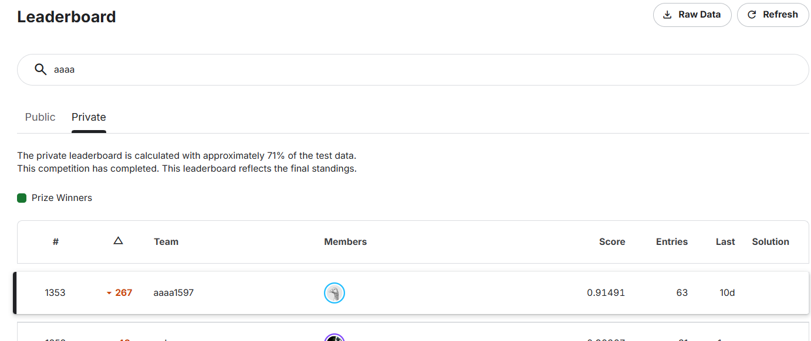

## Abstract
- biohub 4位解法(BarryZhou / songqizhouさん Public 0.969 / Private 0.962)のまとめ
  - 数百エポックの学習を避ける。
  - 「生物学的現象の観察」と「評価指標の特性」に注目。
  - NN、CPU上の勾配ブースティング木(LightGBM / CatBoost)、大域的ILP(整数線形計画法)で解決。

**用語解説**

- **DoG(Difference of Gaussians)** ... 異なる半径($\sigma$)のガウシアンフィルタをかけた2枚の画像の差分で、特定の大きさの明るい塊(ブロブ/細胞核)を強調・検出する古典的画像処理手法。4位解法では深層学習モデルから完全に独立した「Stage1.動画ごとの細胞密度ルーター」と「Stage6.疎な動画のトラック支持ゲート」の2箇所で重要な役割を果たす。
- **Cellpose型ベクトル場と移流(Advection)** ... 各ボクセルから「自身が属する細胞核の中心」を指す3D単位ベクトル場を予測し、閾値以上の高確率ボクセル(シード)をそのベクトル場に沿って少しずつ移動(移流: Advection)させて収束点でクラスタリングする検出手法([Stringer et al., Nature Methods 2021](https://www.nature.com/articles/s41592-020-01018-x))。密集して2つの細胞核が接触し1つの明るい塊に見えても、ベクトルが別々の中心を向くため明確に分離できる。
- **InfoNCE(対照学習: Contrastive Learning)** ... Info(Mutual Information:相互情報量)+NCE(Noise-Contrastive Estimation:ノイズ対照推定)を組み合わせた造語だけど、偉い人が論文で発表した損失関数の名前。連続するフレーム $t$ と $t+1$ における「同一細胞のパッチ」の埋め込みベクトル同士を引き寄せ、「周囲の競合する別細胞のパッチ」を遠ざける損失関数。要するに、「1個の本物(同一細胞)と複数のダミー(周囲の別細胞)を見分けるクイズを解かせることで、細胞固有の見た目特徴(情報)を抽出できるようにした学習法」。細胞の個体識別特徴(Cell Embedding)の学習に使用。
- **ILP(整数線形計画法: Integer Linear Programming)** ... 数理最適化の一種。グラフ上の出現・消失・移動リンク・細胞分裂のすべてにコスト(または報酬)を与え、生物学的整合性制約のもとで動画全体の総コストを最小化する大域的数理最適化手法。4位解法では `tracksdata` ライブラリと `SCIP` ソルバーを使用し、「ノードごとの個別分裂コスト($\text{base} - 16s_i$)」を導入したことが単一で最大のスコア向上(+0.035)をもたらした。
- **細胞密度ルーター** ... 基本的には作者の造語。ですが、動画の細胞密度をみてルーターの役目をさせているからこの名前にしている様です。具体的には、各動画の平均細胞核間隔(dog_sp)を見て、19.7 µm を境に後続パイプラインのルート(処理経路)を2つ(密なルート/疎なルート)に振り分けています。
- **トラック支持ゲート** ... これも作者の造語。条件を満たしたものだけを通過させ、満たさないものを遮断する『関門・検問所(フィルタ)』の役割を実行してるからこの名前になっています。

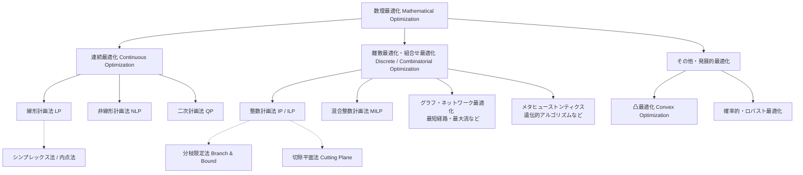

## 概要
先日、Biohub細胞トラッキングコンペが完了しました。
Private LB 1353位/3800人と大変悔しい結果に終わりましたが、Kaggleの素晴らしいところは、トップ層の解法が公開されることです。
このお宝を徹底的に解析し、確実に自身のスキルへと昇華させるべく、今回は4位に入賞された BarryZhou(songqizhou)さんの解法を深掘りします。

1位〜3位の解法が「数百エポック学習した巨大な3D U-Netや15モデルアンサンブル」「40個のTensorRTエンジン」といった重厚なGPU計算していたのに対し、4位解法は **「計算リソースが控えめ(最大の3D Netでも18Mパラメータ・わずか10エポック学習、結合モデルはすべてCPU上のLightGBMとCatBoost)」** です。生物学的なドメイン知識を緻密な特徴量と数理最適化に落とし込むアプローチを重要視している点が極めてユニークで実践的です。どうして省計算リソースを意識したかは不明です。計算リソースは参加者全員平等だと思うのですけど。

- 解説のURL(Writeup)
https://www.kaggle.com/competitions/biohub-cell-tracking-during-development/writeups/4th-place-solution
- ソースコード(Inference Notebook)
https://www.kaggle.com/code/songqizhou/biohub-4th-place-solution
- コード&学習済み重みデータセット(Artifacts)
https://www.kaggle.com/datasets/songqizhou/biohub-4th-place-artifacts

## biohub 4位解法まとめ
4位解法は、全6Stageで構成されています。その特徴はざっくりと **「生物学をモデル化する(Model the biology)」** というアプローチと、ILP(整数線形計画法)内部に組み込まれた **「ノードごとの学習済み分裂コスト($6 - 16s_i$)」** です。

- **Stage0**. Main(CPU処理とGPU並列実行)
- **Stage1**. 密度ルーター(DoG Router)と 3D Net 細胞検出(Cell Detection)
- **Stage2**. 候補リンク構築とマルチモーダル特徴量・LightGBMエッジモデル(Linking)
- **Stage3**. 細胞分裂の事前確率モデル(Division Prior: 3段階ハイブリッド構成)
- **Stage4**. ノード別分裂コスト付き大域的ILPと動き補償平滑化(ILP & Smoothing)
- **Stage5**. 原画像トレースによる分岐検証(Fork Verifier)とギャップ補間(Gap Filling)
- **Stage6**. 疎な動画向けのトラック支持ゲート(Track-Support Gate)


### 「生物学と評価指標の観察」からの観点

4位解法は、「胚の発生データと評価指標の性質」を観察し、以下の7つの構造を構築しています。

| 観点 | 具体的な対応内容 | 対応Stage |
| :--- | :--- | :---: |
| **① アノテーションは全体の約1%のみ**<br>本物の細胞や本物の分裂の大半には正解ラベルが付いていない(分裂にいたっては、全199動画でラベル付きは151件のみ) | **3階層(Tier)正規化BCE損失 & 分裂ラベルのみ抽出**<br>検出学習では3階層:Tier(「ラベル付き核」「確実な局所背景」「未ラベル領域(極小重み)」)に分けボクセル数で正規化。Stage3の分裂専用モデル3種(分裂CNN・分裂グラフモデル・分裂ペアモデル)を学習する際、ラベル付きトラックのみから陽性(分裂:子2つ)・陰性(未分裂:子1つ)を作成し、未ラベルノードは決して陰性にしない | Stage1, Stage3 |
| **② 接触した2つの核は1つの塊に見えてしまう**<br>単純な輝度ピークでは密集組織で細胞中心が融合してしまうが、実際は細胞中心自体は別々に存在する | **Cellpose型の3D単位ベクトル場と移流(Advection)デコーディング**<br>各ボクセルから核中心へ向かう単位ベクトルを予測し、シードを40ステップ移流させて収束先でクラスタリング | Stage1 |
| **③ 胚によって核のサイズと間隔が全く異なる**<br>密集した小核の胚(間隔13〜19µm)と、疎で大核の胚(間隔17〜31µm)が存在する | **検出器非依存のDoG密度ルーター & 適応的NMS**<br>古典的DoGトラッカーで動画ごとの核間隔を算出し、疎な動画($\ge 19.7\text{ µm}$)には厳しいシード閾値(`0.99`)と緩和された分裂基本コスト(`5`)を適用 | Stage1, Stage4 |
| **④ 分裂する母細胞は特有の挙動を示す**<br>分裂直前に母細胞は丸まり輝度が上昇し、減速した後にクロマチンが割れ、反対側に2つの引き締まった娘細胞が現れる | **3段階の分裂事前確率モデル($s_i$)とILP内のノード別分裂コスト**<br>5フレーム3D CNN + 53特徴量CatBoost + 261特徴量(174個の画像時系列特徴を含む)母娘ペアモデルで分裂確率 $s_i$ を算出し、ILPでノード別コスト $\text{base} - 16s_i$ として適用(**+0.035**) | Stage3, Stage4 |
| **⑤ 本物の娘細胞ペアは数フレーム離れ続ける**<br>ノイズによる偽の分岐と異なり、本物の姉妹細胞は分裂軸に沿って互いに遠ざかり続ける | **原画像DoGトレースによる分岐検証器(Fork Verifier)**<br>ILP後の全分岐について、分岐前後9フレーム(`t-3..t+5`)の原画像上で両娘を局所DoGピーク追跡し、157特徴量からCatBoostで偽分岐の弱い枝を切断(**+0.005**) | Stage5 |
| **⑥ 組織全体がフレーム間で平行移動(ドリフト)する**<br>そのまま座標を平滑化すると、組織全体のドリフトによって軌道が歪む | **動き補償付き局所直線フィッティング平滑化**<br>高確信度リンクの中央値変位からフレームごとの組織平行移動量を推定・除去した上で、`±3`フレームの直線フィット(最小二乗法のこと)で座標を80%平滑化 | Stage4 |
| **⑦ 疑似ラベルや短時間学習は未知の胚で偽トラックを作る**<br>10エポック学習の検出器や疑似ラベルモデルは再現率(Recall)が高い反面、疎な動画で存在しないトラックを捏造する | **独立モデルとの合意検証(Pseudo-label Refinement & Track-Support Gate)**<br>第2のモデルは「置き換え」ではなく「確認役」として使用。独立した検出器(正解のみモデル / 3D Net-64 / 高感度DoG)が合意したトラックのみを保持 | Stage1, Stage6 |


- **BCE損失(Binary Cross-Entropy Loss:二値交差エントロピー損失)** ... 確率(0.0〜1.0)を予測する2択クイズの採点ルール(ペナルティ関数)のこと。正解が「1(細胞)」のボクセルで、モデルが p=0.99 と予測したらペナルティはほぼゼロですが、p=0.01 と予測したら特大のペナルティ(−log(0.01))を与えます。また正解が「0(背景)」のボクセルで、モデルが p=0.01 と予測したらペナルティはほぼゼロですが、p=0.99 と予測したら特大のペナルティ(−log(1−0.99))を与えます。

- **クロマチン** ... 細胞の核内でDNAがタンパク質(ヒストン)と結びついて糸状に折りたたまれた構造体のこと。
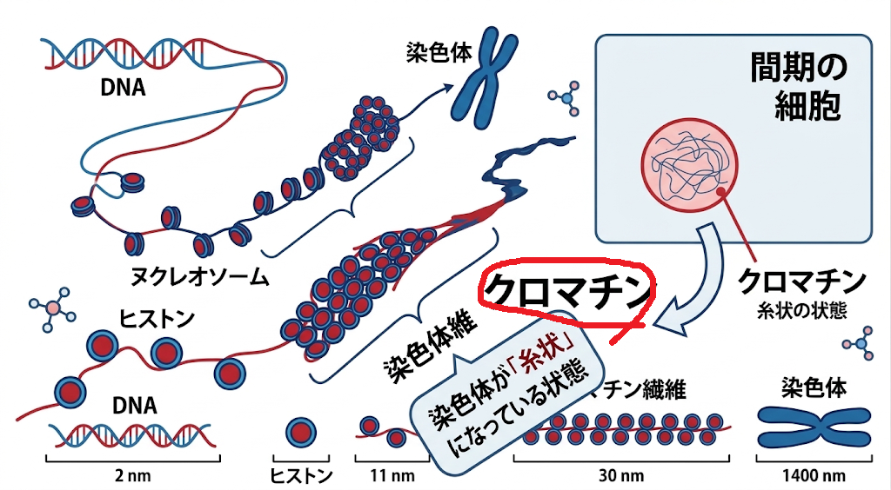


---

## プロジェクト構成

4位解法は、推論オーケストレーションを行うノートブック(`biohub-4th-place-solution.py`)と、全18個のモジュールスクリプトおよび学習済みモデル重みを格納した `biohub-4th-place-artifacts` から構成されています。

```text
4thPlaceSolution/
├── biohub-4th-place-artifacts/        # 4位解法コード & 学習済み重み一式
│   ├── dog_tracker.py                 # ルールベースDoGブロブ検出・追跡・核間隔算出コア
│   ├── dog_route.py                   # 密度ルーター(動画ごとの核間隔 dog_sp を算出し疎密判定)
│   ├── dog_nodes.py                   # 疎動画向けの高感度DoG検出(rel_threshold=0.01)
│   ├── net3d.py                       # Dual-Encoder 3D U-Net + ChangeGate + Self-Attention Mixer定義
│   ├── detect.py                      # 3D Net推論、移流クラスタリング、適応NMS、疑似ラベル合意洗練
│   ├── downstream.py                  # 検出後の全下流ステージ(Stage2〜5)を一括実行するドライバー
│   ├── common.py                      # 共通定数、貪欲リンク、短トラック除去、動き補償直線平滑化、CSV変換
│   ├── nodes_table.py                 # 検出ノードとスコアを動画別テーブル(t, um, vox, seed, size)に整形
│   ├── candidates.py                  # 候補リンク生成(半径10µm以内 + 順方向Top-5 + 逆方向Top-3)
│   ├── edge_features.py               # 候補リンクの幾何・速度残差・組織フロー残差・競合特徴量(26特徴量)
│   ├── edge_transformer.py            # Temporal 3D U-Net + Cross-Attention PairScorer モデル定義
│   ├── tf_edges.py                    # Edge Transformer推論(順方向fwd / 逆方向rev / 調和平均harm確率)
│   ├── cell_embedding.py              # InfoNCE対照学習3D CNNによるパッチ埋め込みとコサイン類似度算出
│   ├── edge_model.py                  # LightGBMエッジモデル推論(計47特徴量から統合リンク確率 p を予測)
│   ├── division_cnn.py                # 5フレーム(t-2..t+2) 3D Division CNN(6モデル×4 flip TTA)推論
│   ├── division_features.py           # 分裂判定用の候補グラフ・近傍密度・孫世代進展特徴量(53特徴量)
│   ├── division_cat.py                # CatBoostノード分裂モデル推論(53特徴量)
│   ├── division_pair.py               # 母娘ペア(三つ組)分裂モデル推論(174画像+53グラフ+12埋込+22リンク=261特徴量)
│   ├── ilp_solve.py                   # tracksdata + SCIPによるノード別分裂コスト付きILP求解 & 平滑化
│   ├── fork_verify.py                 # ILP後の分岐検証器(原画像9フレームDoGトレース + 157特徴量CatBoost)
│   ├── gapfill.py                     # 1〜2フレームのギャップ補間(線形補間ノード挿入 & 既存ノード衝突回避)
│   ├── track_gate.py                  # 疎動画向けのトラック支持ゲート(3D Net-64 & 高感度DoGによる偽枝削除)
│   ├── models/                        # 学習済みモデル重み・設定ファイル群
│   │   ├── net3d_128.pt               # メイン検出器: 3D Net (XY 1/2縮小, GTのみ学習, 18M params)
│   │   ├── net3d_128_pl.pt            # 洗練用検出器: 3D Net (XY 1/2縮小, GT+疑似ラベル学習, 18M params)
│   │   ├── net3d_64.pt                # 疎動画検証用: 3D Net (XY 1/4縮小, GTのみ50ep学習, 18M params)
│   │   ├── edge_transformer/          # リンカー: weights.pth (2.1M params) & config.json
│   │   ├── cell_embedding.pt          # 細胞埋め込み: 4層3D CNN (0.24M params)
│   │   ├── edge_lgbm/                 # エッジ統合器: model.txt (LightGBM) & spec.json (47 features)
│   │   ├── division_cnn/              # 分裂CNN: cnn_s0~2.pt, cnn_copypaste_s0~2.pt (計6個, 各1.4M params)
│   │   ├── division_cat.cbm           # 分裂グラフモデル: CatBoost (53 features)
│   │   ├── division_pair/             # 分裂ペアモデル: lgb.txt (LightGBM) & cat.cbm (CatBoost, 261 features)
│   │   └── fork_verifier/             # 分岐検証器: a/{model.cbm, calibration.json}, b/{model.cbm, calibration.json}
│   └── wheels/                        # オフライン環境補完用ホイール(catboost)
├── input/test/                        # テスト用Zarr動画データ(4動画)
├── working/                           # 推論作業ディレクトリ & 最終出力(submission.csv)
├── biohub-4th-place-solution.ipynb    # Kaggle推論ノートブック原本
├── biohub-4th-place-solution.py       # 推論実行Pythonスクリプト(ローカル・Kaggle両対応)
├── verify_local_env.py                # ローカル環境健全性検証スクリプト
└── requirements.txt                   # 仮想環境再現用パッケージ定義
```

### 主要モデル・重み一覧

| カテゴリ | 使用Stage | モデル名・重みファイル | アーキテクチャ / 規模 | 役割・機能 |
| :--- | :---: | :--- | :--- | :--- |
| **Router (密度判定)** | **Stage1**<br>(結果利用: Stage4, 6) | `dog_route.py`<br>`dog_nodes.py` | マルチスケール3D DoG + ハンガリアン追跡 (CPU) | **動画別の核間隔(密度)推定と高感度サポート検出:** 検出器に依存せず各動画の平均核間隔(`dog_sp`)を算出。`19.7 µm` 以上を「疎(sparse)」と判定し、Stage1の検出閾値・Stage4のILPコスト・Stage6の最終ゲートを制御。 |
| **Detection (細胞検出)** | **Stage1**<br>(`net3d_64`利用: Stage6) | `net3d_128.pt`<br>`net3d_128_pl.pt`<br>`net3d_64.pt` | Dual-Encoder 3D U-Net + ChangeGate + MixerBlock (各18M params) | **細胞確率と中心向き単位ベクトル場の同時予測:** 現在フレームと前後フレーム差分の2系統入力。移流(Advection)と適応NMSで核を抽出し、GTモデルと疑似ラベル(PL)モデルの合意により欠損補完と偽陽性抑制を両立(`net3d_64.pt`はStage6の独立検証用)。 |
| **Link Evidence (リンク特徴)** | **Stage2**<br>(特徴利用: Stage3, 4) | `edge_transformer/weights.pth`<br>`cell_embedding.pt` | Temporal 3D U-Net + Cross-Attention (2.1M params)<br>InfoNCE 4層3D CNN (0.24M params) | **深層リンク確率と外見類似度:** 連続2フレーム間の全ノードペアを双方向Cross-Attentionで採点(`fwd, rev, harm`)。さらに `16×32×32` 生パッチの対照学習埋め込みのコサイン類似度を算出(Stage3のペア特徴やStage4の第2娘救済でも利用)。 |
| **Link Model (エッジ統合)** | **Stage2**<br>(確率利用: Stage3, 4) | `edge_lgbm/model.txt` | LightGBM (CPU, 47特徴量) | **候補リンク確率 $p_{ij}$ の統合予測:** 幾何・運動残差・組織フロー残差(26特徴)とTransformer確率・埋め込み類似度および候補内ランク/ギャップ(21特徴)を統合し、単一のリンク確率 $p_{ij}$ へ変換(Stage3のグラフ特徴・Stage4のILPへ入力)。 |
| **Division Prior (分裂事前確率)** | **Stage3**<br>(スコア利用: Stage4) | `division_cnn/*.pt` (6個)<br>`division_cat.cbm`<br>`division_pair/{lgb,cat}` | 5フレーム3D CNN (1.4M×6)<br>CatBoost (53特徴量)<br>LightGBM + CatBoost (261特徴量) | **3段階の母細胞分裂スコア $s_i$ 算出:** ①5フレームパッチCNN(4 flip TTA)、②候補グラフ構造+密度変化のCatBoost、③母7フレーム・娘3フレームの174画像特徴等を用いた母娘三つ組ペアモデルを統合し $s_i = \max(s_{\text{pair}}, s_{\text{cat}})$ を出力(Stage4のILPへ入力)。 |
| **Optimization (大域的追跡)** | **Stage4** | `ilp_solve.py` | `tracksdata` + `SCIP` ILPソルバー (CPU) | **ノード別分裂コスト付き大域的ILP:** 各ノードに個別の分裂コスト $\text{base} - 16s_i$ (密:6, 疎:5)を与え、第2娘救済と参入閾値緩和を伴うILPで大域的最適グラフを求解。直後に動き補償直線平滑化を適用。 |
| **Verification & Gate (後処理)** | **Stage5**<br>**Stage6** | `fork_verifier/{a,b}` (Stage5)<br>`gapfill.py` (Stage5)<br>`track_gate.py` (Stage6) | CatBoost×2 + Sigmoid較正 (157特徴量)<br>ルールベース補間・ゲーティング | **分岐検証・ギャップ補間・疎動画ゲート:** Stage5にて原画像9フレームの局所DoG追跡で偽の分裂枝を切断(`p < 0.25`)し、1〜2フレームの途切れを衝突回避付きで線形補間。Stage6にて疎動画の未支持セグメントを除去。 |

---

## 4位解法の全体像

4位解法は、**「DoG密度ルーティング & 3D Net移流検出 + 疑似ラベル合意洗練(Stage1)」→「候補リンク抽出 & 幾何・Transformer・対照学習埋め込みのLightGBM統合(Stage2)」→「CNN・グラフ・母娘ペアの3段階分裂事前確率 $s_i$(Stage3)」→「ノード別分裂コスト付きILP & 動き補償直線平滑化(Stage4)」→「原画像トレース分岐検証 & ギャップ補間(Stage5)」→「疎動画向けトラック支持ゲート(Stage6)」** の6段階パイプラインで構成されています。

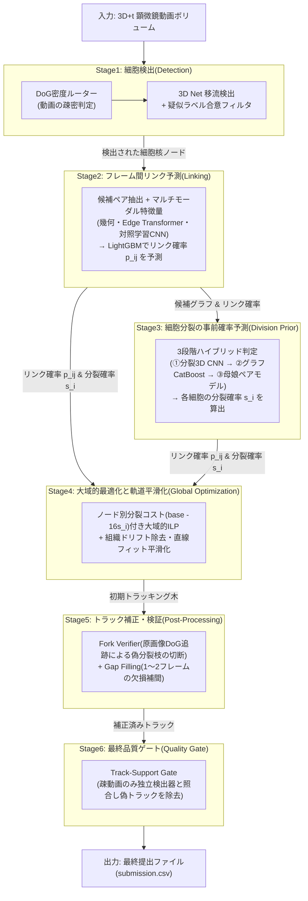

---

## パイプラインの詳細解説

### Stage0. Main(CPU処理とGPU並列実行)

ノートブック本体(`biohub-4th-place-solution.py`)は、Kaggle環境の2枚のGPU(T4×2)とCPUマルチコアを無駄なく使い切るため、**CPUでの古典的DoG処理(`dog_route.py`, `dog_nodes.py`)をバックグラウンドスレッド付きサブプロセス(`launch`)として非同期起動し、その裏でGPUによる3D Net検出(`detect.py`)を並列実行する**構成をとっています。

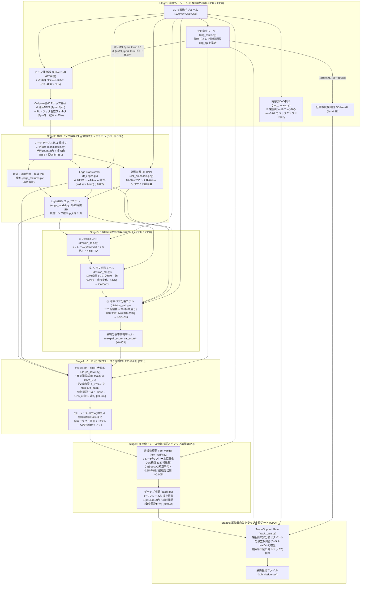

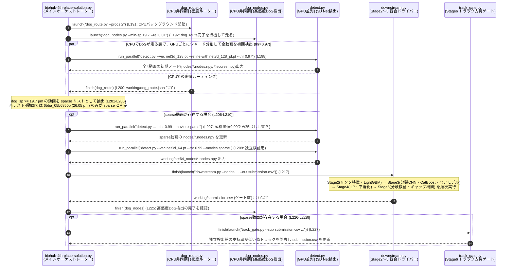

---

### Stage1. 密度ルーター(DoG Router)と 3D Net 細胞検出(Cell Detection)

#### 1-1. 検出器から独立した DoG 密度ルーター (`dog_route.py`, `dog_tracker.py`)
胚(Embryo)によって細胞の大きさと密集度は大きく異なります。初期バージョンでは「3D Net自身の検出ノード数」を使って疎密を判定していましたが、未知の胚に対してニューラルネットの検出数はドリフト(変動)しやすく、「振り分けられるモデル自身の出力でルーターの閾値を決めるべきではない」という教訓から、**学習を一切含まない古典的DoG(Difference of Gaussians)トラッカー**によるルーターが導入されました(Public LB +0.002)。

* **マルチスケールDoGブロブ検出 (`detect_blobs`, L101-L159)**:
  - XY平面を1/4に間引いたボリュームに対し、フレームごとに1.0〜99.7パーセンタイルで頑健な輝度正規化を実施(暗い細胞核も浮かび上がらせる)。
  - 2つの物理スケールペア `dog_scales = [[1.5, 4.0], [2.2, 5.5]]` (µm) で3Dガウシアン差分応答 $G(\sigma_{\text{small}}) - G(\sigma_{\text{large}})$ を計算し、スケール間の最大値をとることで多様な核サイズに対応。
  - 物理半径 `3.2 µm` の楕円体フットプリント(`_ball_footprint`)による3D極大値フィルタと相対閾値 `0.045` でピークを抽出し、元解像度の `(1, 3, 3)` 窓で輝度重み付き重心補正(`refine_centroids`)を実施。
* **簡易トラッキングと平均核間隔 `dog_sp` の算出 (`track_movie`, `movie_spacing_um`, L378-L404)**:
  - 距離ゲート `8.0 µm` のハンガリアン法(`link_frames`)でフレーム間を接続し、1フレームのギャップ補間(`close_gaps`)と孤立点除去(`prune_isolated`)を行った後の総ノード数 $N_{\text{nodes}}$ を取得。
  - 検出された全細胞の座標範囲(1〜99パーセンタイルのバウンディングボックス体積 $V$)と1フレームあたりの平均細胞数 $N_{\text{frame}} = N_{\text{nodes}} / T$ から、以下の立方体格子近似式で**平均細胞核間隔 `dog_sp` (µm)** を算出します:
    $$\text{spacing} = \left(\frac{V}{N_{\text{frame}}}\right)^{\frac{1}{3}}$$
  - この `dog_sp` が **`19.7 µm` 以上** の動画を **疎(sparse)**、未満を **密(dense)** と判定します。

#### 1-2. Dual-Encoder 3D Net と Cellpose型移流デコーディング (`net3d.py`, `detect.py`)
1位〜3位解法が「細胞中心のガウシアンヒートマップ」を予測してMax Pooling NMSでピークを抜いていたのに対し、4位解法は **「密集して接触した2つの核を分離するため、各ボクセルから核中心へ向かう3D単位ベクトル場を予測する(Cellpose方式)」** という独自のアプローチを採用しています。

* **Dual-Encoder + ChangeGate + Self-Attention Mixer (`net3d.py`, L26-L124)**:
  - 入力は連続する3フレーム `[t-1, t, t+1]`(XY方向に1/2プーリングされた `64×128×128` グリッド、50〜99.5パーセンタイルで正規化し `[-0.5, 6.0]` にクリップ)。
  - **2つの独立した3D CNNエンコーダ**: `enc_frame` は現在フレーム $I_t$ を読み込み、`enc_change` は前後フレームの差分画像 $I_{t+1} - I_{t-1}$ を読み込みます(各4ステージ、チャネル数 `32 → 64 → 128 → 256`、GroupNorm + SiLU)。
  - **ChangeGate (L42-L53)**: 最深部(1/8解像度)において、時間変化特徴 `change` からSigmoidゲートを生成して現在フレーム特徴 `frame` に掛け合わせ、両者を結合して畳み込みます。論文の知見通り、この前後フレーム差分の導入により交差胚検証での検出スコアが **0.73 → 0.93** へと劇的に向上しています。
  - **MixerBlock (L56-L76)**: 最深部の3Dトークンに対し、Depthwise Conv位置エンコーディング + Pre-Norm Multi-Head Self-Attention(4 heads) + GELU-FFN を2ブロック適用して大域的な文脈を混合。
  - **Decoder & FlowProbHead (L87-L114)**: 両エンコーダからのスキップ接続(`f[level], g[level]`)を束ねながら元のグリッドへ復元し、最後に `1×1×1` Convで **① 3次元単位ベクトル場 `flow` (ノルム1に正規化)** と **② 細胞確率ロジット `prob`** を出力します。
* **3階層(Tier)正規化損失による1%疎ラベル問題の克服 (Writeup Section 2.1)**:
  - アノテーションが全細胞の約1%しかないため、通常のボクセル単位BCE損失では正例が全体の0.5%未満しか寄与せず確率ヘッドが0に崩壊します。そこで4位チームは、ボクセルを「① アノテーション核(半径5.5µm以内かつフレーム上位5%の明るさ + 2µmコア)」「② 確実な局所背景(半径3.5µm内の局所最大値の0.4倍より暗いボクセル)」「③ その他すべての未ラベル領域(背景への極小の押し下げのみ)」の**3階層(Tier)に分け、各階層の重みをそのボクセル数で割って正規化**することで学習を安定させています。
* **移流デコーディング (`advect_decode`, `detect.py` L101-L138)**:
  1. **厳格なシード抽出**: $\text{sigmoid}(\text{prob}) > \text{seed\_thr}$ (密動画は `0.97`、疎動画は `0.99`)を満たすボクセルのみを初期シードとして抽出。
  2. **40ステップの移流(Advection)**: 各シードの物理座標 $\mathbf{p}$ を、予測された単位ベクトル場 $\mathbf{v}$ に沿って `step_um = 0.5 µm` ずつ **`niter = 40` 回** 反復移動させます(各ステップのベクトルは `F.grid_sample` のトリリニア補間で取得)。
  3. **シンク(収束点)クラスタリング**: 40ステップ移動後の終点座標を `sink_um = 1.0 µm` の3Dグリッドに丸めてハッシュ化し、同じセルに `min_size` 個(pool=2なら `20` ボクセル、pool=4なら `5` ボクセル)以上収束したクラスターのみを「本物の細胞核」としてその平均終点座標を採用します。
  4. **適応的NMS (`nms`, L81-L97, L272-L279)**: クラスター内の最大シード確率順にソートし、動画全体の最近傍距離(NND)の中央値 `nn_med` が `10 µm` 未満(小核・密集)なら半径 **`4 µm`**、`10 µm` 以上(大核・疎)なら半径 **`7 µm`** でGreedy NMSを実行します。

#### 1-3. 疑似ラベルモデル(`net3d_128_pl.pt`)による合意検証リファインメント (`detect.py`, L280-L316)
正解ラベルのみで学習した `net3d_128.pt` は保守的で薄暗い核を見逃すことがある一方、全199動画のOut-of-fold検出結果と外部Zebrahub胚の疑似ラベルを加えて学習した `net3d_128_pl.pt` は感度が高い反面、単独で使うと未知の胚で偽トラックを捏造してしまいます(LB -0.003〜-0.004)。
そこで、**「両方のモデルを走らせ、正解モデルが合意したトラック上でのみ疑似ラベルモデルのノードを採用する」** という巧妙な洗練処理を行っています:
1. 各フレーム $t$ で、疑似ラベルモデル(`model2`)の検出点と正解モデル(`model`)の検出点を半径 **`6.0 µm` 以内で1対1マッチング(`match_one_to_one`)** し、一致した疑似ラベルノードを「確認済み(`supported = True`)」とマークする(スコアも一致した正解モデル側の値を引き継ぐ)。
2. 疑似ラベルモデルの全ノードを、距離ゲート `7.0 µm` のハンガリアン法(`link_greedy`)でフレーム間接続し、Union-Findで連結成分(トラック)に分割する。
3. **構成ノードの `50%` 以上(`--support 0.5`)が確認済みであるトラックのみを保持**し、残りのトラックは捏造とみなして丸ごと破棄する。これにより、アンサンブルではなく「確認付きの置換」として機能し、LBで **+0.004** の改善を達成しています。

#### Stage1. ソースコード一覧
| ファイルパス | 関数・クラス・定数 | 行番号 | 処理内容 |
| :--- | :--- | :---: | :--- |
| `biohub-4th-place-solution.py` | `THR_DENSE`, `THR_SPARSE`, `SPARSE_UM`, `NMS_ADAPT`, `REFINE_R`, `REFINE_SUPPORT` | L58-L62 | シード閾値(`0.97`/`0.99`)、疎判定閾値(`19.7µm`)、適応NMS(`4,7,10`)、PL洗練半径(`6µm`)・支持率(`0.5`)の定義 |
| `dog_route.py` | `one()`, `__main__` | L20-L35 | マルチプロセスで全動画に `dog_tracker.track_movie()` を実行し、`dog_route.json` に核間隔 `dog_sp` を保存 |
| `dog_nodes.py` | `load_route()`, `dog_nodes()` | L27-L53 | `dog_route.json` 完了を待機し、`dog_sp >= 19.7µm` の疎動画のみ低閾値(`rel=0.01`)で高感度DoGノードを抽出 |
| `dog_tracker.py` | `detect_blobs()`, `refine_centroids()`, `link_frames()`, `close_gaps()`, `movie_spacing_um()` | L101-L404 | マルチスケールDoG極大点抽出、重心補正、ハンガリアン接続、1フレーム補間、体積とノード数からの平均核間隔算出 |
| `net3d.py` | `Encoder`, `ChangeGate`, `MixerBlock`, `Body`, `FlowProbHead`, `Net3D`, `load_net3d()` | L26-L132 | 現在フレームと前後差分フレームのDual-Encoder、ChangeGate、Self-Attention Mixer、単位ベクトル場+確率ヘッドの定義 |
| `detect.py` | `Movie`, `advect_decode()`, `nms()`, `detect_movie()` | L54-L178 | XYプーリングとパーセンタイル正規化、40ステップ移流と1µmシンククラスタリング、確率順Greedy距離NMS(`4µm`/`7µm`) |
| `detect.py` | `match_one_to_one()`, `link_greedy()`, `main()` | L181-L324 | 適応NMS半径の決定、PLモデル(`net3d_128_pl.pt`)との6µm内1対1照合、Union-Findによる支持率50%以上のトラック抽出と `.nodes.npy` 保存 |

#### Stage1. シーケンス図
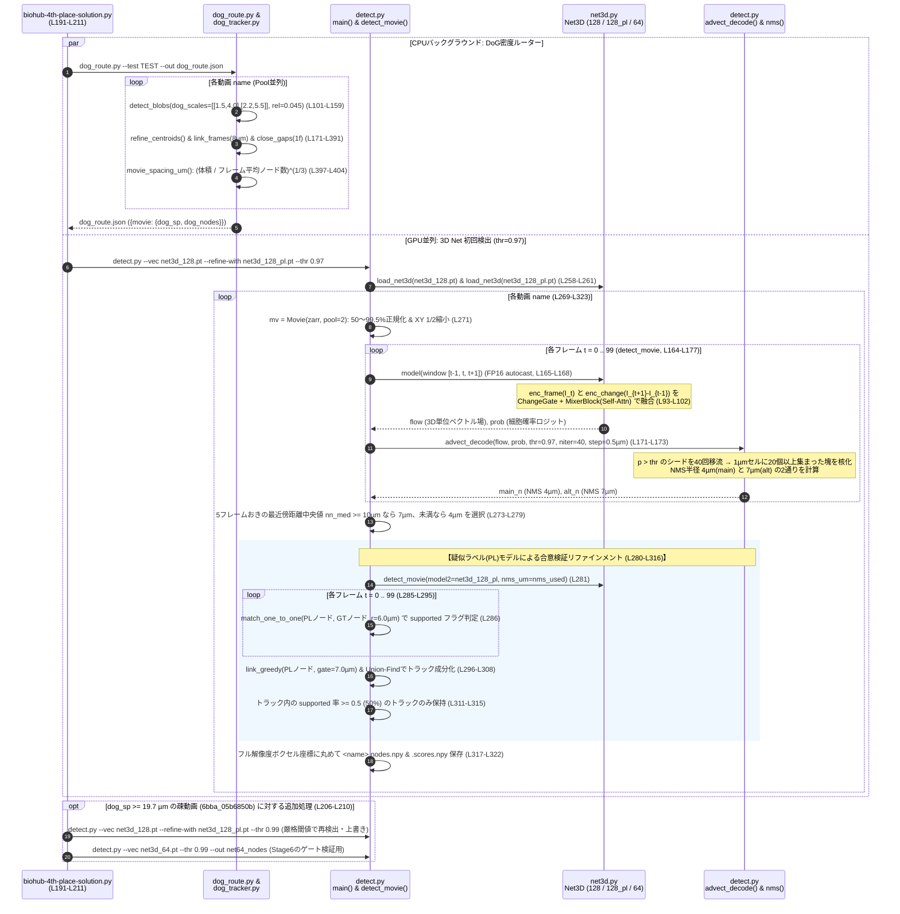

---

### Stage2. 候補リンク構築とマルチモーダル特徴量・LightGBMエッジモデル(Linking)

Stage1で確定したノード集合に対し、`downstream.py`(L35-L42)の前半パートとして、フレーム $t \to t+1$ 間の候補リンクを生成し、**①幾何・運動特徴量、②Edge Transformer確率、③対照学習Cell Embedding類似度** の3種の証拠を集めて **LightGBM(計47特徴量)** で単一のリンク確率 $p_{ij}$ に統合します。

#### 2-1. ノードテーブル化と候補リンクの網羅的抽出 (`nodes_table.py`, `candidates.py`)
* **ノードテーブル整形 (`nodes_table.py`, L17-L34)**:
  - 各動画の検出ノードを `(t, z, y, x)` 順に辞書順ソート(`np.lexsort`)し、時刻 `t`、物理座標 `um`($\mu\text{m}$)、フル解像度ボクセル座標 `vox`、最大シード確率 `seed`、クラスターサイズ `size` をまとめた `<movie>.npz` を生成(テスト4動画で計150,983ノード)。
* **双方向k近傍を含む候補リンク抽出 (`candidates.py`, L13-L35)**:
  - フレーム $t$ の各ノードから、次フレーム $t+1$ における **① 半径 `10.0 µm` 以内の全ノード** および **② 最も近い `k = 5` 個の後続ノード** を候補に追加。
  - さらに、分裂や急な移動で取りこぼさないよう、次フレーム $t+1$ の各ノードから見て **③ 最も近い `k_in = 3` 個の先行ノード(親候補)** も逆向きに追加します(テスト4動画で計772,332リンク、1ノードあたり平均5.12本)。

#### 2-2. 3系統のリンク証拠の抽出 (`edge_features.py`, `tf_edges.py`, `cell_embedding.py`)

1. **幾何・速度残差・局所組織フロー特徴量 (`edge_features.py`, 26特徴量)**:
   - まず準備として、距離ゲート `7.0 µm`(分裂ゲート `5.0 µm`)の1巡目貪欲ハンガリアンリンク(`link_greedy`)を実行し、以下の2つの運動ベクトルを推定します:
     - **個別細胞の過去速度 `vel`**: 直前フレーム $t-1 \to t$ で1対1リンクが成立していた場合、その変位 $\mathbf{x}_t - \mathbf{x}_{t-1}$ を速度とし、次フレーム予測位置 $\mathbf{x}_t + \text{vel}$ と候補先 $\mathbf{x}_{t+1}$ のズレを **速度残差 `vel_res`** とする(L31-L36)。
     - **局所組織フロー `flow`**: 1巡目リンクのうち移動距離 `< 6.0 µm` の確実なリンクを「アンカー」とし、対象ノードの周囲半径 `3 × max(NND, 4.0) µm` 以内にある他細胞のアンカー変位の中央値を「局所組織フロー」と定義。候補リンク変位とのズレを **組織フロー残差 `tis_res`** とする(L37-L54)。
   - これに3次元距離 `d`、各軸変位 `dz, dy, dx`、同一フレーム内最近傍距離 `nnd_i, nnd_j`、距離比率 `d_nnd`、両端の検出信頼度 `seed_i, seed_j` とサイズ `size_i, size_j`、候補プール内での順方向・逆方向の距離ランク `rank_ij, rank_ji`、候補数 `ncand_i, ncand_j`、第2候補距離 `d2_i, d2_j`、過去・未来への接続有無 `past_i, fut_j`、お互いが距離1位かどうかの相互フラグ `mutual`、Z座標 `z_i`、正規化時刻 `t_frac` を合わせた **計26特徴量** を構築します。

2. **Edge Transformer による双方向リンク確率 (`edge_transformer.py`, `tf_edges.py`)**:
   - コンペ公式ベースライン(`tracking-cellmot`)のリンカー構造を再実装し、全199訓練動画で学習したモデル(2.1M params)です。
   - **TemporalUNet (L41-L80)**: `[1, 4, 4]` ダウンサンプリング(`64×64×64`)された連続2フレーム(`W=2`)を入力とし、各エンコーダ段階で時間方向のSelf-Attention(`TimeAttention`)をかけながら32チャネルの3D特徴マップを抽出。
   - **PairScorer (L97-L125)**: 各ノード位置でサンプリングした画像特徴量(32次元)と、4次元座標 `(t, z, y, x)` のSinusoidal位置エンコーディング(`position_embedding`: 各軸8次元×4=32次元)を連結した64次元トークンを入力。フレーム $t$ のノード群と $t+1$ のノード群の間で **双方向Cross-Attention(`CrossBlock`)を4ブロック** 繰り返した後、両端の埋め込みと相対座標差 `(pos_a - pos_b) / 100.0` をMLPに通して全ペアのロジット行列 `(N_a, N_b)` を出力します。
   - **3種の確率化 (`score_movie`, `tf_edges.py` L66-L73)**:
     - モデルを順方向($t \to t+1$)と逆方向($t+1 \to t$)の両方で実行し、列方向(各ターゲットに対するソース間)のSoftmaxをとることで **順方向確率 `tf_fwd`** と **逆方向確率 `tf_rev`** を算出し、さらに重み `harm_w = 0.15` の **重み付き調和平均 `tf_harm`** を計算します:
       $$p_{\text{harm}} \propto \left(\frac{1 - 0.15}{p_{\text{fwd}}} + \frac{0.15}{p_{\text{rev}}}\right)^{-1}$$
     - ※ローカル検証では少ないデータで学習したFold版しか使えず効果が小さく見えましたが、全199動画で学習した本番モデルはLBで **+0.005** の大きなゲインを生みました。

3. **対照学習(InfoNCE)による 3D CNN 細胞埋め込み (`cell_embedding.py`)**:
   - フル解像度ボリュームから各ノード周囲 `16 × 32 × 32` ボクセルの生パッチを切り出し、`log1p` 変換後にパッチごとのZスコア正規化(`norm_patch`)を適用。
   - InfoNCE損失で学習された軽量な4層3D CNN(`Encoder`, 0.24M params, チャネル `16→32→64→96`)に通してL2正規化された単位埋め込みベクトル $\mathbf{e}_i$ を抽出し、候補リンク両端のコサイン類似度を $[0, 1]$ にスケーリングした確率 $p_{\text{emb}} = (\cos(\mathbf{e}_i, \mathbf{e}_j) + 1) / 2$ を出力します(同時に埋め込みベクトル自体もStage3用に `embeddings/<movie>.npy` に保存)。

#### 2-3. LightGBM エッジモデルによる確率統合 (`edge_model.py`, 47特徴量)
`edge_model.py` は、幾何26特徴量(`X`)に加え、4つの追加証拠 `P = [tf_fwd, tf_rev, tf_harm, embed]` のそれぞれについて「①確率値そのもの、②ソース $i$ の候補内でのランク、③ソース $i$ の最大確率との差(ギャップ)、④ターゲット $j$ の候補内でのランク、⑤ターゲット $j$ の最大確率との差(ギャップ)」の5特徴(4種×5=20特徴)と、順逆差の絶対値 `|tf_fwd - tf_rev|` (1特徴)を付加した **計47特徴量** を構築し、Out-of-fold検出で学習された LightGBM(`models/edge_lgbm/model.txt`)で最終リンク確率 $p_{ij}$ を予測します。

#### Stage2. ソースコード一覧
| ファイルパス | 関数・クラス・定数 | 行番号 | 処理内容 |
| :--- | :--- | :---: | :--- |
| `downstream.py` | Stage2 呼び出し部 | L35-L42 | `nodes_table` → `candidates` → `edge_features` → `tf_edges` → `cell_embedding` → `edge_model` を順次実行 |
| `nodes_table.py` | `__main__` | L14-L34 | `.nodes.npy` と `.scores.npy` を読み込み、座標順ソートして `ds/nodes/<movie>.npz` に保存 |
| `candidates.py` | `candidate_pairs()` | L13-L35 | `cKDTree` を用い、半径 `10µm` 以内 + 順方向最近傍 `k=5` + 逆方向最近傍 `k_in=3` の候補ペア `(I, J)` を抽出 |
| `edge_features.py` | `FEATS`, `compute()` | L15-L74 | 1巡目貪欲リンクからの速度残差 `vel_res`、近傍アンカー中央値からの組織フロー残差 `tis_res` 等26特徴量を計算 |
| `edge_transformer.py` | `TimeAttention`, `TemporalUNet`, `CrossBlock`, `PairScorer`, `EdgeTransformer` | L24-L165 | 時間Attention付き3D U-Netと双方向Cross-Attentionノードペア採点器、32次元Sinusoidal位置埋込の定義 |
| `tf_edges.py` | `Movie`, `score_movie()` | L18-L75 | `[1,4,4]` 縮小ボリューム上で連続2フレームごとに順逆スコアを計算し、`edges_tf_{fwd,rev,harm}` を保存 |
| `cell_embedding.py` | `Encoder`, `norm_patch()`, `crop()`, `main()` | L20-L74 | `16×32×32` パッチの `log1p`+Z正規化、4層3D CNNによる単位ベクトル抽出、コサイン類似度計算と保存 |
| `edge_model.py` | `extra_cols()`, `__main__` | L15-L42 | 26幾何特徴 + 4証拠×5(値・順逆ランク・順逆ギャップ) + `|fwd-rev|` = 47特徴量をLightGBMに入力し `edges_learned` を出力 |

#### Stage2. シーケンス図
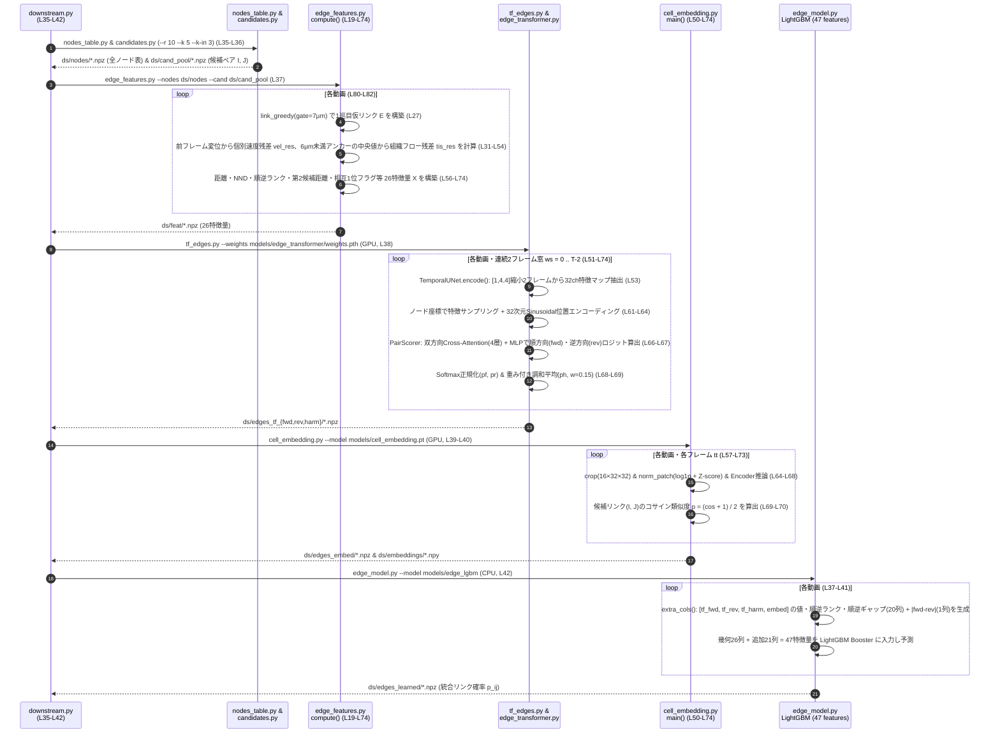

---

### Stage3. 細胞分裂の事前確率モデル(Division Prior: 3段階ハイブリッド構成)

細胞分裂は全訓練データ199動画中に151件しかアノテーションされておらず、本物の分裂の大半がラベル無しです。そのため、4位チームは **「ラベル付きトラックの分岐点(子2つ)のみをPositive、ラベル付きトラックの非分岐点(子1つ)のみをNegativeとし、未ラベルのノードは絶対にNegativeに使わない」** という厳格な学習データ構築を行った上で、以下の**3段階のスコア器(①3D CNN → ②CatBoostグラフモデル → ③母娘ペアモデル)** を積み上げています。

#### 3-1. モデル①: 5フレーム 3D Division CNN アンサンブル (`division_cnn.py`)
* **入力と前処理 (`read_frame`, `main`, L35-L95)**:
  - 各ノード $(t, z, y, x)$ を中心に、前後2フレームを含む **5フレーム (`t-2, t-1, t, t+1, t+2`) × `9 × 33 × 33` ボクセル**(`HZ=4, HY=16, HX=16`)の3D生パッチを、Zarr v3のチャンクファイル(`0/c/<t>/0/0/0`)から `blosc2.decompress` で直接高速デコードして切り出します。輝度はZarrメタデータの0.1〜99.9%分位点で正規化。
* **アーキテクチャと推論 (`DivNet`, L20-L33, L95-L102)**:
  - 5チャネル(5フレーム分)を入力とする3ステージの3D CNN(`ch = 48 → 96 → 144`、各ステージは `Conv3d(3×3×3) + BN + SiLU` ×2 + `MaxPool3d`)。最終特徴マップの **Global Average Pooling と Global Max Pooling を連結(288次元)** してMLPヘッドでロジットを出力します。
  - **6モデルアンサンブル × 4方向フリップTTA**: 3つの乱数シード × Copy-Pasteデータ拡張のあり/なし(`cnn_s0~2.pt`, `cnn_copypaste_s0~2.pt`)の計6モデルに対し、XY平面の4反転(`views = [xb, flip(-1), flip(-2), flip(-1,-2)]`)の計24予測のSigmoid平均を算出します(`--half` によるFP16推論、ノード数に応じたマルチGPU負荷分散を実行)。

#### 3-2. モデル②: CatBoost グラフ特徴量ノードモデル (`division_features.py`, `division_cat.py`, 53特徴量)
`edges_learned` のうち確率 $p \ge 0.02$ のリンクからなる候補グラフ上で、各ノードの周囲のトポロジーとDivision CNNスコアを統合した **53個の特徴量(`NAMES`)** を構築し、CatBoost(`division_cat.cbm`)でノード単位の分裂確率を推論します:
* **出リンク・入リンク競合特徴 (10個)**: 上位3出リンク確率 `p1, p2, p3`、比率 `p2_over_p1`, `p3_over_p2`、差 `p1_minus_p2`、出次数 `n_out`、最良入リンク確率 `q1`、入次数 `n_in`、第2出リンク確率のフレーム内相対ランク `p2_rank`。
* **候補娘ペアの幾何・対称性特徴 (8個)**: 上位2つの子候補 `c1, c2` への距離 `d1, d2`、姉妹間距離 `dsib`、母から見た2つの娘の開き角コサイン `cos_sib`(反対側にあるほど `-1` に近づく)、`dsib / (d1 + d2)`、距離非対称度 `|d1 - d2| / (d1 + d2)`、フレーム中央値移動量に対する相対距離 `d1_rel, d2_rel`。
* **娘側の競合・継続特徴 (13個)**: 各娘候補 `c1, c2` にとって自分が最良の親か(`c1_is_mine, c2_is_mine`)、他親候補との確率マージン(`p1_margin_c1, p2_margin_c2`)、娘自身の次フレームへの最良出リンク確率(`c1_out, c2_out`)、娘が直後にまた分裂しそうか(`grand_div`)等。
* **親の運動と方向転換 (4個)**: 親の流入移動量 `mot_in`、流入ベクトルと2つの娘への流出ベクトルのなす角コサイン `cos_turn1, cos_turn2`、相対移動量 `mot_in_rel`。
* **局所細胞密度の増加 (6個)**: 半径 `15 µm` および `8 µm` 以内の現在フレームの近傍細胞数(`dens15, dens8`)、次フレームでの同位置の細胞数(`dnext15, dnext8`)、および分裂による局所細胞数の増分(`ddens15, ddens8`)。
* **CNNスコア・2フレーム後の孫世代成長・第3候補特徴 (12個)**: Division CNNスコア `cnn`、フレーム内ランク `cnn_rank`、正規化時刻 `trel`、交差項 `p2 * cnn`、さらに1フレーム先の孫候補(`gc1, gc2`)間の距離 `dsib2` と離間成長率 `dsib2 / dsib`、および第3の子候補 `c3` とのペア特徴(`dsib13, cos13, dsib23, cos23`)。

#### 3-3. モデル③: 母娘ペア(三つ組)モデル (`division_pair.py`, LightGBM + CatBoost, 計261特徴量)
ノード単独の特徴量だけでなく、「母細胞 $u$ と次フレームの2つの娘細胞 $(v, w)$ の三つ組(Triplet)」を直接評価するモデルです:
1. **三つ組候補の幾何ゲーティング (`candidate_triplets`, L124-L146)**:
   - 母からの距離がともに `dmax = 13.5 µm` 以内、姉妹間距離が `4.5 〜 17.0 µm`、姉妹の中点と母のズレが `mid = 7.0 µm` 以内、かつ母から見た2娘の角度余弦が `cos <= 0.6` を満たすペアを抽出し、幾何スコア `mid + 0.3 * |sis - 8.0|` が良い上位 **`TOPK = 8` 組** を候補とします。
2. **174個の生物学的画像時系列特徴量 (`local_batch`, `tables`, `triplet_features`, L50-L104)**:
   - 各細胞の周囲半径 `3.0 µm` の球領域(内球 `<= 1.5 µm` と外殻 `1.5〜3.0 µm`)から、**8個の局所画像記述子 `LOCAL`**(①平均輝度 `b`、②ピーク輝度 `peak`、③変動係数 `cv`、④引き締まり度 `compact`[内球/外殻比]、⑤半値幅サイズ `size`、⑥⑦輝度共分散行列の固有値比による異方性 `aniso31, aniso21`、⑧背景外殻輝度 `bg`)を計算します。
   - **母細胞の過去7フレーム追跡 (`t, t-1, ..., t-6`)**: 最近傍4µm以内で母の過去7フレームを辿り、8記述子×(7フレーム値 + 6フレーム線形傾き `slope6` + 最大値 `max6` + 直前変化 `t0_minus_mean`, `t1_minus_t3`) = 88特徴、さらに分裂直前の減速 `m_slowdown` 等の速度特徴4個を抽出。
   - **両娘細胞の未来3フレーム追跡 (`t+1, t+2, t+3`)**: 最近傍5µm以内で両娘を3フレーム先まで辿り、8記述子×(2娘×3フレーム + 初回和 `sum_t1` + 初回非対称度 `asym_t1`) = 64特徴、母娘輝度比 `mass_ratio` 2個を抽出。
   - **姉妹の離間成長と分裂位置の輝度急落 (16個)**: 3フレーム間の姉妹間距離 `sep_t1, sep_t2, sep_t3` と離間増加量 `sep_growth`、分裂軸に沿った両娘の遠ざかり量 `d0_along_axis, d1_along_axis`、そして **「分裂した瞬間($t \to t+1$)に母細胞の元の座標からどれだけ輝度が抜け落ちたか(`split_drop_b`, `split_drop_peak`, `split_ratio_b`)」** を算出(計174特徴)。
3. **261特徴量の結合と MAX 統合 (`one`, L237-L252)**:
   - `[174画像三つ組特徴(X) + 53母グラフ特徴(XP) + 12対照学習埋め込み特徴(XE) + 22母娘リンク特徴(link_features)]` の **計261特徴量** を LightGBM(`lgb.txt`)と CatBoost(`cat.cbm`)に入力して `0.5 : 0.5` で平均。
   - 各母ノードについて最良の三つ組のスコア $s_{\text{pair}}$ をとり、最後にモデル②のCatBoostノードスコア $s_{\text{cat}}$ との最大値
     $$s_i = \max(s_{\text{pair}, i},\; s_{\text{cat}, i})$$
     を最終的な分裂事前確率として `ds/div_prior/<movie>.divscore.npz` に保存します(ペアモデルの追加で +0.003)。

#### Stage3. ソースコード一覧
| ファイルパス | 関数・クラス・定数 | 行番号 | 処理内容 |
| :--- | :--- | :---: | :--- |
| `downstream.py` | Stage3 呼び出し部 | L44-L69 | `cand_npz` 作成、GPU別負荷分散での `division_cnn.py` 並列起動、`division_cat.py`、`division_pair.py` の実行 |
| `division_cnn.py` | `DivNet`, `read_frame()`, `main()` | L20-L107 | Zarr v3チャンクの `blosc2` 直接解凍、`5×9×33×33` パッチ切り出し、6モデル×4 flip TTAによるCNN分裂確率推論 |
| `division_features.py` | `NAMES`, `build()`, `build_arrays()` | L16-L148 | 候補グラフから上位リンク比率・姉妹角度・孫世代離間・近傍密度増分・CNNスコア等 **53特徴量** を構築 |
| `division_cat.py` | `__main__` | L13-L19 | 53特徴量を `models/division_cat.cbm` に入力し、ノード単位のCatBoost分裂確率を `ds/div_cat` に出力 |
| `division_pair.py` | `local_batch()`, `tables()`, `triplet_features()`, `candidate_triplets()` | L50-L175 | 8種の局所3D球領域記述子の算出、母7フレーム・娘3フレーム追跡による **174個の生物学的三つ組特徴量** の構築 |
| `division_pair.py` | `embedding_features()`, `link_features()`, `one()` | L177-L253 | 174画像 + 53グラフ + 12埋込 + 22リンク = **261特徴量** でLGB+CatBoost推論し、`max(pair, cat)` を `ds/div_prior` に保存 |

#### Stage3. シーケンス図
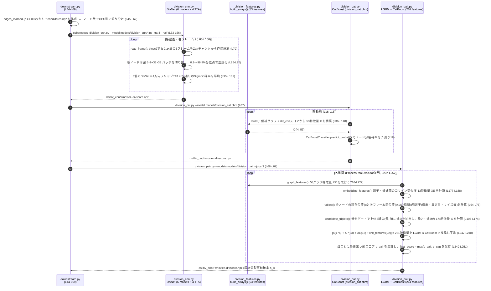

---

### Stage4. ノード別分裂コスト付き大域的ILPと動き補償平滑化(ILP & Smoothing)

Stage2の統合リンク確率 $p_{ij}$ と Stage3の分裂事前確率 $s_i$ を受け取り、`ilp_solve.py` にて **`tracksdata` + `SCIP` ソルバーを用いた大域的整数線形計画法(ILP)** を解きます。このステージにおける「ノード別分裂コスト」の導入が、4位解法において最大のスコア向上(**+0.035**, LB 0.913 → 0.948)を生み出しています。

#### 4-1. なぜ「ノードごとの分裂コスト」が必要なのか？ (Writeup Section 4.1)
ILPにおいて細胞分裂を起こすということは、1つの母ノードから2本の出エッジを選択することを意味します。しかし、2人目の娘細胞は母から遠かったり外見が変化していたりするため、第2娘へのリンク確率 $p_{ij}$ は通常よりも低くなります。
もし全ノードに一律の分裂コストを設定すると、ソルバーは「まったく分裂を作らない」か、「2つの細胞がたまたま接近しているだけの場所で偽の分裂を大量に作ってしまう」かの両極端に陥ります。そこで4位解法では、Stage3で求めた分裂事前確率 $s_i \in [0, 1]$ を用いて以下の3つの仕組みをILPに組み込んでいます:

1. **第2娘細胞の確率救済 (`Second-daughter rescue`, L41-L51)**:
   - 分裂確率が $s_i \ge 0.2$(`--alt-min-divs 0.2`)の母ノードについて、そのノードの第1位リンク以外の候補リンク(`~top_row`)の確率 $p_{ij}$ を、Edge Transformerの調和平均確率 $p_{\text{harm}}$ との最大値 $\max(p_{ij}, p_{\text{harm}, ij})$ に置き換えます(LightGBMよりもTransformerの方が第2娘に対して高い確信度を持つケースが多いため)。
2. **エッジ参入閾値の緩和 (`Relaxed admission`, L62-L63)**:
   - 通常はリンク確率 $p_{ij} > 0.3$(`--thr 0.3`)のエッジのみをILPグラフに入れますが、母細胞の分裂確率 $s_i$ に応じて有効閾値を
     $$\text{eff\_thr}_i = \max(0.3 - 0.5 s_i,\; 0.0)$$
     へと引き下げ、分裂しそうな母ノードが弱い第2娘リンクをグラフ内に保持できるようにします。
3. **ノード別分裂コスト (`Per-node division cost`, L55-L70)**:
   - `tracksdata` の最小化目的関数:
     $$\min \sum_{(i,j)} (-p_{ij}) y_{ij} + \sum_i \text{app} \cdot a_i + \sum_i \text{dis} \cdot d_i + \sum_i \text{div}_i \cdot v_i$$
     において、出現コスト $\text{app} = 0.5$、消失コスト $\text{dis} = 3.2$ とし、各ノード $i$ の分裂コスト $\text{div}_i$ を
     $$\text{div}_i = \text{base} - 16 \cdot s_i \quad (\text{密動画: base}=6,\; \text{疎動画: base}=5)$$
     と設定します。$s_i \approx 0$ の通常ノードでは分裂コストが `+6`(または `+5`)と極めて高く分裂が抑制される一方、$s_i > 0.375$ の有望な母細胞では分裂コストが負(報酬)となり、証拠が揃った場所でのみ確実に分岐が開かれます。

#### 4-2. 短トラック除去と動き補償直線平滑化 (`common.py`: `filter_short_tracks`, `stabilized_linefit`)
ILP求解後、以下の2つのクリーニング処理を適用して `ds/pred.csv` および `ds/graph/<movie>.npz` を出力します(L95-L100):
* **短トラック除去 (`filter_short_tracks`, `common.py` L76-L101)**:
  - `min_len = 2`(`--L 2`)を指定し、分裂を含まない孤立単一ノード(どのエッジにも繋がらなかったノード)を除去します。
* **動き補償付き局所直線フィッティング平滑化 (`stabilized_linefit`, `common.py` L104-L161)**:
  - 胚組織全体がフレーム間で平行移動(ドリフト)するため、そのまま時間方向に座標を平滑化すると軌道が歪みます。
  - そこでまず、リンク確率 `conf > 0.9` の非分裂エッジ(フレームあたり8本以上存在する場合)の変位の中央値を各時刻の**組織平行移動速度 `velocity[t]`** として推定し、その累積和 `shift` を全ノード座標から一旦差し引きます(L150-L158)。
  - ドリフトを除去した静止座標系の上で、分岐を含まない単一鎖に沿って前後 `±3フレーム`(`window = 3`)の座標に最小二乗法(`np.linalg.lstsq`)で直線を当てはめ、元の座標と直線上の予測値を `0.2 : 0.8`(`weight = 0.8`)でブレンド(`linefit_smooth`)し、最後に累積ドリフト `shift` を足し戻します(L159-L161)。

#### Stage4. ソースコード一覧
| ファイルパス | 関数・クラス・定数 | 行番号 | 処理内容 |
| :--- | :--- | :---: | :--- |
| `biohub-4th-place-solution.py` | `DIV_COSTS`, `SPARSE_DIV_COSTS` | L63 | 密動画用分裂コストパラメータ `"6,16,0.5"`、疎動画用 `"5,16,0.5"` の定義 |
| `downstream.py` | `ilp_solve.py` 呼び出し部 | L73-L74 | `--alt-min-divs 0.2 --div-costs 6,16,0.5 --sparse-div-costs 5,16,0.5` を渡してILPを起動 |
| `ilp_solve.py` | `solve_one()` | L29-L72 | 第2娘の `tf_harm` 救済(L41-L51)、`tracksdata.graph.InMemoryGraph` 構築、閾値緩和 `0.3-0.5*s`、ノード別分裂コスト `base-16*s` での `ILPSolver.solve()` 実行 |
| `ilp_solve.py` | `__main__` | L75-L102 | 動画並列で `solve_one()` を実行後、`filter_short_tracks(L=2)` と `stabilized_linefit(window=3, weight=0.8)` を適用し `pred.csv` と `graph/*.npz` を保存 |
| `common.py` | `filter_short_tracks()` | L76-L101 | Union-Findで連結成分を求め、ノード数 `< min_len` かつ分裂を含まない成分を除去 |
| `common.py` | `linefit_smooth()`, `stabilized_linefit()` | L104-L161 | 高確信度リンク(`conf>0.9`)の中央値から組織ドリフト `velocity` を推定・除去し、`±3` フレーム直線フィット(`weight=0.8`)後にドリフトを復元 |

#### Stage4. シーケンス図
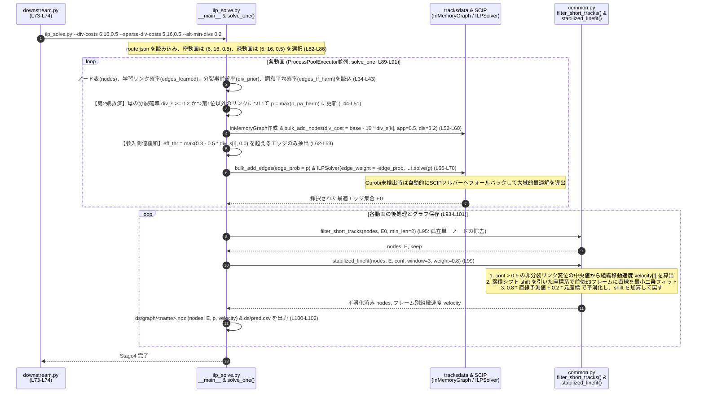

---

### Stage5. 原画像トレースによる分岐検証(Fork Verifier)とギャップ補間(Gap Filling)

Stage4のILPで開かれた分裂分岐(Fork)の中には、近接する別細胞への誤接続による偽の分岐が一部含まれます。Stage5では、**「本物の娘細胞ペアは分裂後数フレームにわたって互いに離れ続ける」** という生物学的性質を利用し、原画像に戻って両娘を追跡・検証する **Fork Verifier(`fork_verify.py`)** と、1〜2フレームの途切れを繋ぐ **Gap Filling(`gapfill.py`)** を実行します。

#### 5-1. 原画像DoGピーク追跡による分岐検証器 (`fork_verify.py`, +0.005 LB)
* **9フレームの局所DoGピーク追跡 (`trace`, `peak`, L24-L93)**:
  - ILPグラフ上で2つの子を持つすべての母ノード(分岐点)を抽出し、リンク確率が高い方を「強い娘(`branch 0`)」、低い方を「弱い娘(`branch 1`)」とします(`forks_of`, L139-L147)。
  - 分岐フレーム $t$ の3フレーム前から5フレーム後までの **計9フレーム (`t-3, t-2, t-1, t, t+1, t+2, t+3, t+4, t+5`)** にわたり、分岐直後(`view=4`, 時刻 $t+1$)の両娘の予測位置を起点として、時間軸の外側へ向かって原画像上で両娘を1フレームずつ追跡します(その際、Stage4で推定した組織ドリフト `shift` を加算して予測中心を補正)。
  - 各ステップでは、予測中心の周囲 `13 × 41 × 41` ボクセルを切り出し、$\sigma = 1.2\text{ µm}$ と $2.4\text{ µm}$ の3D DoG応答を計算。半径 `5 µm`(`dist2 <= 25`)以内でメリット関数 `(dog - median) / noise - dist2 / 18.0` が最大となるピークを探し、周囲3×3×3の重み付き重心でサブボクセル位置と4つのピーク品質統計量(`SN比, 中心ズレ, 原画像Zスコア, 有効マスク率`)を取得します。
* **157個の特徴量構築と CatBoost×2 較正判定 (`assemble`, `trend_features`, `verify`, L53-L173)**:
  - 9フレーム間のドリフト除去後の両娘間距離 `separation`(9列)、両娘のピーク品質の和(36列)と差(36列)、有効フレームフラグ(9列)、分岐時点(`view=4`)からの各娘の移動距離と離間変化(24列)、分岐前後の最小・中央値離間距離(3列)の **117個の基本特徴量(`assemble`)** を作成。
  - さらに、分岐前(`pre`)・分岐直後(`early`)・分岐後全体(`post`)の3区間における離間距離のTheil-Sen中央値傾き(`slope`)、増加率、最大ドローダウン、最弱ピーク品質などの **40個のトレンド特徴量(`trend_features`)** を連結し、**計157特徴量** を構築します。
  - 2つのCatBoostモデル(`models/fork_verifier/a`, `b`)のRaw出力に対し、それぞれの `calibration.json` の係数(`coef, intercept`)でSigmoid較正を行って平均確率 $p_{\text{fork}}$ を算出(L166)。
  - **枝刈りルールと物理保護ゲート (`slopes`, L120-L136, L167-L173)**:
    - $p_{\text{fork}} < 0.25$(`--threshold 0.25`)の分岐は偽陽性とみなして**弱い方の娘エッジのみを削除**(ノード自体は削除しない)します。
    - ただし、分岐後のフレームにおいて両方の娘細胞が分岐軸方向に中央値速度 **`0.5 µm/frame` 以上(`--gate 0.5`)で明確に反対方向へ離れ続けている場合(`protect`)** は、モデルのスコアが低くても本物の分裂として保護します(テスト4動画では134個の分岐中42個を削除、1個を保護)。

#### 5-2. 衝突回避付きギャップ補間 (`gapfill.py`, +0.002 LB)
* トラックの終点(出次数0、時刻 $t \le T-2$)と、トラックの始点(入次数0、時刻 $t + k + 1$)について、欠損フレーム数 $k \in \{1, 2\}$(`--max-gap 2`)の短い順に探索します。
* 3次元距離が **`4.0 × (k + 1) µm` 以内(`--step 4.0`)** のペアを抽出し、距離が近い順に1対1でマッチングします。
* 端点を線形補間して中間フレーム $t + i$ に新しいノードを挿入しますが、その際 **「補間位置の半径 `2.5 µm`(`--excl 2.5`)以内に同一フレームの既存ノードが既に存在する場合は、別細胞との衝突とみなして補間を中止する」** という安全フィルタを備えています(テスト4動画で1フレームギャップ354箇所、2フレームギャップ331箇所を補間)。

#### Stage5. ソースコード一覧
| ファイルパス | 関数・クラス・定数 | 行番号 | 処理内容 |
| :--- | :--- | :---: | :--- |
| `downstream.py` | Stage5 呼び出し部 | L75-L80 | `fork_verify.py` (`--threshold 0.25 --gate 0.5`) と `gapfill.py` (`--max-gap 2`) を実行し、通し番号 `id` を付与して `submission.csv` に出力 |
| `fork_verify.py` | `peak()`, `trace()`, `assemble()`, `trend_features()` | L24-L117 | 分岐前後9フレーム(`t-3..t+5`)の原画像上で局所DoGピークを追跡し、離間距離・品質(117列)とトレンド特徴(40列)の **157特徴量** を構築 |
| `fork_verify.py` | `slopes()`, `forks_of()`, `verify()`, `main()` | L120-L198 | 2つのCatBoostモデルのSigmoid較正平均を計算。分裂軸方向の離間速度 `>= 0.5 µm/f` の保護条件を除き、スコア `< 0.25` の弱い娘枝を削除 |
| `gapfill.py` | `one()`, `__main__` | L23-L73 | $k=1, 2$ フレームの途切れに対し、距離 `4(k+1)µm` 以内・既存ノードとの距離 `> 2.5µm` の条件で線形補間ノードとエッジを挿入 |

#### Stage5. シーケンス図
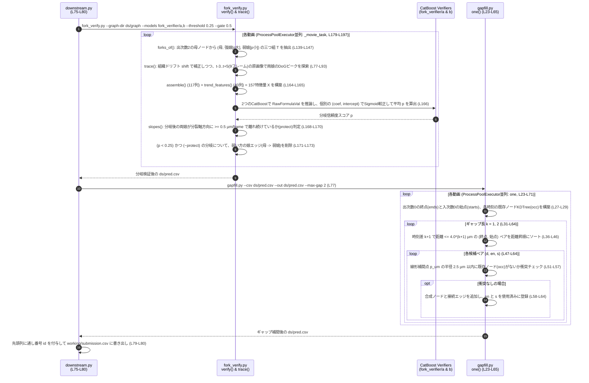

---

### Stage6. 疎な動画向けのトラック支持ゲート(Track-Support Gate)

パイプラインの締めくくりとして、疎な動画(`dog_sp >= 19.7 µm`)に残存する「本物の細胞核ではない、長くて薄暗い偽陽性トラック(Over-counting)」を除去するため、`biohub-4th-place-solution.py`(L225-L228)から **`track_gate.py`** が呼び出されます。

#### 6-1. 2つの独立検出器(`3D Net-64` & `高感度DoG`)によるセグメント単位の合意検証
Stage1-3(疑似ラベルの洗練)と同じ「独立モデルによる確認」の哲学を、最終トラックに対して適用します:
1. **非分岐セグメントへの分解 (`segments`, L30-L50)**:
   - トラックを「出次数1かつ入次数1のリンク」のみで繋がった極大の単一鎖セグメント(分裂点で区切られた枝ごとの区間)に分割します。
2. **核間隔バンド別の確認条件と閾値判定 (`GATE_SPEC`, L24-L81)**:
   - `GATE_SPEC = "19.7:25:or:0.4:4:5;25:99:and:0.2:5:5"` に従い、動画の核間隔 `dog_sp` が属するバンドに応じて、各ノードが「確認済み(`sup = True`)」となる条件とセグメント保持閾値 $\theta$ を切り替えます:

| 動画の核間隔バンド (`dog_sp`) | ノードが確認済み(`sup = True`)となる条件 | セグメント削除条件 (支持率 $< \theta$) | テスト動画での該当 |
| :--- | :--- | :---: | :--- |
| **`< 19.7 µm` (密な動画)** | ゲート処理なし(すべてそのまま保持) | 削除なし | `44b6_0113de3b` (16.27 µm)<br>`44b6_0b24845f` (15.27 µm)<br>`6bba_05db0fb1` (11.98 µm) |
| **`19.7 〜 25.0 µm` (やや疎な動画)** | **OR条件**: 同一フレーム内で半径 **`4.0 µm` 以内に高感度DoGノード** がある **または** 半径 **`5.0 µm` 以内に 3D Net-64 ノード** がある | セグメント内の確認済みノード率が **`40%` (`0.4`) 未満** ならセグメントごと削除 | (該当なし) |
| **`>= 25.0 µm` (極めて疎な動画)** | **AND条件**: 同一フレーム内で半径 **`5.0 µm` 以内に高感度DoGノード** があり **かつ** 半径 **`5.0 µm` 以内に 3D Net-64 ノード** がある | セグメント内の確認済みノード率が **`20%` (`0.2`) 未満** ならセグメントごと削除 | `6bba_05b6850b` (26.05 µm)<br>※6,161ノード中229ノードを削除 |

#### Stage6. ソースコード一覧
| ファイルパス | 関数・クラス・定数 | 行番号 | 処理内容 |
| :--- | :--- | :---: | :--- |
| `biohub-4th-place-solution.py` | `NET64_THR`, `GATE_SPEC`, `track_gate.py` 呼び出し | L62, L65, L225-L228 | `dog_nodes` の完了待機後、`GATE_SPEC` を渡して `track_gate.py` を実行 |
| `track_gate.py` | `segments()`, `support()`, `__main__` | L30-L86 | トラックを非分岐セグメントに分解し、`dog_nodes` と `net64_nodes` による支持率が閾値 $\theta$ 未満のセグメントのノードと接続エッジを除去 |

#### Stage6. シーケンス図
```mermaid
sequenceDiagram
    autonumber
    participant Main as biohub-4th-place-solution.py<br/>(L225-L228)
    participant Gate as track_gate.py<br/>(L24-L86)

    Main->>Main: finish(dog_nodes) (高感度DoG検出の完了を確認, L225)
    Main->>Gate: track_gate.py --sub submission.csv --route dog_route.json --net64-dir net64_nodes --dog-dir dog_nodes --spec "19.7:25:or:0.4:4:5;25:99:and:0.2:5:5"
    Gate->>Gate: dog_route.json から各動画の dog_sp を読込 & GATE_SPEC をパース (L24-L27, L62)
    loop 各動画 m (L64-L81)
        alt dog_sp < 19.7 µm (密動画)
            Gate->>Gate: 何も変更せずそのまま保持 (L65-L67)
        else 19.7 <= dog_sp < 25.0 µm (orモード) または dog_sp >= 25.0 µm (andモード)
            Gate->>Gate: net64_nodes/<m>.nodes.npy と dog_nodes/<m>.npy を読込 (L70, L74)
            Gate->>Gate: support(): 同一フレーム内で半径 r 以内に独立検出ノードが存在するか cKDTree で判定 (L53-L59, L74-L75)
            Gate->>Gate: segments(): 出次数1・入次数1の極大チェーンごとにセグメントIDを付与 (L30-L50, L76)
            Gate->>Gate: セグメントごとの平均支持率 sup.mean() < theta のセグメントを特定 (L77)
            Gate->>Gate: 該当セグメントの全ノード(badn)とそれに接続するエッジを除去 (L78-L81)
        end
    end
    Gate->>Gate: 通し番号 id を振り直して submission.csv を上書き保存 (L82-L85)
    Gate-->>Main: 最終提出ファイル submission.csv 完了
```

---

## アブレーションスタディと不採用手法(What did not help)の知見

Writeup(Section 6 & 7)で公開されている、各コンポーネントの追加によるリーダーボードスコアの推移と、実験の結果「効果がなかった(または悪化した)アプローチ」のまとめです。

### 1. スコア向上の主要マイルストーン

| フェーズ / 追加コンポーネント | 主な該当スクリプト | Public / Private LB スコア推移・効果 | 技術的ポイント |
| :--- | :--- | :---: | :--- |
| **① 3D Net 検出器の改良** | `net3d.py`, `detect.py`, `dog_route.py` | **0.875 → 0.906 (+0.031)**<br>・前後差分フレーム入力: CV +0.20 (0.73→0.93)<br>・疑似ラベル合意洗練: **+0.004**<br>・DoG密度ルーター: **+0.002** | 3階層正規化損失、Cellpose型移流デコード、正解モデルが50%以上合意したPLトラックのみ採用する安全機構。 |
| **② マルチモーダルLinking** | `edge_features.py`, `tf_edges.py`, `cell_embedding.py`, `edge_model.py` | **0.906 → 0.913 (+0.007)**<br>・全データ学習Edge Transformer: **+0.005** | 幾何26特徴(速度残差・組織フロー残差) + 双方向Cross-Attention確率 + InfoNCE埋め込みをLightGBM(47特徴)で統合。 |
| **③ 分裂事前確率 $s_i$ とノード別ILP分裂コスト** | `division_cnn.py`, `division_cat.py`, `division_pair.py`, `ilp_solve.py` | **0.913 → 0.948 (+0.035)**<br>・母娘ペアモデル追加: **+0.003** | **単一で最大のブレイクスルー(+0.035)**。一律の分裂コストを廃止し、各ノードに $\text{base} - 16s_i$ の個別コストと第2娘救済を導入。 |
| **④ 後処理(分岐検証・平滑化・ギャップ補間・ゲート)** | `common.py`, `fork_verify.py`, `gapfill.py`, `track_gate.py` | **0.948 → 0.969 / 0.962 (+0.021)**<br>・Fork Verifier + 閾値調整: **+0.005**<br>・Gap bridging (1〜2f): **+0.002** | 原画像9フレームDoGトレースによる偽分岐枝刈り、組織ドリフト除去後の直線平滑化、衝突回避付きギャップ補間。 |

### 2. 効果がなかった手法(What did not help)から得られる教訓

| 試したアイデア | LBへの影響 | なぜうまくいかなかったのか(教訓) |
| :--- | :---: | :--- |
| **疑似ラベル3D Net(`net3d_128_pl`)を単独でメイン検出器として使用** | **−0.003 〜 −0.004** | 感度(Recall)は上がるが、未知の新しい胚に対して存在しないトラックを捏造してしまう。第2のモデルは「置き換え」ではなく「独立した確認役」として使うべき。 |
| **分裂モデルに対するハードネガティブマイニング (Hard-negative mining)** | **ローカルCVで大幅悪化** | 全細胞の約1%しかラベルがないため、「モデルが最も分裂だと強く予測したのに正解ラベルがないノード(Hard Negative)」の正体は、ほぼすべて**アノテーションされていない本物の分裂**だった。 |
| **リンクの幾何特徴を計算する前のフレーム間レジストレーション(位置合わせ)** | **−0.003** | 事前にフレーム全体を剛体変換するよりも、1巡目リンクからの局所組織フロー残差(`tis_res`)として特徴量に入れたり、ILP後の平滑化(`stabilized_linefit`)で補償する方が優れていた。 |
| **3D Net-64 を使わない DoG 単独のトラック支持ゲート** | **Public −0.001 / Private −0.011** | 古典的DoGだけでは未知の胚での大核・薄暗い核の特性変化に対応しきれず、本物のトラックまで過剰に削除してしまった。 |
| **全ネットワークへの TensorRT FP16 変換** | **42%高速化するも −0.001** | 4位解法のネットワーク群はもともと軽量(計31分で完走)なため、精度を0.001犠牲にしてまでTensorRT化するメリットがなかった。 |
| **3D Net 推論時の 4/8方向 TTA (Test-Time Augmentation)** | **効果なし(ノイズ範囲内)** | 検証コストが4〜8倍に跳ね上がる割に、移流クラスタリング+下流フィルタのパイプラインでは最終スコアに寄与しなかった。 |

---

## 1位・2位・3位・4位解法の比較

本コンペの上位4ソリューションのアプローチの比較表です。

| 項目 | 1位解法(sersasj) | 2位解法(soheilayati) | 3位解法(yu4u / ren4yu) | 4位解法(BarryZhou / songqizhou) |
| :--- | :--- | :--- | :--- | :--- |
| **Public / Private LB** | **0.976 / 0.977** | **0.974 / 0.970** | **0.978 / 0.969** | **0.969 / 0.962** (Best Private: 0.964) |
| **基本設計思想** | **ビジュアルトラッキング**<br>細胞の見た目変化・FPN占有マップから直接追跡 | **幾何ヒューリスティクス & 特徴量工学**<br>距離・速度・カルマンフィルタベース | **物理フロー補正 + 数理計画法(LP)**<br>3D Dense Flow + 4段分裂判定 + 整数計画法 | **生物学的観察のモデリング + 個別コストILP**<br>軽量NN(最大18M) + CPU GBDT + ノード別分裂コストILP |
| **検出器 (Detector)** | 3D U-Net (MAE事前学習 + 3Dベクトルフロー予測) | 3D U-Net (5-foldアンサンブル + 多段コンセンサス) | 2.5D U-Net (EffNetV2-L, B7) + 3D SegResNet (15モデルTRT) | **Dual-Encoder 3D Net (現在+前後差分)** + Cellpose型40ステップ移流 + **PL合意洗練** & **DoG密度ルーター** |
| **リンク・特徴量抽出** | 視覚特徴からの直接リンク予測 | 幾何距離・カルマンフィルタ速度・近傍特徴 | FlowNet3D変位補正 + 2.5D Siamese EmbedUnet (5-fold) | **幾何・組織フロー残差(26特徴) + Edge Transformer + InfoNCE 3D CNN埋め込み → LightGBM(47特徴)** |
| **分裂(Division)の解法** | **Soon Net**<br>分裂前後3クラス分類 + 娘細胞占有マップ | **ペア特徴量 + 分裂スタッキング**<br>距離・形状特徴からGBDT/ペアモデル | **4系統の専門モデル (div3f)**<br>parent / pre / post / native-parent (計40 TRT) | **3段階ハイブリッド ($s_i = \max(\text{pair}, \text{cat})$)**<br>①5f Division CNN(6個) + ②53特徴CatBoost + ③母7f/娘3fの**261特徴ペアモデル(LGB+Cat)** |
| **グラフ構築・追跡** | **貪欲法 (Greedy Decode)**<br>対数オッズ比による逐次決定 | **多段制約ソルバー**<br>Stage6リランキング + フォーク投票 | **整数計画法 (Lineage LP / HiGHS)**<br>2段階確率分解($a \times q$) + 反復線形化MILP | **`tracksdata` + `SCIP` 大域的ILP**<br>**ノード別分裂コスト($\text{base} - 16s_i$)** + 参入閾値緩和 + 第2娘Transformer救済 |
| **後処理の工夫** | 線形平滑化 + ギャップ補完 + 短トラック除去 | 動的閾値 + カルマン速度ゲーティング | オプティカルフローに基づく**アフィン座標微調整** + 3fギャップ補完 | **原画像9f DoGトレース分岐検証(Fork Verifier)** + **動き補償直線平滑化** + 2fギャップ補間 + **疎動画支持ゲート** |
| **計算資源・高速化** | PyTorchモデルの軽量化 | Python/NumPyの並列化 | TensorRTへの全エンジン化 + エンコーダ特徴量再利用 | **小規模モデル設計(10ep学習)** + Zarrチャンクの `blosc2` 直接解凍 + CPU/GPU非同期並列実行 |


---

### 同じ「材料集め → ジャッジ → 後始末」の中での1位〜4位の違い

| 順位 | ① 材料集め (点・線・分裂) | ② ジャッジ (繋ぎ方の決定) | ③ 後始末 (手直し・検品) | 一言でいうと |
| :---: | :--- | :--- | :--- | :--- |
| **1位** | **超・重厚な3D NN**<br>MAE事前学習3D U-Net + Soon Net(分裂3クラス+娘占有マップ) | **超シンプル(貪欲法: Greedy)**<br>数理計画法(ILP)すら使わず、対数オッズが高い順に上から確定 | 線形平滑化 + ギャップ補間 + 短トラック除去 | **「材料が完璧なら、ジャッジは単純な貪欲法でも勝てる」** 型 |
| **2位** | **5-fold 3D U-Net** +<br>カルマンフィルタ速度・幾何特徴量 + GBDT | **多段階ルール & 制約ソルバー**<br>いきなり一括で決めず、確実なリンクから段階的にジャッジ | フォーク投票 + カルマン速度ゲーティング | **「カルマンフィルタと多段階審査で手堅く固める」** 型 |
| **3位** | **超・重厚なNN大軍団**<br>15個の検出TRT + FlowNet3D + Siamese Net + 40個の分裂TRT | **数理計画法 (Lineage LP/MILP)**<br>動画全体を `HiGHS` ソルバーで大域的に一括ジャッジ | Optical Flowによる座標微調整 + 3fギャップ補間 | **「最強のGPU特徴量 × 数理計画法(LP)の王道フル装備」** 型 |
| **4位** | **軽量NN + 生物学的GBDT**<br>18M 3D Net + 261特徴量の母娘ペアLGB/CatBoost | **数理計画法 (個別コストILP)**<br>`tracksdata` + `SCIP` でノード別コスト($6-16s_i$)一括ジャッジ | **原画像9f再追跡(Fork Verifier)** + 動き補償平滑化 + **疎動画ゲート** | **「GPU資源の差を、生物学特徴量とILP設計・原画像再検品で埋めた」** 型 |

### 比較すると見えてくる面白いポイント

* **3位と4位は「設計図(アーキテクチャ)」が双子のように似ている**:
  どちらも「リンク確率と分裂確率を別々のモデルで作って、数理計画法(LP/ILP)で動画全体を一括ジャッジする」という全く同じ思想です。
* **違いは「計算パワーフル活用(3位)」対「特徴量と後始末の工夫(4位)」**:
  3位が数十個のニューラルネット(TensorRT)のアンサンブルで圧倒的な精度の材料を作ったのに対し、4位はニューラルネットを最小限(10エポック学習)に抑え、そのぶん **「母7フレーム・娘3フレームの174個の生物学的特徴量(Stage3)」** や **「ジャッジした後にわざわざ原画像に戻ってDoGで9フレーム追跡し直す検品(Stage5)」** で精度を稼いでいます。

このように「1〜4位すべて同じ3部構成の土俵の上で戦っていて、各パートへの力の掛け方が違った」と見ると、4つの解法の比較がとても整理しやすくなります！

---

## まとめ

Biohubコンペの4位解法は、膨大なGPU計算資源がなくとも、**「データと生物学的現象を深く観察し、評価指標の急所を突く数理設計を行う」** ことでトップランカーと互角に戦えることを証明した素晴らしいソリューションでした。

特に学びとして持ち帰りたい重要ポイントは以下の5点です:

1. **「疎な正解ラベル(1%)」に対する正しい損失設計とネガティブサンプリングの規律**:
   - 検出では「アノテーション核・確実な局所背景・未ラベル領域」の3階層をボクセル数で正規化し、分裂では「ラベル付きトラックの非分岐点のみを陰性とし、未ラベルノードは絶対に陰性にしない(ハードネガティブマイニングを行わない)」という規律がモデルの崩壊を防いだこと。
2. **時間変化(`nxt - prev`)を組み込んだ Dual-Encoder 3D Net と Cellpose型移流デコーディング**:
   - 前後フレームの差分を入力に加えるだけで未知の胚への検出性能が `0.73 → 0.93` に向上し、単位ベクトル場に沿った40ステップの移流クラスタリングで密集・接触した細胞核を綺麗に分離したこと。
3. **第2のモデルは「置き換え」ではなく「合意確認(Check)」として使う**:
   - 疑似ラベルモデル(`net3d_128_pl`)や疎動画ゲート(`3D Net-64` + `高感度DoG`)において、単独では偽陽性を増やしてしまう高感度モデルを「独立したモデルと50%(または20〜40%)以上一致したトラックのみ残す」という確認機構に組み込むことで、安全にRecallを引き上げたこと。
4. **ILP(整数線形計画法)における「ノード別分裂コスト($\text{base} - 16s_i$)」の威力**:
   - 一律の分裂ペナルティではなく、5フレームCNN・53特徴グラフモデル・261特徴母娘ペアモデルから算出した分裂確率 $s_i$ によってノードごとに分裂コストと参入閾値を動的に変化させたことが、単一で **+0.035** という決定的なスコア飛躍を生んだこと。
5. **原画像に立ち返る「Fork Verifier(分岐検証器)」と「動き補償平滑化」**:
   - グラフ上の特徴量だけで完結させず、ILPが出した分岐候補の娘細胞を「分岐前後9フレームの原画像上で局所DoGにより直接追跡し、姉妹が実際に離れ続けているか検証する」という地道かつ本質的な後処理でさらに **+0.005** を削り出したこと。

お役に立てれば。
