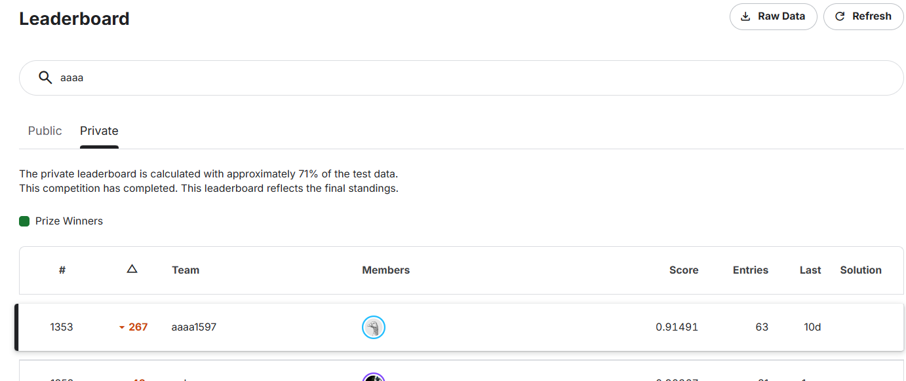
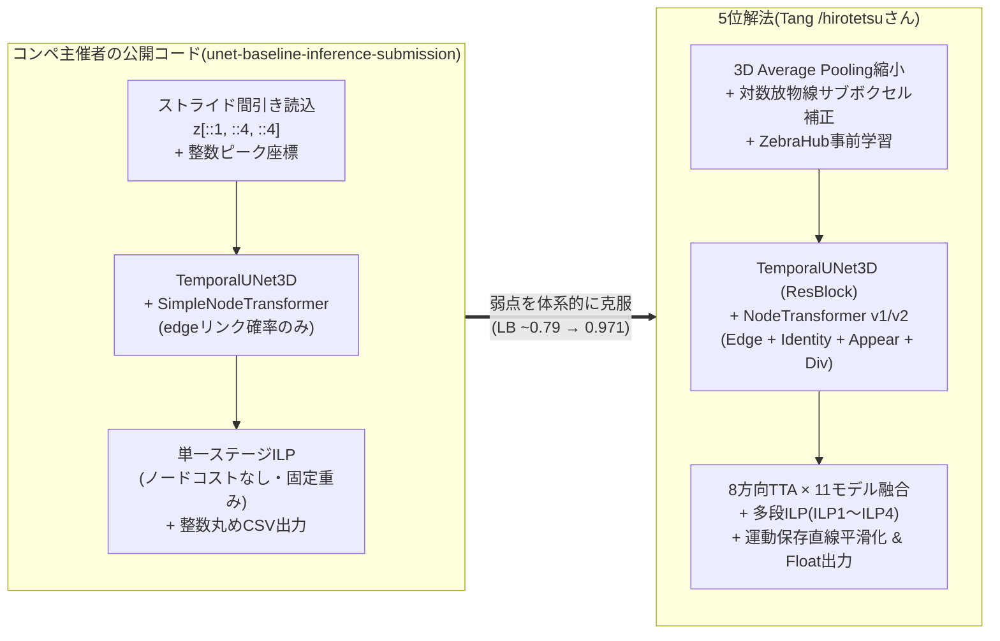
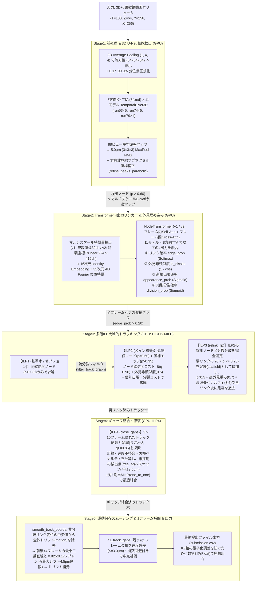
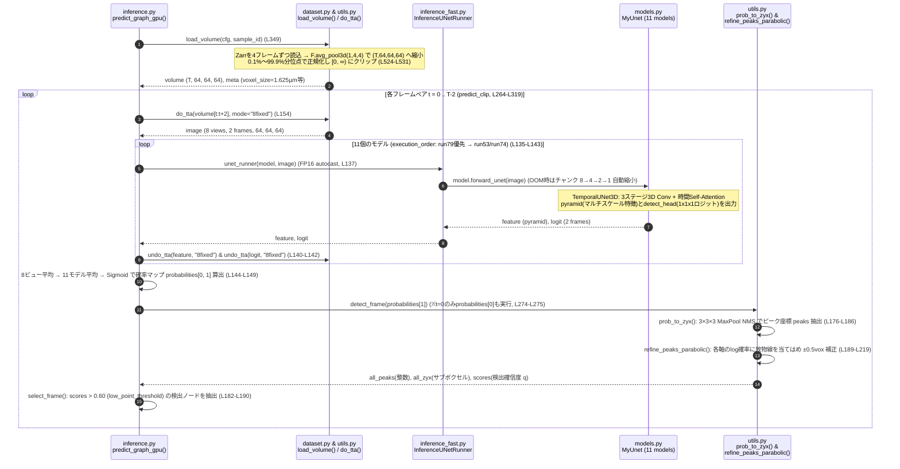
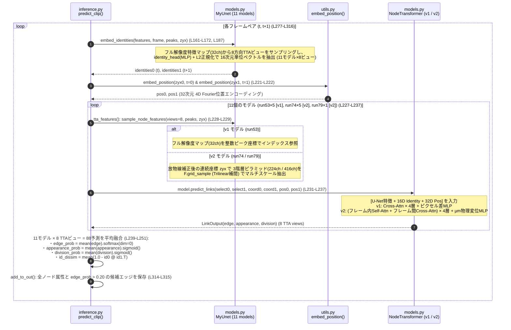
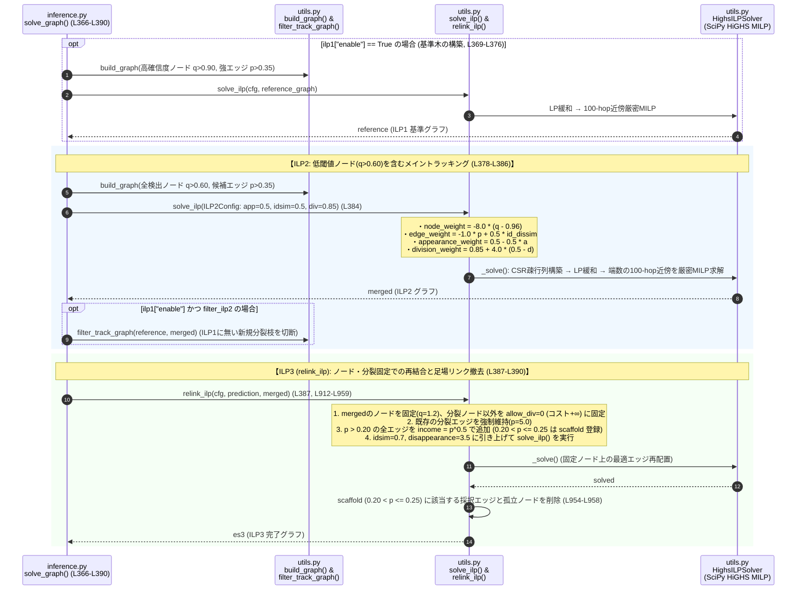
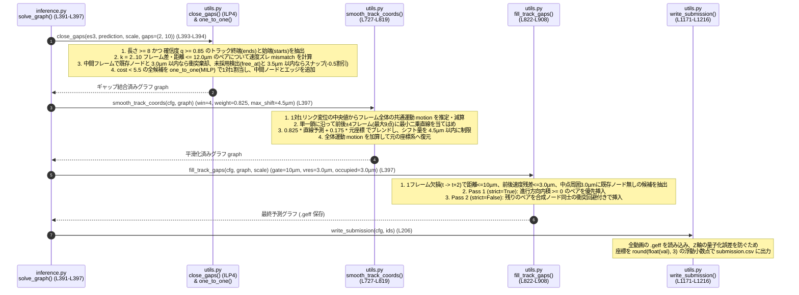

18-⑤Kaggle実践3 Biohub細胞トラッキング 5位解法のまとめ


## Abstract
- biohub 5位解法(Tang/hirotetsuさん Public 0.971 / Private 0.958)のまとめ
  - コンペ主催者の公開コード(`thibautgoldsborough/unet-baseline-inference-submission`)の「Single-Backbone(3D Temporal U-Net + Node Transformer) + 大域的ILP」という骨格を活用。その弱点を補完強化してスコアアップした。
  - 1つの共有バックボーン(TemporalUNet3D)から細胞検出を行い、同じマルチスケール特徴マップからサンプリングした特徴量で **「リンク確率・16次元外見類似度(Identity)・新規出現スコア(Appearance)・細胞分裂スコア(Division)」の4要素** をNodeTransformer(v1/v2)で一括予測。
  - 4つの公開ZebraHubデータセットによる事前学習、8方向TTA(`8fixed`)×11モデルアンサンブル(`run53` 5-fold + `run74` 5-fold + `run79` fold0)、および **多段ILPトラッキング(ILP1〜ILP4: HiGHS局所厳密MILPソルバー) + 運動保存直線スムージング + 1フレーム欠損補間** で完結。

**用語解説**

- **TemporalUNet3D(時系列3D U-Net)** ... 連続する2フレーム `[t, t+1]` の3D画像ボリュームを入力とし、エンコーダの各階層で空間3D畳み込みの直後に同一ボクセル座標 `(z, y, x)` における時間方向のMulti-Head Self-Attention(`_TemporalAttention`)を適用する3D U-Net。検出ヘッドと後続のTransformerリンカーが**単一の3D特徴抽出バックボーンを共有**する点が最大の特徴。
- **サブボクセル対数放物線フィッティング(`refine_peaks_parabolic`)** ... 4倍ダウンサンプリングされた離散グリッド `(64, 64, 64)` 上でMax Pooling NMSによって見つけたピーク座標 `(z, y, x)` に対し、各軸の前後1ボクセルの対数確率 $\log p$ に放物線(2次関数)を当てはめ、真の頂点オフセット(`[-0.5, +0.5]` ボクセル)を解析的に求める手法。離散化による最大2 µmの量子化誤差を解消する。
- **NodeTransformer / NodeTransformerV2(4出力Transformerリンカー)** ... フレーム $t$ の検出細胞群とフレーム $t+1$ の検出細胞群の間でAttention計算を行い、①全ペアのリンクロジット `edge`、②16次元の細胞外見埋め込み `identity_embedding`、③フレーム $t+1$ の新規出現ロジット `appearance`、④フレーム $t$ の細胞分裂ロジット `division` の**4つの出力**を同時に予測するネットワーク。`v2` ではマルチスケール特徴量のTrilinear補間サンプリング、同一フレーム内Self-Attention、およびマイクロメートル単位の3次元変位ベクトル入力を導入。
- **CenterNet型ガウシアンFocal損失(`TrackingLoss.detection`)** ... 全体の数%しか細胞がアノテーションされていない疎ラベル問題に対処するため、正解座標の周囲に3Dガウシアン分布($\sigma = 1.0\text{ vox}$)を配置し、正例($\text{target}=1$)と負例($\text{target}<1$)をそれぞれのボクセル数で別々に正規化した上で、負例側に $(1 - \text{target})^4$ の距離減衰と小さな重み(`det_neg_weight = 0.01`)を掛ける損失関数。
- **多段ILPトラッキング(ILP1〜ILP4)** ... 1回のILPで全てを決めるのではなく、段階的にグラフを洗練する数理最適化パイプライン。①高確信度ノード($p \ge 0.9$)のみで基準木を作る **ILP1**、②低閾値ノード($p \ge 0.6$)を入れてギャップを埋めつつ偽分裂を抑制する **ILP2**、③ノードと分岐を固定し「弱い足場リンク(`scaffold`: $p \in (0.2, 0.25]$)」を補助に入れて再結合後に足場を撤去する **ILP3(`relink_ilp`)**、④2〜10フレーム離れたトラック終端と始端を速度整合性と空き検出スナップで1対1結合する **ILP4(`close_gaps`)** から構成される。
- **HiGHS LP緩和 + 局所厳密MILPソルバー(`HighsILPSolver`)** ... トラッキングILPの線形計画(LP)緩和解が「ほぼ全ての変数で最初から整数(0または1)に収束する(全単模性に近い)」という性質を利用し、まず連続LPとして高速に解いた後、端数(小数)になった変数から制約グラフ上で `hops=100` ステップ以内の近傍変数だけを開放して厳密な混合整数計画法(MILP: `mip_rel_gap=0.0`)で解き直す高速・厳密ソルバー。
- **BCE** ... Binary Cross-Entropy。BCE損失関数のこと。正式には難解に見える下記数式なんだけど、実はそんな対した意味はない。「Yes(1) か No(0) かの2択クイズ(二値分類)で、モデルの予想確率がどれくらい外れているかを測る損失関数(ペナルティ)」を計算する。
$$L = -\frac{1}{N} \sum_{i=1}^{N} \left[ y_i \log(\hat{y}_i) + (1 - y_i) \log(1 - \hat{y}_i) \right] \newline y_i:正解ラベル(0 \;or\; 1) \newline \hat{y}_i:モデルが予測した確率(0 < \hat{y}_i < 1)\newline ※通常は最終層に Sigmoid 関数を適用した出力 $$
このままだと難解なままなので、実はしょうもないという説明を。
$$
\text{BCE} = -\left( \underbrace{y \log(p)}_{\text{正解が1のときだけ発動}} + \underbrace{(1 - y)\log(1 - p)}_{\text{正解が0のときだけ発動}} \right)
$$
正解が0($y=0$)の時は、右の項 $(1 - y)\log(1 - p)$ だけ見ればよくて(正解が0なら $0 \times \log(p) = 0$ で消えるから)、<br/>正解が1($y=1$)の時は、左の項 $y \log(p)$ だけ見ればいい(正解が1なら $(1-1) \times \log(1-p) = 0$ で消えるから)。すっきり～。
  - 正解が $y = 0$ の時:
  左項は無視。右項の $- \log(1 - \hat{y})$ だけを考えます。予測 $\hat{y}$ が $0$ に近い(正解)とき、$\log(1) = 0$ となり、損失は $0$ に近くなります。また、予測 $\hat{y}$ が $1$ に近い(大外れ)とき、損失は 無限大 になります。
  - 正解が $y = 1$ の時:
右項は無視。左項の $- \log(\hat{y})$ だけ見る。予測 $\hat{y}$ が $1$ に近い(正解)とき、$\log(1) = 0$ となり、損失は $0$ に近づきます。予測 $\hat{y}$ が $0$ に近い(大外れ)とき、$\log(0)$ はマイナス無限大に向かうため、損失は 無限大(非常に大きなペナルティ) になります。




## 概要
先日、Biohub細胞トラッキングコンペが完了しました。
Private LB 1353位/3800人と大変悔しい結果に終わりましたが、Kaggleの素晴らしいところは、トップ層の解法が公開されることです。
このお宝を徹底的に解析し、確実に自身のスキルへと昇華させるべく、今回はソロ参加で5位(3,947チーム中5位・金メダル)に入賞された (Tang/hirotetsu)さんの解法を深掘りします。

5の位解法って、
1位〜4位の解法がコンペ主催者の公開コードを捨てて、それぞれ独自の専用モジュール(1位のSoon Net、2位のカルマンフィルタ多段審査、3位のFlowNet3D+40個のTensorRT分裂モデル、4位のCellpose移流+261特徴量GBDT+原画像DoG検証器)を構築したのに対し、5位解法はコンペ序盤にコンペ主催者(Royer Lab / Thibaut Goldsborough氏)から公開されてたコード **[UNet + Transformer baseline](https://www.kaggle.com/code/thibautgoldsborough/unet-baseline-inference-submission) を出発点とし、その単一バックボーン設計を崩さずにどこまで極限まで精度を引き上げられるか** 活かしたアーキテクチャなんですね。

- 出発点となったコンペ主催者の公開コード(Baseline Notebook)
https://www.kaggle.com/code/thibautgoldsborough/unet-baseline-inference-submission
- 解説のURL(Writeup)
https://www.kaggle.com/competitions/biohub-cell-tracking-during-development/writeups/5th-place-3d-u-net-transformer-linker-multi-s
- 5位解法 推論コード(Kaggle Kernel)
https://www.kaggle.com/code/hirotetsu/ctdd-11model-final-v2-ilp1-rematch-adj-off
- 5位解法 コードデータセット & 学習済み重みデータセット
https://www.kaggle.com/datasets/hirotetsu/ctdd-final-v2-ilp1-rematch-adj-off-code
https://www.kaggle.com/datasets/hirotetsu/ctdd-run53-run74-run79-ensemble-code

## biohub 5位解法まとめ
5位解法の特徴は
- **「コンペ主催者の公開コード(3D U-Net + Transformer + ILP)を補足強化するため1つずつ弱点を潰し切ったアプローチ」**
- **「リンカーへの4出力(Link / Identity / Appearance / Division)の集約」** と **「検出確信度コスト・足場リンク・ギャップ結合を備えた多段ILP(ILP1〜ILP4)」**

です。

### コンペ主催者の公開コード(`unet-baseline`)と5位解法での改善点

まず、元のコード(`unet-baseline-inference-submission`)と5位解法(`ctdd-11model-final-v2-ilp1-rematch-adj-off`)がどのように変わったのかを一覧表で比較します。

| 比較項目 | コンペ主催者の公開コード(`unet-baseline-inference-submission`) | 5位解法 (`ctdd-11model-final-v2-ilp1-rematch-adj-off`) | スコアへの寄与・改善理由 |
| :--- | :--- | :--- | :--- |
| **空間ダウンサンプリング** | スライス間引き `raw[:, ::1, ::4, ::4]`<br>(4ピクセル中3ピクセルを捨てており、エイリアシングと位置ズレが発生) | **3D Average Pooling (`F.avg_pool3d(1, 4, 4)`)**<br>+ ボクセル中心を合わせる座標変換 `(c + 0.5) / s - 0.5` | 4×4領域の全輝度情報を保持し、元の解像度との幾何学的な中心ズレ(最大1.5ボクセル)を完全に解消 |
| **ピーク座標の精度** | `int16` の整数グリッド座標に丸め込み (`coords[:, 1:] *= ds_arr`) | **対数放物線サブボクセル補正 (`refine_peaks_parabolic`)**<br>+ 最終CSVも小数第3位の `float` で出力 | 4倍縮小グリッドの粗い量子化誤差を解消し、Z軸(1.625µm間隔)の丸めによる `-0.0074` のスコア損失も回避 |
| **検出損失関数** | アノテーション座標1点のみを正例とする単純BCE(Binary Cross Entropy/BCE損失関数) (`compute_detection_loss`) | **3Dガウシアン($\sigma=1.0$) + CenterNet型Focal損失**<br>(正例・負例を個別にカウント正規化、`det_neg_weight=0.01`) | 疎ラベル(数%のみアノテーション)環境下でもピーク周辺の勾配が滑らかになり、サブボクセル放物線フィットと完全整合 |
| **リンカーの構造** | `SimpleNodeTransformer`<br>・整数座標の1スケール特徴量(32ch)のみ<br>・フレーム間Cross-Attentionのみ<br>・ピクセル単位の相対座標差 `(c_a - c_b)/100` | **`NodeTransformerV2` (`run74`, `run79`)**<br>・**マルチスケール特徴量**(Head+Decoder+Bottleneck計224/416ch)を精製座標でTrilinear補間抽出<br>・**同一フレーム内Self-Attention** + フレーム間Cross-Attention<br>・**物理単位($\mu\text{m}$)の変位ベクトルとユークリッド距離**を入力 | 同一フレーム内の近傍細胞の競合関係をSelf-Attentionで把握し、異方性ボクセルに惑わされない物理距離ベースのペア採点を実現 |
| **リンカーの出力ヘッド** | `edge` (リンク確率) の **1種類のみ** | **4種類のマルチタスク出力**:<br>① `edge` (リンク確率)<br>② `identity` (16次元外見ベクトル類似度, InfoNCE/CE損失)<br>③ `appearance` (新規出現確率, `pos_weight=10`)<br>④ `division` (細胞分裂確率, `pos_weight=20`) | **単一で最大の改善(Public +0.020 / Private +0.024)**。稀な分裂や視野流入細胞を専用ヘッドで直接検知し、ILPのノード別コストへ直結 |
| **学習データ・事前学習** | コンペ訓練データのランダム分割(Split 0)のみ | **4つの公開ZebraHubデータセット(`ZSNS001, 003, 004, 005`)で事前学習** + クリップ種別・分裂数による層化5-fold CV + 人手レビュー分裂データ補強 | **Public +0.014 / Private +0.016**。大規模な完全アノテーション付き外部胚データで表現力を獲得 |
| **TTA & アンサンブル** | 単一モデル + 検出時のみ4方向フリップTTA (`det_tta`) | **11モデルアンサンブル**(`run53`×5 + `run74`×5 + `run79`×1)<br>× **8方向XY反転・回転TTA(`8fixed`)** を検出・特徴量・リンク・外見類似度の全段階で融合 | 5-foldアンサンブルで **+0.008/+0.007**、8方向TTAで **+0.007/+0.005** の安定した上積み |
| **トラッキング(ILP)** | `tracksdata` 標準の単発ILP<br>(定数コスト `app=0.1, dis=0.1, div=1.0`、ノードコストなし、閾値 `0.99` 固定) | **検出確信度ノードコスト付き多段ILP**:<br>・低閾値(`0.60`)ノードを採用し確信度でコスト付け(**+0.008/+0.020**)<br>・**ILP1/ILP2**(基本木構築と偽分裂抑制: **+0.003/+0.007**)<br>・**ILP3(`relink_ilp`)**(分岐固定+足場リンク補助再結合)<br>・**ILP4(`close_gaps`)**(2〜10fギャップ結合: **+0.001/+0.002**) | 単発ILPでは不可能な「高再現率(Recall)の確保」と「偽分裂・途切れの防止」を多段階の制約設計で両立 |
| **軌道平滑化・欠損補間** | なし | **運動保存付き局所直線スムージング(`smooth_track_coords`, ±4f, 重み0.825, 上限4.5µm)** + **1フレーム欠損補間(`fill_track_gaps`)** | **Public +0.004 / Private +0.005**。フレーム全体のドリフトを保護しつつ検出の微小なブレを除去 |

---

### 「データ・バリデーション・評価指標の観察」からの7つの設計指針

5位解法(Writeupおよびコード内の詳細な設計コメント)では、データの性質と評価指標の挙動を深く分析し、以下の7つの工夫を実装しています。

| 観点 | 具体的な対応内容 | 対応Stage |
| :--- | :--- | :---: |
| **① 訓練データに「重複フレーム」と「巨大ドリフト」が混入している**<br>訓練動画の一部でフレーム $t$ と $t+1$ がバイト単位で完全一致(`DUPLICATE_FRAMES`: 114動画)したり、画像全体が $6\sim 14\text{ µm}$ 以上ジャンプ(`DRIFT_FRAMES`: 116動画)している | **CV評価時における問題フレームエッジの除外 & テストデータのドリフト検証**<br>バリデーション評価では予測・正解の双方から重複フレーム(`DUPLICATE_FRAMES`)と大ドリフトフレーム(`DRIFT_FRAMES`)を出るリンクを除外して正確なCVを計測。一方、LBプローブにより「隠されたテストデータには6µm以上の巨大ドリフトが存在しない」ことを突き止め、推論時のドリフトシフト補正(`drift_compensate`)を敢えてOFFにしてPublic/Private双方の安定性を確保 | Validation,<br>Stage1 |
| **② Z軸の異方性と減衰によりZ反転TTAは逆効果になる**<br>顕微鏡の光は片側から入るためZ軸深部は暗くなり、解像度もZ(1.625µm)はXY(0.406µm)の4倍粗い | **XY平面限定の8方向対称群TTA(`8fixed`)とバグ修正**<br>Z軸は一切触れず、XY平面の恒等・X反転・Y反転・180°回転・90°回転・270°回転・主対角反転・副対角反転の8ビュー(`D_4` 二面体群)のみを適用。さらに旧モード(`8fliprot`)で8番目がX反転と重複していたバグを修正した `8fixed` を導入 | Stage1 |
| **③ 高い検出閾値(`0.90`)だけでは薄暗い細胞を見逃してトラックが途切れる**<br>しかし単純に閾値を `0.60` に下げると偽の細胞や偽の分裂が急増する | **ILPのノード確信度コスト(`node_weight`)と多段ILP(ILP1→ILP2)**<br>検出閾値を `0.60` まで下げて候補を広く拾った上で、ILP内で各ノードに `-8.0 * (q - 0.96)` の確信度コストを課す(`q > 0.96` なら報酬、`q < 0.96` ならペナルティ、Private **+0.020**)。さらに高確信度(`0.90`)のILP1に無かった分裂をILP2から除去する仕組み(`filter_track_graph`)を構築 | Stage2,<br>Stage3 |
| **④ 分裂と新規出現は稀であり、リンク確率だけでは判断できない**<br>1つの親から2つの娘へ確率が分散するためSoftmaxリンク確率が下がり、視野端からの流入細胞も既存トラックに誤吸収されやすい | **NodeTransformerへの `appearance_head` & `division_head` 追加と外見埋め込み(`identity_head`)**<br>正例重みを高めたBCE損失(`appearance_pos_weight=10`, `division_pos_weight=20`)で新規出現と分裂を直接分類。さらに検出器が片方の娘を見逃しても元のGT親の次数(`out_degree == 2`)から分裂ラベルを維持して学習(**+0.020 / +0.024**) | Stage2 |
| **⑤ 確定した細胞間でも、中程度のリンクや1フレームの弱リンクで繋ぎ間違いが起きる**<br>1度目のILPで選ばれたノード集合の中で、より外見類似度(`id_dissim`)を重視して繋ぎ直す余地がある | **ノード・分岐固定の再リンクILP(`ILP3: relink_ilp`)と足場リンク(`scaffold`)**<br>ILP2で残ったノードと分裂エッジを固定し、確率 $p \in (0.20, 0.25]$ の弱いリンクを「一時的な足場(`scaffold`)」として入れて $\sqrt{p}$ (`gamma=0.5`)と高い外見類似度重み(`idsim=0.7`)で再最適化し、解いた直後に足場リンクを撤去 | Stage3 |
| **⑥ 数フレームの検出抜けで長いトラックが分断される**<br>1フレームの抜けだけでなく、2〜10フレームにわたって一時的に検出閾値を下回る区間が存在する | **MILPによるギャップ結合(`ILP4: close_gaps`) + 空き検出スナップ + 1フレーム補間(`fill_track_gaps`)**<br>長さ8以上・端点確信度0.85以上のトラック終端と2〜10フレーム後の始端について、速度整合性と距離コストを計算し、途中に未採用の検出点(`free_at`)があれば半径3.5µm以内でスナップさせながら1対1 MILP(`one_to_one`)で結合 | Stage4 |
| **⑦ 座標の整数丸め(`round`)がZ軸で大きな距離ペナルティを生む**<br>公式評価指標はユークリッド距離マッチングを行うため、フル解像度グリッドでもZ軸を整数に丸めると最大 `0.81 µm` ズレる | **運動保存直線スムージング(`smooth_track_coords`) + 小数第3位Float出力**<br>フレーム全体の共通移動(`motion`)を差し引いた上で前後 `±4` フレームの最小二乗直線と `0.825 : 0.175` でブレンド(最大移動幅 `4.5 µm` 制限)。最終CSVも整数ではなく `round(val, 3)` の浮動小数点で出力し、丸めによる `-0.0074` のスコア低下を完全に防止 | Stage5 |

---

## プロジェクト構成

5位解法のリポジトリ(`5thPlaceSolution`)は、Kaggle提出エントリスクリプト(`ctdd-11model-final-v2-ilp1-rematch-adj-off.py`)、コア推論・学習コード(`ctdd-final-v2-ilp1-rematch-adj-off-code/`)、全11モデルの学習済みチェックポイント(`ctdd-run53-run74-run79-ensemble-code/`)、および比較用の公開ベースライン一式(`unet_baseline_inference.py`, `cellmot-baseline-artifacts/`)から構成されています。

```text
5thPlaceSolution/
├── ctdd-11model-final-v2-ilp1-rematch-adj-off.py  # 5位解法 Kaggle/ローカル両対応 推論エントリスクリプト
├── ctdd-final-v2-ilp1-rematch-adj-off-code/       # 5位解法 コアコードデータセット (SHA-256検証対象: 全17ファイル)
│   ├── config.py                                  # BaseConfig / InferConfig / SubmitConfig / TrainConfig / 問題フレーム定義
│   ├── dataset.py                                 # CompetitionDataset, ZebraHubDataset, HumanDivisionDataset, load_volume()
│   ├── models.py                                  # TrackingLoss, TemporalUNet3D, NodeTransformer(v1/v2), MyUnet
│   ├── inference.py                               # predict_clip(), predict_graph_gpu(), solve_graph(), run_clips()
│   ├── inference_fast.py                          # InferenceUNetRunner(OOM自動チャンク縮小), run_scheduled(GPU/CPU非同期並列)
│   ├── utils.py                                   # 放物線ピーク補正, 8方向TTA, HighsILPSolver, ILP1~4, 平滑化, CSV出力
│   └── vendor/repo/                               # ベンダー同梱の公式ベースライン拡張パッケージ
│       ├── scripts/
│       │   ├── augmentations.py                   # 3D明暗シフト・ガンマ補正・XY反転回転データ拡張
│       │   ├── dataspec.py                        # データセットパス・定数定義
│       │   └── train_unet_transformer.py          # ベースライン学習ループ・位置エンコーディング・検出マッチング
│       └── src/tracking_cellmot/
│           ├── io.py / img_proc.py                # Zarr / GEFF グラフ入出力・時間反転処理
│           ├── metrics.py / division_metrics.py   # 公式評価指標 (Adjusted Edge Jaccard + 0.1 * Division Jaccard)
│           └── models/
│               ├── temporal_unet.py               # ベースライン TemporalUNet3D
│               └── simple_node_transformer.py     # CrossAttentionBlock & SimpleNodeTransformer
├── ctdd-run53-run74-run79-ensemble-code/          # 5位解法 学習済み重みデータセット (SHA-256検証対象: 全11モデル)
│   └── models/
│       ├── run53/fold_0..4/                       # Group 1: Plain TemporalUNet3D(32,64,128) + NodeTransformer v1 (5 models)
│       ├── run74/fold_0..4/                       # Group 2: Plain TemporalUNet3D(32,64,128) + NodeTransformer v2 (5 models)
│       └── run79/fold_0/                          # Group 3: Residual TemporalUNet3D(64,128,256) + NodeTransformer v2 (1 model)
├── cellmot-baseline-artifacts/                    # コンペ主催者の公開コードのコード & 重み (edge_predictor_best.pth)
├── unet-baseline-inference-submission.ipynb       # コンペ主催者の公開コード 推論ノートブック原本
├── unet_baseline_inference.py                     # コンペ主催者の公開コード ローカル・Kaggle両対応推論スクリプト
├── verify_local_env.py                            # 環境・GPU・全28ファイルSHA-256ハッシュ・モデルロード検証スクリプト
├── input/test/                                    # テスト用Zarr動画データ (4動画)
├── working/                                       # 推論作業ディレクトリ (predictions/*.geff, submission.csv)
├── requirements.txt                               # 仮想環境再現用パッケージ定義
└── README_LOCAL.md                                # ローカル環境構築・実行ガイド
```

### 主要モデル・重み一覧(11モデルアンサンブル + ソルバー群)

5位解法は、アーキテクチャとチャネル幅が異なる **3世代・計11個のEnd-to-Endモデル(`MyUnet`)を均等重みでアンサンブル** し、各モデルに8方向TTA(`8fixed`)を適用することで、1フレームペアあたり実質 **$11 \times 8 = 88$ ビュー** の予測を統合しています。

| カテゴリ | 使用Stage | モデル群・重みファイル | アーキテクチャ / 規模 | 役割・機能 |
| :--- | :---: | :--- | :--- | :--- |
| **Model Group 1 (`run53`)** | **Stage1, 2** | `run53/fold_0/epoch_035.pth`<br>`run53/fold_1/epoch_025.pth`<br>`run53/fold_2/epoch_020.pth`<br>`run53/fold_3/epoch_028.pth`<br>`run53/fold_4/epoch_028.pth` | **Plain `TemporalUNet3D`**<br>`layers=(32, 64, 128)`, `out=32`<br>+ **`NodeTransformer` (v1)**<br>(`feat_dim=80`, 整数ピーク特徴サンプリング) | **第1世代 5-foldモデル群:** 32chのフル解像度U-Netヘッド特徴量 + 16次元Identity埋め込み + 32次元Fourier位置特徴(計80次元)を入力とし、双方向Cross-Attention(4層)で4出力(`edge, identity, appearance, division`)を予測。 |
| **Model Group 2 (`run74`)** | **Stage1, 2** | `run74/fold_0/epoch_027.pth`<br>`run74/fold_1/epoch_030.pth`<br>`run74/fold_2/epoch_024.pth`<br>`run74/fold_3/epoch_025.pth`<br>`run74/fold_4/epoch_025.pth` | **Plain `TemporalUNet3D`**<br>`layers=(32, 64, 128)`, `out=32`<br>+ **`NodeTransformerV2` (v2)**<br>(`feat_dim=272`, マルチスケールTrilinearサンプリング) | **第2世代 5-foldモデル群:** 放物線補正後のサブボクセル座標にて、Head(32ch) + 中間Decoder(64ch) + Bottleneck(128ch)の**マルチスケール特徴量(計224ch)**を `F.grid_sample` で抽出。フレーム内Self-Attention + フレーム間Cross-Attention + 物理変位(`µm`)で高精度リンク予測。 |
| **Model Group 3 (`run79`)** | **Stage1, 2** | `run79/fold_0/epoch_024.pth` | **Residual `TemporalUNet3D`**<br>`layers=(64, 128, 256)`, `out=32`<br>+ **`NodeTransformerV2` (v2)**<br>(`feat_dim=464`, 広帯域マルチスケール特徴) | **第3世代 大容量モデル:** U-Netの全ブロックを残差接続(`_ResidualConvBlock`)に刷新し、チャネル幅を2倍(`64, 128, 256`)に拡大。ZebraHub事前学習(`run77`)からファインチューニングされ、Head(32ch)+Decoder(128ch)+Bottleneck(256ch)=**416chのマルチスケール特徴**を抽出。 |
| **Global ILP Solver** | **Stage3** | `utils.py::HighsILPSolver`<br>`utils.py::solve_ilp`<br>`utils.py::relink_ilp` | `tracksdata` + `SciPy milp (HiGHS)`<br>(LP緩和 + 100-hop近傍厳密MILP) | **多段大域的トラッキング(ILP1〜ILP3):** 検出確信度コスト、外見非類似度コスト、新規出現・分裂コストを統合した目的関数を大域的に最小化。`relink_ilp`(ILP3)では分岐とノードを固定し、足場リンクを用いて再結合。 |
| **Gap & Trajectory Repair** | **Stage4, 5** | `utils.py::close_gaps` (ILP4)<br>`utils.py::smooth_track_coords`<br>`utils.py::fill_track_gaps` | 1対1割当MILP (`one_to_one`)<br>+ 運動保存付き局所最小二乗直線フィット | **ギャップ結合・平滑化・欠損補間:** 2〜10フレームの途切れを空き検出スナップ付きMILPで結合(ILP4)し、フレーム全体の共通運動を保護しながら前後 `±4` フレームの直線フィットで平滑化後、1フレーム欠損を補間。 |

---

## 5位解法の全体像

5位解法の推論パイプラインは、大きく分けて以下の6つのStageで構成されています。
- **Stage0**. Main & Fast Scheduling(SHA-256整合性検証、OOM自動チャンク制御、GPU予測とCPU後処理の非同期オーバーラップ実行)
- **Stage1**. 等方性3D Average Pooling前処理と `TemporalUNet3D` (11モデル×8方向TTA) による細胞中心検出・対数放物線サブボクセル補正
- **Stage2**. マルチスケール特徴サンプリングと `NodeTransformer(v1/v2)` による4要素(Link / Identity / Appearance / Division)予測・融合
- **Stage3**. 検出確信度ノードコスト付き多段ILPトラッキング(ILP1 / ILP2 / ILP3 `relink_ilp`)
- **Stage4**. トラック修復ステージ(ILP4 `close_gaps` による2〜10フレームのギャップ結合と空き検出スナップ)
- **Stage5**. 運動保存付き局所直線スムージング(`smooth_track_coords`)、1フレーム欠損補間(`fill_track_gaps`)、およびサブボクセルFloat CSV出力



---

## パイプラインの詳細解説

### ◆Stage0. Main処理(OOM管理・GPU/CPU非同期並列)

メイン処理(`ctdd-11model-final-v2-ilp1-rematch-adj-off.py`)で並列処理を制御します。

1. **大容量モデルを優先実行してAttention重みは破棄 (`inference_fast.py`, L30-L89)**:
   - **`model_execution_order()` (L78-L88)**: 11モデルのうち、チャネル幅が2倍(`64, 128, 256`)でVRAM消費が最大の `run79`(Residual U-Net)を**他のモデルの特徴マップより先に実行**して、アンサンブル平均をとる際は元のモデル順序(`[0..10]`)に格納することで、数値結果を変えずにピークVRAMを削減しています。
   - **`fast_model_context()` (L41-L76)**: 推論時、すべての `CrossAttentionBlock` の `forward` メソッドを一時的にモンキーパッチし、MultiheadAttentionの `need_weights=False` を強制することで不要なAttention行列のメモリ確保を省きます。
2. **OOM時縮小実行 (`InferenceUNetRunner`, `inference_fast.py` L131-L224)**:
   - 8方向TTAの8ビューを一括バッチ(`batch_size = 8`)で3D U-Netに入力しますが、もしVRAM不足で `torch.OutOfMemoryError` が発生した場合、例外スコープで、一旦テンソルを解放・`torch.cuda.empty_cache()` 。チャンクサイズを **`8 → 4 → 2 → 1`** と半分に縮小後リトライ実行。これにより、8GB VRAMのローカルGPU(RTX 4060等)でも8ビューすべてを完走させます。
3. GPU/CPU非同期 (`run_scheduled`, `inference_fast.py` L226-L346)**:
   - 各GPUワーカースレッドは内部に `ThreadPoolExecutor(max_workers=1)` のCPUスレッドを持ち、**「クリップ $i$ のCPU多段ILP求解(`solve_save`)」と「次のクリップ $i+1$ のGPUニューラル推論(`predict_graph_gpu`)」を完全にオーバーラップして並列実行**します。

#### Stage0. フローチャート

$$\begin{gathered} \boxed{ \begin{aligned} &\textbf{Stage0. Main処理} \\ &\text{\small \texttt{ctdd-11model-final-v2-ilp1-rematch-adj-off.py(L64-L208)}, \texttt{inference\_fast.py(L226-L346)}} \end{aligned} } \\
\downarrow \\
\boxed{ \begin{aligned} &\textbf{Stage1. 等方性3D Average Pooling \& 11モデル×8方向TTA 細胞中心検出} \\ &\text{\small ・呼び出し元: \texttt{inference.py::predict\_graph\_gpu(L340-L364)} $\rightarrow$ \texttt{predict\_clip(L33-L276)}} \\ &\text{\small ・前処理 \& TTA: \texttt{dataset.py::load\_volume(L510-L539)}, \texttt{utils.py::do\_tta / undo\_tta(L281-L320)}} \\ &\text{\small ・3D U-Net \& 放物線補正: \texttt{models.py::TemporalUNet3D(L226-L299)}, \texttt{utils.py::refine\_peaks\_parabolic(L189-L219)}} \end{aligned} } \\
\downarrow \\
\boxed{ \begin{aligned} &\textbf{Stage2. マルチスケール特徴抽出 \& NodeTransformer(v1/v2) 4出力リンク予測} \\ &\text{\small ・呼び出し元: \texttt{inference.py::predict\_clip(L219-L316)} (\texttt{fuse\_links}, \texttt{embed\_identities})} \\ &\text{\small ・実行: \texttt{models.py::MyUnet.sample\_node\_features(L534-L551)} $\rightarrow$ \texttt{NodeTransformer / V2(L301-L475)}} \end{aligned} } \\
\downarrow \\
\boxed{ \begin{aligned} &\textbf{Stage3. 検出確信度ノードコスト付き多段ILP (ILP1 / ILP2 / ILP3 relink)} \\ &\text{\small ・呼び出し元: \texttt{inference.py::solve\_graph(L366-L390)} (CPUスレッドで非同期実行)} \\ &\text{\small ・実行: \texttt{utils.py::HighsILPSolver(L452-L523)}, \texttt{solve\_ilp(L533-L572)}, \texttt{relink\_ilp(L912-L959)}} \end{aligned} } \\
\downarrow \\
\boxed{ \begin{aligned} &\textbf{Stage4. トラック修復 \& 2〜10フレームギャップ結合 (ILP4)} \\ &\text{\small ・呼び出し元: \texttt{inference.py::solve\_graph(L391-L396)}} \\ &\text{\small ・実行: \texttt{utils.py::close\_gaps(L1084-L1143)} (+ オプション: \texttt{rematch\_ambiguous}, \texttt{join\_adjacent})} \end{aligned} } \\
\downarrow \\
\boxed{ \begin{aligned} &\textbf{Stage5. 運動保存直線スムージング \& 1フレーム補間 \& サブボクセルCSV出力} \\ &\text{\small ・呼び出し元: \texttt{inference.py::solve\_graph(L397)}, \texttt{write\_submission(L1171-L1216)}} \\ &\text{\small ・実行: \texttt{utils.py::smooth\_track\_coords(L727-L819)} $\rightarrow$ \texttt{fill\_track\_gaps(L822-L908)}} \end{aligned} } \end{gathered}$$

#### Stage0. ソースコード一覧
| ファイルパス | 関数・クラス・定数 | 行番号 | 処理内容 |
| :--- | :--- | :---: | :--- |
| `ctdd-11model-final-v2-ilp1-rematch-adj-off.py` | `OFFLINE_PACKAGES`, `install_offline_deps()` | L33-L85 | `tracksdata`, `zarr`, `geff`, `pyscipopt`, `ilpy`, `polars` 等13個のオフラインWheel導入とモジュールキャッシュパージ |
| `ctdd-11model-final-v2-ilp1-rematch-adj-off.py` | `configure()`, `main()` | L101-L208 | `SubmitConfig` のパス設定、全17コードファイルと全11モデルのSHA-256検証、`run_clips()` と `write_submission()` の実行 |
| `config.py` | `BaseConfig`, `InferConfig`, `SubmitConfig`, `TrainConfig` | L4-L262 | 入力解像度 `(64,64,64)`、11モデルのチェックポイント、多段ILP(ILP1〜ILP4)とスムージングの全パラメータ定義 |
| `config.py` | `DUPLICATE_FRAMES`, `DRIFT_FRAMES` | L268-L503 | CV評価から除外する訓練データ内の重複フレーム(114動画)および6µm超の大ドリフトフレーム(116動画)の辞書定義 |
| `inference.py` | `inference_devices()`, `run_clips()` | L411-L493 | 利用可能な全GPUデバイスの検出、`Backend` クラス定義、`run_scheduled()` による推論実行とスケジュールJSON保存 |
| `inference_fast.py` | `fast_model_context()`, `model_execution_order()` | L41-L89 | Cross-Attentionの不要な重み計算の無効化、および大容量Residual U-Net(`run79`)を先頭に配置する実行順序ソート |
| `inference_fast.py` | `InferenceUNetRunner` | L131-L224 | OOM発生時にTTAバッチサイズを `8 → 4 → 2 → 1` へ自動縮小してリトライする推論ランナー |
| `inference_fast.py` | `clip_costs()`, `run_scheduled()` | L226-L346 | フレーム数の多い動画を優先する `PriorityQueue` と、GPU予測(`predict`)とCPU多段ILP(`solve_save`)の非同期オーバーラップ実行 |

<br/><br/>

### ◆Stage1. 等方性3D Average Pooling(平均プーリング)前処理と `TemporalUNet3D` による細胞検出

#### 1-1. 3D Average Pooling による等方性グリッド化と正確な座標変換 (`dataset.py`, `utils.py`)
コンペの顕微鏡動画は1フレームあたり `(Z=64, Y=256, X=256)` ボクセルであり、物理ボクセル間隔は `Z = 1.625 µm`, `Y = X = 0.40625 µm` と、XY方向がZ方向の4倍細かい異方性(Anisotropic)データです。
* **主催者コードの欠点**: 主催者提供の公開コード(`predict_unet_transformer.py` L215)では `zarr_arr[t, ::1, ::4, ::4]` と4ボクセルごとに1つだけを抜き出すストライド間引きを行っており、かつ座標変換も単純な割り算 `coords / downsample` だったため、16ボクセル中15ボクセルの輝度情報が失われ、さらにボクセル中心が `1.5` ピクセル(約 `0.6 µm`)ズレていました。
* **5位解法の改善 (`downsample_volume`, `image_to_network_coordinates`, `utils.py` L46-L73)**:
  - `load_volume()` (`dataset.py` L510-L539)にて、4フレームずつチャンク読み込みしながら **`F.avg_pool3d(volume, kernel_size=(1, 4, 4), stride=(1, 4, 4))`** を適用します。これにより全ボクセルの輝度を平均化してノイズを抑えつつ、全軸が `1.625 µm` 間隔の完全な**等方性3Dボリューム `(64, 64, 64)`** に変換します。
  - 輝度はZarrメタデータに記録された動画全体の0.1%〜99.9%分位点(`q_low`, `q_high`)で正規化し、`0.0` 以上にクリップします。
  - さらに、Average Poolingのブロック中心と元の画像座標の中心を正確に一致させるため、縮小率 $\mathbf{d} = (1, 4, 4)$ に対して以下の半ボクセルオフセット(`0.5`)付き座標変換式(`utils.py` L55-L73)で計算しています:
  - **① 学習時(元画像の正解座標 $\mathbf{x}_{\text{raw}}$ $\rightarrow$ 縮小グリッド座標 $\mathbf{x}_{\text{net}}$ への変換 `image_to_network_coordinates`)**:
    $$\mathbf{x}_{\text{net}} = \frac{\mathbf{x}_{\text{raw}} + 0.5}{\mathbf{d}} - 0.5$$
  - **② 推論時(U-Netの予測座標 $\hat{\mathbf{x}}_{\text{net}}$ $\rightarrow$ 元画像スケールの予測座標 $\hat{\mathbf{x}}_{\text{raw}}$ への復元 `network_to_image_coordinates`)**:
    $$\hat{\mathbf{x}}_{\text{raw}} = (\hat{\mathbf{x}}_{\text{net}} + 0.5) \odot \mathbf{d} - 0.5$$
    - $\mathbf{x}_{\text{raw}} = (z_{\text{raw}}, y_{\text{raw}}, x_{\text{raw}})$ : 元画像解像度 `(Z=64, Y=256, X=256)` 上の3次元座標
    - $\mathbf{x}_{\text{net}} = (z_{\text{net}}, y_{\text{net}}, x_{\text{net}})$ : 縮小後のU-Net入力グリッド `(Z=64, Y=64, X=64)` 上の3次元座標
    - $\mathbf{d} = (d_z, d_y, d_x) = (1, 4, 4)$ : 各軸のダウンサンプリング倍率(Z軸は等倍、Y・X軸は4分の1縮小)
    - $\odot$ , $/$ : 各軸(Z, Y, X)ごとの要素積(アダマール積)

#### 1-2. XY平面8方向TTA (`8fixed`) と `TemporalUNet3D` のマルチスケール特徴抽出 (`models.py`, `utils.py`)
* **XY平面8方向TTA (`do_tta` / `undo_tta`, `utils.py` L281-L320)**:
  - Z軸は光の減衰により上下非対称であるため反転させず、等方的なXY平面に対して正方形の二面体群 $D_4$(恒等、X反転、Y反転、180°回転、90°回転、270°回転、主対角転置、副対角転置)の **全8通りの変換(`8fixed`)** を生成します。
  - ※コード内のコメント(`utils.py` L294-L297)にある通り、初期の `8fliprot` モードでは8番目の変換 `rot90(1).transpose(-1, -2)` が実は2番目の `flip_x` と数学的に同一になってしまう重複バグがあったため、真の副対角反転 `rot90(im.transpose(-1, -2), 2)` に修正した **`8fixed`** が使われています。
* **`TemporalUNet3D` アーキテクチャ (`models.py` L226-L299)**:
  - 連続する2フレーム $(t, t+1)$ のバッチ `(V=8, T=2, C=1, Z=64, Y=64, X=64)` を入力します。
  - エンコーダは3ステージ(`run53`/`run74` は `(32, 64, 128)` チャネルの通常3D Convブロック、`run79` は `(64, 128, 256)` チャネルの残差ブロック `_ResidualConvBlock`)。
  - **時間方向Self-Attention (`_TemporalAttention`, L205-L224)**: 計算量が大きい第1ステージ(フル解像度 $64^3$)はスキップ(`skip_fullres_temporal=True`)し、1/2解像度($32^3$)および1/4解像度($16^3$)のエンコーダ出力において、同一空間座標 `(z, y, x)` のフレーム $t$ と $t+1$ の間でMulti-Head Attention(4 heads)を実行します。
  - デコーダはTrilinear Upsampleとスキップ接続で元の `64×64×64` 解像度まで復元し、最終ヘッド `head` で32チャネルの特徴マップを出力します。さらに `v2` リンカー向けに、**`pyramid = [head(64^3), decoder_mid(32^3), bottleneck(16^3)]` の3段階マルチスケール特徴ピラミッド** を同時に返します(L296-L298)。

#### 1-3. 88ビュー統合ピーク検出と対数放物線サブボクセル補正 (`prob_to_zyx`, `refine_peaks_parabolic`)
1. **88ビューのアンサンブル確率マップ生成 (`forward_models`, `inference.py` L130-L150)**:
   - 11個のモデルそれぞれについて、8方向TTAの検出ロジット `detect_head(head)` を逆変換(`undo_tta`)して8ビュー平均をとり、さらに11モデル間でロジットを平均してからSigmoid関数をかけることで、極めて滑らかで高精度な3D細胞中心確率マップ `probabilities` を得ます。
   - また、フレームペア $(t-1, t)$ の第2フレームと $(t, t+1)$ の第1フレームで計算が重複しないよう、`detected1` を次ステップの `detected0` として再利用する設計になっています(L274-L275)。
2. **物理半径5.0µmの3D Max Pooling NMS (`prob_to_zyx`, `utils.py` L165-L186)**:
   - 縮小後のボクセルサイズ `1.625 µm` に対し、`pool_kernel_um = 5.0 µm` から計算された `3 × 3 × 3` カーネルで `F.max_pool3d` を実行し、近傍極大かつ確率が閾値(`low_point_threshold = 0.60`)を超えるボクセルを整数ピーク `peaks` として抽出します。
3. **対数放物線フィッティングによるサブボクセル補正 (`refine_peaks_parabolic`, `utils.py` L189-L219)**:
   - 抽出された各整数ピーク座標 $(z, y, x)$ について、Z・Y・Xの各軸ごとに中心の対数確率 $c = \log p(0)$ と両隣の対数確率 $l = \log p(-1), r = \log p(+1)$ を取り、曲率 $\kappa = l - 2c + r < -10^{-6}$ (上に凸)を満たす場合に、ガウシアン分布の頂点に対応する二次関数の極大点オフセット
     $$\Delta = \text{clamp}\left(\frac{0.5 \cdot (l - r)}{l - 2c + r},\; -0.5,\; +0.5\right)$$
     を加算します。これにより、4倍ダウンサンプリングされた粗いグリッド上でありながら、連続値(サブボクセル精度)の細胞中心座標 `zyx` を復元します。

#### Stage1. ソースコード一覧
| ファイルパス | 関数・クラス・定数 | 行番号 | 処理内容 |
| :--- | :--- | :---: | :--- |
| `dataset.py` | `load_volume()` | L510-L539 | 4フレーム単位でZarrを読み込み、`downsample_volume()` で `(64,64,64)` へAverage Pool縮小し、0.1〜99.9%分位点で正規化 |
| `utils.py` | `calculate_downsample()`, `downsample_volume()` | L30-L52 | `(64,256,256) → (64,64,64)` の縮小率 `(1,4,4)` を算出し、`F.avg_pool3d` で等方性グリッドへ変換 |
| `utils.py` | `image_to_network_coordinates()`, `network_to_image_coordinates()` | L55-L73 | Average Poolingのブロック中心に合わせた `(coords + 0.5) / scale - 0.5` の双方向座標変換 |
| `utils.py` | `do_tta()`, `undo_tta()` | L281-L320 | XY平面の8方向変換(`8fixed`: 恒等・反転・回転・主/副対角転置)の適用と逆変換による元の向きへの復元 |
| `models.py` | `_ResidualConvBlock`, `_TemporalAttention`, `TemporalUNet3D` | L172-L299 | 時間方向Attentionを備えた3D U-Netの定義。フル解像度ヘッドと中間デコーダ・ボトルネックの特徴ピラミッドを出力 |
| `models.py` | `TrackingLoss.detection()` | L53-L104 | 学習時における3Dガウシアン($\sigma=1.0$)ターゲット生成と、正例・負例個別カウント正規化付きのCenterNet型Focal損失 |
| `utils.py` | `pool_kernel_from_um()`, `prob_to_zyx()`, `refine_peaks_parabolic()` | L165-L219 | `3×3×3` MaxPool NMSによるピーク抽出と、各軸の対数確率への放物線当てはめによるサブボクセル座標補正 |
| `inference.py` | `predict_clip()` 内 `forward_models()`, `detect_frame()`, `select_frame()` | L130-L191 | 11モデル×8方向TTAのU-Net推論、アンサンブル確率マップからのピーク検出・放物線補正、閾値フィルタリング |

#### Stage1. シーケンス図


---

### ◆Stage2. マルチスケール特徴サンプリングと `NodeTransformer(v1/v2)` による4出力リンク予測

Stage1で検出されたフレーム $t$ の細胞群($N_t$ 個)とフレーム $t+1$ の細胞群($N_{t+1}$ 個)に対し、共有バックボーン `TemporalUNet3D` がすでに出力している特徴マップを再利用してノード特徴量を組み立て、Transformerリンカーで**4種類の予測値(`edge_prob`, `id_dissim`, `appearance_prob`, `division_prob`)**を一括算出します。

#### 2-1. 2世代のノード特徴量サンプリング (`sample_node_features`, `models.py` L534-L551)
11個のアンサンブルモデルには、`v1`(`run53` の5モデル)と `v2`(`run74` の5モデル + `run79` の1モデル)の2種類のリンカーが含まれており、特徴量の抜き出し方が大きく進化しています:
* **`v1` リンカー (`run53`: 整数ピークでの単一スケール抽出)**:
  - フル解像度($64^3$)のU-Net出力ヘッド `levels[0]`(32ch)から、整数ピーク座標 `peaks` `(z, y, x)` を直接インデックス参照して **32次元** の特徴ベクトルを取得します。
* **`v2` リンカー (`run74`, `run79`: サブボクセル座標でのマルチスケールTrilinear補間)**:
  - 放物線フィッティングで精緻化された連続座標 `zyx` を `[-1, 1]` の正規化グリッド座標 `grid = (zyx + 0.5) / shape * 2 - 1` に変換します。
  - `align_corners=False` の **`F.grid_sample(..., mode="bilinear")` (5Dテンソルに対しては3次元Trilinear補間)** を用いることで、解像度が異なる3つのピラミッド階層すべてにおいて**物理的に全く同じ3次元空間位置**から特徴量を滑らかに補間抽出して連結します:
    - `run74`: Head(32ch, $64^3$) + Decoder(64ch, $32^3$) + Bottleneck(128ch, $16^3$) = **計224次元**
    - `run79`: Head(64chではなく `out_ch=32`, $64^3$) + Decoder(128ch, $32^3$) + Bottleneck(256ch, $16^3$) = **計416次元**
* **TTAビュー融合 (`tta_features`, `inference.py` L157-L160)**:
  - `SubmitConfig` では `tta_head_fusion = True`, `tta_idsim_fusion = True` に設定されており、元の1ビューだけでなく**8方向TTAのすべての逆変換済み特徴マップ(`V=8`)から各ノードの特徴量をサンプリング**し、8ビュー×11モデルのすべてにリンカーを通します。

#### 2-2. 4つの出力ヘッドの設計と学習時の工夫 (`models.py`: `MyUnet`, `NodeTransformer`, `NodeTransformerV2`, `TrackingLoss`)
各ノード $i$ の入力トークンは、`[U-Net特徴量(32 / 224 / 416次元) + 外見埋め込み(16次元) + 4次元Fourier位置エンコーディング(32次元)]` を連結したベクトル(`v1`: 80次元、`run74`: 272次元、`run79`: 464次元)です。これを `hidden_dim = 128` に線形射影してTransformerに入力します。

1. **外見埋め込みと非類似度 (`identity_head` & `id_dissim`, `models.py` L105-L120, L495-L500, L571-L573)**:
   - フル解像度U-Net特徴(先頭32ch)を2層MLP(`32 → GELU → 16`)に通し、L2正規化して **16次元の単位外見ベクトル $\mathbf{e}_i$** を作ります。
   - **学習時 (`TrackingLoss.identity`)**: フレーム $t+1$ の各細胞から見て、フレーム $t$ の全実在細胞との温度付き内積 $\mathbf{e}_i^\top \mathbf{e}_j / \tau$ ($\tau = 0.1$)をロジットとし、正解の親細胞を当てる多クラス交差エントロピー損失(InfoNCE対照学習と同等の定式化、`id_loss_weight = 0.005`)で学習します。
   - **推論時 (`inference.py` L246-L251)**: 全ペア $(i, j)$ について **外見非類似度 $\text{id\_dissim}_{ij} = 1 - \mathbf{e}_i^\top \mathbf{e}_j \in [0, 2]$** を88ビュー平均で算出し、後続の多段ILPにおけるエッジコストのペナルティ項として直接利用します。
2. **`NodeTransformer` (v1) と `NodeTransformerV2` (v2) の構造的進化 (`models.py` L301-L476)**:
   - **`v1` (`NodeTransformer`, L301-L399)**: フレーム $t$ のトークン群 $Q$ とフレーム $t+1$ のトークン群 $K$ の間で、双方向 `CrossAttentionBlock` を4ブロック繰り返します。ペア採点MLP(`pair_mlp`)には `[q_i, k_j, (coord_i - coord_j) / 100.0]` (259次元)を入力します。
   - **`v2` (`NodeTransformerV2`, L409-L476)**: 各ブロックにおいて、まず**同一フレーム内の全細胞間でSelf-Attention(`self_block(q, q)` および `self_block(k, k)`)を実行してから、フレーム間の双方向Cross-Attention(`cross_block`)を実行**します(計4ブロック)。さらにペア採点MLPには、ピクセル座標差ではなく**物理単位($\mu\text{m}$)での3次元変位ベクトル $\Delta \mathbf{u}_{ij} / 5.0\text{ µm}$ とそのユークリッド距離 $\|\Delta \mathbf{u}_{ij}\| / 5.0\text{ µm}$** を連結した260次元ベクトルを入力します。
   - ※両バージョンとも、細胞数 $N$ が多いフレームで $O(N^2)$ のペアテンソルがVRAMを圧迫しないよう、`pair_chunk_size = 32` 単位でソースノードを分割して `pair_mlp` を計算する省メモリ設計になっています(L370-L395, L467-L472)。
3. **リンク確率 (`edge`), 新規出現ヘッド (`appearance_head`), 細胞分裂ヘッド (`division_head`)**:
   - **リンク確率 `edge_prob`**: `pair_mlp` が出力したロジット行列 `(N_t, N_{t+1})` を88ビュー平均した後、**ソース方向(`dim=0`: 各ターゲット $j \in t+1$ に対する親候補 $i \in t$ 間)にSoftmax** をとります(`inference.py` L242)。これにより「1つの親 $i$ が2つの娘 $j_1, j_2$ の両方で確率1.0に近い値をとる(細胞分裂)」ことは許容しつつ、「複数の親が1つの子を取り合う(合流: Merge)」ことを自然に抑制します。
   - **新規出現確率 `appearance_prob` (`models.py` L138-L145, L397, L473)**: フレーム $t+1$ のCross-Attention通過後トークン $k_j$ に線形層 `appearance_head` を適用し、「フレーム $t$ に対応する親が存在しない新規細胞か？」を予測します。学習時は正例重み **`appearance_pos_weight = 10.0`** のBCE損失で学習。
   - **細胞分裂確率 `division_prob` (`models.py` L147-L170, L398, L474)**: フレーム $t$ のCross-Attention通過後トークン $q_i$ に線形層 `division_head` を適用し、「この細胞が次フレームで2つに分裂するか？」を予測します。
     - **学習時の重要な工夫 (L148-L166)**: 訓練中、検出器が2つの娘細胞のうち片方を見逃してしまうと、マッチングされたエッジ行列上では出次数が1になってしまいます。そこで5位解法は、検出されたソース細胞を元の正解グラフ(GT)の親ノードIDへ逆引きし、**「たとえ検出器が片方の娘を見逃していても、元のGT親ノードの出次数が2(`gt_edges.sum(-1) == 2`)であれば正例(分裂=1)としてラベル付けする」** という処理と、正例重み **`division_pos_weight = 20.0`**(さらに人手レビュー分裂データ `human_positive.csv` の補強)を組み合わせることで、稀な細胞分裂の検出力を劇的に引き上げています(**Public +0.020 / Private +0.024**)。

#### Stage2. ソースコード一覧
| ファイルパス | 関数・クラス・定数 | 行番号 | 処理内容 |
| :--- | :--- | :---: | :--- |
| `models.py` | `LinkOutput`, `TrackingLoss` (`identity`, `appearance`, `division`) | L25-L170 | 外見対照学習損失($\tau=0.1$)、新規出現BCE損失(`pos_weight=10`)、GT親次数に基づく分裂BCE損失(`pos_weight=20`)の定義 |
| `models.py` | `NodeTransformer` (v1) | L301-L399 | `run53` 用の双方向Cross-Attention(4層) + チャンク分割ペア採点MLP + `appearance_head` + `division_head` |
| `models.py` | `NodeTransformerV2` (v2) | L409-L476 | `run74`/`run79` 用のフレーム内Self-Attention + フレーム間Cross-Attention + 物理変位(`µm`)ペア採点MLP |
| `models.py` | `MyUnet` (`sample_node_features`, `identity_embedding`, `predict_links`) | L478-L588 | U-NetとTransformerを統合するモデル本体。`v2` では `F.grid_sample` によるマルチスケール特徴のTrilinear補間を実行 |
| `utils.py` | `embed_position()` | L257-L276 | 4次元座標 `(t, z, y, x)` に対する4周波数Sin/Cos Fourier位置エンコーディング(8次元×4軸=32次元) |
| `inference.py` | `tta_features()`, `embed_identities()`, `fuse_links()`, `add_to_out()` | L83-L129, L157-L257 | 8方向TTA×11モデルのノード特徴抽出、16次元外見埋め込みと非類似度 `id_dissim` 算出、4出力の平均融合と候補エッジ(`p > 0.20`)登録 |

#### Stage2. シーケンス図



---

### ◆Stage3. 検出確信度ノードコスト付き多段ILPトラッキング (ILP1 / ILP2 / ILP3 `relink_ilp`)

Stage2で得られた動画全体の検出ノードと候補エッジを受け取り、`inference.py::solve_graph()` (L366-L398)にて **`tracksdata` + `HighsILPSolver` を用いた多段整数線形計画法(Multi-stage ILP)** を解きます。

#### 3-1. ILPの目的関数と「検出確信度ノードコスト」 (`solve_ilp`, `utils.py` L533-L572)
公開ベースラインのILPは、検出されたノードに対して一切のコスト(または報酬)を与えず、出現・消失・分裂にも全ノード共通の固定定数(`0.1, 0.1, 1.0`)しか使っていませんでした。
これに対し5位解法は、Stage1・Stage2で予測した **5つの確率・距離属性(`node_prob` $q_i$, `edge_prob` $p_{ij}$, `id_dissim` $s_{ij}$, `appearance_prob` $a_i$, `division_prob` $d_i$)** をすべてILPの最小化目的関数に組み込んでいます:

$$\min \sum_{i} w_{\text{node}}(i)\cdot x_i + \sum_{(i,j)} w_{\text{edge}}(i,j)\cdot y_{ij} + \sum_{i} w_{\text{app}}(i)\cdot \alpha_i + \sum_{i} w_{\text{dis}}\cdot \delta_i + \sum_{i} w_{\text{div}}(i)\cdot \nu_i$$

各係数は以下のように動的に計算されます(`solve_ilp`, L538-L565):
1. **検出確信度によるノードコスト (`node_weight`, Private +0.020 の大改善)**:
   $$w_{\text{node}}(i) = -\text{ilp\_node\_weight} \cdot (q_i - \text{ilp\_node\_bias}) = -8.0 \cdot (q_i - 0.96)$$
   - 確信度 $q_i > 0.96$ の確実な細胞はコストが**負(報酬)**となるため、ソルバーは積極的にその細胞をトラックに採用します。
   - 逆に $0.60 < q_i < 0.96$ の低確信度ノードは**正のペナルティ(最大 `+2.88`)**を支払うため、「前後の高確信度ノードを綺麗に繋ぐギャップ埋めとして機能し、エッジ報酬がそのペナルティを上回る場合」にのみ選択されます。これにより、検出閾値を `0.60` まで下げても偽陽性ノードが氾濫しません。
2. **外見非類似度を加味したエッジコスト (`edge_weight`)**:
   $$w_{\text{edge}}(i, j) = \text{ilp\_edge\_weight} \cdot p_{ij} + w_{\text{idsim}} \cdot s_{ij} = -1.0 \cdot p_{ij} + 0.5 \cdot (1 - \cos(\mathbf{e}_i, \mathbf{e}_j))$$
   - リンク確率 $p_{ij}$ が高く、かつ16次元外見ベクトルが似ている($s_{ij}$ が0に近い)ペアほどコストが負に大きくなり優先的に接続されます。
3. **ノード別の新規出現コスト (`appearance_weight`) と消失コスト (`disappearance_weight`)**:
   $$w_{\text{app}}(i) = 0.5 - 0.5 \cdot a_i, \qquad w_{\text{dis}} = 1.8 \text{ (ILP2)} \to 3.5 \text{ (ILP3)}$$
   - Transformerの `appearance_head` が「この細胞は新規出現($a_i \approx 1$)」と予測したノードでは、トラック開始コストが `0.5 → 0.0` に割引されます。
4. **ノード別の細胞分裂コスト (`division_weight`)**:
   $$w_{\text{div}}(i) = \text{ilp\_division\_weight} + \text{ilp\_division\_scale} \cdot (0.5 - d_i) = 0.85 + 4.0 \cdot (0.5 - d_i) = 2.85 - 4.0 d_i$$
   - 通常細胞($d_i \approx 0$)の分裂コストは `+2.85` と高く偽分裂を抑止しますが、`division_head` が $d_i > 0.7125$ と強く予測した母細胞では分裂コストが**負(報酬)**となり、2つの娘細胞への分岐が自然に選択されます。

#### 3-2. `HighsILPSolver`: LP緩和 + 100-hop近傍厳密MILPによる高速求解 (`utils.py` L452-L523)
動画全体のグラフ(数万ノード・十数万エッジ)をそのまま汎用MIPソルバーに投げると計算時間がかさみます。そこで5位解法は、`tracksdata.solvers.ILPSolver` を継承した独自の **`HighsILPSolver`** を実装しています:
1. シンボリック式の構築を省き、直接疎行列 `scipy.sparse.csr_matrix` で流量保存制約(入次数・出次数・分裂整合性)を高速構築(`_add_continuous_flow_constraints`, L459-L494)。
2. まず全変数の整数制約を外した **連続LP緩和問題(`integrality = 0`)** を SciPy の `milp` (HiGHSバックエンド)で解きます(L509)。ネットワークフロー問題の性質(全単模性に近い構造)により、この時点で**ほぼすべての変数が最初から厳密に `0.0` または `1.0` に収束**します。
3. 小数(端数: `|x - round(x)| >= 1e-6`)になったごく一部の変数だけを特定し、制約行列 $A$ の二部グラフ上でその端数変数から **`hops = 100` ステップ以内の近傍にある変数だけを自由変数(`free`)として開放**し、残りの確定変数はすべてLP緩和の整数値に固定(`Bounds(round(x), round(x))`)した上で、相対ギャップ許容誤差ゼロ(`mip_rel_gap = 0.0`)の**厳密な混合整数計画法(MILP)** を解きます(L510-L522)。

#### 3-3. ILP1 → ILP2 → ILP3 (`relink_ilp`) の多段構成 (`inference.py` L366-L390, `utils.py` L575-L623, L912-L959)
* **ILP1 (高確信度基準木) & ILP2 (低閾値ギャップ埋め) + `filter_track_graph`**:
  - **基本設計 (`InferConfig` / Writeup)**: まず高確信度ノード($q > 0.90$)と強いエッジ($p > 0.35$)のみで **ILP1** を解き、信頼できる「基準トラックと基準分裂(`reference_forks`)」を確定します。次に低閾値ノード($q > 0.60$)まで広げた **ILP2** を解いて途切れたギャップを埋め、`filter_track_graph()` (`utils.py` L575-L623)によって **「ILP2で新たに発生した分裂のうち、ILP1に存在しなかった偽の分裂エッジをすべて切断し、余った細胞は独立トラックにする(`no_new_divisions`)」** 処理を行います(Writeupで Public +0.003 / Private +0.007)。
  - **最終提出(`SubmitConfig` Group N)でのチューニング (`config.py` L185-L203)**: 11モデルアンサンブルでは検出器・分裂ヘッドの精度が十分に高まったため、最終提出設定では分裂基本重みを `0.75 → 0.85`、ILP2エッジ閾値を `0.30 → 0.35` に引き上げることで、ILP1による枝刈り無し(`ilp1["enable"] = False`)でも偽分裂が2件減少しCV/LBが向上する構成に到達しています。
* **ILP3 (`relink_ilp`: ノード・分裂固定での足場リンク付き再結合, `utils.py` L912-L959)**:
  - ILP2で採択されたノード集合 `nodes` と分裂分岐 `forks`($\text{out\_degree} \ge 2$)を**完全に固定**します(`probs = 1.2` に設定して全ノードの維持を強制し、`allow_div` 属性により `forks` 以外のノードでの新規分裂コストを $+\infty$ にピン留め、既存の分裂エッジ `fork_edges` には報酬 `5.0` を与えて強制維持)。
  - その上で、ILP2では閾値(`0.35`)未満で切り捨てられていた **弱い候補エッジ($0.20 < p \le 0.35$)** を解空間に呼び戻し、エッジ報酬を $\text{income} = p^{\gamma} = \sqrt{p}$ (`gamma = 0.5`)に非線形変換します。
  - さらに外見非類似度ペナルティ重みを `0.5 → 0.7`、トラック消失ペナルティを `1.8 → 3.5` に引き上げて再度ILPを解きます。
  - このとき、確率が特に低い **$0.20 < p \le 0.25$ (`weak_lo < p <= keep_lo`) のエッジは「足場リンク(`scaffold`)」** として登録しておき、ソルバーが全体のフロー整合性を保つのを助けた後、**ILP求解完了直後に `scaffold` エッジをすべて撤去**します(L954-L958)。これにより、不確実な弱リンクを最終出力に残すことなく、中程度リンク($p > 0.25$)の最適な繋ぎ直しだけを実現します。

#### Stage3. ソースコード一覧
| ファイルパス | 関数・クラス・定数 | 行番号 | 処理内容 |
| :--- | :--- | :---: | :--- |
| `inference.py` | `solve_graph()` (前半: ILP1〜ILP3) | L366-L390 | ILP1基準木求解、ILP2求解、`filter_track_graph()` による偽分裂除去、`relink_ilp()`(ILP3)の順次呼び出し |
| `utils.py` | `build_graph()` | L324-L352 | ノード属性(`z, y, x, node_prob, appearance_prob, division_prob`)とエッジ属性(`edge_prob, edge_dist, id_dissim`)を持つ `InMemoryGraph` 構築 |
| `utils.py` | `HighsILPSolver`, `make_ilp_solver()` | L452-L530 | 連続LP緩和を解き、端数変数から `100` ホップ以内の変数のみを開放して厳密MILP(`mip_rel_gap=0.0`)を解く高速ソルバー |
| `utils.py` | `solve_ilp()` | L533-L572 | 検出確信度ノードコスト `-8(q-0.96)`、外見非類似度コスト、個別出現・分裂コストを設定してILPを実行 |
| `utils.py` | `filter_track_graph()` | L575-L623 | ILP1(`reference`)に存在しないILP2の新規分裂枝を切断(`no_new_divisions`)し、必要に応じ未支持パスを除去(`anchor_paths`) |
| `utils.py` | `relink_ilp()` (ILP3) | L912-L959 | ILP2のノードと分裂を固定し、$p \in (0.20, 0.25]$ の足場リンク(`scaffold`)と $\sqrt{p}$ 報酬・高消失コスト(`3.5`)で再リンク後に足場を除去 |

#### Stage3. シーケンス図


---

### ◆Stage4. トラック修復と2〜10フレームのギャップ結合 (ILP4: `close_gaps`)

Stage3のILP3(`es3`)は連続するフレーム $(t, t+1)$ 間のエッジのみを扱いますが、細胞の輝度が一時的に低下したり重なったりして、2フレーム以上にわたって検出が途切れる(トラックが一旦終了し、数フレーム後に別トラックとして再開する)ケースが存在します。
そこでStage4(`inference.py` L391-L396, `utils.py` L962-L1168)では、分断されたトラック同士を繋ぎ合わせる修復処理を実行します。

#### 4-1. ILP4 (`close_gaps`): 空き検出スナップ付き2〜10フレームギャップ結合 (`utils.py` L1084-L1143)
`SubmitConfig` で有効化(`gap_close["enable"] = True`)されている主力修復ステージであり、以下のアルゴリズムで **2〜10フレーム離れたトラック終端と始端** を大域的に1対1結合します:
1. **信頼できる端点のみに限定 (`track_ends`, L1052-L1068, L1093-L1097)**:
   - 動画の最終フレームより前で終わっているトラック終端 `ends`(出次数0・入次数1)と、最初のフレームより後で始まっているトラック始端 `starts`(入次数0・出次数1)を抽出します。
   - 短いノイズ断片を誤結合しないよう、**「端点の検出確信度が `min_q = 0.85` 以上、かつそのトラックの連続長(`run_length`)が `min_len = 8` フレーム以上」** の堅牢なトラック端点のみを対象とします。
2. **ギャップ長 $k \in [2, 10]$ の探索と速度・距離コスト計算 (L1103-L1114)**:
   - 終端 $e$ (時刻 $t_e$)から $k \in \{2, 3, \dots, 10\}$ フレーム後の始端 $s$ (時刻 $t_e + k$)のうち、物理3次元距離が **`dist_um = 12.0 µm` 以内** にある候補ペアを `cKDTree` で探索します。
   - 1フレームあたりの平均移動ベクトル $\text{step} = (\mathbf{u}_s - \mathbf{u}_e) / k$ を求め、終端直前の速度 $\mathbf{v}_{\text{before}} = \mathbf{u}_e - \mathbf{u}_{\text{parent}(e)}$ および始端直後の速度 $\mathbf{v}_{\text{after}} = \mathbf{u}_{\text{child}(s)} - \mathbf{u}_s$ との最大速度ズレ
     $$\text{mismatch} = \max\left(\|\text{step} - \mathbf{v}_{\text{before}}\|_2,\; \|\text{step} - \mathbf{v}_{\text{after}}\|_2\right)$$
     を算出します。
3. **衝突回避チェックと「未採用の空き検出点(`free_at`)」へのスナップ (L1115-L1130)**:
   - 欠損している中間フレーム $t_e + h$ ($h = 1, \dots, k-1$)における直線補間位置 $\mathbf{x}_h = \mathbf{u}_e + h \cdot \text{step}$ を走査します。
   - **衝突回避**: その中間フレームの半径 **`occupied_um = 3.0 µm` 以内に、すでにグラフ内で採用されている既存ノードが存在する場合は、別細胞の領域を横切っていると判断して結合を棄却**します(L1118-L1119)。
   - **空き検出スナップ (`free_at`)**: Stage1で検出されていたもののStage3のILPで不採用となっていた「余り検出点(`free_at`)」が中間フレームの半径 **`snap_um = 3.5 µm` 以内** に存在する場合、補間位置をその実測検出点 `snap` にスナップさせ、1個につき **`snap_bonus = 0.5`** のコスト割引を与えます(L1120-L1127):
     $$\text{cost} = \frac{\|\mathbf{u}_s - \mathbf{u}_e\|_2}{k} + \text{mismatch} + 0.5 \cdot (k - 1) - 0.5 \cdot N_{\text{snap}}$$
   - この `cost` が上限 **`max_cost = 5.5` 未満** の候補のみを採用プール `joins` に登録します。
4. **1対1割当MILP (`one_to_one`, L973-L985, L1131-L1143)**:
   - 各終端 `("e", e)`、各始端 `("s", s)`、および途中の各空き検出点 `("f", snap)` が**最大でも1つのギャップ結合にしか使われない**という制約行列 $A \mathbf{x} \le \mathbf{1}$ を組み、SciPy `milp` で総コスト最小の結合集合を一括選択して中間ノードとエッジを挿入します。

#### 4-2. オプション修復機能 (`rematch_ambiguous`, `join_adjacent`)
リポジトリにはさらに2つの修復関数が実装されており、実験設定(`K1` 等)に応じて切り替え可能になっています(Writeup Section "Tracking - Repairs"):
* **曖昧な連結成分の再マッチング (`rematch_ambiguous`, `utils.py` L988-L1049)**:
  - 候補エッジの二部グラフ連結成分ごとに、採択されたリンクを1本外したときの目的関数低下量が `tau = 2.0` 未満である「僅差で決まった曖昧な成分」を検出し、外見非類似度重みを `0.7 → 3.0` に強めたハンガリアン法(`linear_sum_assignment`)で再マッチングします。
* **隣接フレームの弱リンク結合 (`join_adjacent`, `utils.py` L1146-L1167)**:
  - 時刻 $t$ のトラック終端と時刻 $t+1$ のトラック始端の間に、ILP3では漏れたが $0.10 < p \le 0.30$ かつ外見非類似度が `id_dissim < 0.35` と極めてよく似ている候補エッジが存在する場合、スコア $1 + p - \text{id\_dissim}$ を最大化する `one_to_one` MILPで結合します。

---

### ◆Stage5. 運動保存直線スムージング・1フレーム補間・サブボクセルCSV出力

パイプラインの最終仕上げとして、`utils.py` の `smooth_track_coords()` (L727-L819)、`fill_track_gaps()` (L822-L908)、および `write_submission()` (L1171-L1216)が実行されます。

#### 5-1. 運動保存付き局所直線フィッティング平滑化 (`smooth_track_coords`, Public +0.004 / Private +0.005)
検出された細胞中心は、4倍縮小グリッドの境界付近などでフレームごとに微小なジッター(ブレ)を持ちます。しかし、胚全体の組織移動(ドリフト)が含まれたまま時間平滑化を行うと軌道が内側に潰れてしまいます。そこで以下の手順で座標のみを洗練します:
1. **全体運動(`motion`)の抽出と一時除去 (`smooth_preserve_motion = True`, L748-L770)**:
   - 分岐や合流を含まない1対1リンク($t \to t+1$)の全変位ベクトルを集め、フレームごとに変位の中央値 `velocity[t]` を算出します。
   - その時間累積和 `motion` を各フレームの全ノード座標から一旦差し引き、組織全体が静止した座標系に変換します。
2. **前後 `±4` フレームの最小二乗直線フィッティング (L772-L798)**:
   - 各ノード $i$ から、分岐を含まない単一鎖に沿って過去方向に最大 `win = 4` フレーム、未来方向に最大 `win = 4` フレーム(最大9点)のチェーンを辿ります。
   - 相対時刻 $\Delta t = t_{\text{chain}} - t_i$ に対する3次元座標 $\mathbf{Y}$ の最小二乗直線の切片($\Delta t = 0$ での予測位置)
     $$\hat{\mathbf{y}}_i = \bar{\mathbf{Y}} - \frac{\Delta \mathbf{t}^\top (\mathbf{Y} - \bar{\mathbf{Y}})}{\Delta \mathbf{t}^\top \Delta \mathbf{t}} \cdot \overline{\Delta t}$$
     を解析的に計算し、元の座標と **`w = 0.825` (82.5%直線 + 17.5%元座標)** の重みでブレンドします。
   - ※コード内にはカルマンフィルタ+RTSスムーザー(`_rts_track_estimate`, L629-L724)も実装されていますが、局所直線フィット単独の方がシンプルかつ高精度であったためデフォルトでは無効化されています。
3. **最大シフト量キャップ(`smooth_max_shift_um = 4.5 µm`)と運動復元 (L805-L818)**:
   - 急激に曲がる軌道などで直線フィットが元の検出核から離れすぎないよう、物理単位(`SMOOTH_VOXEL_UM = (1.625, 0.40625, 0.40625)`)での移動距離が **`4.5 µm` を超えた場合は `4.5 µm` にクランプ**し、最後にステップ1で引いた全体運動 `motion` を足し戻します。

#### 5-2. 2段階の1フレーム欠損補間 (`fill_track_gaps`, `utils.py` L822-L908)
スムージングによってトラック端点の速度ベクトルが綺麗になった後、残っている **1フレームの欠損($t_e \to t_e + 2$)** を補間します:
* 時刻 $f$ のトラック終端 $e$ と時刻 $f + 2$ のトラック始端 $s$ のうち、距離が `gate_um = 10.0 µm` 以内のペアを探索。
* 補間ステップ $\text{step} = (\mathbf{u}_s - \mathbf{u}_e) / 2$ と、直前速度 $\mathbf{v}_{\text{before}}$・直後速度 $\mathbf{v}_{\text{after}}$ とのズレ `residual` がともに **`velocity_residual_um = 3.0 µm` 以下** であり、かつ中点 $\mathbf{m} = (\mathbf{u}_e + \mathbf{u}_s) / 2$ の半径 **`occupied_um = 3.0 µm` 以内に既存ノードが存在しない**ペアを候補とします(L858-L874)。
* **2パス貪欲選択 (L879-L907)**:
  - **第1パス (`strict = True`)**: 直前速度・直後速度の両方と進行方向が一致している(`step @ before >= 0` かつ `step @ after >= 0`)確実なペアを、コスト `residual + 0.1 * ||step||` の小さい順に採用します。
  - **第2パス (`strict = False`)**: 方向内積条件を満たさなかった残りのペアについても、第1パスで追加された合成ノードと `3.0 µm` 以内で衝突しない限り追加採用します。

#### 5-3. なぜ最終CSVの座標を整数丸めせず `float` (小数第3位)で出すのか？ (`write_submission`, `utils.py` L1171-L1216)
コンペ主催者の公開コード(`unet-baseline-inference-submission.ipynb`)では、最終CSVを作成する際に `int(round(r["z"]))` と整数ボクセルに丸めていました。
しかし、`utils.py` (L1191-L1198)のコメントに極めて重要な知見が記されています:
> **「公式評価指標はユークリッド距離でノードをマッチングする。フル解像度グリッドであってもZ軸の1ボクセルは `1.625 µm` もあるため、整数に丸めるとZ座標が `1.625 µm` 単位で量子化されてしまい、スムージングによってホールドアウト検証で稼いだ `+0.0246` のゲインのうち `0.0074` をドブに捨てることになる」**

そのため5位解法では、`round(float(r["z"]), 3)` のように**小数第3位までの浮動小数点(`float`)**として座標を出力し、対数放物線補正と直線スムージングで得たサブボクセル精度を100%評価指標へ届けています。

#### Stage4 & Stage5. ソースコード一覧
| ファイルパス | 関数・クラス・定数 | 行番号 | 処理内容 |
| :--- | :--- | :---: | :--- |
| `inference.py` | `solve_graph()` (後半: 修復・平滑化・補間) | L391-L397 | `close_gaps()`(ILP4) → `smooth_track_coords()` → `fill_track_gaps()` を順次呼び出し |
| `utils.py` | `best_assignment()`, `one_to_one()` | L966-L985 | ハンガリアン法およびSciPy `milp` による重複なし1対1最小コスト割当ヘルパー |
| `utils.py` | `rematch_ambiguous()` | L988-L1049 | マージン `< tau` の曖昧な候補エッジ連結成分を、高い外見重み(`idsim=3.0`)で再マッチング(オプション) |
| `utils.py` | `track_ends()`, `by_frame()`, `run_length()` | L1052-L1081 | トラック終端・始端の抽出、フレーム別KDTree構築、トラック連続長のカウント |
| `utils.py` | `close_gaps()` (ILP4) | L1084-L1143 | 長さ8以上・$q \ge 0.85$ の端点間で2〜10fギャップを探索し、空き検出スナップ(`3.5µm`)と衝突回避(`3.0µm`)付きMILPで結合 |
| `utils.py` | `join_adjacent()` | L1146-L1167 | 1フレーム差の端点間を、外見が酷似(`id_dissim < 0.35`)した弱リンク($0.1 < p \le 0.3$)で1対1結合(オプション) |
| `utils.py` | `smooth_track_coords()` | L727-L819 | 非分岐リンクの中央値変位から全体運動 `motion` を除去し、前後 `±4` フレームの直線フィット(`w=0.825`, 上限 `4.5µm`)後に運動を復元 |
| `utils.py` | `fill_track_gaps()` | L822-L908 | 1フレーム欠損($t \to t+2$)に対し、速度残差 `<= 3.0µm`・既存ノード距離 `>= 3.0µm` の条件で中点ノードを2パス挿入 |
| `utils.py` | `write_submission()` | L1171-L1216 | 各動画の `.geff` グラフを読み込み、座標を `round(val, 3)` の浮動小数点で `submission.csv` に書き出し |

#### Stage4 & Stage5. シーケンス図


---

## アブレーションスタディと実験の知見

Writeup(Section "Results" & "Validation design")および `config.py` の実験ログに記載されている、各改善要素のリーダーボード効果と重要な知見のまとめです。

### 1. スコア向上の主要マイルストーン (Writeup Results)

| 追加・改良した手法 | 対応Stage | Public LB 効果 | Private LB 効果 | 技術的ポイント |
| :--- | :---: | :---: | :---: | :--- |
| **① リンカーへの新規細胞(`appearance`)・分裂(`division`)ヘッド追加** | Stage2 | **+0.020** | **+0.024** | **単一で最大のスコア向上**。正例重み(`pos_weight=10, 20`)とGT親次数ラベル維持により、稀な分裂と視野流入を直接検知してILPコストへ反映。 |
| **② トラッキング: 検出確信度 $q_i$ をILPのノードコストに導入** | Stage3 | **+0.008** | **+0.020** | **Private LBで第2位の巨大ゲイン**。`-8.0 * (q - 0.96)` のノードコストにより、検出閾値を `0.60` まで下げてギャップを埋めつつ偽陽性トラックを抑止。 |
| **③ 公開ZebraHubデータセット(4種)による事前学習** | 学習時 | **+0.014** | **+0.016** | `ZSNS001, 003, 004, 005` のランダム3Dクロップで事前学習してからコンペデータへファインチューニング。未知の胚(Private)への汎化性能が大きく向上。 |
| **④ 5-fold アンサンブル (最終は3世代11モデル)** | Stage1, 2 | **+0.008** | **+0.007** | クリップ種別(`44b6`/`6bba`)とクリップ内分裂数(`0, 1, 2+`)で層化した5-fold CVモデルのロジット・特徴平均。 |
| **⑤ XY平面の8方向反転・回転TTA (`8fixed`)** | Stage1, 2 | **+0.007** | **+0.005** | Z軸の異方性・減衰を考慮してXY平面の二面体群8変換のみに限定し、検出・外見埋め込み・リンカーの全段階で8ビューを融合。 |
| **⑥ 多段ILP: ILP2(低閾値拡張) + 新規分裂の抑制** | Stage3 | **+0.003** | **+0.007** | 低閾値ノード(`p >= 0.6`)でギャップを繋ぎつつ、高確信度解にない偽の分裂や弱い分裂を抑制。 |
| **⑦ 運動保存付き局所直線スムージング + 1f欠損補間** | Stage5 | **+0.004** | **+0.005** | フレーム全体のドリフトを保護した上で前後 `±4` フレームの直線フィット(`w=0.825`, 上限 `4.5µm`)を適用し、さらに座標を小数第3位のFloatで出力。 |
| **⑧ トラック修復 (ILP4 `close_gaps`: 2〜10フレームギャップ結合)** | Stage4 | **+0.001** | **+0.002** | 長さ8以上の堅牢なトラック端点を対象に、速度整合性と未採用検出点へのスナップを用いて数フレームの途切れをMILPで結合。 |

### 2. 「CVとLBの不一致」の正体と、採用を見送った手法から得られる教訓

| 観察・試したアイデア | 結果・影響 | なぜそうなったのか(教訓) |
| :--- | :---: | :--- |
| **訓練データの「重複フレーム」と「14µm巨大ドリフト」の発見** | **CV設計の鍵** | 訓練データには「次フレームとバイト単位で完全同一の重複フレーム(`DUPLICATE_FRAMES`)」と「1フレームで画像全体が6〜14µm以上ジャンプするドリフトフレーム(`DRIFT_FRAMES`)」が含まれていた。CV評価時にこれらを予測・GTの双方から除外したことで、ノイズに振り回されない信頼できるローカル検証環境が完成した。 |
| **推論時のフレーム間ドリフト補正 (`drift_compensate`)** | **fold0 CV +0.0060 だが<br>Public LB 変化なし** | 検出点群の相互最近傍グリッドサーチで全体シフトを推定・補正する精緻な処理(`local_flow`, `frame_drift_um`)を実装しCVでは大きく改善したが、LBプローブの結果**「隠されたテストデータには6µm以上のドリフトフレームが1つも存在しない」**ことが判明。これがコンペ全体で多くの参加者がCVとLBの乖離に悩まされた大きな原因だった。 |
| **重複フレーム除外 + ドリフト補正済みデータでのモデル学習** | **Public LB 低下 /<br>Private LB +0.011** | 訓練データから重複フレームを除きドリフトを補正して学習すると、同一fold-0モデルのPrivateスコアは **+0.011** 跳ね上がったが、Public LBが下がったため最終提出には採用しなかった(もし採用していればPrivate 0.969相当で3位〜4位争いに食い込むポテンシャルがあった)。 |
| **原画像からの輝度重心ブレンド (`refine_centroid`)** | **無効化でGPU推論10%高速化** | 放物線サブボクセル補正(`refine_peaks_parabolic`)と運動保存直線スムージング(`smooth_track_coords`)がすでに十分高精度だったため、フル解像度Zarrを毎フレーム読み直して重心をブレンドする処理は不要となり、OFFにすることで精度を維持したまま推論時間を約10%短縮できた。 |

---

## 1位・2位・3位・4位・5位解法の比較

これで本コンペの金メダル上位5ソリューション(1位〜5位)がすべて出揃いました！5つのアプローチを並べて比較します。

| 項目 | 1位解法(sersasj) | 2位解法(soheilayati) | 3位解法(yu4u / ren4yu) | 4位解法(BarryZhou / songqizhou) | 5位解法(Tang / hirotetsu) |
| :--- | :--- | :--- | :--- | :--- | :--- |
| **Public / Private LB** | **0.976 / 0.977** | **0.974 / 0.970** | **0.978 / 0.969** | **0.969 / 0.962** | **0.971 / 0.958** |
| **基本設計思想** | **ビジュアルトラッキング**<br>細胞の見た目変化・FPN占有マップから直接追跡 | **幾何ヒューリスティクス & 特徴量工学**<br>距離・速度・カルマンフィルタベース | **物理フロー補正 + 数理計画法(LP)**<br>3D Dense Flow + 4段分裂判定 + 整数計画法 | **生物学的観察のモデリング + 個別コストILP**<br>軽量NN + CPU GBDT + ノード別分裂コストILP | **公開ベースラインの極限進化 (Single-Backbone E2E)**<br>共有3D U-Net + 4出力Transformer + 多段ILP |
| **検出器 (Detector)** | 3D U-Net (MAE事前学習 + 3Dベクトルフロー予測) | 3D U-Net (5-foldアンサンブル + 多段コンセンサス) | 2.5D U-Net (EffNetV2-L, B7) + 3D SegResNet (15モデルTRT) | Dual-Encoder 3D Net (現在+前後差分) + Cellpose移流 + PL合意洗練 & DoGルーター | **TemporalUNet3D (11モデル×8方向TTA)** + 3D AvgPool縮小 + **対数放物線サブボクセル補正** |
| **リンク・特徴量抽出** | 視覚特徴からの直接リンク予測 | 幾何距離・カルマンフィルタ速度・近傍特徴 | FlowNet3D変位補正 + 2.5D Siamese EmbedUnet (5-fold) | 幾何・組織フロー残差(26特徴) + Edge Transformer + InfoNCE CNN → LightGBM(47特徴) | **U-Netマルチスケール特徴(Trilinear補間) + NodeTransformerV2 (Self+Cross Attn) + 16D Identity** |
| **分裂(Division)の解法** | **Soon Net**<br>分裂前後3クラス分類 + 娘細胞占有マップ | **ペア特徴量 + 分裂スタッキング**<br>距離・形状特徴からGBDT/ペアモデル | **4系統の専門モデル (div3f)**<br>parent / pre / post / native-parent (計40 TRT) | **3段階ハイブリッド ($s_i = \max(\text{pair}, \text{cat})$)**<br>5f CNN + 53特徴CatBoost + 261特徴ペアモデル | **リンカー内蔵の `division_head` (`pos_weight=20`)**<br>別モデルを作らず、NodeTransformer内で新規出現・分裂を同時予測 |
| **グラフ構築・追跡** | **貪欲法 (Greedy Decode)**<br>対数オッズ比による逐次決定 | **多段制約ソルバー**<br>Stage6リランキング + フォーク投票 | **整数計画法 (Lineage LP / HiGHS)**<br>2段階確率分解($a \times q$) + 反復線形化MILP | **`tracksdata` + `SCIP` 大域的ILP**<br>ノード別分裂コスト($\text{base} - 16s_i$) + 第2娘救済 | **多段ILP (`HighsILPSolver`: ILP1〜ILP4)**<br>検出確信度ノードコスト `-8(q-0.96)` + 足場リンク再結合(`relink_ilp`) |
| **後処理の工夫** | 線形平滑化 + ギャップ補完 + 短トラック除去 | 動的閾値 + カルマン速度ゲーティング | オプティカルフローに基づくアフィン座標微調整 + 3fギャップ補完 | 原画像9f DoGトレース分岐検証(Fork Verifier) + 動き補償直線平滑化 + 疎動画ゲート | **2〜10f空き検出スナップ結合(ILP4)** + **運動保存直線平滑化(±4f)** + 1f補間 + **Float CSV出力** |
| **計算資源・高速化** | PyTorchモデルの軽量化 | Python/NumPyの並列化 | TensorRTへの全エンジン化 + エンコーダ特徴量再利用 | 小規模モデル設計(10ep学習) + Zarrチャンクの `blosc2` 直接解凍 + CPU/GPU非同期並列 | **LP緩和+100-hop局所厳密MILP** + OOM自動チャンク縮小 + 最長動画優先GPU/CPU非同期キュー |

---

### 同じ「材料集め → ジャッジ → 後始末」の中での1位〜5位の違い

| 順位 | ① 材料集め (点・線・分裂) | ② ジャッジ (繋ぎ方の決定) | ③ 後始末 (手直し・検品) | 一言でいうと |
| :---: | :--- | :--- | :--- | :--- |
| **1位** | **超・重厚な3D NN**<br>MAE事前学習3D U-Net + Soon Net(分裂3クラス+娘占有マップ) | **超シンプル(貪欲法: Greedy)**<br>数理計画法(ILP)すら使わず、対数オッズが高い順に上から確定 | 線形平滑化 + ギャップ補間 + 短トラック除去 | **「材料が完璧なら、ジャッジは単純な貪欲法でも勝てる」** 型 |
| **2位** | **5-fold 3D U-Net** +<br>カルマンフィルタ速度・幾何特徴量 + GBDT | **多段階ルール & 制約ソルバー**<br>いきなり一括で決めず、確実なリンクから段階的にジャッジ | フォーク投票 + カルマン速度ゲーティング | **「カルマンフィルタと多段階審査で手堅く固める」** 型 |
| **3位** | **超・重厚なNN大軍団**<br>15個の検出TRT + FlowNet3D + Siamese Net + 40個の分裂TRT | **数理計画法 (Lineage LP/MILP)**<br>動画全体を `HiGHS` ソルバーで大域的に一括ジャッジ | Optical Flowによる座標微調整 + 3fギャップ補間 | **「最強のGPU特徴量 × 数理計画法(LP)の王道フル装備」** 型 |
| **4位** | **軽量NN + 生物学的GBDT**<br>18M 3D Net + 261特徴量の母娘ペアLGB/CatBoost | **数理計画法 (個別コストILP)**<br>`tracksdata` + `SCIP` でノード別コスト($6-16s_i$)一括ジャッジ | 原画像9f再追跡(Fork Verifier) + 動き補償平滑化 + 疎動画ゲート | **「GPU資源の差を、生物学特徴量とILP設計・原画像再検品で埋めた」** 型 |
| **5位** | **単一バックボーン11モデル×8TTA**<br>1つの3D U-Net + 4出力Transformerで検出・リンク・外見・出現・分裂を全出力 | **多段ILP (ILP1〜ILP3)**<br>ノード確信度コスト付きILP + 足場リンク(`scaffold`)を用いた再結合 | **ILP4(2〜10fスナップ結合)** + 運動保存直線平滑化 + **Float出力** | **「公式ベースラインの単一モデル構造を、正攻法で極限まで磨き上げた」** 型 |

### 比較すると見えてくる5位解法のユニークな立ち位置

* **1位〜4位が「分裂専用モデル」や「GBDT特徴量統合器」を別建てしたのに対し、5位は「1つのニューラルネット(`MyUnet`)」に全てを集約している**:
  3位は40個の分裂専用TensorRTエンジン、4位は6個の分裂3D CNN + 53特徴CatBoost + 261特徴ペアGBDTを構築しましたが、5位解法は **「共有3D U-Netの特徴ピラミッドから、NodeTransformer 1つでリンク・外見ベクトル・新規出現・細胞分裂の4つをすべて同時に予測させる」** という非常にクリーンなEnd-to-End設計を貫いています。
* **そのシンプルさを支えたのが「ZebraHub事前学習」と「多段ILP(ILP1〜ILP4)」**:
  モデル構造が単一でシンプルであるぶん、①公開ZebraHubデータセットでの事前学習(+0.016)、②検出確信度をそのままILPのノードコストにする設計(+0.020)、③弱いリンクを一時的な「足場(`scaffold`)」として使って繋ぎ直した後に足場を外すILP3(`relink_ilp`)、④未採用の検出点へスナップさせながら2〜10フレームの途切れを繋ぐILP4(`close_gaps`)という、**ニューラルネットの出力と数理計画法(ILP)の結合部分の緻密さ**で金メダル圏内(Public 0.971 / 5位)へと到達しています。

---

## まとめ

Biohubコンペの5位解法は、多くの参加者が一度は触れたはずの **「コンペ主催者の公開コード(`unet-baseline-inference-submission`)」を出発点としながら、データの問題点・前処理の歪み・リンカーの表現力・ILPの目的関数・最終出力の丸め誤差に至るまで、パイプラインのあらゆるボトルネックを科学的に特定して潰し切ることでソロ金メダル(5位)を獲得した、最もお手本にしやすい王道ソリューション** でした。

特に学びとして持ち帰りたい重要ポイントは以下の5点です:

1. **ベースラインの「見えない情報損失」を徹底的に排除する基本動作の大切さ**:
   - ストライド間引き(`::4`)を3D Average Poolingに置き換えてボクセル中心座標を正確に合わせ、4倍縮小グリッドのピークを対数放物線フィッティング(`refine_peaks_parabolic`)でサブボクセル補正し、最終CSVも整数丸めではなく小数第3位の `float` で出力する(Z軸の量子化による `-0.0074` の損失を防ぐ)という、一つ一つの丁寧なエンジニアリングが土台を支えていること。
2. **訓練データの異常(重複フレーム・巨大ドリフト)の特定と、CV/LB乖離の原因解明**:
   - 訓練動画の中に「完全同一の重複フレーム」と「14µm以上の巨大ドリフトフレーム」が存在することを突き止めてCV評価から除外し、さらにLBプローブによって「テストデータには巨大ドリフトが無い」と見抜いたことで、無駄な過適合を防いだこと。
3. **Transformerリンカーのマルチタスク4出力化(`Link / Identity / Appearance / Division`)とマルチスケール特徴**:
   - 既存のU-Netバックボーンの特徴ピラミッドから `F.grid_sample` でマルチスケール特徴を引き出し、フレーム内Self-Attention + フレーム間Cross-Attentionを通すだけで、別モデルを追加することなく分裂(`pos_weight=20`)・新規出現(`pos_weight=10`)・16次元外見埋め込みを高精度に同時学習できたこと(**+0.020 / +0.024**)。
4. **「検出確信度ノードコスト」と「多段ILP(ILP1〜ILP4)」によるRecallとPrecisionの両立**:
   - 検出閾値を `0.60` に下げて候補を広く拾いつつ、ILP内で `-8.0 * (q - 0.96)` のノード確信度コストを課すことで「ギャップを埋める時だけ低確信度ノードを採用する」挙動を実現したこと(**Private +0.020**)。さらにノード・分岐固定での足場リンク付き再結合(ILP3)や空き検出スナップ付きギャップ結合(ILP4)など、ILPを多段階に使い分ける設計が極めて有効であったこと。
5. **HiGHS LP緩和 + 100-hop局所厳密MILP(`HighsILPSolver`)による高速かつ厳密な求解**:
   - トラッキングILPのLP緩和がほぼ整数解になる性質を活かし、端数が出た変数の100ホップ近傍だけを厳密MILP(`mip_rel_gap=0.0`)で解き直すことで、商用ソルバー(Gurobi)を使わずともオープンソースのSciPy/HiGHSだけで高速・厳密な大域的最適化を実現したこと。

お役に立てれば。
