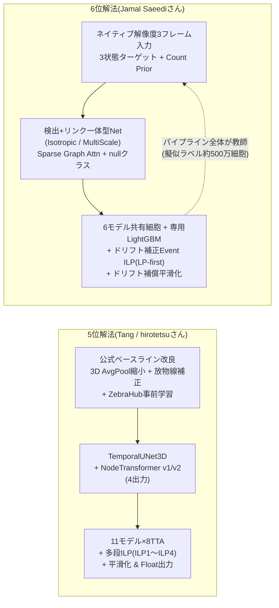
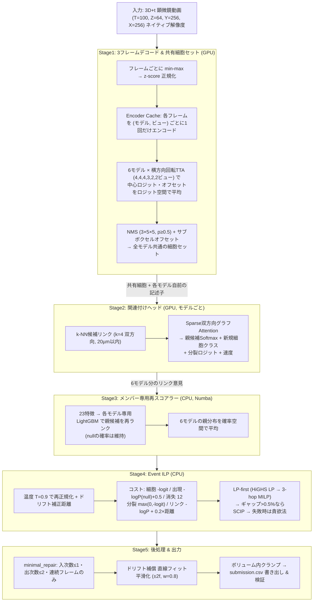
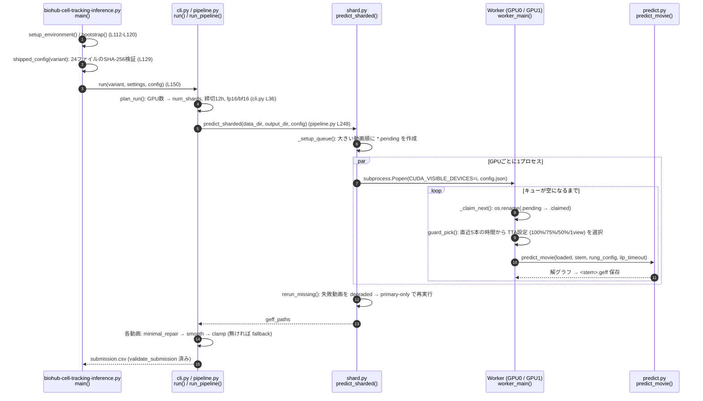
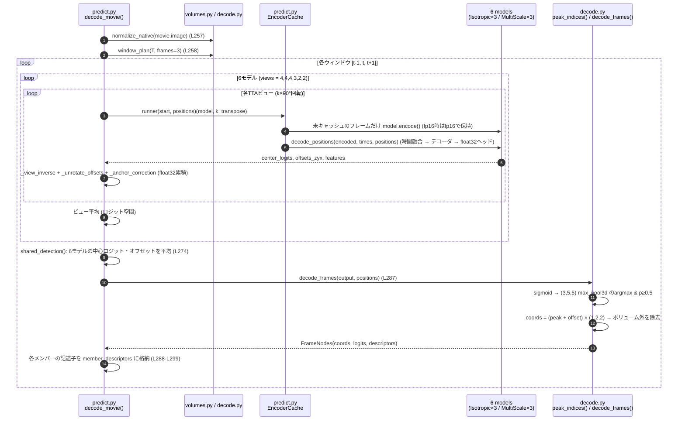
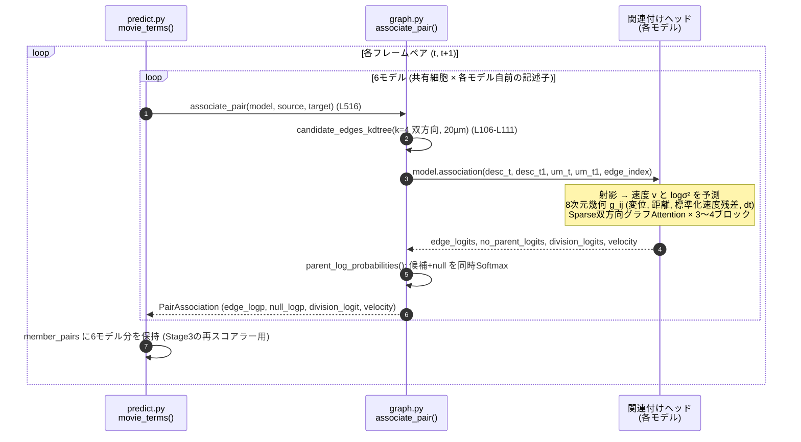
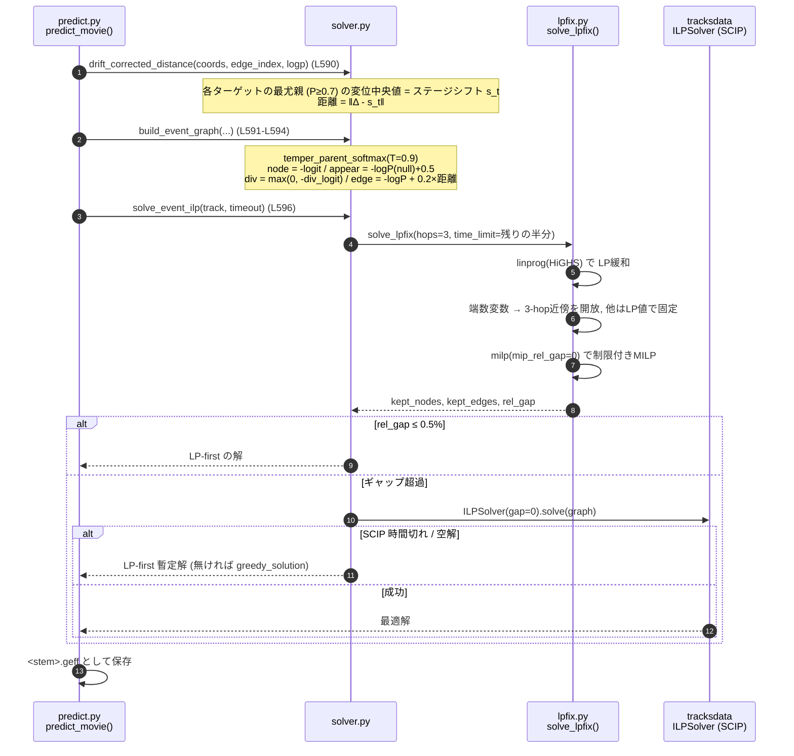
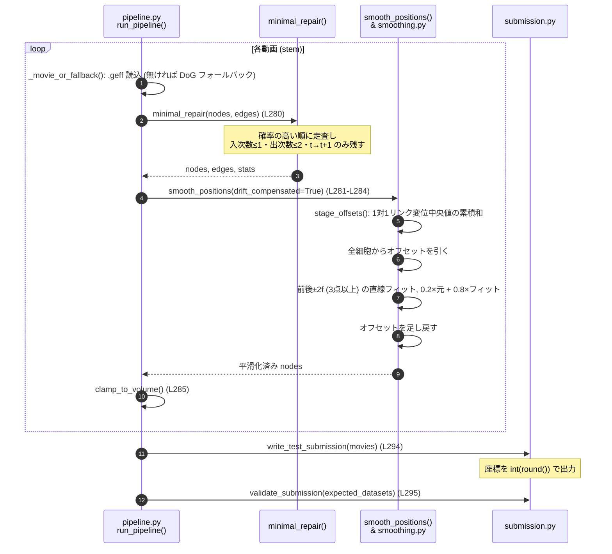
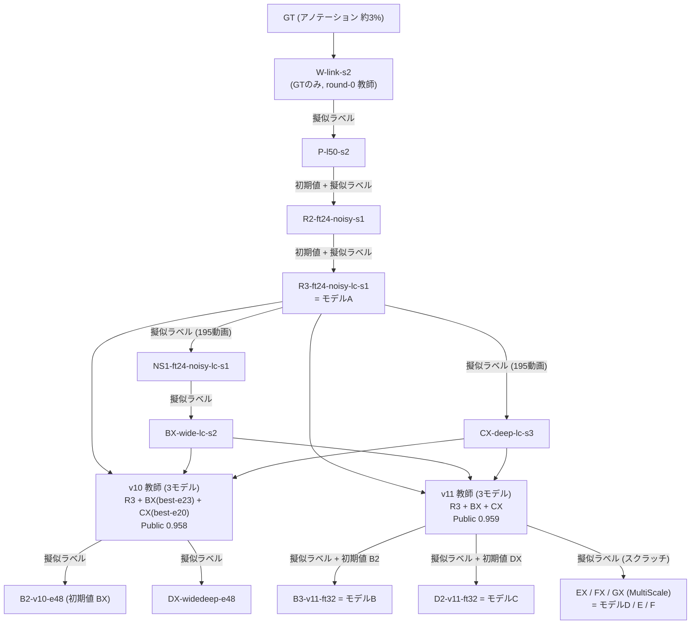
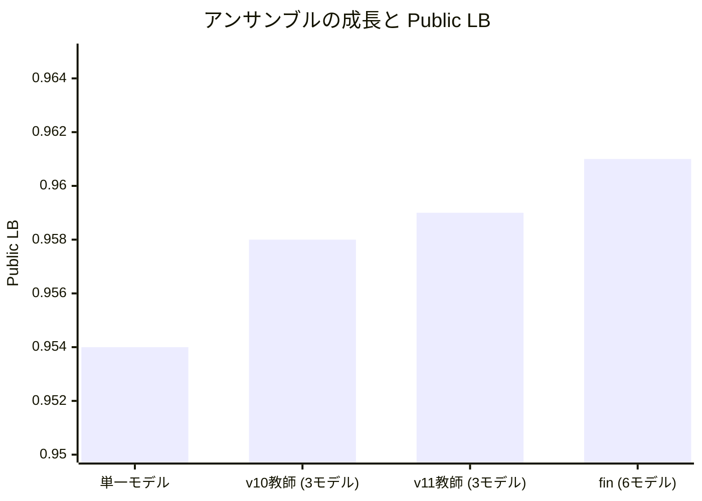

18-⑤Kaggle実践3 Biohub細胞トラッキング 6位解法のまとめ


## Abstract
- biohub 6位解法(Jamal Saeediさん/jamalsaeedi Public 0.961 / Private 0.953)のまとめ
  - **1つのネットワークで「細胞検出」と「リンク(親子付け)」を同時に実施**、その確率をそのまま大域的ILPのコストとして使い、さらに **パイプライン全体を「教師」にして擬似ラベルを作り、次のモデルを学習する(Teacher → Student)** を何周も回した解法。
  - 正解ラベルが細胞全体の **約3%** しかない問題に対し、**3状態ターゲット(正例/検証済み背景/未知)+ Count Prior(細胞数事前分布)** で検出器を学習し、**ILPトポロジー由来の約500万細胞・490万リンクの擬似ラベル** で残り97%を埋めた。
  - 推論は **2アーキテクチャ×6モデル(IsotropicLineageNet×3 + MultiScaleLineageNet×3)** の中心ヒートマップを平均して **共有細胞セット** を作り、各モデルが自前のリンクヘッド+ **自前のLightGBM再スコアラー(23特徴)** で採点 → 確率平均 → **ドリフト補正距離付き Event ILP(LP-first + SCIP)** → **ドリフト補償直線スムージング** で完結。手作業の修復ヒューリスティックは一切なし。

**用語解説**

- **IsotropicLineageNet / MultiScaleLineageNet(検出+リンク一体型ネットワーク)** ... ネイティブ解像度の3フレーム `(t-1, t, t+1)` を入力に、①細胞中心ヒートマップ、②サブボクセルオフセット、③細胞記述子(Descriptor)用の特徴マップ を出力する3D U-Net風の検出器と、連続2フレームの候補リンクを採点する **関連付けヘッド(Association Head)** を1つのモデルに同居させたネットワーク。MultiScaleはIsotropicの上位版で、時間融合を2スケール化し、学習可能な記述子サンプラーと、グラフ内での速度補正を追加したもの。
- **Transformer** ... ちょくちょく出てくる抽象度の高いキーワードなんですが、要は、繋がり(このコンペだとedge)を計算する数式モデルの総称。複数個のデータのリストを入力 → 全員を総当たりで見比べて(Attention)、『どれとどれが繋がるか』を計算して返すAI関数(数式モデル)の総称。総称なので、具体的なアルゴリズムは別途存在する。6位解法では「総当たり」ではなく **k近傍の候補リンク上だけでAttentionを回すスパース版(Sparse Graph Attention)** を使っています。
- **明示的な「新規細胞(new cell)」クラス(null class)** ... 各細胞 $j$ (フレーム $t+1$)について「親候補 $i_1, i_2, \dots$ のどれが親か」をSoftmaxで出すときに、**「親はいない(新規出現)」という選択肢を1つ追加** して一緒に正規化する仕組み。この確率がよく較正(calibrate)されているため、ILPの「出現コスト」にそのまま使えます。
- **3状態ターゲット(Three-state targets)** ... 検出器の学習で、ボクセルを「①正例(アノテーション中心から3µm以内)」「②検証済み背景(フレーム中央値より暗く、全アノテーションから6µm以上離れている)」「③未知(それ以外)」に分け、③の損失重みを0にする手法。アノテーションされていない97%の細胞を「背景だ」と誤って教えないための工夫です。
- **Count Prior(細胞数事前分布損失)** ... 未知領域には損失がかからないため、放っておくと検出器はそこで撃ちまくる(過検出する)。そこで「クロップ内のヒートマップ総和(≒予測細胞数)」を、主催者公表の動画ごとの推定細胞数 $N_{est}$ をクロップに按分した値に引き寄せる損失。
- **Noisy Student / Teacher → Student(教師→生徒 自己学習)** ... 学習済みモデル(教師)で未ラベルデータに擬似ラベルを付け、ノイズ(データ拡張・Dropout等)を加えた状態で新しいモデル(生徒)を学習させる半教師あり学習。6位解法の特徴は、**教師が「1つのネットワーク」ではなく「アンサンブル+再スコアラー+ILP」のパイプライン全体** である点。
- **メンバー専用エッジ再スコアラー(Member-own re-scorer)** ... 各モデル専用に学習したLightGBM(300本・31葉)で、各細胞の親候補を「確率・順位・マージン・ドリフト補正距離・速度残差・局所密度・競合度」など23特徴から並べ替え直す後段モデル。推論時はLightGBMライブラリを使わず、木をフラット配列化してNumba JITで走らせます。
- **ドリフト補正距離(Drift-corrected distance)** ... 顕微鏡ステージ自体がフレーム間でズレる(中央値1.3µm, 99パーセンタイル7.3µm)ため、「確信度の高いリンク($P \ge 0.7$)の変位の中央値」をフレーム全体のシフトとして差し引いた後の移動距離。ILPのリンクコストに入れて **+0.009**(検証)。
- **LP-first ソルバー(`solve_lpfix`)** ... トラッキングILPのLP緩和は「分裂行以外はネットワーク行列(全単模)」なのでほぼ整数解になる。まずHiGHSでLPを解き、整数になった変数を固定し、端数変数とその **3ホップ近傍** だけを小さなMILPで解く。SCIP単体比 **38〜166倍高速**。LP下界とのギャップが0.5%を超えた時だけSCIPにフォールバックします。
- **Deadline Guard(締切ガード)** ... Kaggleの12時間制限に収めるため、動画を1本処理するたびに直近の処理時間から残り時間を見積もり、「全TTAビュー → 75% → 50% → 1ビュー」の中から間に合う最も豪華な設定を選び直す仕組み。
- **ペナルティ低減Focal損失(Penalty-reduced focal loss)** ... CornerNet/CenterNetで使われる検出損失。正解中心の周囲にガウシアンを置き、負例側に $(1-y)^\beta$ を掛けて「正解の近くの負例」へのペナルティを弱めるもの。
- **アブレーションスタディ** ... AIモデルの検証時に、モデルやシステムの各構成要素を一つずつ除去・変更し、それぞれが全体の性能にどの程度寄与しているかを調べる分析手法です。名称は神経科学における脳の一部を除去して機能を調べる実験に由来しています。
- **BCE** ... Binary Cross-Entropy。BCE損失関数のこと。正式には難解に見える下記数式なんだけど、実はそんな対した意味はない。「Yes(1) か No(0) かの2択クイズ(二値分類)で、モデルの予想確率がどれくらい外れているかを測る損失関数(ペナルティ)」を計算する。6位解法では「細胞分裂するか?」(division head)の学習に使われています。
$$L = -\frac{1}{N} \sum_{i=1}^{N} \left[ y_i \log(\hat{y}_i) + (1 - y_i) \log(1 - \hat{y}_i) \right] \newline y_i:正解ラベル(0 \;or\; 1) \newline \hat{y}_i:モデルが予測した確率(0 < \hat{y}_i < 1)\newline ※通常は最終層に Sigmoid 関数を適用した出力 $$
このままだと難解なままなので、実はしょうもないという説明を。
$$
\text{BCE} = -\left( \underbrace{y \log(p)}_{\text{正解が1のときだけ発動}} + \underbrace{(1 - y)\log(1 - p)}_{\text{正解が0のときだけ発動}} \right)
$$
正解が0($y=0$)の時は、右の項 $(1 - y)\log(1 - p)$ だけ見ればよくて(正解が0なら $0 \times \log(p) = 0$ で消えるから)、<br/>正解が1($y=1$)の時は、左の項 $y \log(p)$ だけ見ればいい(正解が1なら $(1-1) \times \log(1-p) = 0$ で消えるから)。すっきり～。
  - 正解が $y = 0$ の時:
  左項は無視。右項の $- \log(1 - \hat{y})$ だけを考えます。予測 $\hat{y}$ が $0$ に近い(正解)とき、$\log(1) = 0$ となり、損失は $0$ に近くなります。また、予測 $\hat{y}$ が $1$ に近い(大外れ)とき、損失は 無限大 になります。
  - 正解が $y = 1$ の時:
右項は無視。左項の $- \log(\hat{y})$ だけ見る。予測 $\hat{y}$ が $1$ に近い(正解)とき、$\log(1) = 0$ となり、損失は $0$ に近づきます。予測 $\hat{y}$ が $0$ に近い(大外れ)とき、$\log(0)$ はマイナス無限大に向かうため、損失は 無限大(非常に大きなペナルティ) になります。


## 概要
先日、Biohub細胞トラッキングコンペが完了しました。
Private LB 1353位/3800人と大変悔しい結果に終わりましたが、Kaggleの素晴らしいところは、トップ層の解法が公開されることです。
このお宝を徹底的に解析し、確実に自身のスキルへと昇華させるべく、今回はソロ参加で6位(金メダル)に入賞された Jamal Saeedi(jamalsaeedi)さんの解法を深掘りします。

6位解法は **ゼロから自作した「検出+リンク一体型ネットワーク」** を軸に、**「正解ラベルが3%しかない」という問題そのものを、パイプライン全体を教師にした自己学習(Teacher → Student)で正面から解きにいった** 解法です。

コンペの設定をおさらいしておくと、
- **入力**: 発生中の胚の3D タイムラプス動画。1動画100フレーム、1フレーム `64 × 256 × 256` ボクセル、ボクセル間隔は Z=1.625µm / Y=X=0.406µm の異方性(4:1)、1フレームに最大約400細胞。
- **出力**: 全フレームの全細胞中心と、時刻 $t$ の細胞から $t+1$ の後継細胞へのリンク。後継が2つなら「分裂」。
- **評価指標**: 動画ごとのエッジJaccardにノード数ペナルティを掛けたものの重み付き平均+分裂項。

$$J_{adj} = \max\left(0,\; J_{edge} \cdot \left(1 - 0.1\,\frac{N_{pred} - N_{est}}{N_{est}}\right)\right) \qquad$$
$$\text{score} = \overline{J_{adj}} + 0.1 \cdot J_{div}$$

- **最大の難所**: 訓練199動画に13.3万個の細胞アノテーションがあるが、これは **実在する細胞の約3%** に過ぎず(系譜ごと丸ごと付いている)、分裂は全体でたった151個。

参考URL
- 6位解法の解説URL(Writeup)
https://www.kaggle.com/competitions/biohub-cell-tracking-during-development/writeups/6th-place-solution
- 6位解法 推論コード(Kaggle Notebook)
https://www.kaggle.com/code/jamalsaeedi/biohub-cell-tracking-inference
- 6位解法 GitHubリポジトリ
https://github.com/jamal-saeedi/biohub_cell_tracking_kaggle
- 6位解法 学習済みモデル(Kaggle Models, MIT) & コードデータセット
https://www.kaggle.com/models/jamalsaeedi/biohub-cell-tracking
https://www.kaggle.com/datasets/jamalsaeedi/biohub-cell-tracking-kaggle

## biohub 6位解法まとめ

ざっくり
> **6位解法の設計を決めた2つの観察**
> 1. **アノテーションは細胞の約3%しかない** → 画像の大部分は「既知の正例」でも「既知の背景」でもない。普通の密な検出ターゲットで学習すると、検出器は **実在する(が未アノテーションの)細胞を抑制するように学習してしまう**。
> 2. **リンクの誤りの大半は「見た目がそっくりな隣の(未アノテーション)細胞との取り違え(Identity Swap)」**(検証でエッジ誤りの51〜57%)。正解データ(GT)だけではこの誤りは **一切ペナルティを受けない**。また、座標しか見ないリンカーでは見分けられない。
> 
> そこで、
> - **1つのネットワークで検出とリンクを行う**(細胞を見つけた画像特徴から、そのままリンク用の記述子を取り出す)
> - **ネットワークはソルバーがそのまま使える確率を出す**(明示的な「新規細胞」クラス付き)→ 大域的ILPに手作業の修復ルールが不要
> - **パイプライン全体が次のモデルを教える** → 訓練動画上の追跡結果を、誰もアノテーションしていない97%の細胞の擬似ラベルにする

6位解法の特徴は
- **「検出とリンクを1つのネットワーク(Detector + Sparse Association Head)で同時学習」**
- **「3状態ターゲット + Count Prior による3%疎ラベル学習」** と **「パイプライン全体(アンサンブル+再スコアラー+ILP)を教師にしたTeacher → Student反復」**
- **「6モデル共有細胞セット + メンバー専用LightGBM再スコアラー」** と **「ドリフト補正距離付きEvent ILP(LP-first)」**
- **「T4×2で12時間に収めるための徹底した時間設計(fp16・Encoder Cache・2GPUシャーディング・Deadline Guard)」**

です。

### 5位解法と6位解法の比較

どちらも「1つのネットワークで検出とリンク確率を出して、ILPで解く」という同じ系統の解法なので、5位解法と並べると違いが分かりやすくなります。

| 比較項目 | 5位解法 (Tang / hirotetsuさん) | 6位解法 (Jamal Saeediさん) | ポイント |
| :--- | :--- | :--- | :--- |
| **出発点** | コンペ主催者の公開コード(`unet-baseline`)を改良 | 独自実装(`IsotropicLineageNet` / `MultiScaleLineageNet`) | 6位は時間融合・記述子・ヘッドまで全部自作 |
| **入力解像度** | 3D AvgPool `(1,4,4)` で `64×64×64` に縮小 | **ネイティブ解像度** `64×256×256` をそのまま入力(リサンプリング・クロップなし) | 6位はネットワーク内部で「横方向だけ2段縮小 → 等方グリッド → 3D縮小」して異方性を処理 |
| **入力フレーム** | 2フレーム `[t, t+1]` | **3フレーム `[t-1, t, t+1]`** | フレームごとに独立エンコード → 3ウィンドウで再利用 |
| **時間方向の融合** | 同一ボクセル座標での時間Self-Attention | **変位予測付きサンプリング(Motion/Gated Temporal Fusion)** | 動く細胞を「位置合わせしてから」比較する |
| **サブボクセル座標** | 対数放物線フィッティング | **オフセットヘッド(±0.5グリッド)を学習** | Smooth L1で直接学習 |
| **疎ラベル対策** | ZebraHub(密ラベル外部データ)で事前学習 | **3状態ターゲット + Count Prior + パイプライン教師の擬似ラベル(約500万細胞)** | 5位は「外部の密ラベル」、6位は「自前で密ラベルを作る」 |
| **リンカー** | NodeTransformer(全ペア総当たり Self/Cross-Attn) | **k近傍候補グラフ上のスパース双方向グラフAttention** + 速度・不確実性予測 | 6位は候補を `k=4`・`20µm` に絞ってから採点 |
| **リンク出力** | edge / identity / appearance / division の4出力 | **親候補Softmax + 新規細胞(null)クラス** / 分裂ロジット / 娘ペア(学習専用) / 速度 | 6位は「出現」をSoftmaxのnullとして同時に正規化 |
| **リンク後段** | なし(ILPへ直行) | **メンバー専用LightGBM再スコアラー(23特徴)** | Identity Swap対策で +0.004〜0.007/モデル |
| **アンサンブル** | 11モデル × 8方向TTA | **6モデル × 2〜4ビューTTA(計19ビュー)**、細胞セットは共有 | 6位は全6モデルの中心ロジット・オフセットを平均して1つの共有細胞セットを作成 |
| **検出閾値とノードコスト** | 閾値0.60 + ノードコスト $-8(q-0.96)$ | 閾値0.50 + ノードコスト $-\text{logit}$(損益分岐 $p=0.5$) | 6位は「閾値を下げると偽細胞が増えるだけ」と検証済み |
| **ILP** | 多段ILP(ILP1〜ILP4) + LP緩和100-hop厳密MILP | **単発Event ILP** + LP-first(3-hop)→SCIP→貪欲法 | 6位は「全細胞・全出現に値段が付いているので修復不要」 |
| **ドリフト** | 推論時ドリフト補正は採用見送り | **ドリフト補正距離をリンクコストに採用(+0.009)**、平滑化もドリフト補償(+0.005) | 「細胞だけでなくカメラをモデル化する」 |
| **平滑化** | 運動保存直線フィット ±4f, w=0.825, 上限4.5µm | ドリフト補償直線フィット **±2f, w=0.8** | 考え方はほぼ同じ |
| **最終座標** | 小数第3位のfloatで出力 | **整数に丸めて出力**(`submission.py`) | 5位の知見(丸めで -0.0074)からすると伸びしろがあったかも |
| **LB** | Public 0.971 / Private 0.958 | Public 0.961 / Private 0.953 | |



### 「データ・評価指標の観察」からの設計指針7つ

6位解法(Writeupおよびコード内の詳細な設計コメント)では、データの性質と評価指標の挙動を分析し、以下の7つの工夫を実装しています。

| 観点 | 具体的な対応内容 | 対応Stage |
| :--- | :--- | :---: |
| **① アノテーションが3%しかなく、画像の大半は「正例でも背景でもない」**<br>密な検出ターゲットだと未アノテーション細胞を抑制してしまう | **3状態ターゲット + Count Prior**<br>アノテーション中心3µm以内=正例(σ1.5µmガウシアン)、フレーム中央値より暗く全アノテーションから6µm以上=検証済み背景、それ以外=損失0。未知領域での過検出はCount Prior(推定細胞数への引き寄せ)で抑える | 学習 |
| **② GTだけでは「隣の未アノテーション細胞への誤リンク」が罰せられない** | **パイプライン全体を教師にしたTeacher → Student**<br>ILPの解のトポロジー(argmaxより高精度: 0.949 vs 0.885)と生検出座標から擬似ラベルを作り、`L = L_GT + 0.5·L_pseudo` で学習。最初の1周だけで **+0.008**(検証) | 学習 |
| **③ 異方性4:1、Z軸は光の減衰で方向性がある** | **ネットワーク内で異方性を解消 + 横方向のみのD4 TTA/拡張**<br>横方向だけ2段縮小 → 1.625µmの等方グリッド → 3D縮小(3.25µm)。Z反転は学習でも推論でも一切しない | Stage1, 学習 |
| **④ 「新規出現」と「リンク」を別々に予測すると較正がズレる** | **親候補Softmaxに明示的な「新規細胞」クラス**<br>学習時に親の15%を意図的に削除して「新規細胞」ラベルを付け、nullクラスを教える。推論ではこの確率がそのままILPの出現コストに | Stage2, Stage4 |
| **⑤ 誤りの最大要因は隣接細胞とのIdentity Swap(51〜57%)** | **メンバー専用LightGBM再スコアラー**<br>ヘッドが見ていない幾何情報(親側の競合度、局所密度、ドリフト補正後の動き)で親候補を再ランク。nullの確率は変えないので出現コストはそのまま | Stage3 |
| **⑥ 顕微鏡ステージがフレーム間でドリフトし(中央値1.3µm/p99 7.3µm)、Swapはそのフレームに集中** | **「カメラをモデル化」**: ソルバーではドリフト補正距離(+0.009)、平滑化ではドリフト補償(+0.005)、学習では最大6µm/ステップの合成ドリフト拡張 | Stage4, Stage5, 学習 |
| **⑦ Kaggle T4×2・12時間で6モデル×TTAを回す必要がある** | **fp16(T4にネイティブbf16が無い: 3.5倍速)、Encoder Cache(1.4〜1.9倍速)、GPUごとのワーカー+共有キュー、Deadline Guard、多段フォールバック** | Stage0 |

---

## プロジェクト構成

6位解法のリポジトリ(`6thPlaceSolution`)は、Kaggle提出エントリスクリプト(`biohub-cell-tracking-inference.py`)と、`pip install` 可能なパッケージ形式の公式リポジトリ(`biohub_cell_tracking_kaggle/`)、Kaggle Modelsから取得したSHA-256検証済みの重み一式(`models/`)から構成されています。推論コードだけでなく、**学習・擬似ラベル生成・再スコアラー学習まで含めた全学習系譜(レシピ)** が公開されているのが特徴です。

```text
6thPlaceSolution/
├── biohub-cell-tracking-inference.py           # 6位解法 推論エントリスクリプト(Kaggle/ローカル両対応, --variant fin/best)
├── biohub-cell-tracking-inference.ipynb        # 元のKaggle推論ノートブック
├── biohub_cell_tracking_kaggle/                # 6位解法 公式GitHubリポジトリ(パッケージ: biohub_tracking)
│   ├── docs/                                   # SOLUTION.md(Writeup原文), MODEL_SUMMARY.md, figures/
│   ├── recipes/
│   │   ├── train/*.json                        # 全14学習ランのレシピ(W-link-s2 → … → GX-ms-lc-s7)
│   │   └── ensembles/*.json                    # 教師アンサンブル(v10/v11)と提出アンサンブル(fin/best)の定義
│   ├── src/biohub_tracking/
│   │   ├── cli.py                              # biohub-predict: run(), summarize()
│   │   ├── recipe.py                           # VARIANTS(fin/best の6チェックポイント+6再スコアラー, SHA-256)
│   │   ├── settings.py / submission.py         # パス設定 / CSV書き出し・検証
│   │   ├── labels.py                           # biohub-pseudo-labels: 教師パイプラインによる擬似ラベル生成
│   │   ├── ensembles.py                        # アンサンブル仕様(JSON) → IsotropicConfig
│   │   ├── models/
│   │   │   ├── isotropic_lineage.py            # IsotropicLineageNet, MotionTemporalFusion, LineageAssociationHead
│   │   │   └── multiscale_lineage.py           # MultiScaleLineageNet, GatedTemporalFusion, LearnedDescriptorSampler, RefiningAssociationHead
│   │   ├── isotropic/                          # 推論エンジン
│   │   │   ├── config.py                       # IsotropicConfig(提出レシピのデフォルト値)
│   │   │   ├── pipeline.py                     # run_pipeline(), minimal_repair(), smooth_positions()
│   │   │   ├── shard.py                        # マルチGPUワーカー, 共有キュー, Deadline Guard
│   │   │   ├── predict.py                      # TTA, EncoderCache, decode_movie(), predict_movie(), 再スコア融合
│   │   │   ├── decode.py / volumes.py          # ウィンドウ計画, NMS, 正規化
│   │   │   ├── graph.py                        # k-NN候補リンク, associate_pair()
│   │   │   ├── edge_rescorer.py                # 23特徴, TreeEnsemble(Numba木探索)
│   │   │   ├── solver.py / lpfix.py            # Event ILP, ドリフト補正距離, LP-first ソルバー
│   │   │   ├── fallback.py                     # モデル無しトラッカー(DoG検出 + 最近傍リンク)
│   │   │   └── kaggle.py / checkpoint.py       # 環境ブートストラップ, 実行計画 / チェックポイント読込
│   │   ├── postprocess/smoothing.py            # 直線フィット平滑化
│   │   └── training/                           # 3状態ターゲット, 損失, データ拡張, 擬似ラベル統合, LightGBM学習
│   └── tools/                                  # download_models.py, smoke_test.py, reproduce_training.sh 等
├── models/
│   ├── mres-fin-444322/1/                      # 最終選択提出(fin): 6モデル + 6再スコアラー
│   └── mres-best-444322/1/                     # 最良検証チェックポイント(best): 6モデル + 6再スコアラー
├── input/test/                                 # 公開テスト用 4動画(*.zarr)
├── working/                                    # predictions/*.geff, submission.csv
├── SETTINGS.json                               # 入出力パス設定
├── verify_local_env.py                         # 環境・GPU・全24ファイルSHA-256・モデルロード・Numba・HiGHS検証
└── README_LOCAL.md                             # ローカル環境構築・実行ガイド
```

### 主要モデル・重み一覧(6モデルアンサンブル + 6再スコアラー)

6位解法は、**2種類のアーキテクチャ・6個のモデル** をアンサンブルします。各モデルは **それぞれ別のランダムな動画分割(train 165本/val 30本)** で学習されており、間違え方がバラバラになるよう設計されています。

| | モデル(run名) | アーキテクチャ | ch / linker幅×層 | パラメータ | 学習の経緯 | TTAビュー |
|---|---|---|---|---:|---|---:|
| **A**(primary) | `R3-ft24-noisy-lc-s1` | Isotropic | 48 / 192×3 | 2.47M | 3周目のTeacher → Student | 4 |
| **B** | `B3-v11-ft32-noisy-lc-s31` | Isotropic(wide) | 64 / 256×3 | 4.38M | アンサンブル教師ラベルで2回ファインチューニング | 4 |
| **C** | `D2-v11-ft32-noisy-lc-s33` | Isotropic(wide+deep) | 64 / 256×4 | 4.78M | v10ラベルで学習、v11でファインチューニング | 4 |
| **D** | `EX-ms-lc-s5` | MultiScale | 64 / 256×4 | 5.68M | アンサンブル教師ラベルでスクラッチ学習 | 3 |
| **E** | `FX-ms-lc-s6` | MultiScale | 64 / 256×4 | 5.68M | 同上 | 2 |
| **F** | `GX-ms-lc-s7` | MultiScale | 64 / 256×4 | 5.68M | 同上(32epoch予定のうち24で停止) | 2 |

- **`fin`(最終選択)**: B〜Eは最終チェックポイント(`last`)。Public 0.961 / **Private 0.953**
- **`best`**: B〜Eは検証損失最良チェックポイント。Public 0.958 / Private 0.955
- AとFは両バリアント共通。再スコアラーは各バリアント専用に6個ずつ(`MRES-FIN-444322-m0..m5` / `MRES-BEST-444322-m0..m5`)。
- 全24ファイル(6チェックポイント+6再スコアラー×2バリアント)は `recipe.py::VARIANTS` (L49-L104) にSHA-256が固定されており、読み込み前に `verify_variant()` (L124-L132) で検証されます。

| コンポーネント | A (Iso, c48, h192, L3) | B (Iso, c64, h256, L3) | C (Iso, c64, h256, L4) | D〜F (MultiScale) |
|---|---:|---:|---:|---:|
| エンコーダ(stem → coarse) | 0.78M | 1.39M | 1.39M | 1.61M |
| 時間融合 | 0.51M | 0.91M | 0.91M | 1.13M(coarse 0.90 + iso 0.23) |
| デコーダ・アダプタ・中心/オフセットヘッド | 0.28M | 0.50M | 0.50M | 0.72M |
| 関連付けヘッド | 0.90M | 1.59M | 1.99M | 2.22M |
| うち娘ペアヘッド(学習専用) | 0.11M | 0.20M | 0.20M | 0.20M |
| **合計** | **2.47M** | **4.38M** | **4.78M** | **5.68M** |

> [!NOTE]
> 1位〜5位の解法と比べると、**1モデルあたり2.5〜5.7Mパラメータと非常に小さい** のが印象的です。その分、TTAとアンサンブル、そして擬似ラベルによる「データ側の強化」で精度を稼いでいます。

---

## 6位解法の全体像

6位解法の推論パイプラインは、大きく分けて以下の6つのStageで構成されています。
- **Stage0**. Main & マルチGPUスケジューリング(GPUごとのワーカー+共有キュー、Deadline Guard、多段フォールバック)
- **Stage1**. ネイティブ解像度3フレームウィンドウのデコード(フレーム正規化、Encoder Cache、6モデル×TTA、**共有細胞セット**の抽出)
- **Stage2**. k-NN候補リンクと、各モデル自前の **関連付けヘッド** による採点(親候補Softmax + 新規細胞クラス、分裂ロジット、速度)
- **Stage3**. **メンバー専用LightGBM再スコアラー** による親候補の再ランクと、6モデルの確率平均
- **Stage4**. **ドリフト補正距離付き Event ILP**(温度付きSoftmax、LP-first → SCIP → 貪欲法)
- **Stage5**. 構造制約の最小修復、**ドリフト補償直線スムージング**、ボリューム内クランプ、CSV書き出しと検証



---

## パイプラインの詳細解説

### ◆Stage0. Main処理(マルチGPUスケジューリング・Deadline Guard・フォールバック)

メイン処理(`biohub-cell-tracking-inference.py`)は非常に薄く、実処理はパッケージ側の `cli.run()` → `pipeline.run_pipeline()` に委譲されています。

1. **環境セットアップと設定(`biohub-cell-tracking-inference.py` L30-L145)**:
   - Kaggle上ではコードデータセット内のwheel(`biohub_tracking-*.whl`)を `pip install --no-index` し、ローカルでは `biohub_cell_tracking_kaggle/src` を `sys.path` に追加します(`setup_environment()`, L30-L72)。
   - `shipped_config(variant)` (`recipe.py` L135-L151) が `IsotropicConfig()` で定義している設定値に従って、「6個のニューラルネット重みファイル(best.pt)」と「各モデル専用の6個のLightGBM再スコアラーファイル(.npz)」のファイルパスを設定して返します。
   - CUDA初期化前に `PYTORCH_CUDA_ALLOC_CONF=expandable_segments:True` を設定し、8〜16GB GPUでの断片化OOMを防いでいます(L19)。
2. **GPUごとに1ワーカー + ファイルシステムの共有キュー (`shard.py` L38-L65, L165-L264)**:
   - 各ワーカーは別プロセス(ノートブックのセルは `spawn` できないため `subprocess.Popen`)で起動され、設定はJSONで受け取ります。
   - キューは `<順位>__<動画名>.pending` という空ファイルの集まりで、ワーカーは `os.rename(... .pending → .claimed)` で1本ずつ動画を取ります。**`os.rename` はアトミック** なので、競合に負けた側は `OSError` になって次を探すだけ。速いGPUが自然に多くの動画を処理します。
3. **Deadline Guard (`shard.py` L68-L131)**:
   - 動画処理を開始時に直近の処理実績から所要時間を予測し、締切に間に合う適切な動画を選び直します(`guard_pick()`, L101-L119)。
   - デコード時間の算出式を自前で定義して、残り時間で収まるように、TTA回数を決定します(`guard_cost_ratio()`, L94-L98)。
   - 後処理・CSV書き出し・失敗動画の再実行用に、最低30分(動画数に応じて増加)を確保しています(`post_reserve_seconds()`, L124-L131)。
4. **「全動画に必ず予測を出す」多段フォールバック (`shard.py` L267-L293, `pipeline.py` L198-L223)**:
   - 失敗した動画は次に軽い設定で再試行 → 1ビュー(`degraded_config`) → primaryモデル単体(`primary_only_config`) → **モデル無しトラッカー**(DoG検出+ドリフト補正最近傍リンク, `fallback.py`) → 最後はプレースホルダ1ノード、と段階的に落とします。
5. **ILPの時間見積モリ (`predict.py` L651-L656)**: 各動画のILPには `0.3 × 残りセッション時間 / 残り動画数`(最低30秒)のタイムアウトが割り当てられます。

#### Stage0. フローチャート

$$\begin{gathered} \boxed{ \begin{aligned} &\textbf{Stage0. Main処理} \\ &\text{\small \texttt{biohub-cell-tracking-inference.py(L75-L170)}, \texttt{cli.py::run(L18-L56)}, \texttt{shard.py::predict\_sharded(L165-L264)}} \end{aligned} } \\
\downarrow \\
\boxed{ \begin{aligned} &\textbf{Stage1. 3フレームデコード \& 共有細胞セット} \\ &\text{\small ・\texttt{predict.py::decode\_movie(L251-L306)}, \texttt{EncoderCache(L196-L238)}, \texttt{\_tta\_forward(L134-L175)}} \\ &\text{\small ・\texttt{decode.py::window\_plan(L44-L60)}, \texttt{peak\_indices(L63-L93)}, \texttt{decode\_frames(L103-L152)}} \end{aligned} } \\
\downarrow \\
\boxed{ \begin{aligned} &\textbf{Stage2. k-NN候補リンク \& 関連付けヘッド} \\ &\text{\small ・\texttt{graph.py::candidate\_edges\_kdtree(L44-L87)}, \texttt{associate\_pair(L90-L140)}} \\ &\text{\small ・\texttt{isotropic\_lineage.py::LineageAssociationHead(L282-L350)}, \texttt{parent\_log\_probabilities(L253-L264)}} \end{aligned} } \\
\downarrow \\
\boxed{ \begin{aligned} &\textbf{Stage3. メンバー専用再スコアラー \& 確率平均} \\ &\text{\small ・\texttt{predict.py::fuse\_member\_rescored(L422-L465)}, \texttt{edge\_rescorer.py::rescore\_edges(L236-L246)}} \end{aligned} } \\
\downarrow \\
\boxed{ \begin{aligned} &\textbf{Stage4. ドリフト補正距離付き Event ILP} \\ &\text{\small ・\texttt{solver.py::build\_event\_graph(L129-L227)}, \texttt{solve\_event\_ilp(L230-L295)}, \texttt{lpfix.py::solve\_lpfix(L43-L133)}} \end{aligned} } \\
\downarrow \\
\boxed{ \begin{aligned} &\textbf{Stage5. 最小修復 \& ドリフト補償平滑化 \& CSV出力} \\ &\text{\small ・\texttt{pipeline.py::run\_pipeline(L275-L296)}, \texttt{minimal\_repair(L59-L98)}, \texttt{smooth\_positions(L140-L162)}} \end{aligned} } \end{gathered}$$

#### Stage0. ソースコード一覧
| ファイルパス | 関数・クラス・定数 | 行番号 | 処理内容 |
| :--- | :--- | :---: | :--- |
| `biohub-cell-tracking-inference.py` | `setup_environment()` | L30-L72 | Kaggleではwheelをオフラインinstall、ローカルでは `src/` を `sys.path` に追加し、`SETTINGS.json` を解決 |
| `biohub-cell-tracking-inference.py` | `main()` | L75-L170 | 引数解析(`--variant fin/best`, `--movies`, `--num-shards`, `--session-hours`)、設定表示、`cli.run()` 実行、集計表示 |
| `recipe.py` | `VARIANTS`, `verify_variant()`, `shipped_config()` | L49-L151 | fin/best の6チェックポイント+各モデル専用の6個LightGBM再スコアラー、検証後に `IsotropicConfig` へ取り付け |
| `isotropic/config.py` | `WindowConfig`, `DetectionConfig`, `CandidateConfig`, `SolverConfig`, `SmoothingConfig`, `IsotropicConfig` | L16-L156 | 閾値0.5、NMS窓(3,5,5)、TTAビュー(4,4,4,3,2,2)、k=4/20µm、ILPコスト、平滑化(w=0.8, ±2)のデフォルト値 |
| `isotropic/kaggle.py` | `bootstrap()`, `plan_run()` | L122-L216 | 環境構築、GPU数に応じたシャード数・12時間セッション締切・autocast dtype(T4はfp16)の決定 |
| `cli.py` | `run()`, `summarize()` | L18-L71 | 実行計画を作り `run_pipeline()` を呼ぶ。動画ごとのノード・エッジ・分裂数を集計 |
| `isotropic/shard.py` | `movie_weight()`, `_setup_queue()`, `_claim_next()` | L38-L65 | 大きい動画順のファイルキュー作成と `os.rename` によるアトミックな動画取得 |
| `isotropic/shard.py` | `guard_ladder()`, `guard_cost_ratio()`, `guard_pick()`, `post_reserve_seconds()` | L76-L131 | Deadline Guard: TTAラダーの構築、コスト推定、締切に間に合う設定の選択、後処理用の予約時間 |
| `isotropic/shard.py` | `predict_sharded()`, `rerun_missing()`, `worker_main()` | L165-L434 | GPUごとのワーカー起動、失敗動画の degraded → primary-only 再実行 |
| `isotropic/fallback.py` | `dog_frame()`, `link_nearest()`, `model_free_movie()`, `placeholder_movie()` | L30-L130 | 最終手段: DoG検出 + ドリフト補正最近傍リンク、それも失敗したら1ノードのプレースホルダ |

#### Stage0. シーケンス図


<br/><br/>

### ◆Stage1. ネイティブ解像度3フレームウィンドウのデコードと共有細胞セット

#### 1-1. 入力正規化とウィンドウ計画 (`volumes.py`, `decode.py`)
* **ネイティブ解像度のまま入力 (`open_native_movie`, `volumes.py` L38-L59)**: 5位解法のような事前の縮小はせず、`(T, 64, 256, 256)` をそのまま読み込みます。
* **フレームごとの正規化 (`normalize_native`, L62-L78)**: 各フレームを、そのフレームの最小値・レンジで `[0, 1]` にスケールしてから、フレーム全体の平均・標準偏差でz-scoreします。
* **ウィンドウ計画 (`window_plan`, `decode.py` L44-L60)**: 各フレーム $t$ は **自フレームが中央に来る3フレームウィンドウ `[t-1, t, t+1]`** からデコードします(先頭・末尾フレームは端の完全ウィンドウを使用)。全フレームがちょうど1回ずつデコードされます。

#### 1-2. 検出器アーキテクチャ (`isotropic_lineage.py`, `multiscale_lineage.py`)

`IsotropicLineageNet` (`isotropic_lineage.py` L366-L454) は、`feature_channels = c` に対して以下のチャネル計画を持ちます。

| 段 | ストライド(元解像度比) | グリッド | 物理間隔 | チャネル |
| :--- | :---: | :---: | :---: | :---: |
| stem | (1,1,1) | 64×256×256 | 1.625 / 0.406µm | 8 |
| fine | (1,2,2) | 64×128×128 | 1.625 / 0.8125µm | c/2 |
| isotropic | (1,4,4) | 64×64×64 | **1.625µm 等方** | c |
| coarse | (2,8,8) | 32×32×32 | 3.25µm 等方 | 2c(+時間融合) |
| decoder → heads | (1,2,2) | 64×128×128 | 検出グリッド | c |

1. **エンコーダ(フレームごと独立, `encode()` L414-L425)**: `Conv3d → GroupNorm → GELU` のブロック(`conv_block`, L20-L37)で、**横方向だけの縮小を2回** して1.625µmの等方グリッドへ、さらに3D縮小で3.25µmの粗いグリッドへ。**フレームを独立にエンコードする** のがミソで、推論時は各フレームを1回だけエンコードして、そのフレームを含む3つのウィンドウで使い回せます。
2. **時間融合 (`MotionTemporalFusion`, L78-L118)**: 粗いグリッド上で、フレーム $t$ の各ボクセルが「隣接フレーム $s$ のどこを見るべきか」の **有意な変位**($2\cdot\tanh(\cdot)$ セル以内)と注意スコアを予測し、隣のフレームの特徴をその位置から `grid_sample` で取ってきて、自分自身と合わせてSoftmax重み付き和をとります。
   $$\mathbf{out}_t = \mathbf{x}_t + W\left(\sum_{s \in \{t, t\pm1\}} a_{t,s}\, \mathbf{x}_s(\mathbf{p} + \mathbf{d}_{t,s})\right)$$
   動く細胞を **位置合わせしてから比較する** ための仕組みで、初期化時は変位ゼロ・一様Attentionになるようゼロ初期化されています。
3. **デコーダとヘッド (`decode_positions()`, L427-L454)**: スキップ接続で `64×128×128` の検出グリッドまで戻し、**中心ロジット**(1ch)と **サブボクセルオフセット**($0.5\tanh(\cdot)$ で±0.5グリッドセル, 3ch)を出力します。bf16だと確率1付近の分解能が粗くなり隣接ピークが同点になるため、**2つのヘッドだけはautocastを切ってfloat32で計算** しています(L444-L449)。
4. **`MultiScaleLineageNet` の追加要素 (`multiscale_lineage.py` L340-L465)**:
   - **`GatedTemporalFusion` (L77-L163)**: 時間融合を粗い(coarse)と等方(isotropic)の **2スケール** で行い、隣接フレームごとに複数(4個/2個)の学習済みサンプル点と、ボクセルごとのゲート $g_t$ を持ちます(初期状態は恒等写像)。
   - **タスク別残差アダプタ (L387-L388)**: 共有デコーダの上に「検出用」と「リンク用」のアダプタを別々に置き、検出とリンクの特徴を分離。
   - 学習時はメモリ節約のため、等方融合とアダプタを `torch.utils.checkpoint` で再計算します(`_recompute`, L462-L465)。

#### 1-3. TTAと Encoder Cache による高速化 (`predict.py`)
* **横方向の回転TTA (`_tta_forward`, L134-L175)**: Z軸は光の減衰で方向性があるため触らず、横方向(Y, X)の $k \times 90°$ 回転(4ビューまでは回転のみ、5〜8ビューは転置も追加するD4群)を使います。モデルごとのビュー数は `(4, 4, 4, 3, 2, 2)` で、**1ウィンドウあたり計19ビュー**。単一モデルで1 → 4ビューにしただけで **+0.05** という大きな効果があったそうです。
* **オフセットの逆変換まで正確に (`_unrotate_offsets` L90-L98, `_anchor_correction` L112-L131)**: 画像を回すと、オフセットベクトルの `(dy, dx)` 成分も回さないといけません。さらに、検出グリッド(ストライド2)とネイティブ解像度で「反転の軸」が半セルずれる問題($\delta = (S - 1 - (G-1)\cdot\text{stride})/\text{stride}$、偶数サイズで半セル)まで補正しています。
* **ロジット空間で平均**: 中心ロジット・オフセット・特徴マップをすべて元の向きに戻してから平均します。記述子は **ビュー平均済みの特徴マップ** からサンプリングするので、リンク側もTTAの恩恵を受けます。半精度で8ビュー加算すると精度が落ちるため、累積はfloat32です(L153-L154)。
* **Encoder Cache (`EncoderCache`, L196-L238)**: 1フレームは最大3つのウィンドウに含まれるので、エンコード結果を `(モデル, 回転k, 転置)` ごとにキャッシュし、各ウィンドウでは **必要なフレーム位置だけデコード**(`decode_positions`)します。以降のウィンドウが読まないフレームは即座に破棄。fp16 autocast時はキャッシュもfp16で保持して16GB GPUに収めます。これで **1.4〜1.9倍** 高速化。
* **fp16 vs bf16 (`inference_autocast_dtype`, L57-L71)**: `"auto"` 設定では、ネイティブbf16対応GPU(Compute Capability 8以上)ならbf16、T4のような非対応GPUならfp16を選びます。T4でbf16をエミュレーションすると **3.5倍遅い** ためです。

#### 1-4. 共有細胞セットの抽出 (`shared_detection`, `peak_indices`, `nodes_from_peaks`)
1. **6モデルの平均 (`shared_detection`, `predict.py` L190-L193)**: 各モデルのTTA平均済み中心ロジットとオフセットを、さらにモデル間で平均します。**これにより全モデルが全く同じ細胞セットを共有** します(`decode_movie` 内で、全メンバーのデコード結果が一致することを `np.array_equal` で検査, L289-L295)。
2. **NMS (`peak_indices`, `decode.py` L63-L93)**: `sigmoid` 後の確率に `(3, 5, 5)` 窓(Z 4.9µm × 横 4.1µm)の `max_pool3d` をかけ、**窓内のargmaxがそのボクセル自身** で、かつ確率が `threshold = 0.5` 以上のものを細胞とします(完全な平坦部でも1個だけ残るように `return_indices` で判定)。
3. **サブボクセル座標と記述子 (`nodes_from_peaks`, `isotropic_lineage.py` L175-L185)**: ネイティブ座標 $= (\text{整数ピーク} + \text{オフセット}) \odot (1, 2, 2)$。半精度では128のインデックスにサブボクセルを足すと丸められてしまうため、ここもfloat32で計算しています。オフセットでボリューム外に押し出された中心は捨てます(`_inside`, `decode.py` L96-L100)。
4. **記述子のサンプリング (`sample_node_features`, L144-L172)**: 連続座標で、特徴マップの **中心値** と **`(3,5,5)` 局所平均** を `grid_sample` で取り出して連結(2C次元)。MultiScaleでは `LearnedDescriptorSampler` (`multiscale_lineage.py` L166-L210)が、中心から±3µm以内の **学習済みオフセット位置** の特徴をAttentionプーリングして追加(3C次元、Deformable Convと同じ発想)。各モデルは **共有細胞の位置で、自分自身の特徴マップから記述子を取る** ので、細胞は共通でもリンク意見はモデルごとに異なります。

> [!NOTE]
> 実装(`shared_detection()`, `predict.py` L190-L193)により、モデルA〜Fの**全6モデルのTTA平均済み中心ロジットとオフセットを等重み(1/6ずつ)で単純平均**して共有細胞セットを抽出しています。

#### Stage1. ソースコード一覧
| ファイルパス | 関数・クラス・定数 | 行番号 | 処理内容 |
| :--- | :--- | :---: | :--- |
| `isotropic/volumes.py` | `open_native_movie()`, `normalize_native()` | L38-L78 | ネイティブ解像度読込(ボクセル間隔チェック付き)と、フレームごとの min-max → z-score 正規化 |
| `isotropic/decode.py` | `window_plan()` | L44-L60 | 各フレームを自分が中央の3フレームウィンドウに割り当て |
| `models/isotropic_lineage.py` | `conv_block`, `ResidualBlock`, `MotionTemporalFusion` | L20-L118 | Conv3d-GroupNorm-GELU、残差ブロック、変位予測付き時間融合 |
| `models/isotropic_lineage.py` | `IsotropicLineageNet` (`encode`, `decode_positions`) | L366-L454 | フレーム独立エンコーダ、時間融合、デコーダ、float32の中心/オフセットヘッド |
| `models/multiscale_lineage.py` | `GatedTemporalFusion`, `MultiScaleLineageNet` | L77-L163, L340-L465 | 2スケール・複数サンプル・ゲート付き時間融合、検出/リンク別アダプタ |
| `isotropic/predict.py` | `inference_autocast_dtype()` | L57-L71 | ネイティブbf16対応ならbf16、T4ならfp16 |
| `isotropic/predict.py` | `_view_forward/_view_inverse`, `_unrotate_offsets`, `_anchor_correction`, `_tta_forward` | L80-L175 | 横方向D4 TTA、オフセットベクトルの逆回転、半セルずれ補正、float32累積でのロジット平均 |
| `isotropic/predict.py` | `EncoderCache` | L196-L238 | (モデル, ビュー)ごとのフレームエンコード結果のキャッシュと、必要位置だけのデコード |
| `isotropic/predict.py` | `shared_detection()`, `decode_movie()` | L190-L306 | 6モデルの中心ロジット・オフセット平均による共有細胞セット、メンバーごとの記述子保持 |
| `isotropic/decode.py` | `peak_indices()`, `decode_frames()` | L63-L152 | (3,5,5)窓のargmax型NMS、閾値0.5、ボリューム外除去 |
| `models/isotropic_lineage.py` | `sample_node_features()`, `nodes_from_peaks()` | L144-L185 | ネイティブ座標の復元と、中心値+局所平均の記述子サンプリング |
| `models/multiscale_lineage.py` | `LearnedDescriptorSampler` | L166-L210 | ±3µm以内の学習済みオフセットでのAttentionプーリング記述子 |

#### Stage1. シーケンス図


---

### ◆Stage2. k-NN候補リンクと関連付けヘッドによる採点

Stage1の共有細胞について、連続するフレームペア $(t, t+1)$ ごとに候補リンクを作り、**各モデルが自分の関連付けヘッドで** 採点します(`predict.py::movie_terms()` L499-L538 → `associate_members()` L361-L380)。

#### 2-1. 候補リンク: 対称k近傍グラフ (`candidate_edges_kdtree`, `graph.py` L44-L87)
* 「フレーム $t+1$ の各細胞から見た $t$ の近傍4個」と「フレーム $t$ の各細胞から見た $t+1$ の近傍4個」の **和集合**(半径20µm以内)を `cKDTree` で作り、重複を除きます(重複があると親の確率質量を二重計上してしまうため)。
* これで **アノテーションされたリンクの約99.4%で、真の親が候補に入る** そうです。
* **確率による枝刈りは一切しません**。Softmaxにすでに「新規細胞」の選択肢があるので、ILPに全候補をそのまま渡します(Writeupでは、確率で枝刈りすると0.48カットで 0.900 → 0.867 と、どのカットでも悪化)。

#### 2-2. 関連付けヘッド (`LineageAssociationHead`, `isotropic_lineage.py` L282-L350)
1. **射影と速度予測**: 記述子を `Linear → LayerNorm → GELU` で `hidden` 次元(Aは192, B〜Fは256)に射影し、各ソース細胞が **速度 $\mathbf{v}_i$(µm/フレーム)と軸ごとの対数分散 $\log\boldsymbol{\sigma}_i^2$** を予測します(`self.motion`)。
2. **8次元のエッジ幾何特徴 (`edge_geometry`, L267-L279)**: 候補リンク $(i, j)$ の変位 $\Delta_{ij} = \mathbf{u}_j - \mathbf{u}_i$ から
   $$\mathbf{g}_{ij} = \left[\frac{\Delta_{ij}}{10},\; \frac{\|\Delta_{ij}\|}{10},\; \frac{\Delta_{ij} - \mathbf{v}_i\,dt}{\boldsymbol{\sigma}_i\,dt + 10^{-3}},\; dt\right]$$
   を作ります。3番目の項は **「予測速度からのズレを、予測した不確実性で標準化したもの」** で、カルマンフィルタのイノベーションに近い発想です。
3. **双方向スパースグラフAttention (`SparseAssociationBlock`, L208-L238)**: 各候補リンクのスコアを `MLP([src_i, tgt_j, g_ij])` で計算し、**ターゲット側でグループ化したSoftmax** と **ソース側でグループ化したSoftmax** の両方(`segment_softmax`, L198-L205)でメッセージを集約して、$t$ と $t+1$ の細胞が互いを更新します。これを3〜4ブロック繰り返します(Trackastraと似ていますが、k-NN候補グラフ上のスパース版で、検出器と同時学習される点が違います)。
4. **出力 (`AssociationOutput`, L241-L250)**:
   - **エッジロジット** $e_{ij}$(候補リンクごと)
   - **親無しロジット** $n_j$(ターゲットごと = 「新規細胞」クラス)
   - **分裂ロジット** $\ell^{div}_i$(ソースごと)
   - **速度** $\mathbf{v}_i$
   - (娘ペアヘッド `score_daughter_pairs` は学習時の補助信号のみで、推論では未使用)
5. **親候補 + nullの同時正規化 (`parent_log_probabilities`, L253-L264)**:
   $$\log P(\text{parent}=i \mid j) = e_{ij} - \log\left(e^{n_j} + \sum_{i' \in \mathcal{C}(j)} e^{e_{i'j}}\right), \qquad \log P(\text{null} \mid j) = n_j - (\text{同じ正規化項})$$
   各ターゲット細胞 $j$ について「候補親のどれか or 新規細胞」の確率がちょうど合計1になります。
6. **`RefiningAssociationHead`(MultiScale用, `multiscale_lineage.py` L213-L328)**: 1ブロック目の後に、各ソースの候補後継への **ソフト割当(暫定スコアのSoftmax)から期待変位** を計算し、速度と不確実性を残差的に更新してから、エッジ幾何を再計算して残りのブロックを通します(ゼロ初期化なので学習開始時は通常ヘッドと同一)。

#### 2-3. 6モデルのリンク意見の統合 (`combine_member_pairs`, `predict.py` L335-L358)
再スコアラーを使わない場合は、6モデルの「親候補+null」分布を **確率空間で平均** します(`logaddexp.reduce - log K`)。分裂ロジットと速度は単純平均。提出レシピでは、この前にStage3の再スコアラーが入ります。

#### Stage2. ソースコード一覧
| ファイルパス | 関数・クラス・定数 | 行番号 | 処理内容 |
| :--- | :--- | :---: | :--- |
| `isotropic/graph.py` | `PairAssociation` | L26-L41 | フレームペアごとのエッジindex、`edge_logp`、`null_logp`、分裂ロジット、距離、速度 |
| `isotropic/graph.py` | `candidate_edges_kdtree()` | L44-L87 | 双方向k=4・20µm以内の対称k近傍候補グラフ(重複除去) |
| `isotropic/graph.py` | `associate_pair()` | L90-L140 | 関連付けヘッドの実行と親候補+nullの対数確率化 |
| `models/isotropic_lineage.py` | `segment_softmax()`, `SparseAssociationBlock` | L198-L238 | 端点ごとのスパースSoftmaxと双方向メッセージパッシング |
| `models/isotropic_lineage.py` | `parent_log_probabilities()`, `edge_geometry()` | L253-L279 | 候補+nullの同時正規化、8次元幾何特徴(不確実性で標準化した速度残差を含む) |
| `models/isotropic_lineage.py` | `LineageAssociationHead` | L282-L350 | 射影・速度/分散予測・グラフAttention・エッジ/null/分裂/娘ペアヘッド |
| `models/multiscale_lineage.py` | `RefiningAssociationHead` | L213-L328 | グラフ内でのソフト割当による速度・不確実性の途中更新 |
| `isotropic/predict.py` | `associate_members()`, `combine_member_pairs()`, `movie_terms()` | L335-L380, L499-L538 | 全モデルでの採点、確率空間平均、動画全体のフラット配列化 |

#### Stage2. シーケンス図


---

### ◆Stage3. メンバー専用LightGBM再スコアラーと確率平均

エッジ誤りの51〜57%を占める **隣接細胞とのIdentity Swap** を減らすため、各モデルの親候補分布を、そのモデル専用の勾配ブースティング木で並べ替え直します(`predict.py::fuse_member_rescored()` L422-L465)。

#### 3-1. 23次元のエッジ特徴 (`edge_features`, `edge_rescorer.py` L31-L103)

| 次元 | 特徴 | 狙い |
|---:|---|---|
| 5 | モデルの対数確率、そのターゲットの候補内での順位、最良ライバルとのマージン、候補数、「新規細胞」の対数確率 | モデル自身の自信度 |
| 2 | 距離(生 / ドリフト補正後) | ステージドリフトの影響を除いた移動量 |
| 4 | Z方向・横方向の変位(生 / フレームのドリフト除去後) | 異方性を考慮した動き |
| 2 | 速度残差(全体 / Z方向) | 予測速度との整合性 |
| 3 | 両細胞の中心ロジット、親の分裂ロジット | 偽細胞・分裂の可能性 |
| 3 | **親側の競合**: 親が他のターゲットへ持つ最良スコア、親を1位に選んでいるターゲット数、親の候補子数 | 「1人の親を2人で取り合っていないか」 |
| 2 | 局所密度(半径10µm以内の細胞数, 両細胞) | 混み合った場所ほどSwapしやすい |
| 2 | 細胞の深さ(Z)、動画内の相対時刻 | 深部は暗くぼやける、発生ステージ |

関連付けヘッドはターゲット側でSoftmaxをとるので、**「親側から見た競合」** は見えていません。再スコアラーはまさにその穴を埋める設計になっています。

#### 3-2. nullの確率を変えずに再ランク (`rescored_logp`, L106-L115)
木の出力(raw margin) $m_e$ を候補内でSoftmaxし、元の「新規細胞」確率 $P_{null}$ はそのまま残します。
$$\log P'(\text{parent}=e) = \log\left(1 - P_{null}(j)\right) + \text{log-softmax}_{e \in \mathcal{C}(j)}(m_e)$$
こうすることで、**ILPの出現コスト(=nullの確率)は再スコアラーの影響を受けません**。

#### 3-3. 学習と推論の工夫 (`training/rescorer.py`, `TreeEnsemble`)
* **学習 (`biohub-train-rescorer`)**: 各メンバーは、**アンサンブルの共有細胞上での、そのメンバー自身のスコア** で検証動画を使って学習します(Writeup本文では「メンバー自身の検証動画」と記載されていますが、再現スクリプト `tools/reproduce_training.sh` L85-L86 では `fin`/`best` ともモデルAの検証分割 `seed=314159` の30動画で一括学習されています)。1行は「アノテーション細胞とその親が、どちらも7µm以内でデコード細胞にマッチした」細胞の親候補1つで、真の親が正例です(`labelled_rows`, L56)。LightGBMは `objective=binary, learning_rate=0.05, num_leaves=31, 300本`(L33-L37)。検証時は動画単位5-foldのout-of-foldで適用し、リークを防いでいます。**1モデルあたり +0.004〜+0.007**(検証)。
* **推論 (`TreeEnsemble`, L118-L198 / `_numba_kernel`, L204-L233)**: LightGBMの `dump_model()` を **フラットなnumpy配列(feature, threshold, left, right, value, roots)** に変換して `.npz` で保存。推論時は **Numbaの `@njit(parallel=True)` で行ごとに木を辿る** だけなので、勾配ブースティングライブラリ不要。Numbaが無ければnumpy版(約20倍遅い)にフォールバックします。
* **6モデル分を確率平均 (`fuse_member_rescored`, `predict.py` L442-L462)**: メンバー $k$ の再スコア済み分布 $P'_k$ と、メンバーの null 分布を、それぞれ確率空間で平均します。
  $$\bar{P}(\text{parent}=e) = \frac{1}{K}\sum_{k=1}^{K} P'_k(\text{parent}=e), \qquad K = 6$$

> [!TIP]
> Writeupによると、**全メンバーの上に1つの再スコアラーを積む(スタッキング)より、メンバーごとに1つずつ持つ方が全提出で良かった**(同じモデルで Public 0.958 vs 0.959)そうです。「各モデルの癖を、そのモデル専用の木で補正してから平均する」方が多様性を保てる、ということですね。

#### Stage3. ソースコード一覧
| ファイルパス | 関数・クラス・定数 | 行番号 | 処理内容 |
| :--- | :--- | :---: | :--- |
| `isotropic/edge_rescorer.py` | `FEATURES`, `edge_features()` | L22-L103 | 23次元特徴(順位・マージン・ドリフト補正距離・速度残差・親側競合・局所密度など) |
| `isotropic/edge_rescorer.py` | `rescored_logp()` | L106-L115 | nullの質量を保ったままの候補内log-softmax |
| `isotropic/edge_rescorer.py` | `TreeEnsemble`, `_numba_kernel()`, `rescore_edges()` | L118-L246 | LightGBMのフラット配列化、Numba並列木探索、再スコアの実行 |
| `isotropic/predict.py` | `member_edge_terms()`, `fuse_member_rescored()` | L410-L465 | メンバーkの自前スコアを再スコアし、6モデルを確率空間で平均 |
| `training/rescorer.py` | `labelled_rows()`, `fit_rescorer()`, `train_rescorers()` | L56-L148 | 7µmマッチングによる学習行の作成、LightGBM(300本・31葉)の学習とエクスポート検証 |

---

### ◆Stage4. ドリフト補正距離付き Event ILP

Stage3までで得られた動画全体の細胞と候補リンクを、`tracksdata` 形式のグラフに変換し、**1回の大域的ILP** で解きます(`predict.py::predict_movie()` L590-L596)。

#### 4-1. 変数と制約(Conservation Tracking型)
各細胞に二値変数 *exists*($x_i$)、*appears*($a_i$)、*disappears*($d_i$)、*divides*($\delta_i$)、各候補リンクに $y_{ij}$ を置きます。流量保存制約は
$$a_j + \sum_i y_{ij} = x_j \qquad d_i + \sum_j y_{ij} = x_i + \delta_i \qquad \delta_i \le x_i$$
(親は1つか無し、子は1つか2つ)です。

#### 4-2. 目的関数のコスト (`build_event_graph`, `solver.py` L129-L227)

$$\min \sum_i c^{node}_i x_i + \sum_i c^{app}_i a_i + \sum_i c^{dis} d_i + \sum_i c^{div}_i \delta_i + \sum_{(i,j)} c^{edge}_{ij} y_{ij}$$

| 項 | コスト | 意味 |
|---|---|---|
| 細胞 $c^{node}_i$ | $-\ell_i$(中心ロジット) | **損益分岐点が $p = 0.5$**。$p > 0.5$ の細胞は採用すると得(負のコスト)。**唯一負になり得る項** で、これが無いと空グラフが最適解になってしまう |
| 出現 $c^{app}_j$ | $-\log P_T(\text{null} \mid j) + 0.5$ | ネットワークの「新規細胞」確率をそのまま使用。先頭フレームの細胞は出現無料 |
| 消失 $c^{dis}$ | $12$ | モデルに消失ヘッドが無いので定数。かなり高く、トラックの途切れを強く嫌う |
| 分裂 $c^{div}_i$ | $\max(0, -\ell^{div}_i)$ | 分裂ロジットが正なら無料、ただし **分裂がソルバーに報酬を与えることはない**(下限0) |
| リンク $c^{edge}_{ij}$ | $-\log P_T(i \mid j) + 0.2 \cdot \tilde{d}_{ij}$ | 再スコア・アンサンブル済みの親確率 + ドリフト補正距離(µm) |

* **温度付き再正規化 (`temper_parent_softmax`, L107-L126)**: $\log P_T = (\log \bar{P}) / T$ を候補+nullで再正規化します($T = 0.9$ で少しだけ尖らせる)。ILPの係数には温度後の値を使い、グラフの `edge_prob` 属性には温度前の確率を残します(擬似ラベルの重みに使うため)。
* **ドリフト補正距離 (`drift_corrected_distance`, L73-L104)**: フレーム $t \to t+1$ について、**各ターゲットの最尤親のうち $P \ge 0.7$ のものの変位の中央値** をステージシフト $\mathbf{s}_t$ とし、各リンクの変位からそれを引いたノルム $\tilde{d}_{ij} = \|\Delta_{ij} - \mathbf{s}_t\|$ をコストにします。解く前のモデル自身の確信リンクだけを使い、GTもソルバーも使いません。**+0.009**(検証)。

> [!IMPORTANT]
> **「全ての細胞と全ての出現に値段が付いている」ので、ILPは中途半端な断片を残さず、修復ヒューリスティックが不要** というのが6位解法の主張です。5位解法がILP1〜ILP4の多段構成でギャップ結合や足場リンクを駆使したのとは対照的に、6位は **「ネットワークの確率を較正しておけば、ILPは1回で十分」** という設計思想です。実際、Writeupでは「ソルバー側でのIdentity Swap対策(Z割引距離、平滑化後の再リンク)は +0.0001 しか効かず、**ソルバーはリンカーに従うだけなので、Swapはネットワークで直すしかない**」と結論付けています。

#### 4-3. LP-first ソルバー (`solve_lpfix`, `lpfix.py` L43-L133)
1. **疎行列で制約を構築 (L74-L86)**: 変数を `[node, appear, disappear, division, edge]` の順に並べ、入流量・出流量の等式制約と、`division ≤ node` の不等式制約を `scipy.sparse` で作ります。**全単模性を壊すのは `division ≤ node` の行だけ** です。
2. **LP緩和 (L88-L94)**: `scipy.optimize.linprog(method="highs")` で連続LPを解きます。ネットワーク行列なのでほぼ整数解。
3. **3-hop近傍だけ開放 (L96-L107)**: `|x - round(x)| > 1e-6` の端数変数から、変数-制約の二部グラフを **3ステップ** 辿った近傍だけを自由変数にし、残りはLPの値に固定。
4. **小さなMILP (L109-L122)**: `scipy.optimize.milp`(HiGHS, `mip_rel_gap=0.0`)で解きます。LPの目的値が下界になるので、相対ギャップ `rel_gap` で最適性を保証できます。

#### 4-4. 必ず実行可能解を返す3段構え (`solve_event_ilp`, `solver.py` L230-L295)
* LP-first の答えがLP下界から **0.5%以内**(`lp_first_gap = 0.005`)ならそれを採用(38〜166倍高速)。
* そうでなければ `tracksdata.solvers.ILPSolver`(SCIP, `gap=0.0`)を実行。ただし残り時間が少なければLP-firstの暫定解を採用し、SCIPが時間切れ・空解ならやはり暫定解に戻します。
* どちらも無ければ、**同じ目的関数の貪欲解**(`greedy_solution`, L306-L345: コストの安い順に、合法かつ目的関数を下げるリンクだけを採用)を返します。

#### Stage4. ソースコード一覧
| ファイルパス | 関数・クラス・定数 | 行番号 | 処理内容 |
| :--- | :--- | :---: | :--- |
| `isotropic/predict.py` | `combine_pair_terms()`, `predict_movie()` | L309-L332, L541-L617 | フレームペアの値を動画全体のフラット配列に展開し、距離計算 → グラフ構築 → ILP求解 |
| `isotropic/solver.py` | `drift_corrected_distance()` | L73-L104 | $P \ge 0.7$ の最尤親の変位中央値をステージシフトとして除いた距離 |
| `isotropic/solver.py` | `temper_parent_softmax()` | L107-L126 | 候補+nullの温度付き再正規化($T=0.9$) |
| `isotropic/solver.py` | `build_event_graph()` | L129-L227 | 細胞・出現・分裂・リンクのコストを持つ `tracksdata.InMemoryGraph` の構築 |
| `isotropic/solver.py` | `solve_event_ilp()`, `_solve_lp_first()`, `_lpfix_graph()` | L230-L295, L348-L418 | LP-first → SCIP → 貪欲法の3段構えと、解のサブグラフ化 |
| `isotropic/solver.py` | `greedy_solution()` | L306-L345 | 同じ目的関数での1パス貪欲解(最終手段) |
| `isotropic/lpfix.py` | `LPFixResult`, `solve_lpfix()` | L21-L133 | HiGHS LP緩和 → 端数変数の3-hop近傍のみの制限付きMILP、LP下界による相対ギャップ |
| `isotropic/config.py` | `SolverConfig` | L57-L87 | 消失12.0、距離重み0.2、温度0.9、出現バイアス0.5、3-hop、ギャップ0.005 |

#### Stage4. シーケンス図


---

### ◆Stage5. 最小修復・ドリフト補償直線スムージング・CSV出力

`pipeline.py::run_pipeline()` (L275-L296)で、各動画の解グラフに最小限の後処理を施してCSVにします。

#### 5-1. 構造制約の最小修復 (`minimal_repair`, `pipeline.py` L59-L98)
提出フォーマットの構造契約(**入次数 ≤ 1、出次数 ≤ 2、全エッジが連続フレーム間、ぶら下がりエッジ無し**)だけを強制し、それ以外は一切変えません。違反があれば **確率の低いエッジから捨てる** よう、確率の降順に走査します。ILPの解は通常この契約を満たしているので、実質的には安全装置です。

#### 5-2. ドリフト補償直線スムージング (`smooth_positions` L140-L162, `linefit_smooth_output_graph` `smoothing.py` L29-L87)
Z軸は1.625µmで量子化されており、位置誤差の大部分を占めるため、トラックに沿って座標を平滑化します。
1. **累積ステージドリフトの除去 (`stage_offsets`, `pipeline.py` L101-L128)**: 解かれた **1対1リンク(分裂エッジ除外)** の変位の中央値をフレームごとのステップとし、その累積和をフレーム $t$ のオフセットとして全細胞から引きます。
2. **前後±2フレームの直線フィット (`_line_intercept`, `smoothing.py` L15-L26)**: 各細胞から、分裂・合流で止まる単一鎖に沿って前後最大2フレーム(最大5点)を集め、**3点以上ある場合のみ** 軸ごとに1次の最小二乗直線を当てはめ、自分の時刻での値を求めます。
   $$\hat{\mathbf{y}}_i = (1 - w)\,\mathbf{y}_i + w \cdot \text{fit}_i(0), \qquad w = 0.8$$
3. **ドリフトを戻す**: 引いたオフセットを足し戻します。素の平滑化に比べて **+0.005**。
4. **ボリューム内クランプ (`clamp_to_volume`, L176-L188)**: 平滑化で鎖の端点がボリューム外に外挿されることがあるので、`[0, dim-1]` にクリップします。

5位解法の「運動保存直線スムージング(±4f, w=0.825, 上限4.5µm)」とほぼ同じ発想ですが、6位はウィンドウが±2と短く、シフト上限はありません。

#### 5-3. CSV出力 (`write_test_submission`, `submission.py` L17-L84)
ノード座標は `max(0, int(round(z)))` のように **整数ボクセルに丸めて** 出力され(L45-L47)、`validate_submission()` (L85-)でフォーマットと全動画の網羅を検証します。

> [!NOTE]
> 5位解法のコードコメントには「Z軸1ボクセル=1.625µmなので、整数に丸めると平滑化で稼いだゲインの一部(-0.0074)を失う」という知見がありました。6位解法は平滑化後に整数丸めをしているので、ここをfloat出力にしていれば、もう少しスコアが伸びた可能性があります(あくまで5位の知見からの推測です)。

#### Stage5. ソースコード一覧
| ファイルパス | 関数・クラス・定数 | 行番号 | 処理内容 |
| :--- | :--- | :---: | :--- |
| `isotropic/pipeline.py` | `graph_to_dicts()` | L31-L56 | `.geff` の解グラフをノード・エッジの辞書に読み込み |
| `isotropic/pipeline.py` | `minimal_repair()` | L59-L98 | 入次数≤1・出次数≤2・連続フレーム・ぶら下がり無しを、低確率エッジから捨てて強制 |
| `isotropic/pipeline.py` | `stage_offsets()`, `_moved()`, `smooth_positions()` | L101-L162 | 1対1リンク変位中央値の累積ドリフトを除去 → 平滑化 → 復元 |
| `postprocess/smoothing.py` | `_line_intercept()`, `linefit_smooth_output_graph()` | L15-L87 | 前後±2フレームの単一鎖に1次最小二乗フィット、`0.2×元 + 0.8×フィット` |
| `isotropic/pipeline.py` | `clamp_to_volume()`, `run_pipeline()` | L176-L304 | ボリューム内クランプ、空動画のフォールバック、CSV書き出しと検証、タイミング集計 |
| `submission.py` | `write_test_submission()`, `validate_submission()` | L17-L130 | 整数丸めでのCSV出力と、フォーマット・動画網羅の検証 |

#### Stage5. シーケンス図



---

## 学習パイプライン: 3%のアノテーションから「Detect, Link, Solve, Repeat」

6位解法の真骨頂は推論よりもむしろ学習側にあります。タイトルの「Repeat」はここを指しています。

### T-1. 3状態の検出ターゲット (`training/targets.py`)

| 状態 | 定義 | 損失重み |
|---|---|---|
| **正例** | アノテーション中心から3µm以内。ターゲットはガウシアン(σ=1.5µm)で、最寄りのグリッドセルは1.0 | フル |
| **検証済み背景** | フレームの中央値より暗く、かつ全アノテーションから6µm以上離れている | フル |
| **未知** | それ以外(未アノテーションの細胞がいる可能性がある領域) | **0** |

* `build_detection_targets()` (L53-L156)は、まず全アノテーション点の周囲6µm(ignore band)の重みを0にクリアしてから、正例ボール(3µm)とガウシアンを書き込みます。最寄りセルにはオフセットのターゲット(セル内の残差)も書き込みます。
* 擬似ラベルの点は別マップ(`pseudo_weight`)に書かれ、**GTや検証済み背景が監督しているボクセルでは擬似ラベルを0** にします(L146)。

### T-2. 損失関数 (`training/losses.py`)

中心とリンクの損失は、GTと擬似ラベルで別々に計算して **$L = L_{GT} + 0.5 \cdot L_{pseudo}$** と合成します。疎なGTが擬似ラベルに埋もれないようにするためです。

| 損失 | 重み | 実装 | 内容 |
|---|---:|---|---|
| ペナルティ低減Focal損失(中心) | 1.0 | `center_focal_loss` L59-L98 | 監督ボクセルのみ。正例と負例を別々に正規化 |
| サブボクセルオフセット | 1.0 | `offset_loss` L101-L110 | Smooth L1(β=0.1セル)、アノテーション細胞のみ |
| 親の交差エントロピー(候補+新規細胞) | 1.0 | `parent_loss` L113-L142 | 親を意図的に削除したターゲットは null が正解 |
| 分裂BCE | 0.5 | `division_loss` L169-L182 | 正例重み20、GTのみ |
| 娘ペアBCE | 0.25 | `daughter_loss` L199-L205 | 学習専用ヘッド |
| 速度ガウスNLL | 0.1 | `velocity_nll` L185-L196 | $\frac{1}{2}\left((v - v_{gt})^2 e^{-\log\sigma^2} + \log\sigma^2\right)$、GTのみ |
| Count Prior | 1.0 | `count_prior_loss` L208-L228 | 予測ヒートマップ総和 ÷ 期待質量 を1に引き寄せる Smooth L1(β=0.2) |

中心のFocal損失は、$p = \sigma(\text{logit})$、ターゲット $y$ に対して($\alpha = 2, \beta = 4$)
$$L_{pos} = -\frac{\sum_{pos} w\,(1-p)^{\alpha}\log p}{\sum_{pos} w}, \qquad L_{neg} = -\frac{\sum_{neg} w\,(1-y)^{\beta} p^{\alpha}\log(1-p)}{\sum_{neg} w}$$
で、$w$ は3状態マスク(未知=0、擬似ラベルは教師の確信度)です。1クロップに正例は数個、検証済み背景は数十万ボクセルあるので、正例と負例を別々に正規化するのが重要です。

Count Priorは、未知領域に損失が無いことの穴埋めです。
$$L_{count} = \text{SmoothL1}\left(\frac{\sum \sigma(\text{logit})}{N_{est} \times \frac{\text{クロップ体積}}{\text{動画体積}} \times \text{ガウス質量}},\; 1\right)$$
これが無いと、検出器は未知領域で撃ちまくるそうです。

* **リンク損失のウォームアップ (`trainer.py` L113-L114, L238-L242)**: スクラッチ学習では、最初の300ステップはリンク関連4損失をオフにし、次の300ステップで線形に立ち上げます。「まだ何も位置を特定できない特徴」でリンカーを学習させないためです。

### T-3. リンクの学習サンプル (`training/candidates.py`, `training/dataset.py`)
* 推論と同じk-NN候補グラフ(k=4双方向, ≤20µm)を使い、k-NNが取りこぼしたGTの親リンクは追加します。
* **ディストラクタ (`_distractor_points`, `dataset.py` L484-)**: アノテーションの無い明るい輝度ピーク(1フレーム最大256個、最後のファインチューニングB・Cでは64個)をノードとして追加します。ソースとしてのディストラクタは **「確実に間違った親」**、ターゲットとしてのディストラクタは親不明(損失なし)として扱います。
* **親の15%を意図的に削除 (`parent_drop_probability = 0.15`, `dataset.py` L79)**: 削除したターゲットには「新規細胞」ラベルを付け、nullクラスを学習させます。
* MultiScaleモデルは、マッチしたアノテーション細胞の75%を **検出器自身の検出位置に置き換えて** リンカーを学習させ、推論時の入力分布に近づけています。

### T-4. サンプリングとデータ拡張 (`training/dataset.py`, `training/augment.py`)
* **サンプル**: 3フレームのフルフレームクロップ(`64×256×256`)。15%は一様ランダムな位置、残りのうち25%は分裂中心、それ以外はアノテーション細胞中心。
* **拡張**:
  - 横方向D4のみ(Zは反転しない)
  - ガンマ補正、ガウシアンノイズ
  - **合成ステージドリフト (`sample_drift` / `apply_drift`, L136-L179)**: フレームを横方向にランダムウォークでずらす(1ステップ最大6µm)
  - **Noisy Studentのノイズ**: ショットノイズ、平均を保つ深さゲイン、ファインチューニング時はチャネルDropout 0.2・Weight Decay 0.01
  - **低コントラストのもや(haze, `degrade_contrast`, L181-)**: 各フレームを、横方向41ボクセル(約17µm)の箱フィルタでぼかした自分自身とランダムなコントラストで合成し、深くてもやのかかった動画を模倣(**+0.005**, 検証)
* **最適化**: AdamW、線形ウォームアップ+コサイン減衰、勾配クリップ1、**EMA(0.999)の重みを推論に使用**、RTX 3090/4090でbf16混合精度。スクラッチは lr 1e-4・32エポック(1エポック2,048クロップ)、ファインチューニングは 3e-5・24〜48エポック。

### T-5. 擬似ラベルと Teacher → Student (`labels.py`, `training/pseudo.py`)

> [!IMPORTANT]
> **教師は1つのネットワークではなく、パイプライン全体**(デコード → リンク → 再スコア → ILP)です。

**擬似ラベルの作り方 (`biohub-pseudo-labels`, `labels.py`)**
1. **教師パイプラインを全訓練動画で実行**(`teacher_labels`, L81-L97): 推論と全く同じ `predict_movie()` を使います。
2. **トポロジーはILPの解から**(`labels_from_graph`, L30-L56): ILPのリンクは、ネットワークの細胞ごとのargmaxよりはるかに正確です(アノテーション系譜上で **0.949 vs 0.885**)。
3. **座標は平滑化前の生検出から**: 平滑化は指標には効くが、点を真の中心から動かしてしまうため。
4. **撮像コホートごとの位置合わせ**(`cohort_offsets`, L59-L78): 教師の細胞は、アノテーターが付けた位置から系統的に少しズレている(Zで最大0.5µm、コホート `44b6`/`6bba` 依存)。検証動画上でハンガリアン法(4µm以内)でマッチングして平均ズレを測り、差し引きます。
5. **教師の確率を保持**: 細胞ごとの中心確率、リンクごとの親確率を、学習時の損失重みに使います。
6. 公開テスト4動画には **決してラベルを付けません**(L131-L134で拒否)。

**学習時のラベル統合 (`merge_pseudo`, `pseudo.py` L72-L152)**
- 同じフレームでアノテーション細胞から4µm以内の擬似細胞は、**そのアノテーション細胞そのもの** とみなす(ハンガリアン法)。
- アノテーションの親・子と矛盾する擬似リンクは捨てる(GTが優先)。
- 確率0.5未満の擬似細胞・擬似リンクは捨てる。
- 分裂・速度・サブボクセルオフセットはGTのみで監督。

最終的なラベルセットは **195動画で約500万細胞・490万リンク、アノテーションの約38倍** になりました。

#### 最終モデルの学習系譜



- 最初の1周(GTのみ → 擬似ラベル学習)が単一で最大の改善で、GTのみのモデルに対して検証 **+0.008**。
- その後、単純な自己蒸留は頭打ちになり、以降の改善は **新しいアーキテクチャ、新しい動画分割、そしてアンサンブル教師** から得られました。
- アンサンブル教師(v10, v11)は「3モデル+メンバー専用再スコアラー」のパイプラインで、それぞれ提出するとPublic 0.958 / 0.959でした。

#### 学習側ソースコード一覧
| ファイルパス | 関数・クラス・定数 | 行番号 | 処理内容 |
| :--- | :--- | :---: | :--- |
| `training/targets.py` | `build_detection_targets()`, `reduce_background()` | L53-L156, L216- | 3状態ターゲット(正例3µm / ignore 6µm / σ1.5µm)、オフセットターゲット、検証済み背景の縮約 |
| `training/losses.py` | `LossWeights`, `center_focal_loss()`, `offset_loss()`, `parent_loss()` | L22-L142 | 損失重み(擬似ラベル0.5、分裂正例重み20)、Focal損失、オフセット、親+nullの交差エントロピー |
| `training/losses.py` | `division_loss()`, `velocity_nll()`, `daughter_loss()`, `count_prior_loss()` | L169-L228 | 分裂BCE、速度ガウスNLL、娘ペアBCE、Count Prior |
| `training/dataset.py` | `DataConfig`, `_node_sets()`, `_distractor_points()` | L54-L91, L357-L400, L484- | ランダムクロップ15%、ディストラクタ、親削除15%、座標ジッター |
| `training/augment.py` | `sample_drift()`, `apply_drift()`, `degrade_contrast()` | L136-L199 | 合成ステージドリフト(≤6µm/ステップ)、低コントラストhaze |
| `training/trainer.py` | `TrainConfig`, `association_scale()`, `Trainer` | L93-L260 | 検出のみ300ステップ → リンク損失300ステップで立ち上げ、EMA |
| `labels.py` | `labels_from_graph()`, `cohort_offsets()`, `teacher_labels()`, `main()` | L30-L157 | 教師パイプラインによるILPトポロジー+生座標の擬似ラベル、コホート別位置合わせ |
| `training/pseudo.py` | `merge_pseudo()` | L72-L152 | 4µmマッチング、GT優先、確率0.5未満の除外 |
| `recipes/train/*.json`, `recipes/ensembles/*.json` | — | — | 全14学習ランと教師/提出アンサンブルのレシピ |

---

## アブレーションスタディと実験の知見

[解説記事](https://www.kaggle.com/competitions/biohub-cell-tracking-during-development/writeups/6th-place-solution)および `docs/SOLUTION.md` に記載されている、各改善要素の効果と重要な知見のまとめです。

### 1. 検証・評価の方法
- **ローカル指標**: 公式指標(動画ごとの重み付け含む)の再実装。Kaggleノートブックが公開テスト4動画で書き出すCSVは、ローカルでも全く同じスコアになることを確認済み。
- **分割**: 各モデルは165動画で学習、自分専用の30動画で検証。公開テスト4動画は全モデルの学習から除外。**モデルAの30検証動画で、アンサンブルを含む全ての変更を順位付け**。
- **チューニング**: モデルや推論の変更ごとに小さなソルバーグリッド(消失・出現バイアス・距離重み・温度・平滑化)を回し、検証動画上の2-fold CVと **動画単位のペアードブートストラップ** で比較。
- 分裂項はローカル値から除外(全コーパスで分裂151個しかなく、変更を順位付けるにはノイズが大きすぎる)。

| 提出 | 検証(adj. J) | 公開テスト4動画 | Public LB | Private LB |
|---|---:|---:|---:|---:|
| `fin`(選択) | 0.940 | 0.928 | 0.961 | **0.953** |
| `best` | 0.939 | 0.933 | 0.958 | 0.955 |

### 2. スコア向上の主要要素 (What mattered)

| 追加・改良した手法 | 対応Stage | 効果 | 技術的ポイント |
| :--- | :---: | :---: | :--- |
| **① TTA 1 → 4ビュー(単一モデル)** | Stage1 | **+0.05**(スコア) | 横方向の90°回転のみ。記述子もビュー平均特徴から取るのでリンクにも効く |
| **② ドリフト補正リンク距離** | Stage4 | **+0.009**(検証) | 確信リンク($P \ge 0.7$)の変位中央値をステージシフトとして除去 |
| **③ 最初の Teacher → Student** | 学習 | **+0.008**(検証) | GTのみモデルに対して。ILPトポロジー+生座標の擬似ラベル |
| **④ メンバー専用エッジ再スコアラー** | Stage3 | **+0.004〜+0.007**/モデル | 23特徴のLightGBM、nullの確率は維持 |
| **⑤ ドリフト補償平滑化(素の平滑化比)** | Stage5 | **+0.005** | 累積ドリフトを引いてから直線フィットし、戻す |
| **⑥ 低コントラストhaze拡張** | 学習 | **+0.005**(検証) | 17µm箱フィルタとのブレンドで深部のもやを模倣 |
| **⑦ 異なる分割・アーキテクチャのアンサンブル** | Stage1〜3 | **Public 0.954 → 0.959**(1 → 3モデル) | 各モデルが独自のランダム動画分割 |
| **⑧ T4でbf16エミュレーションでなくfp16** | Stage0 | **3.5倍高速** | Encoder Cache(1.4〜1.9倍)、2GPUシャーディング、Deadline Guardと合わせて12時間に収める |



### 3. 効かなかったこと (What did not work)

| 試したアイデア | 結果 | 教訓 |
| :--- | :---: | :--- |
| **検証損失でモデルを順位付け** | 損失も細胞Recallも良いモデルが0.878、見劣りするモデルが0.885 | **全モデルをEnd-to-Endのスコアで順位付けする** |
| **Mean Teacherの一貫性学習**(EMA教師・同一ビュー) | −0.001 | オフラインの擬似ラベルで十分 |
| **2モデルの重みスープ** | −0.005(検証, CI [−0.009, −0.001]) | 別分割・別系譜のモデルは重み平均ではなく出力平均で |
| **MultiScaleモデルの細胞をアンサンブルに入れる** | 0.939 vs 0.942(検証) | MultiScaleは細胞を出しすぎる → リンクの意見だけ使う(※Writeup §10の実験記載。最終提出コード `shared_detection` では6モデル全て平均) |
| **全メンバーの上に1つの再スコアラーを積む** | 全提出でメンバーごとより悪い(0.958 vs 0.959 Public) | 再スコアラーもメンバー専用に |
| **ソルバー側のIdentity Swap対策**(Z割引距離、平滑化トラックの再リンク) | +0.0001 | **ソルバーはリンカーに従う。Swapはネットワークで直すしかない** |
| **リンクヘッドの較正**(温度0.5〜2.0、ノード・分裂スケーリング) | 効果なし | 親Softmaxはすでに較正済み(ECE 0.002) |
| **細胞閾値を下げて見逃しを回収** | 生のリンクJaccardが単調に低下 | 増えた細胞は偽物(5位解法とは逆の結論なのが面白い) |
| **確率による候補リンクの枝刈り** | どのカットでも悪化(0.48カットで 0.900 → 0.867) | Softmaxにnullがあるので枝刈り不要 |
| **DoG検出器による細胞の拒否権** | +0.0005(CIが0をまたぐ) | DoGのRecall(2.5µm)は0.64、ネットワークは0.86 |
| **Public スコアで最終提出を選ぶ** | 最高Public 0.96285 → **Private 0.94824** | 選択した提出は Public 0.96185 → **Private 0.95398**。Publicを追いかけない |

> [!WARNING]
> 最後の行が象徴的です。**Publicで一番良かった提出(0.96285)は、Privateでは0.948まで落ちていました**。ローカル検証(モデルAの30動画 + ブートストラップ)を信じて選んだ提出が、Private 0.954で6位に残りました。Public LBが公開テスト4動画分しかないコンペでは、ローカル検証の設計がそのまま順位を決めることがよくわかります。

---

## 1位・2位・3位・4位・5位・6位解法の比較

本コンペの金メダル上位6解法(1位〜6位)のまとめ！6つのアプローチを並べて比較します。

| 項目 | 1位解法(sersasj) | 2位解法(soheilayati) | 3位解法(yu4u / ren4yu) | 4位解法(BarryZhou / songqizhou) | 5位解法(Tang / hirotetsu) | 6位解法(Jamal Saeedi) |
| :--- | :--- | :--- | :--- | :--- | :--- | :--- |
| **Public / Private LB** | **0.976 / 0.977** | **0.974 / 0.970** | **0.978 / 0.969** | **0.969 / 0.962** | **0.971 / 0.958** | **0.961 / 0.953** |
| **基本設計思想** | **ビジュアルトラッキング**<br>細胞の見た目変化・FPN占有マップから直接追跡 | **幾何ヒューリスティクス & 特徴量工学**<br>距離・速度・カルマンフィルタベース | **物理フロー補正 + 数理計画法(LP)**<br>3D Dense Flow + 4段分裂判定 + 整数計画法 | **生物学的観察のモデリング + 個別コストILP**<br>軽量NN + CPU GBDT + ノード別分裂コストILP | **コンペ主催者の公開コードの補足改善 (Single-Backbone E2E)**<br>共有3D U-Net + 4出力Transformer + 多段ILP | **検出+リンク一体型Net + 自己学習**<br>パイプライン全体を教師にしたTeacher → Student + 単発Event ILP |
| **検出器 (Detector)** | 3D U-Net (MAE事前学習 + 3Dベクトルフロー予測) | 3D U-Net (5-foldアンサンブル + 多段コンセンサス) | 2.5D U-Net (EffNetV2-L, B7) + 3D SegResNet (15モデルTRT) | Dual-Encoder 3D Net (現在+前後差分) + Cellpose移流 + PL合意洗練 & DoGルーター | TemporalUNet3D (11モデル×8方向TTA) + 3D AvgPool縮小 + 対数放物線サブボクセル補正 | **ネイティブ解像度3フレーム入力・変位予測付き時間融合**(6モデル×2〜4ビュー) + **3状態ターゲット + Count Prior** |
| **リンク・特徴量抽出** | 視覚特徴からの直接リンク予測 | 幾何距離・カルマンフィルタ速度・近傍特徴 | FlowNet3D変位補正 + 2.5D Siamese EmbedUnet (5-fold) | 幾何・組織フロー残差(26特徴) + Edge Transformer + InfoNCE CNN → LightGBM(47特徴) | U-Netマルチスケール特徴(Trilinear補間) + NodeTransformerV2 (Self+Cross Attn) + 16D Identity | **k-NN候補上のSparse双方向グラフAttention** + 速度・不確実性 + **新規細胞クラス** → **メンバー専用LightGBM(23特徴)** |
| **分裂(Division)の解法** | **Soon Net**<br>分裂前後3クラス分類 + 娘細胞占有マップ | **ペア特徴量 + 分裂スタッキング**<br>距離・形状特徴からGBDT/ペアモデル | **4系統の専門モデル (div3f)**<br>parent / pre / post / native-parent (計40 TRT) | **3段階ハイブリッド ($s_i = \max(\text{pair}, \text{cat})$)**<br>5f CNN + 53特徴CatBoost + 261特徴ペアモデル | **リンカー内蔵の `division_head` (`pos_weight=20`)** | **関連付けヘッド内蔵の分裂ロジット(`pos_weight=20`)** + 娘ペアヘッド(学習専用) → ILPで $\max(0, -\ell^{div})$ |
| **グラフ構築・追跡** | **貪欲法 (Greedy Decode)**<br>対数オッズ比による逐次決定 | **多段制約ソルバー**<br>Stage6リランキング + フォーク投票 | **整数計画法 (Lineage LP / HiGHS)**<br>2段階確率分解($a \times q$) + 反復線形化MILP | **`tracksdata` + `SCIP` 大域的ILP**<br>ノード別分裂コスト($\text{base} - 16s_i$) + 第2娘救済 | **多段ILP (`HighsILPSolver`: ILP1〜ILP4)**<br>検出確信度ノードコスト `-8(q-0.96)` + 足場リンク再結合 | **単発Event ILP (`tracksdata`)**<br>ノード $-\text{logit}$ / 出現 $-\log P(\text{null})$ / ドリフト補正距離、LP-first(3-hop) → SCIP → 貪欲法 |
| **後処理の工夫** | 線形平滑化 + ギャップ補完 + 短トラック除去 | 動的閾値 + カルマン速度ゲーティング | オプティカルフローに基づくアフィン座標微調整 + 3fギャップ補完 | 原画像9f DoGトレース分岐検証(Fork Verifier) + 動き補償直線平滑化 + 疎動画ゲート | 2〜10f空き検出スナップ結合(ILP4) + 運動保存直線平滑化(±4f) + 1f補間 + Float CSV出力 | **修復ヒューリスティック無し**(構造制約の最小修復のみ) + **ドリフト補償直線平滑化(±2f)** |
| **計算資源・高速化** | PyTorchモデルの軽量化 | Python/NumPyの並列化 | TensorRTへの全エンジン化 + エンコーダ特徴量再利用 | 小規模モデル設計(10ep学習) + Zarrチャンクの `blosc2` 直接解凍 + CPU/GPU非同期並列 | LP緩和+100-hop局所厳密MILP + OOM自動チャンク縮小 + 最長動画優先GPU/CPU非同期キュー | **2.5〜5.7Mの小型モデル** + fp16 + Encoder Cache + GPUごとワーカー&ファイルキュー + **Deadline Guard** + 多段フォールバック |

---

### 同じ「材料集め → ジャッジ → 後始末」の中での1位〜6位の違い

| 順位 | ① 材料集め (点・線・分裂) | ② ジャッジ (繋ぎ方の決定) | ③ 後始末 (手直し・検品) | 一言でいうと |
| :---: | :--- | :--- | :--- | :--- |
| **1位** | **超・重厚な3D NN**<br>MAE事前学習3D U-Net + Soon Net(分裂3クラス+娘占有マップ) | **超シンプル(貪欲法: Greedy)**<br>数理計画法(ILP)すら使わず、対数オッズが高い順に上から確定 | 線形平滑化 + ギャップ補間 + 短トラック除去 | **「材料が完璧なら、ジャッジは単純な貪欲法でも勝てる」** 型 |
| **2位** | **5-fold 3D U-Net** +<br>カルマンフィルタ速度・幾何特徴量 + GBDT | **多段階ルール & 制約ソルバー**<br>いきなり一括で決めず、確実なリンクから段階的にジャッジ | フォーク投票 + カルマン速度ゲーティング | **「カルマンフィルタと多段階審査で手堅く固める」** 型 |
| **3位** | **超・重厚なNN大軍団**<br>15個の検出TRT + FlowNet3D + Siamese Net + 40個の分裂TRT | **数理計画法 (Lineage LP/MILP)**<br>動画全体を `HiGHS` ソルバーで大域的に一括ジャッジ | Optical Flowによる座標微調整 + 3fギャップ補間 | **「最強のGPU特徴量 × 数理計画法(LP)の王道フル装備」** 型 |
| **4位** | **軽量NN + 生物学的GBDT**<br>18M 3D Net + 261特徴量の母娘ペアLGB/CatBoost | **数理計画法 (個別コストILP)**<br>`tracksdata` + `SCIP` でノード別コスト($6-16s_i$)一括ジャッジ | 原画像9f再追跡(Fork Verifier) + 動き補償平滑化 + 疎動画ゲート | **「GPU資源の差を、生物学特徴量とILP設計・原画像再検品で埋めた」** 型 |
| **5位** | **単一バックボーン11モデル×8TTA**<br>1つの3D U-Net + 4出力Transformerで検出・リンク・外見・出現・分裂を全出力 | **多段ILP (ILP1〜ILP3)**<br>ノード確信度コスト付きILP + 足場リンク(`scaffold`)を用いた再結合 | **ILP4(2〜10fスナップ結合)** + 運動保存直線平滑化 + **Float出力** | **「公式ベースラインの単一モデル構造を、正攻法で極限まで磨き上げた」** 型 |
| **6位** | **小型の検出+リンク一体型Net×6 + 専用LightGBM**<br>材料そのものを **自分のパイプラインの出力(擬似ラベル)で何周も鍛え直す** | **単発Event ILP**<br>較正済みの確率(新規細胞クラス込み)をそのままコストにして1回で解く | **修復なし**、ドリフト補償平滑化のみ | **「ラベルが3%なら、残り97%は自分で作る。確率を較正すればILPは1回でいい」** 型 |

### 比較すると見えてくる6位解法のユニークな立ち位置

* **「疎ラベル問題」への正面突破**:
  5位解法がZebraHubという **外部の密ラベルデータ** に気づいて事前学習したのに対し、6位解法は **自分のパイプライン(アンサンブル+再スコアラー+ILP)を教師にして、訓練動画の97%の細胞に自前で密ラベルを作る** というアプローチを取りました。しかも擬似ラベルは「ネットワークのargmax」ではなく「ILPの解」から取り(0.949 vs 0.885)、座標は平滑化前の生検出、撮像コホートごとの系統的ズレまで補正する、という細やかさです。
* **「確率の較正」に全振りした結果、ILPが単純になった**:
  明示的な「新規細胞」クラス付きのSoftmax(ECE 0.002)をそのまま出現コストに、中心ロジットをそのまま細胞コストにすることで、**5位のような多段ILPや、4位・1位のようなギャップ補完・修復ルールを一切使わずに** 金メダル圏に到達しています。「ソルバーはリンカーに従う。Swapはネットワークで直すしかない」という割り切りが印象的です。
* **「カメラをモデル化する」視点**:
  ステージドリフトを、学習(合成ドリフト拡張)・再スコアラー(ドリフト補正特徴)・ソルバー(ドリフト補正距離)・平滑化(ドリフト補償)の **4か所で一貫して** 扱っています。5位解法が推論時のドリフト補正をLBで効かずに見送ったのとは対照的です(5位は「テストには6µm超の巨大ドリフトが無い」と判断。6位は中央値1.3µmレベルの小さなドリフトも距離計算から除いている、という違いでしょう)。
* **Kaggle環境での「時間の設計」**:
  T4×2・12時間という制約の中で、fp16選択、Encoder Cache、ファイルキューによる2GPU分散、Deadline Guard、5段階のフォールバックまで作り込み、**「どの動画も必ず何らかの予測を出す」** ことを保証しています。隠しテストは約10時間で完走したそうです。

---

## まとめ

Biohubコンペの6位解法は、**「アノテーションが細胞の3%しかない」という本コンペ最大の難所に対して、検出とリンクを1つの小型ネットワークにまとめ、その確率をそのまま大域的ILPに渡し、さらにパイプライン全体を教師にして次のモデルを鍛える(Detect, Link, Solve, Repeat)ことで、ソロ金メダル(6位)を獲得した、学習設計の教科書のようなソリューション** でした。

特に学びとして持ち帰りたい重要ポイントは以下の5点です:

1. **疎ラベルでは「分からない所は教えない」+「全体量だけ教える」**:
   - 正例・検証済み背景・未知の3状態ターゲットで、未アノテーション細胞を背景として誤学習させない。その代わりにCount Prior(推定細胞数への引き寄せ)で未知領域の過検出を抑える。シンプルですが、疎ラベル検出全般に使える考え方です。
2. **教師は「モデル」ではなく「パイプライン」**:
   - 擬似ラベルのトポロジーはILPの解から、座標は平滑化前の生検出から、確率は損失重みに、GTは常に優先。最初の1周で +0.008。その後はアーキテクチャと分割を変え、アンサンブル教師で上積みしていく、という Noisy Student の実戦的な回し方が学べます。
3. **ソルバーが使える「較正された確率」を出す**:
   - 親候補Softmaxに「新規細胞」クラスを加え、学習時に親の15%を意図的に消して教える。これだけで出現コストが自然に決まり、ILPは1回で済み、修復ルールが不要になる。「後処理で頑張るより、ネットワークの出力の意味を揃える」という設計思想です。
4. **Identity Swapには「別の視点」を足す**:
   - 関連付けヘッドが見ていない「親側の競合」「局所密度」「ドリフト補正後の動き」を23特徴にしたメンバー専用LightGBMで再ランク(+0.004〜0.007/モデル)。nullの確率は触らないので、ILPのコスト体系を壊さない。
5. **ローカル検証を信じ、時間を設計する**:
   - Publicで最良の提出(0.96285)はPrivate 0.948まで落ち、ローカル検証で選んだ提出がPrivate 0.954で残った。また、fp16・Encoder Cache・2GPU分散・Deadline Guard・多段フォールバックで、6モデル×TTAを12時間に確実に収めたこと。

お役に立てれば。
