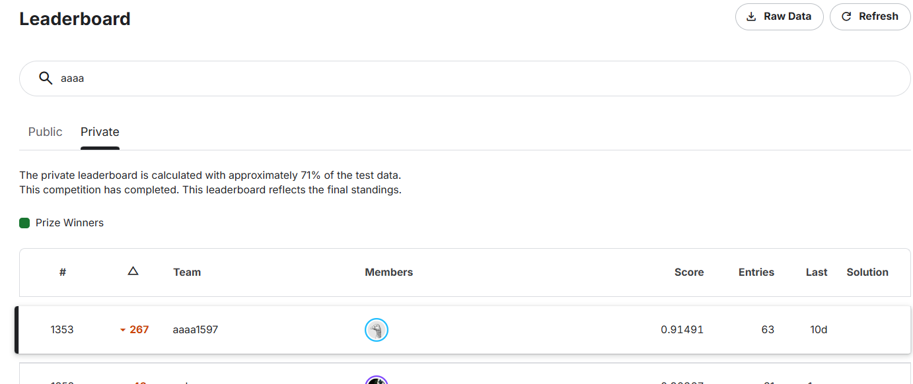
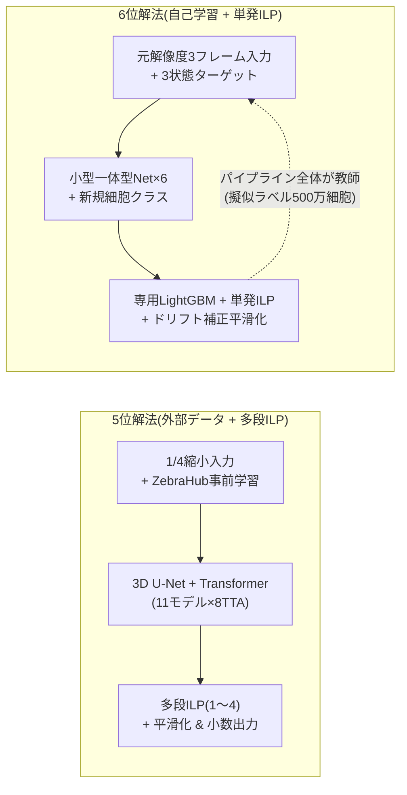
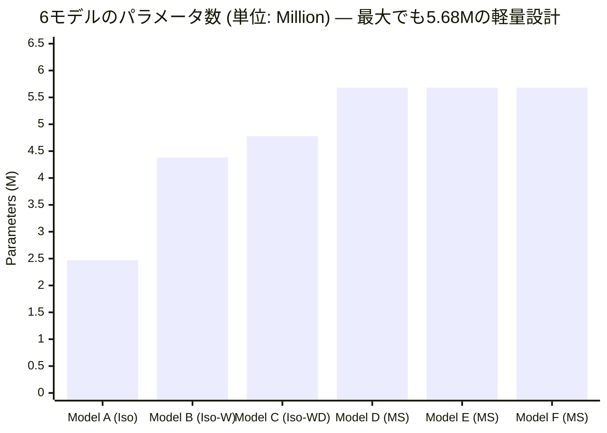
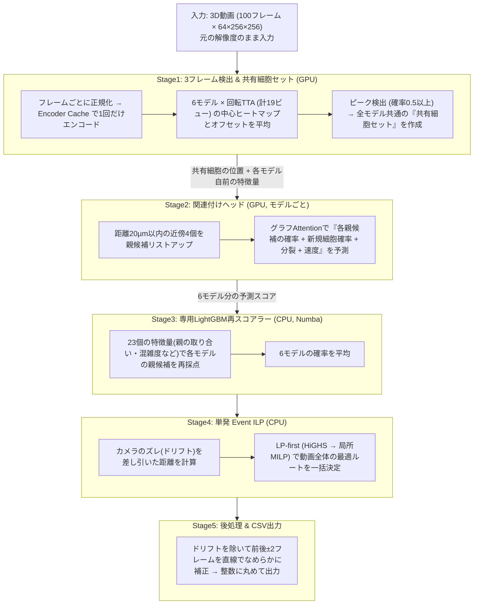
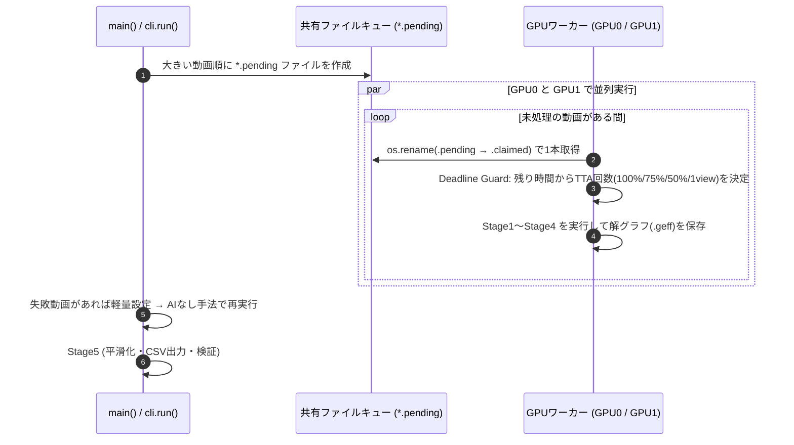
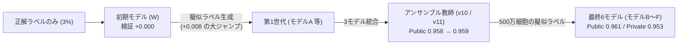
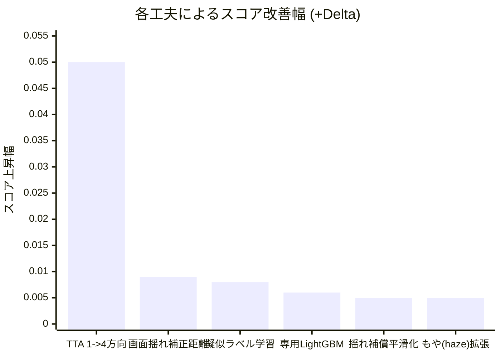
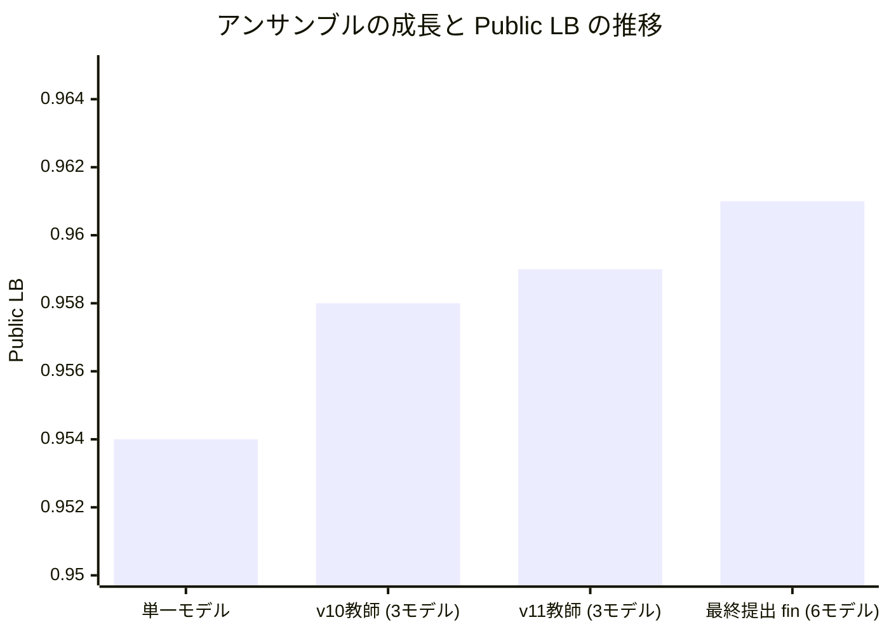

18-⑤Kaggle実践3 Biohub細胞トラッキング 6位解法のまとめ


## Abstract
- biohub 6位解法(Jamal Saeediさん / Public 0.961 / Private 0.953)のまとめ
  - **1つの小型ネットワークで「細胞検出」と「リンク(親子付け)」を同時に予測** し、その確率をそのまま大域的ILP(整数計画法)のコストに使って1回で解く解法。
  - 最大の壁である **「正解ラベルが全体の約3%しかない」** 問題に対し、**パイプライン全体を「教師」にして残り97%の細胞に擬似ラベル(約500万細胞)を付ける自己学習(Teacher → Student)** を何周も回して克服。
  - 推論は **6モデル** で1つの **共有細胞セット** を作り、モデルごとの **専用LightGBM再スコアラー** でリンク確率を補正 → **ステージのズレ(ドリフト)を補正したILP** → **直線スムージング** で完了(手作業の修復ルールは一切なし)。

**用語解説**

- **IsotropicLineageNet / MultiScaleLineageNet** ... 3フレーム `(t-1, t, t+1)` を入力に、「細胞の場所(検出)」と「前後フレームのどの細胞と繋がるか(リンク)」を1つのモデル内で同時に計算する自作ネットワーク。MultiScaleはその上位版。
- **Transformer** ... ちょくちょく出てくる抽象度の高いキーワードなんですが、要は、繋がり(このコンペだとedge)を計算する数式モデルの総称。複数個のデータのリストを入力 → 全員を総当たりで見比べて(Attention)、『どれとどれが繋がるか』を計算して返すAI関数(数式モデル)の総称。6位解法では全員総当たりではなく **近くの候補(k近傍)だけを見比べる軽量版(Sparse Graph Attention)** を使っています。
- **明示的な「新規細胞(new cell)」クラス(null class)** ... 「どの細胞が親か？」の確率を出す際、**「親はいない(新しく現れた細胞)」という選択肢を1つ混ぜておく** 仕組み。そのままILPの「新規出現コスト」として使えます。
- **3状態ターゲット & Count Prior** ... ラベルが3%しかないため、画像を「①確実に細胞」「②確実に背景(暗い場所)」「③不明(未ラベルの細胞がいるかも)」の3つに分け、③ではペナルティを0にする手法。そのままだと③で細胞を検出しすぎるため、「画面内の細胞数の合計」を主催者の推定細胞数に近づける **Count Prior(細胞数制約)** をセットで使います。
- **Teacher → Student(教師→生徒 自己学習)** ... 学習済みモデル(教師)で未ラベルの97%の細胞に仮の正解(擬似ラベル)を付け、それを使って次のモデル(生徒)を鍛える手法。6位解法は **教師に「アンサンブル+LightGBM+ILP」のパイプライン全体** を使うのが特徴。
- **メンバー専用エッジ再スコアラー** ... 一番多いミスである「隣の細胞との取り違え(Identity Swap)」を防ぐため、各モデルの後ろに置いた専用のLightGBM。「親の取り合いになっていないか」「周囲がどれくらい混雑しているか」など23個の特徴で親候補の順位を並べ替えます。
- **ドリフト補正距離** ... 顕微鏡の台(ステージ)自体がフレーム間でガクッと動くことがあるため、「画面全体の細胞の平均移動量」をカメラのズレとして差し引いた後の移動距離。
- **LP-first ソルバー(`solve_lpfix`)** ... 時間の掛かる整数計画法(ILP)をいきなり解かず、まず小数ありの簡単な問題(LP緩和)として解き、小数になってしまった迷い箇所の周辺(3ステップ以内)だけを厳密に解き直すことで **38〜166倍高速化** する手法。
- **Deadline Guard(締切ガード)** ... Kaggleの12時間制限を超えないよう、残り時間と直近の処理速度から「回転させて予測する回数(TTA: 4回→3回→2回→1回)」を自動で減らす安全装置。
- **ペナルティ低減Focal損失** ... 細胞の中心点を当てるための損失関数。正解のど真ん中から少しズレただけの場所にはペナルティを軽く(ガウス分布状に)します。
- **アブレーションスタディ** ... AIモデルの各パーツを1つずつ外したり追加したりして、「どの工夫が何点効いたか」を確かめる実験のこと。

## 概要
先日、Biohub細胞トラッキングコンペが完了しました。
Private LB 1353位/3800人と大変悔しい結果に終わりましたが、Kaggleの素晴らしいところはトップ層の解法が公開されることです。今回はソロ参加で6位(金メダル)に入賞された Jamal Saeediさんの解法を深掘りします。

### コンペの基本設定
| 項目 | 内容 |
| :--- | :--- |
| **入力データ** | 発生中の胚の3Dタイムラプス動画(1動画100フレーム、解像度 `Z=64 × Y=256 × X=256` ボクセル)。<br>Z方向(深さ: 1.625µm)がY・X方向(横: 0.406µm)より4倍粗い。1フレームに最大約400細胞。 |
| **求める出力** | 全フレームの「細胞の中心座標」と、時刻 $t \to t+1$ の「親子リンク」(2つに分かれたら細胞分裂)。 |
| **最大の難所** | 訓練199動画のうち、人間が正解ラベルを付けた細胞は **全体のたった約3%(13.3万個)**、分裂は **151回** しかない。 |

- **評価指標**: リンクの正解率($J_{edge}$)に細胞数のズレのペナルティを掛けたスコア($\overline{J_{adj}}$)と、分裂の正解率($J_{div}$)の合計です。
$$J_{adj} = \max\left(0,\; J_{edge} \cdot \left(1 - 0.1\,\frac{N_{pred} - N_{est}}{N_{est}}\right)\right), \qquad \text{score} = \overline{J_{adj}} + 0.1 \cdot J_{div}$$
  - **凡例**: $J_{edge}$ = リンクの一致率(Jaccard係数)、$N_{pred}$ = 予測した細胞数、$N_{est}$ = 主催者が推定した細胞数、$\overline{J_{adj}}$ = 全動画の重み付き平均、$J_{div}$ = 細胞分裂の一致率。

- **参考URL**:
  - [6位解法 Writeup(解説記事)](https://www.kaggle.com/competitions/biohub-cell-tracking-during-development/writeups/6th-place-solution) / [推論Notebook](https://www.kaggle.com/code/jamalsaeedi/biohub-cell-tracking-inference) / [GitHub](https://github.com/jamal-saeedi/biohub_cell_tracking_kaggle) / [学習済みモデル](https://www.kaggle.com/models/jamalsaeedi/biohub-cell-tracking)

---

## biohub 6位解法まとめ

### 5位解法と6位解法の比較
同じ「単一ネットワーク + ILP」系統である5位解法と比べると、6位解法の個性がよく分かります。

| 比較項目 | 5位解法 (Tang / hirotetsuさん) | 6位解法 (Jamal Saeediさん) | 違いのポイント |
| :--- | :--- | :--- | :--- |
| **ベースコード** | 公式ベースライン(`unet-baseline`)を改良 | 完全自作(`Isotropic` / `MultiScale`) | 6位は1モデル2.5〜5.7Mの超軽量設計 |
| **入力サイズ** | 事前に1/4へ縮小(`64×64×64`)、2フレーム入力 | **元の解像度(`64×256×256`)のまま**、3フレーム入力 | 6位はネット内部で段階的に縮小 |
| **時間方向の結合** | 同じ座標同士でAttention | **細胞の移動先を予測して特徴を拾う(時間融合)** | 動く細胞を「位置合わせ」してから比較 |
| **3%疎ラベル対策** | **外部の密ラベルデータ(ZebraHub)** で事前学習 | **自前のパイプラインで作った擬似ラベル(500万細胞)** | 外部データ活用(5位) vs 自己学習(6位) |
| **リンク後段** | なし(そのままILPへ) | **モデル専用のLightGBM再スコアラー(23特徴)** | 隣の細胞との入れ替わり(Swap)を補正 |
| **アンサンブル** | 11モデル × 8方向TTA | **6モデル × 2〜4方向TTA** (細胞座標は6モデル平均で共有) | 1つの共有細胞セットに6通りのリンク意見 |
| **ILP(整数計画法)** | 4段階の多段ILP(ILP1〜ILP4)で隙間を修復 | **1回だけの単発ILP(LP-firstで高速化)** | 確率に「新規細胞」枠があるため修復不要 |
| **カメラのズレ対策** | 推論時は不使用 | **ILPの距離計算(+0.009)と平滑化(+0.005)の両方で補正** | 顕微鏡ステージの揺れを徹底除去 |
| **スコア(Pub/Priv)** | Public 0.971 / Private 0.958 | Public 0.961 / Private 0.953 | |



### データの観察から生まれた7つの工夫

| 課題・観察 | 6位解法の対策 | 効果・Stage |
| :--- | :--- | :---: |
| **① ラベルが3%しかなく、残りを背景にすると本物の細胞を消してしまう** | **3状態ターゲット(正例 / 暗い背景 / 不明=損失0)** + **Count Prior(総数を推定細胞数へ誘導)** | 学習 |
| **② 未ラベルの隣細胞と取り違えても、正解ラベルだけでは罰せられない** | **パイプライン全体を教師にした自己学習(Teacher → Student)** で全細胞の擬似ラベルを生成 | **+0.008** (学習) |
| **③ 深さ(Z)だけ4倍粗く、深いほど光が減衰して暗い** | 横(Y,X)だけ先に2回縮小して立方体グリッドに揃える。Z方向の反転拡張は一切しない | Stage1 |
| **④ 「新規出現」と「親子リンク」を別々に予測すると確率の基準がズレる** | 親候補のSoftmaxに **「新規細胞(親なし)」枠を追加** し、合計100%になるよう同時計算 | Stage2, 4 |
| **⑤ ミスの51〜57%が「隣の細胞との入れ替わり(Swap)」** | ネットワークが見落とす「親の取り合い・周囲の混雑度」を **専用LightGBM(23特徴)** で再採点 | **+0.004〜0.007** (Stage3) |
| **⑥ 顕微鏡のステージがフレーム間でズレる日にSwapが多発する** | 確信リンクの中央値からカメラのズレを推定し、**ILPの距離計算と平滑化の両方で差し引く** | **+0.014** (Stage4, 5) |
| **⑦ KaggleのT4×2枚・12時間以内に6モデル×TTAを完走させたい** | **fp16化(3.5倍速)** + **エンコード結果の使い回し(1.9倍速)** + **2GPU共有キュー** + **Deadline Guard** | Stage0, 1 |

---

## プロジェクト構成と6つのモデル

```text
6thPlaceSolution/
├── biohub-cell-tracking-inference.py     # 推論エントリスクリプト (--variant fin/best)
├── biohub_cell_tracking_kaggle/          # 公式パッケージ (src/biohub_tracking/)
│   ├── docs/                             # SOLUTION.md (解説原文), MODEL_SUMMARY.md
│   ├── recipes/                          # 全14モデルの学習設定JSONとアンサンブル定義
│   └── src/biohub_tracking/
│       ├── models/                       # IsotropicLineageNet, MultiScaleLineageNet
│       ├── isotropic/                    # 推論パイプライン (decode, graph, edge_rescorer, solver, lpfix, shard)
│       ├── postprocess/smoothing.py      # ドリフト補償直線スムージング
│       └── training/                     # 3状態ターゲット, 損失, 擬似ラベル統合, LightGBM学習
└── models/                               # 学習済み重み (6モデル + 6再スコアラー × 2提出分)
```

### アンサンブルを構成する6モデル
各モデルは **互いに異なるランダムな動画分割(訓練165本 / 検証30本)** で学習されており、似たミスをしないよう多様化されています。1モデルあたり **2.5M〜5.7Mパラメータ** と非常にコンパクトです。

| ID | モデル名 | 種類 | 特徴幅 / リンカー層 | パラメータ数 | 学習の経緯 | TTA回数 |
| :---: | :--- | :--- | :---: | :---: | :--- | :---: |
| **A** | `R3-ft24-noisy-lc-s1` | Isotropic | 48 / 192×3 | **2.47M** | 自己学習(Teacher→Student) 3周目 | 4 |
| **B** | `B3-v11-ft32-noisy-lc-s31` | Isotropic(広) | 64 / 256×3 | **4.38M** | 3モデル教師(v11)の擬似ラベルで微調整 | 4 |
| **C** | `D2-v11-ft32-noisy-lc-s33` | Isotropic(広+深) | 64 / 256×4 | **4.78M** | 3モデル教師(v10→v11)で学習・微調整 | 4 |
| **D** | `EX-ms-lc-s5` | MultiScale | 64 / 256×4 | **5.68M** | 3モデル教師(v11)でゼロから学習 | 3 |
| **E** | `FX-ms-lc-s6` | MultiScale | 64 / 256×4 | **5.68M** | 同上(別シード・別分割) | 2 |
| **F** | `GX-ms-lc-s7` | MultiScale | 64 / 256×4 | **5.68M** | 同上(24エポック時点で停止) | 2 |



---

## 推論パイプラインの全体像 (Stage0〜Stage5)



---

### ◆Stage0. マルチGPU分散・時間管理(Deadline Guard)・5段階フォールバック

Kaggleの「T4 GPU×2枚・制限時間12時間」を確実に使い切り、どんなエラーが起きても絶対に提出を失敗させないための仕組みです。

| 仕組み | 内容 | 該当コード |
| :--- | :--- | :--- |
| **① 2GPUのファイル共有キュー** | 動画ごとに空ファイル(`.pending`)を作り、2つのGPUプロセスが早い者勝ちでリネーム(`.claimed`)して処理。処理が速いGPUが自然に多くの動画を担当する。 | `shard.py` `_claim_next()` |
| **② Deadline Guard (TTAの自動節約)** | 動画を1本終えるたび、直近5本の平均時間から「残り時間で全動画が終わるか」を計算。間に合わなければTTAビュー数を **100%(19view) → 75% → 50% → 1view** へ自動で減らす。 | `shard.py` `guard_pick()` |
| **③ 絶対に落ちない5段階フォールバック** | 万が一エラーや時間切れが起きた動画は、**①少し軽いTTA → ②1ビューのみ → ③モデルA単体 → ④AIなしの古典手法(DoG検出+最近傍リンク) → ⑤ダミー1細胞** の順で必ず出力を作る。 | `shard.py` `rerun_missing()`<br>`fallback.py` |



### ◆Stage1. 3D CNNによる細胞検出と特徴抽出 (`volumes.py`, `decode.py`, `predict.py`)

#### 1-1. 入力とネットワーク構造 (`isotropic_lineage.py`, `multiscale_lineage.py`)
画像を事前に縮小せず、元の解像度 `(64, 256, 256)` のまま `[t-1, t, t+1]` の3フレームを入力します。

| 処理段 | グリッドサイズ | 物理間隔 | 役割 |
| :--- | :---: | :---: | :--- |
| **stem → fine** | `64×256×256` → `64×128×128` | 横方向のみ縮小 | 浅い特徴の抽出 |
| **isotropic** | `64×64×64` | **全軸 1.625µm(等方)** | Z軸とXY軸の解像度を揃える |
| **coarse** | `32×32×32` | 全軸 3.25µm | **時間融合(前後フレームの位置合わせ比較)** |
| **decoder → heads** | `64×128×128` | 検出グリッド | 細胞の中心確率(1ch)と微調整ズレ(3ch)を出力 |

1. **各フレームを独立にエンコード (`encode()`)**:
   最初はフレームごとに別々に処理します。こうすることで、推論時に一度計算した特徴を次のウィンドウでも**キャッシュして使い回せる**(`EncoderCache`、**1.4〜1.9倍高速化**)ようになっています。
2. **時間融合 (`MotionTemporalFusion`)**:
   動く細胞を **位置合わせしてから比較する** ための仕組みです。粗いグリッド(`32×32×32`)上で、フレーム $t$ の各マスが「前後のフレーム $s$ のどこへ動いたか」の予測ズレ $\mathbf{d}_{t,s}$ と重要度 $a_{t,s}$ を予測し、移動先の特徴を取り出してブレンドします。
   $$\mathbf{out}_t = \mathbf{x}_t + W\left(\sum_{s \in \{t, t\pm1\}} a_{t,s}\, \mathbf{x}_s(\mathbf{p} + \mathbf{d}_{t,s})\right)$$
   - **※欄外補足(数学記号と用語の意味)**:
     - $\in$ : 「〜の中に含まれる」「〜という種類のデータに属する」を表す記号(例: $s \in \{t, t\pm1\}$ はプログラムの `for s in [t-1, t, t+1]:` と同じ意味)。
     - $\mathbb{R}^3$ (アール3 / Rの3乗) : $\mathbb{R}$ は実数(小数やマイナスを含む普通の数値、`float`)、右上の $3$ は3次元(3つ組)を表し、「$(z, y, x)$ のように小数3つが並んだ3次元ベクトルデータ」を意味する。同様に $\mathbb{R}^{2c}$ は「数値がチャネル数 $2c$ 個並んだベクトル」を意味する。
     - 特徴量 : ある1座標(= $\mathbf{p}$)の特徴量ベクトルのこと。
     - 特徴マップ : その特徴量が空間全体(`32×32×32`)に並んだ3次元データ全体を指す。
   - **各変数の凡例**:
     - $\mathbf{out}_t$ : 時間融合後の基準フレーム $t$ の出力特徴マップ(空間全体 `32×32×32` マス分のデータ、形状: `B, 2c, 32, 32, 32`)
     - $t$ : 現在着目している基準フレームの時刻インデックス
     - $s \in \{t, t\pm1\}$ : 特徴量を集めてくる参照先フレームの時刻インデックス。前のフレーム($t-1$)、自分自身($t$)、後のフレーム($t+1$)の3枚を走査する。
     - $\mathbf{x}_t$ : 基準フレーム $t$ のエンコーダ(Coarse段)特徴マップ(コード上の `x[:, i]`、形状: `B, 2c, 32, 32, 32`)
     - $\mathbf{x}_s$ : 参照先フレーム $s$ のエンコーダ(Coarse段)特徴マップ(コード上の `x[:, j]`、$s=t$ のときは `x[:, i]`)
     - $\mathbf{p}$ : 元のボクセル空間(`64×256×256`)をエンコーダで縦1/2・横1/8に縮小した後の、**粗いグリッド(`32×32×32` = 元画像の `2×8×8` ボクセル分)での3次元座標 $(z, y, x) \in \mathbb{R}^3$** (`0〜31` のグリッド座標)
     - $\mathbf{d}_{t,s}$ : 粗いグリッド上の座標 $\mathbf{p}$ から見て、「フレーム $s$ のどこへ細胞が移動したか」をモデルが予測した3次元変位オフセットベクトル $(\Delta z, \Delta y, \Delta x) \in \mathbb{R}^3$。粗いグリッドのマス目単位で各軸最大 $\pm 2.0$ マス($\pm 6.5\text{ }\mu\text{m}$)に制限される(自分自身 $s=t$ のときはズレなし $\mathbf{d}_{t,t} = (0, 0, 0)$)
     - $\mathbf{x}_s(\mathbf{p} + \mathbf{d}_{t,s})$ : フレーム $s$ の特徴マップ $\mathbf{x}_s$ の中から、移動先の連続座標 $\mathbf{p} + \mathbf{d}_{t,s}$ の1箇所にある**特徴量**を3次元トリリニア補間(`F.grid_sample`)で抜き出したもの(これを全座標 $\mathbf{p}$ について一括で行うことで、位置合わせ済みの特徴マップが作られる)
     - $a_{t,s}$ : 各マス $\mathbf{p}$ において、3つのフレーム $s \in \{t-1, t, t+1\}$ から抜き出した特徴量をどの割合(重要度)でブレンドするかを表す時間方向のAttention重み(各マスで3フレーム分の合計 $\sum_s a_{t,s} = 1$、範囲は $0 < a_{t,s} < 1$)
     - $W(\cdot)$ : Attention重み付き和でブレンドされた特徴量のチャネル間を混合し、元の特徴空間へ射影する $1 \times 1 \times 1$ の3D畳み込み層(`self.mix = nn.Conv3d(2c, 2c, kernel_size=1)`)
3. **MultiScale版の改良 (`MultiScaleLineageNet`)**:
   時間融合を `coarse` と `isotropic` の**2段階の解像度**で行い、「検出用」と「リンク用」の特徴アダプタを分けて精度を高めています。

#### 1-2. 回転TTAと「共有細胞セット」の抽出 (`shared_detection`, `peak_indices`)
* **横方向の回転TTA**: Z軸(深さ)は触らず、XY平面の90°回転(モデルごとに2〜4方向、計19ビュー)で予測して平均します。1モデルで1→4方向にするだけで **+0.05** スコアが上がります。
* **6モデルで同じ細胞位置を共有 (`shared_detection`)**: 6モデルすべての予測マップを等重み(1/6ずつ)で平均し、3D極大値探索(`max_pool3d` 窓 `3×5×5`、確率0.5以上)で細胞座標を決めます。
* **特徴ベクトルはモデル別**: 検出した「同じ細胞位置」から、6モデルそれぞれが自分の特徴マップの値を抜き出します。これにより**「細胞の場所は全員共通、繋ぎ方の意見はモデルごと」**という綺麗なアンサンブルが実現します。

---

### ◆Stage2. 近傍グラフの作成とリンク確率の採点 (`graph.py`, `isotropic_lineage.py`)

連続する2フレーム $(t, t+1)$ の細胞同士を繋ぐ候補線を引き、各モデルの関連付けヘッド(`LineageAssociationHead`)で採点します。

1. **候補リンクの作成 (`candidate_edges_kdtree`)**:
   半径20µm以内で「$t \to t+1$ の近い順4個」と「$t+1 \to t$ の近い順4個」を合わせたグラフを作ります。これで**正解リンクの99.4%が候補に入ります**。確率による枝刈りはせず、全候補をそのまま残します。
2. **速度予測とグラフAttention (`SparseAssociationBlock`)**:
   各細胞の特徴ベクトルから「予想される移動速度と不確実性」を出し、候補リンクの距離や速度ズレ(8特徴)と一緒にグラフAttentionを3〜4層通して、周囲の細胞と情報をやり取りします。
3. **「新規細胞(親なし)」を含めた確率化 (`parent_log_probabilities`)**:
   時刻 $t+1$ の各細胞について、**「候補の親 $i$ のどれかから来た確率」と「新規に出現した(親なし)確率」の合計がちょうど 1.0 になる**ようにSoftmaxで正規化します。同時に、親側の「分裂しやすさ(分裂ロジット)」も出力します。

---

### ◆Stage3. モデル専用LightGBMによる再採点 (`edge_rescorer.py`)

リンク間違いの半分以上を占める **「隣の細胞との入れ替わり(Identity Swap)」** を防ぐため、各モデル専用のLightGBM(決定木300本)で親候補の順位を並べ替えます(**+0.004〜+0.007**/モデル)。

| 特徴カテゴリ | 主な特徴量(全23次元) | 狙い |
| :--- | :--- | :--- |
| **3D CNNの自信度(5個)** | リンク確率、候補内の順位、2位との差、候補数、新規細胞確率 | 元のモデルの判断を基準にする |
| **動きとカメラ揺れ(8個)** | 距離・Z/XY変位(生 & **画面揺れ補正後**)、予測速度とのズレ | 画面揺れを除いた自然な動きか判定 |
| **親の取り合い・混雑度(5個)** | **同じ親を狙うライバル細胞の数・最高スコア**、半径10µm内の細胞密度 | 「1つの親を2つの子で取り合っていないか」を検出 |
| **細胞状態・位置(5個)** | 親子の中心ロジット、親の分裂スコア、深さZ、動画内の時刻 | 深い場所のボケや分裂タイミングを考慮 |

* **新規細胞の確率は変えない**: LightGBMは「どの親候補が1位か」の内訳だけを並べ替え、「新規細胞(親なし)の確率」はそのまま維持します。
* **6モデルの平均**: 6モデルそれぞれを自分の専用LightGBMで補正した後、6つの確率を平均してStage4へ渡します。

---

### ◆Stage4. 画面揺れ補正と1発の数理計画法 (`solver.py`, `lpfix.py`)

動画全体の「細胞の採用・出現・消失・分裂・リンク」を、**1回の整数線形計画法(Event ILP)** で一気に解きます。

#### 4-1. 画面揺れ(ドリフト)補正距離 (`drift_corrected_distance`)
フレーム間で確率0.7以上の確実なリンクの移動量の中央値を「そのフレームの画面揺れ」とみなし、全リンクの距離から差し引きます。これだけで検証スコアが **+0.009** 上がります。

#### 4-2. コスト設計 (`build_event_graph`)
「コストの合計が最も小さくなる繋ぎ方」を探します。

| 選ぶ対象 | コストの計算式 | 平易な意味 |
| :--- | :--- | :--- |
| **細胞を採用する** | $-\text{logit}$ (中心ロジットのマイナス) | 確率0.5以上の確かな細胞を採用するほど**ご褒美(マイナス)**がもらえる |
| **リンクを繋ぐ** | $-\log P(\text{親}) + 0.2 \times \text{揺れ補正距離}$ | 確率が高く、距離が近いリンクほどコストが安い |
| **途中から新規出現** | $-\log P(\text{新規細胞}) + 0.5$ | AIが「新規細胞だ」と判定した時だけ安く出現できる(先頭フレームは無料) |
| **途中で消える** | $+12.0$ (固定ペナルティ) | 追跡がブツブツ途切れるのを強く防ぐ |
| **分裂する** | $\max(0, -\text{分裂ロジット})$ | AIが「分裂した」と確信している時だけ無料で2つに枝分かれできる |

#### 4-3. 高速な3段構えソルバー (`solve_event_ilp`)
1. **LP-first (`solve_lpfix`)**: まず小数を許す緩和問題(LP)を一瞬で解き、小数になった曖昧な箇所の周囲(3ステップ以内)だけを厳密に整数化します(**38〜166倍高速**)。
2. **SCIP全体求解**: LP-firstの誤差が0.5%を超えた場合のみ、全体厳密ソルバーを動かします。
3. **貪欲法フォールバック**: 時間切れの場合は、コストの安い順に繋ぐ貪欲法で必ず解を返します。

---

### ◆Stage5. 直線スムージングとCSV出力 (`pipeline.py`, `smoothing.py`)

1. **ルール違反の最小チェック (`minimal_repair`)**: 「親は最大1つ、子は最大2つ」のルールに違反する枝があれば、確率の低い方から外します(ILPの解はほぼそのまま通ります)。
2. **画面揺れを除いた直線スムージング (`smooth_positions`)**:
   Z軸の解像度が粗い(1.625µm刻み)ことによるカクつきを滑らかにします。
   - **手順**: ①全体の画面揺れを引く → ②前後±2フレーム(最大5点)に直線を当てはめ、元の位置と直線位置を `2 : 8` でブレンド → ③画面揺れを足し戻す。素の平滑化より **+0.005** 改善します。
3. **CSV出力 (`write_test_submission`)**: 座標を整数ボクセルに丸めて `submission.csv` に書き出します。

---

## 学習パイプライン: 3%の正解から「97%の擬似ラベル」を作る

6位解法の最大の強みは、**「自分の推論パイプライン全体を先生(Teacher)にして、ラベルのない97%の細胞に自動で正解を書き込み、次のモデル(Student)を鍛える」** サイクルにあります。

### 1. 3%の疎ラベルで学習するための3つの工夫 (`targets.py`, `losses.py`)

| 工夫 | 仕組み | 解決する問題 |
| :--- | :--- | :--- |
| **① 3状態マスク** | ・**正解細胞**: ラベルから3µm以内<br>・**確実な背景**: 画面が暗く、ラベルから6µm以上離れた場所<br>・**不明領域(損失ゼロ)**: 残りすべての明るい場所 | ラベルの付いていない本物の細胞(97%)を「背景」として罰してしまうのを防ぐ |
| **② Count Prior損失** | 予測マップの合計値が「その動画の推定細胞数」に近づくように引っ張る損失 | 「不明領域」の罰則をゼロにしたせいで、モデルが不明領域に細胞を乱発するのを抑える |
| **③ 偽物の親混ぜ & 15%親消し** | ・ラベル外の明るい点(最大256個)を「偽の親候補」として混ぜる<br>・正解の親を**15%の確率でわざと消す** | 紛らわしい隣の細胞に飛びつくのを防ぎ、「新規細胞(親なし)」の判定基準を学ばせる |

* **データ拡張 (`augment.py`)**: 人工的な画面揺れ(最大6µm)や、深い場所のボケを再現する「もや(haze)合成」(**+0.005**)を加えて頑健にしています。

### 2. パイプライン全体による擬似ラベル生成 (`labels.py`, `pseudo.py`)

単体モデルの出力ではなく、**「アンサンブル + LightGBM + ILPソルバー」を最後まで通した結果**を次の学習用ラベル(擬似ラベル)にします。
* **繋ぎ方はILPの解を使う**: 単純なモデルの1位予測より、ILPで全体最適化したリンクの方が圧倒的に正確です(精度 **0.949 vs 0.885**)。
* **座標はスムージング前の生座標を使う**: スムージング後の座標を学習させると、細胞の中心がボケてしまうためです。
* **正解ラベル(GT)を最優先**: 正解ラベルと矛盾する擬似ラベルは除外し、損失の重みも `GT : 擬似ラベル = 1.0 : 0.5` にして正解ラベルが埋もれないようにします。

これにより、**195動画で約500万細胞(元の正解ラベルの約38倍)** の密な学習データを構築しました。



---

## アブレーションスタディと実験の知見

### 1. 各工夫によるスコア改善幅 (What mattered)

どの工夫がどれだけスコアを伸ばしたかの比較グラフと一覧表です。





| 順位 | 追加・改良した手法 | 対応箇所 | スコア改善幅 | 要点 |
| :---: | :--- | :---: | :---: | :--- |
| **1** | **回転TTA(1 → 4方向)** | Stage1 | **+0.050** | XY平面の90°回転平均。検出だけでなくリンク特徴も改善 |
| **2** | **画面揺れ(ドリフト)補正距離** | Stage4 | **+0.009** | 確実なリンク($P \ge 0.7$)の中央値シフトを距離から除去 |
| **3** | **パイプライン擬似ラベル学習** | 学習 | **+0.008** | ILPで解いた繋ぎ方 + 生座標で未ラベルの97%を教師化 |
| **4** | **モデル専用LightGBM再採点** | Stage3 | **+0.004〜0.007** | 親の取り合いや混雑度など23特徴で入れ替わりミスを削減 |
| **5** | **画面揺れ補償付き直線平滑化** | Stage5 | **+0.005** | 画面揺れを引いてから前後±2フレームを直線近似 |
| **6** | **低コントラストもや(haze)拡張** | 学習 | **+0.005** | 深い場所のボケた画像を模倣するデータ拡張 |
| **7** | **別分割・別構造の6モデル統合** | 全体 | **0.954 → 0.961** | 学習データの分け方もモデル構造も変えて多様性を確保 |

### 2. 効かなかったこと・重要な教訓 (What did not work)

| 試したこと | 結果 | 得られた教訓 |
| :--- | :---: | :--- |
| **検証データのLoss(損失)でモデルを選ぶ** | 悪化(0.878 vs 0.885) | Lossが良いモデルほど最終スコアが高いとは限らない。**必ず最後までILPを解いた最終スコアで選ぶ** |
| **2つのモデルの重みを平均する(Weight Soup)** | **−0.005** | 学習データの分け方が違うモデルの重みを混ぜると壊れる。予測確率を平均すべき |
| **全モデル共通で1つのLightGBMを使う** | **−0.001** | モデルごとに癖が違うため、**各モデル専用のLightGBM**で直してから平均する方が強い |
| **ILPソルバー側での入れ替わり(Swap)対策** | +0.0001(無意味) | ソルバーはモデルの確率に従うだけ。入れ替わりミスはモデル・再採点側で直すしかない |
| **候補リンクを確率で足切り(枝刈り)する** | **−0.033**(大幅悪化) | すでに「新規細胞」の選択肢があるため、足切りせず全候補をILPに渡す方が良い |
| **Public LBの最高スコアを最終提出に選ぶ** | Public 0.9628 → **Private 0.9482** | 公開テストはたった4動画。**手元の30動画検証を信じて選んだ提出(Private 0.9539)が金メダルを守った** |

---

## 1位〜6位解法の比較

金メダルを獲得した上位6解法のアプローチ比較です。

| 項目 | 1位(sersasj) | 2位(soheilayati) | 3位(yu4u / ren4yu) | 4位(BarryZhou) | 5位(Tang / hirotetsu) | 6位(Jamal Saeedi) |
| :--- | :--- | :--- | :--- | :--- | :--- | :--- |
| **Public / Private** | **0.976 / 0.977** | **0.974 / 0.970** | **0.978 / 0.969** | **0.969 / 0.962** | **0.971 / 0.958** | **0.961 / 0.953** |
| **基本戦略** | **重厚3D NN + 貪欲法**<br>モデルが完璧ならILPすら不要 | **カルマンフィルタ + 多段階審査**<br>幾何特徴と段階的ルールで固める | **総勢55モデルTRT + 数理計画法**<br>最強GPU特徴量×LPの王道装備 | **軽量NN + 生物学GBDT + ILP**<br>261特徴の分裂モデルと原画像再検証 | **公式構造の極限改良 + 多段ILP**<br>外部密データ事前学習 + 4段階ILP | **自己学習(擬似ラベル) + 単発ILP**<br>97%の未ラベルを自前で埋め1発求解 |
| **検出モデル** | 3D U-Net(MAE事前学習 + 3Dフロー) | 3D U-Net(5-fold + 多段合意) | 2.5D U-Net + 3D SegResNet(15 TRT) | Dual 3D Net + Cellpose + DoG | TemporalUNet3D(11モデル×8TTA) | **3D CNN + 位置合わせ時間融合**(6モデル) + **3状態マスク** |
| **リンク採点** | 視覚特徴から直接予測 | 距離・カルマン速度・GBDT | FlowNet3D補正 + Siamese Net | 組織フロー残差 + Edge Transformer + LGB | U-Net特徴 + NodeTransformerV2 | **k-NN双方向グラフAttention** + **専用LightGBM(23特徴)** |
| **繋ぎ方の決定** | **貪欲法(Greedy)** | **多段階制約ソルバー** | **整数計画法(HiGHS)** | **大域的ILP(SCIP)** | **4段階ILP(HiGHS: ILP1〜4)** | **単発Event ILP(LP-first → SCIP)** |
| **後処理** | 平滑化 + ギャップ補間 | カルマン速度ゲート + 投票 | フロー座標微調整 + 3f補間 | 原画像9f再追跡 + 平滑化 | 空き検出スナップ結合 + Float出力 | **修復ルールなし** + **画面揺れ補償平滑化** |

---

## まとめ

Biohub細胞追跡コンペの6位解法は、**「正解ラベルが3%しかない」という最大の壁に対して、外部データに頼らず、自分の推論パイプライン(検出 → リンク → 再採点 → ILP)を先生にして残り97%のラベルを自前で作り出す(Detect, Link, Solve, Repeat)** ことでソロ金メダルを獲得した解法でした。

実践で活かせる重要ポイントは以下の5点です。

1. **疎ラベルでは「分からない場所は罰しない」+「全体の個数だけ縛る」**:
   3状態マスクで未ラベル領域の損失をゼロにしつつ、Count Prior(推定細胞数への引き寄せ)で過剰検出を抑える設計は、ラベルが不完全なあらゆる検出タスクに応用できます。
2. **先生(Teacher)は「単体モデル」ではなく「後処理まで含めたパイプライン全体」**:
   ILPソルバーで全体最適化した繋ぎ方を擬似ラベルに使うことで、単体モデルの予測を使うより圧倒的に高品質な学習データ(約500万細胞)を作れます。
3. **「新規出現」の確率をAIに直接予測させれば、数理計画法(ILP)は1回で済む**:
   学習時に親を15%消して「親なし(新規細胞)」クラスを鍛えることで、複雑な多段ILPやギャップ繋ぎの後処理なしで高い追跡精度を達成しています。
4. **画面全体の揺れ(ドリフト)を全工程で一貫して引き算する**:
   学習時の人工揺れ拡張、LightGBMの特徴量、ILPの距離コスト(+0.009)、最後の直線スムージング(+0.005)の4か所すべてで画面揺れを補正しています。
5. **少数の公開テスト(Public LB)より、手元の検証データと時間管理を信じる**:
   4動画しかないPublic LBの最高スコアを追わず、30動画のローカル検証を信じたことがPrivate 6位につながりました。また、時間監視(Deadline Guard)と5段階の安全網により、12時間制限の中で確実に完走させる設計も見事です。

お役に立てれば。
