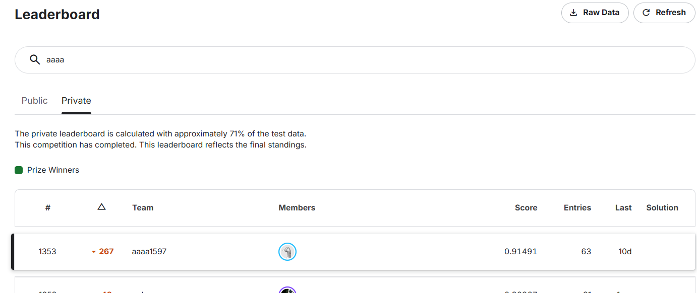
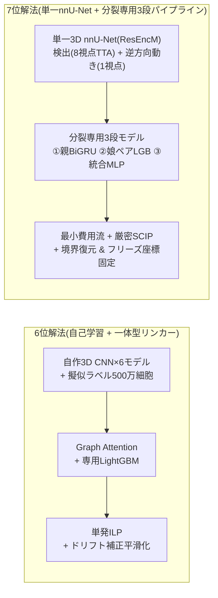
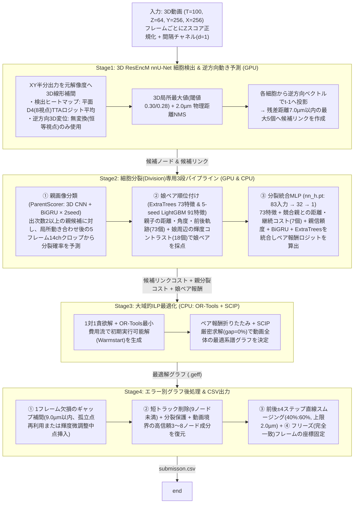
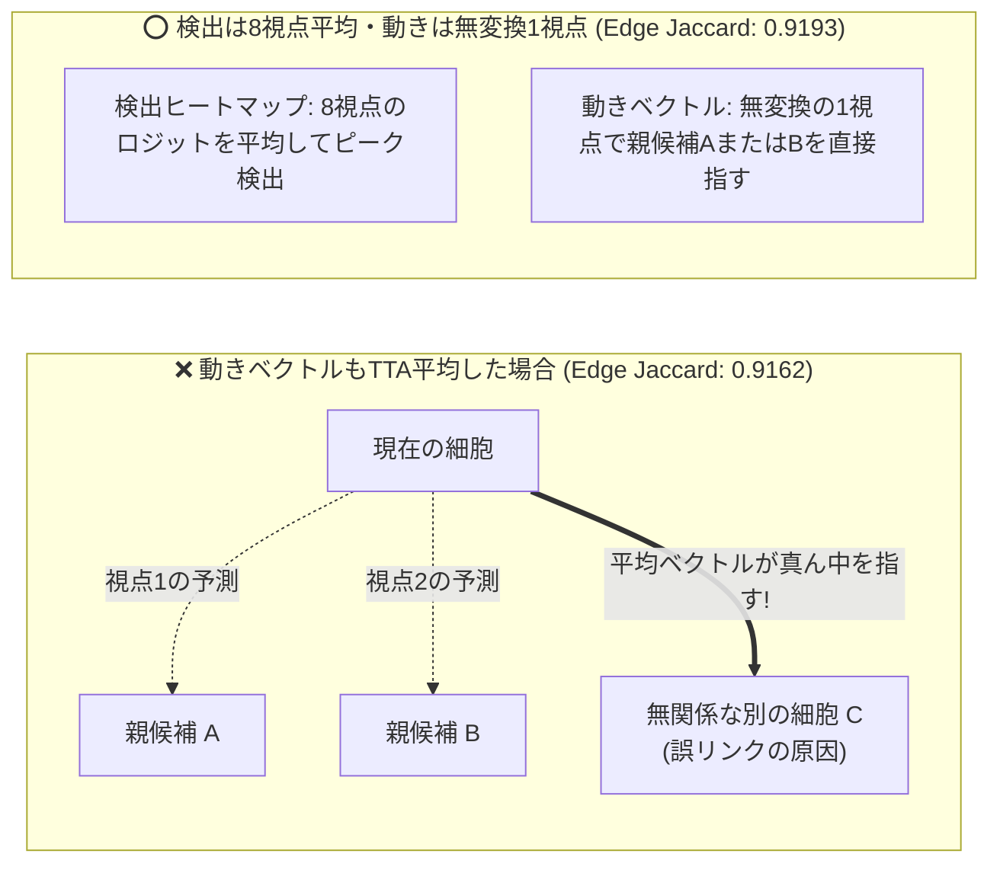
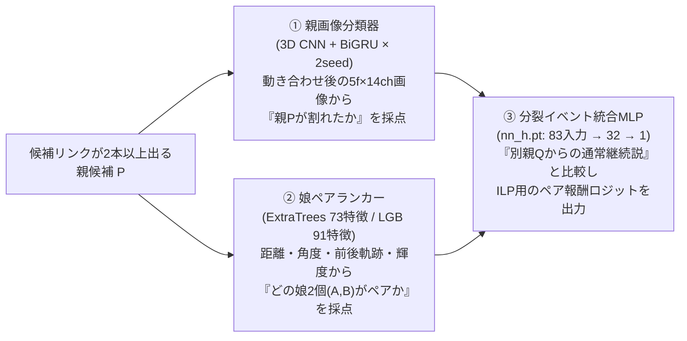
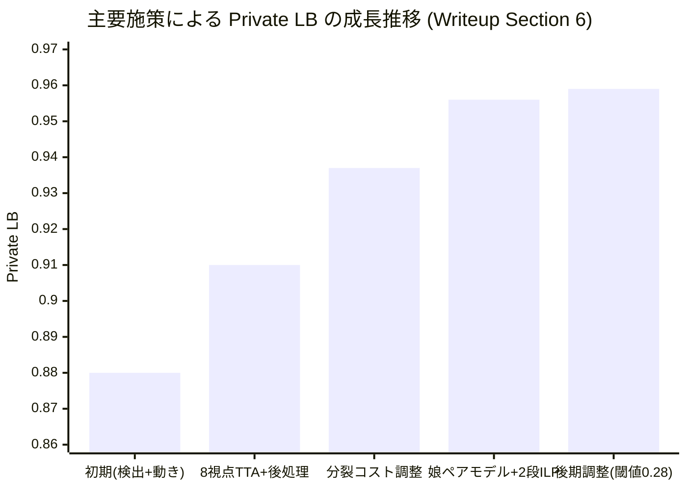

18-⑥Kaggle実践3 Biohub細胞トラッキング 7位解法のまとめ


## Abstract
- biohub 7位解法(tatsutaka / Public 0.970 / Private 0.952 ※事前学習なし構成では Private 0.959)のまとめ
  - 大規模な検出モデルのアンサンブルには頼らず、**単一の3D検出器(3D ResEncM nnU-Net)** で「細胞の中心座標」と「1フレーム前へ向かう3D逆方向ベクトル(動き)」を同時予測し、**「予測を正しい親子リンク・細胞分裂へ変換する後続ステップ」** にアプローチした解法。
  - 学習データ中では151回しか現れない希少な「細胞分裂」を検出器から切り離し、下記の3段構成で評価。
    - **①局所動き合わせ後の画像差分を3D CNN+BiGRUで読む「親分類器」**
    - **②幾何・軌跡・画像コントラスト(91特徴)で娘候補を並べる「娘ペアランカー(ExtraTrees / LightGBM)」**
    - **③隣の親からの継続説と比較する「統合MLP」** 。
  - 繋ぎ方の決定は **最小費用流ウォームスタート(Google OR-Toolsの最小費用流アルゴリズム)を初期解にした厳密ILP(SCIP, gap=0%)** で大域的に解き、最後に **1フレーム補間・境界トラックの選択的復元・直線スムージング・静止(フリーズ)フレームの座標固定** で仕上げています。

※この方も日本の方っぽい。すごいなぁ!

**用語解説**

- **最小費用流ウォームスタート(Min-Cost Flow Warmstart)** ... 厳密だが時間のかかる整数線形計画法(SCIP)をいきなり解くのではなく、まず高速なグラフアルゴリズム(Google OR-Toolsの最小費用循環流 `SimpleMinCostFlow`)で「ほぼ最適な繋ぎ方」を高速で求め、それを初期解(ヒント)としてSCIPに渡すことで厳密解(`gap=0%`)を高速に得る工夫。
- **ILP(整数線形計画法 / Integer Linear Programming)** ... いくつもの制約ルール(例: 細胞の親は最大1つ、娘は最大2つ)をすべて守りながら、全体の目的(例: 確率の高いリンクを繋いで総コストを最小にする)を最も良く達成する組み合わせを、0か1の整数(繋ぐ=1、繋がない=0)で厳密に計算して選び出す数理最適化の手法。本解法ではSCIPという厳密ソルバーを使って、動画全体の系譜グラフを一括決定しています。
- **ランカー(Ranker / 順位付けモデル)** ... 複数の候補に点数を付けて「どれが一番もっともらしいか」を1位から順に並べ替える(ランキングする)AIモデルのこと。「娘ペアランカー」は、親細胞の周囲にある娘細胞候補のペア(AとB、BとC、AとCなど)を総当たりで採点し、真の娘ペアである可能性が高い順に順位を付ける役割を持ちます。
- **MLP(多層パーセプトロン / Multi-Layer Perceptron)** ... 最も基本的かつ標準的な構造をしたニューラルネットワーク(全結合型のAI関数)のこと。画像などを直接読むのではなく、「あらかじめ計算された数字のリスト(表形式の特徴量)」を入力として受け取り、複数の計算層を通して1つの結論(点数や確率)を出力します。「統合MLP」では、83個の数値(画像分類器の確率、娘ペアの点数、隣の親との距離など)をまとめて入力し、「これは本当に分裂か？それとも別々の移動か？」の最終的なボーナス/ペナルティ点数を計算しています。
- **nnU-Net(3D ResEncM)** ... 医療・生物3D画像の領域分割で標準的に使われる深層学習フレームワーク。7位解法ではその残差エンコーダ強化版(ResEncM)をベースに、最高解像度のデコーダ段を省いて計算を軽くしつつ、「細胞中心ヒートマップ(1ch)」と「過去フレームへ向かう3D動きベクトル(3ch)」を同時に出力するよう改造しています。
- **逆方向動き予測(Backward Motion Prediction)** ... 時刻 $t$ の細胞から見て、「1フレーム前の時刻 $t-1$ で親細胞がどこにいたか」の移動ベクトル $(\Delta z, \Delta y, \Delta x)$ を予測する仕組み。細胞が分裂して2つに増えた場合でも、「2つの娘細胞それぞれから1つの共通の親を指し示せる」ため、分裂と相性が良い表現です。
- **時間間隔データ拡張(Temporal Interval Augmentation)** ... 連続するフレーム $(t-1, t, t+1)$ だけでなく、あえて1〜2フレーム飛ばした $(t-d, t, t+d)$ ($d=1, 2, 3$) を入力して学習させる手法。動画が一時停止(フリーズ)した直後に細胞が大きくジャンプする場面でも、見失わずに追跡できるようにします。
- **平面D4 TTA(8視点テスト時データ拡張)** ... XY平面を回転・反転させて8通りの対称変換を使ったテスト時データ拡張(TTA)のこと。0°、90°、180°、270°回転の4通りと、それぞれを裏返した4通り(左右/上下/主対角線/逆対角線)の計8視点のことを厳密に「平面 $D_4$」と名付けられています。7位解法では **「細胞検出には8視点平均を使い、動きベクトルには変換なし(1視点)を使う」** という使い分けを行っています。
- **動き合わせ差分(Motion-Aligned Image Difference)** ... 細胞分裂の前後で「形や明るさがどう変わったか」を画像から読み取る際、周囲の細胞の平均的な移動量(`SparseLocalFlow`)で前後の3D画像をピッタリ重ね合わせてから引き算(差分)する前処理。通常の移動によるズレを消し、分裂特有の「1個が消えて2個が現れる変化」だけを浮かび上がらせます。
- **BiGRU(Bidirectional Gated Recurrent Unit / 双方向ゲート付き回帰型ユニット)** ... 時系列データの「過去から未来」と「未来から過去」の両方向の流れを同時に読み取る軽量なリカレントニューラルネットワーク(RNN)。親候補の前後5フレーム($t-2 \sim t+2$)を3フレームずつ3つの窓に分け、3D CNNで抽出した特徴の時間変化を前後双方向から統合して分裂確率を判定します。時系列を扱う有名なモデルに LSTM（Long Short-Term Memory） がありますが、GRUはその 軽量・高速版 です。
- **補助教師付け(Auxiliary Supervision)** ... 親分類器(3D CNN+BiGRU)を学習させる際、「分裂したか(0/1)」だけでなく、「次フレームに引き継がれる細胞は何個か(0/1/2個)」「娘細胞はどの方向にあるか(相対XYZ座標)」も同時に当てさせる学習手法。細胞の形や分裂の向きを捉える特徴量が育ちやすくなります。
- **ペア報酬の折りたたみ(Pair Reward Folding)** ... 候補リンクが最初から2本しかない親細胞について、「娘ペアA・Bを同時に選んだらボーナスを与える」というペア変数をわざわざ作らず、親の「分裂コスト」に直接ボーナスを足し込む数理上の軽量化テクニック。結果を変えずにILPの変数を減らせます。
- **フリーズ区間(静止フレーム)の座標投影(`first_projection`)** ... 顕微鏡の仕様で隣り合うフレームの3D画像が「1ピクセルの狂いもなく完全一致」している区間を見つけ出し、その間は細胞の座標も動かないよう「最初に検出された座標」へ揃える後処理。
- **アブレーションスタディ** ... AIモデルの各パーツを1つずつ外したり設定を変えたりして、「どの工夫がどれだけスコアに効いたか」を切り分けて確かめる検証実験のこと。

## 概要
先日、Biohub細胞トラッキングコンペが完了しました。
Private LB 1353位/3800人と大変悔しい結果に終わりましたが、Kaggleの素晴らしいところはトップ層の解法が公開されることです。今回はソロ参加で7位(3,947チーム中7位・金メダル、本コンペでKaggle Master昇格)に入賞された tatsutakaさんの解法を深掘りします。

### コンペの基本設定
| 項目 | 内容 |
| :--- | :--- |
| **入力データ** | 発生中のゼブラフィッシュ胚の3Dタイムラプス動画(1動画100フレーム、解像度 `Z=64 × Y=256 × X=256` ボクセル)。<br>Z方向(深さ: 1.625µm)がY・X方向(横: 0.40625µm)より4倍粗い異方性データ。1フレームに最大約400細胞。 |
| **求める出力** | 全フレームの「細胞の中心座標」と、時刻 $t \to t+1$ の「親子リンク」(2つに分かれたら細胞分裂)。 |
| **最大の難所** | 訓練199動画のうち、人間が正解ラベルを付けた細胞は **全体のたった約3%(13.3万個)**、細胞分裂は **151回** しかない。また、一部動画には画面が数フレーム静止(フリーズ)した直後に大きく動く区間がある。 |

- **評価指標**: リンクの正解率($J_{edge}$)に細胞数のズレのペナルティを掛けたスコア($\overline{J_{adj}}$)と、細胞分裂の正解率($J_{div}$)の合計です。
$$J_{adj} = \max\left(0,\; J_{edge} \cdot \left(1 - 0.1\,\frac{N_{pred} - N_{est}}{N_{est}}\right)\right), \qquad \text{score} = \overline{J_{adj}} + 0.1 \cdot J_{div}$$
  - **※欄外補足(数学記号と用語の意味)**:
    - $\max(0, A)$ : $0$ と $A$ のうち大きい方を選ぶ記号(スコアがマイナスにならないように下限を $0$ にする)。
    - $\overline{J_{adj}}$ : 文字の上の横線(オーバーライン)は「全動画の平均値」を表す数学記号。
  - **凡例**: $J_{edge}$ = 親子リンクの一致率(Jaccard係数)、$N_{pred}$ = 予測した細胞数、$N_{est}$ = 主催者が推定した細胞数、$\overline{J_{adj}}$ = 全動画の重み付き平均、$J_{div}$ = 細胞分裂の一致率(全体の約1割を占める重要項目)。

- **参考URL**:
  - [7位解法 Writeup(解説記事)](https://www.kaggle.com/competitions/biohub-cell-tracking-during-development/writeups/7th-place-solution) / [ソースコードNotebook](https://www.kaggle.com/code/tatsutaka/biohub-7th-place-inference)

---

## biohub 7位解法まとめ

### 6位解法と7位解法の比較
同じ解法でも、6位解法(自己学習+単一ネットワーク内リンカー)と7位解法(3D nnU-Net逆方向動き予測+分裂専用3段モデル)は対照的な設計になっています。

| 比較項目 | 6位解法 (Jamal Saeediさん) | 7位解法 (tatsutakaさん) | 違いのポイント |
| :--- | :--- | :--- | :--- |
| **基本方針** | 6モデルのアンサンブル + 自己学習(擬似ラベル) | **単一の3D nnU-Net検出器** + **後続の接続・分裂モデルの徹底強化** | 7位解法はアンサンブルを用いず「繋ぎ方と分裂」に集中 |
| **検出・動きモデル** | 自作軽量3D CNN(`Isotropic` / `MultiScale`)×6個 | **3D nnU-Net(`ResEncM`)×1個** (中心ヒートマップ + 逆方向3D変位) | 7位解法は医療3Dの定番nnU-NetをXY半分出力に改造 |
| **リンク候補の作り方** | 半径20µmのk近傍グラフ + Graph Attention | **逆方向ベクトルで前フレームへ投影 → 残差7µm以内の最大5個** | 動き予測で移動先を当ててから距離を測るため大移動に強い |
| **TTA(回転・反転平均)** | 検出も特徴量も2〜4方向TTA平均 | **検出は8方向TTA平均、動きベクトルは無変換(1視点)のみ** | 動きベクトルを平均すると「2つの親の中間」を指す罠を回避 |
| **細胞分裂の扱い** | リンカー内の1ヘッドで分裂ロジットを出力 | **独立した3段の分裂専用パイプライン**(3D CNN+BiGRU / 木モデル / MLP) | 151回しかない希少な分裂を専用モデル群で徹底攻略 |
| **ILP(整数計画法)** | LP-firstソルバー(HiGHS → 局所MILP) | **最小費用流(OR-Tools)初期解 + SCIP厳密求解(`gap=0%`)** | 分裂候補をMLPで再評価して大域的ILPに統合 |
| **後処理の特徴** | 手作業の修復なし(ドリフト補正直線平滑化のみ) | **1fギャップ補間 + 短トラック選別・境界復元 + フリーズ区間座標固定** | 観察されたエラー原因ごとに安全策付きで丁寧に補正 |
| **スコア(Pub/Priv)** | Public 0.961 / Private 0.953 | Public 0.970 / Private 0.952 (事前学習なし: 0.963 / **0.959**) | |



### データの観察から生まれた7つの工夫

| 課題・観察 | 7位解法の対策 | 効果・対応Stage |
| :--- | :--- | :---: |
| **① ラベルが約3%しかなく、未ラベル細胞を背景にすると本物を消してしまう** | ラベルに基づき損失計算領域を制限し、ターゲット幅を **$\sigma = 2\,\mu\text{m}$ ($6\,\mu\text{m}$ 打ち切り)** に調整(狭すぎるとズレに過敏、広すぎると隣と重なる) | 学習 / Stage1 |
| **② 数フレーム画面が静止(フリーズ)した直後に細胞が大きくジャンプする** | **時間間隔データ拡張($d=1 \to 2 \to 3$)** と間隔チャネル入力で大きな変位を学習。さらに逆方向予測位置からの **残差距離($7\,\mu\text{m}$ 以内)** で候補を張る | 学習 / Stage1 |
| **③ 動きベクトルを8方向TTAで平均すると、かえってリンク精度が落ちる** | 視点ごとに違う親(AとB)を指すベクトルを平均すると「中間の無関係な細胞C」を指してしまうため、**検出は8視点TTA、動きは無変換1視点** に分離 | **0.9162 → 0.9193**<br>(Stage1) |
| **④ 分裂前後で画像の差分を取ると、普通の移動まで強く光ってしまう** | 周囲の細胞から局所移動(`SparseLocalFlow`)を推定し、**3D画像を位置合わせしてから差分を取る** ことで分裂特有の形・輝度変化だけを抽出 | Stage2-① |
| **⑤ 親が分裂したと当たっても、娘2個のペア選びや競合親との区別で間違える** | 「親の画像分類(BiGRU)」と別に、**「娘ペアの順位付け(73幾何+18画像特徴のLightGBM)」** と **「別親からの継続コストも比較する統合MLP(83特徴)」** を構築 | **Private +0.049**<br>(0.910→0.959 / Stage2, 3) |
| **⑥ 短いトラックを一律削除すると、動画の端や分裂直後の本物まで消える** | 9ノード未満を削除しつつ、**分裂を含む成分を保護** し、先頭・末尾フレームに接する高信頼の3〜8ノード成分を **選択的に復元**(`boundary_mean1_post.py`) | Stage4 |
| **⑦ フリーズ(静止)区間中、リンクは正しいのに検出座標が微妙にブレる** | 隣り合う3Dフレームのピクセル完全一致を検知し、分岐以外の1対1トラックを **最初の実検出座標に固定**(`first_projection.py`) | **0.9609 → 0.9627**<br>(開発40動画 / Stage4) |

---

## プロジェクト構成

7位解法のフォルダ構成は以下の通り。

```text
7thPlaceSolution/
├── biohub-7th-place-inference.py                  # ローカルWindows / Kaggle T4両対応 推論エントリスクリプト
├── biohub-7th-place-inference.ipynb               # 元のKaggle推論ノートブック
├── src/                                           # パッチ統合済みの全ソースコード(66 .pyファイル + 設定JSON)
│   ├── custom_trainers/
│   │   └── nnUNetTrainerBiohubColabM2000.py       # Half-XY出力 + 逆方向3D Motion回帰 + 時間間隔カリキュラムTrainer
│   ├── models/                                    # 事前線形サロゲート・ExtraTreesメタデータ・LightGBM特徴量定義
│   ├── runtime/                                   # 推論パイプライン本体
│   │   ├── capture.py / capture_ensemble.py       # Stage1: 3D ResEncM nnU-Net 検出・逆方向動き推論ランナー
│   │   ├── trt_backend.py / division_trt_backend.py # Tesla T4用 FP16 TensorRTエンジン実行バックエンド
│   │   ├── parent.py / parent_fast.py             # Stage2-①: 局所位置合わせ14chクロップ + 3D CNN-BiGRU 親分類器
│   │   ├── pairs.py / portable_forest.py          # Stage2-②: 娘ペア候補列挙(73特徴) + ExtraTrees推論
│   │   ├── daughter_image_lgb5_runtime.py         # Stage2-②: 娘ペア局所画像特徴(18個)追加 + 5-seed LightGBM再採点
│   │   ├── preilp_pairs.py                        # Stage2-③: 線形サロゲート上位1536親 + LGB上位3ペアの候補提案
│   │   ├── choice_features.py / addition_features.py # Stage2-③: 競合親マージン・継続コスト特徴量(7個)と補助特徴
│   │   ├── choice_net.py / division_new_transfer.py  # Stage2-③: 分裂統合MLP(nn_h.pt: 83入力→32→1)とTH/Fusionブリッジ
│   │   ├── biohub_solver_runtime/flow_solver.py   # Stage3: Google OR-Tools SimpleMinCostFlow 最小費用循環流ソルバー
│   │   ├── solve.py / solve_fusion.py / solve_choice.py # Stage3: CertifiedPairSolver(貪欲+最小費用流初期解 + SCIP厳密解)
│   │   ├── choice_worker.py                       # マルチワーカー動的スケジューリング・SCIP自動リカバリ制御
│   │   ├── final_post.py / postbest.py            # Stage4: 1fギャップ補間・短トラック除去・局所直線スムージング
│   │   ├── boundary_mean1_post.py                 # Stage4: 動画境界・内部の高信頼短トラック復元と過剰復元抑制
│   │   ├── first_projection.py                    # Stage4: ピクセル完全一致(フリーズ)フレームでの座標固定
│   │   └── legacy/                                # 学習・特徴量構築・D4 TTA・基底ILPソルバー群(24ファイル)
│   └── tools/
│       └── biohub_geff_to_submission.py           # GEFFグラフ検証(入次数<=1, 出次数<=2) & submission.csv変換
├── datasets/                                      # 学習済みモデル重み・TRTエンジン・オフラインWheel一式(7データセット)
├── input/test/                                    # テスト用3D顕微鏡動画(*.zarr)
├── working/                                       # 推論作業ディレクトリ・最終出力(submission.csv)
├── verify_local_env.py                            # 環境・GPU・全SHA-256ハッシュ・スモークテスト検証スクリプト
└── README_LOCAL.md                                # ローカル環境構築・実行ガイド
```

### 使用モデル一覧 (役割分担型の構成)
7位解法は「同じ検出器を何十個も並べる」のではなく、**各工程の弱点を補う小型の専門モデルを直列に繋ぐ設計**になっています。

| 使用Stage | モデル名・重み | 構造 / 入力サイズ | 役割 |
| :---: | :--- | :--- | :--- |
| **Stage1** | **3D ResEncM nnU-Net**<br>(`pretrained` または `scratch`) | 残差3D U-Net (Half-XYデコーダ)<br>入力: 4ch `(t-d, t, t+d, d/2)` | **細胞中心ヒートマップ(1ch)** と **直前フレームへの3D逆方向変位(3ch)** を同時予測 |
| **Stage2-①** | **親分裂画像分類器 (`ParentScorer`)**<br>(`SlidingT3Residual` × 2シード) | 4層3D CNN(24→48→96→128) + BiGRU<br>入力: 5フレーム `12×48×48` × 14ch | 位置合わせ後の画像差分と再構成ヒートマップから、**親が分裂しそうか** を判定 |
| **Stage2-②** | **娘ペアランカー**<br>(`ExtraTrees` & `5-seed LightGBM`) | ExtraTrees(73特徴)<br>+ LightGBM×5シード(**91特徴**) | 幾何・前後軌跡(73個)と娘周辺の輝度・コントラスト(18個)で **娘ペア候補を順位付け** |
| **Stage2-③** | **分裂イベント統合MLP**<br>(`nn_h.pt`, SWA重み) | 2層SiLU MLP (`83 → 32 → 1`)<br>入力: **83次元特徴ベクトル** | 画像証拠・ペア特徴・**別の親からの継続コスト**を統合し、ILP用の分裂ペア報酬を算出 |
| **Stage3** | **大域的ILPソルバー**<br>(`CertifiedPairSolver`) | OR-Tools `SimpleMinCostFlow`<br>+ SCIP (`gap=0%` 厳密解) | 動画全体で「親は最大1つ、娘は最大2つ」の制約を守りながら総コスト最小の系譜を選択 |

---

## 推論パイプラインの全体像 (Stage0〜Stage4)



---

### ◆Stage0. 実行基盤(TensorRT高速化・動的スケジューリング・SCIP自動リカバリ)

Kaggleの「Tesla T4×2枚・制限時間」の中で、重い3Dフルボリューム推論と厳密ILPを安定して完走させるための実装`biohub-7th-place-inference.py`、`choice_worker.py`。

| 仕組み | 内容 | 該当コード |
| :--- | :--- | :--- |
| **① ビルド済みFP16 TensorRTエンジン** | Kaggle T4環境では、3D nnU-Net検出器と分裂BiGRUの3D CNN部分をビルド済みTensorRTエンジン(`.engine`)で高速実行。ローカルGPU環境では自動的に通常のPyTorch FP16推論へ切り替わる。 | `trt_backend.py`<br>`division_trt_backend.py` |
| **② 大きい動画優先の動的ワーカー分配** | Stage1の検出が終わった動画(`.pkl`)から順に、ファイルサイズが大きい(細胞数が多い)動画を優先して複数ワーカーがディレクトリ作成ロック(`claim.mkdir()`)で早い者勝ち取得。 | `choice_worker.py`、`dynamic_claims()` |
| **③ SCIP高速モードと自動リカバリ** | ノード数30,000以下の動画ではSCIPのカット分離(`SEPARATION_OFF`)を切って高速求解。もし時間制限に達した場合は、自動で標準SCIP設定に切り替えて再求解し、必ず厳密最適解(`gap=0%`)を保証する。 | `choice_worker.py`#L96-L116 |

---

### ◆Stage1. 3D nnU-Net(ResEncM)による細胞検出と逆方向動き予測

#### 1-1. 入力・ネットワーク構造・疎ラベルと動きの学習 (`nnUNetTrainerBiohubColabM2000.py`, `biohub_motion_submission.py`)
3D残差エンコーダ構成の **nnU-Net(3D ResEncM)** をバックボーンとして使い、1つのネットワークで「細胞の中心位置」と「前のフレームからの動き」を同時に学習します。

| 項目 | 設計内容 | 狙い・メリット |
| :--- | :--- | :--- |
| **4チャネル入力** | $(I_{t-d},\; I_t,\; I_{t+d},\; d/2)$<br>前後・現在の3枚の3D画像 + 時間間隔 $d$ を表す定数チャネル | 時間間隔拡張($d=1, 2, 3$)で学習した際、「同じ移動量でも何フレームかけた動きか」をモデルが区別できるようにする |
| **Half-XYデコーダ出力** | 最高解像度のデコーダ段を省略し、XY解像度1/2で出力した後に元の解像度(`64×256×256`)へ3D線形補間 | VRAMと計算時間を大幅削減すると同時に、正解ラベルの微小な位置ズレに過学習するのを防ぐ |
| **疎ラベル対応ヒートマップ** | 正解中心に **$\sigma = 2\,\mu\text{m}$** ($3\sigma = 6\,\mu\text{m}$ 打ち切り)の3Dガウス分布を配置し、損失計算領域を制限 | 未ラベルの本物の細胞(97%)を「背景」として潰してしまうのを防ぎ、隣り合う細胞もくっつかずに分離できる適切な幅を確保 |
| **逆方向動きターゲット** | 中心から $2\,\mu\text{m}$ 以内($\sigma=1\,\mu\text{m}$ 重み付き)で、1フレームあたり変位 $\mathbf{v} = \frac{\mathbf{p}_{t-d} - \mathbf{p}_t}{d \times 8\,\mu\text{m}}$ をSmooth L1損失で回帰 | 分裂で娘が2つに増えても「それぞれの娘から共通の親の位置」を一意に指し示すことができる |

- **合成データ事前学習に関する検証知見 (Writeup Section 1.5)**:
  コミュニティで共有された3D顕微鏡の合成データ生成コード(José Freitas氏)を用いて1,000エポック事前学習 → 実データで1,500エポック学習する構成(`pretrained`)と、実データのみで1,500エポック学習する構成(`scratch`)を比較しています。
  他の条件を揃えた比較では、合成事前学習により **Public LBは `0.960 → 0.966` へ上がった一方、Private LBは `0.956 → 0.947` へ低下** しており、「Public LBで効いた事前学習が未知のPrivateデータへの汎化に直結するとは限らない」という重要な教訓が得られています。

#### 1-2. なぜ「検出は8視点TTA、動きは1視点」にするのか？ (`biohub_planar_d4_tta.py`)
推論時はXY平面の回転・反転8通り($D_4$ 二面体群)でTTAを行いますが、**8視点の平均をとるのは「検出ヒートマップのロジット」だけ**で、**「動きベクトル」は無変換(元の向き)の1視点のみ**を使います([`biohub_planar_d4_tta.py`](file:///c:/work/aaa/kgle_001_BCT_Episode/episode/7thPlaceSolution/src/runtime/legacy/biohub_planar_d4_tta.py))。



- **理由**: 細胞が密集している場所で、ある回転視点の予測が「親候補A」を指し、別の反転視点の予測が「親候補B」を指したとします。この2つの矢印を平均してしまうと、**AとBのちょうど真ん中を指す矢印** になり、たまたまその中間にいた「無関係な細胞C」に誤って繋がってしまいます。開発12動画の検証でも、無変換1視点(`0.91931`)がベクトル平均(`0.91619`)や投票方式(`0.90218`)を上回っています。

#### 1-3. 逆方向投影による候補リンクの作成 (`biohub_motion_ilp_fold.py`)
1. **ピーク検出とNMS**: 検出確率マップから局所最大値(閾値 `0.30` または `0.28`)を取り、物理距離 `2.0 µm` のGreedy NMSで細胞中心を抽出します。
2. **前フレームへの逆方向投影**: 時刻 $t$ の各細胞 $j$ の周囲(半径 $2.0\,\mu\text{m}$ 以内、$\sigma=1.0\,\mu\text{m}$ ガウス重み)から予測変位ベクトルを取り出して現在座標に足し合わせ、「時刻 $t-1$ で親がいそうな予測座標」を求めます。
3. **残差距離による候補リンク採点**: 予測座標から **残差距離 $d_{ij}$ が $7.0\,\mu\text{m}$ 以内** にある時刻 $t-1$ の実検出細胞 $i$ を近い順に最大5個選び、以下の式でリンクスコア $s_{ij}$ を計算します`biohub_motion_ilp_fold.py`。
$$s_{ij} = \exp\left(-\frac{d_{ij}^2}{2 \times (3\,\mu\text{m})^2}\right) \times \sqrt{q_i \times q_j}$$
- **※欄外補足(数学記号と用語の意味)**:
  - $\exp(x)$ : 自然対数の底 $e \approx 2.718$ の $x$ 乗($e^x$)を表す指数関数。ここでは $x$ がマイナスなので、ズレ $d_{ij}$ が $0$ のとき最大値 $\exp(0) = 1$ になり、ズレが大きくなるほど滑らかに $0$ へ近づく「ガウス減衰(釣鐘型のスコア)」になります。
  - $\sqrt{q_i \times q_j}$ : 2つの数値の掛け算の平方根(ルート)。「幾何平均」と呼ばれ、親の検出確率 $q_i$ と子の検出確率 $q_j$ の両方が高いときだけ高くなり、どちらか一方でも低いとスコアを引き下げる働きをします。
- **各変数の凡例**:
  - $s_{ij}$ : 時刻 $t-1$ の親候補 $i$ から時刻 $t$ の細胞 $j$ へ繋ぐ候補リンクの信頼スコア($0 \sim 1$)。ILPにはマイナスを付けた $-s_{ij}$ をコストとして渡します。
  - $d_{ij}$ : 動き予測で求めた「親の予測位置」と「実際の親候補 $i$ の位置」とのズレ(残差3次元距離、単位: $\mu\text{m}$)。細胞自体の移動距離ではなく「予測からの外れ具合」を見るため、細胞が $10\,\mu\text{m}$ 以上大きく動いても予測が当たっていれば $d_{ij}$ は小さく保たれます。
  - $q_i, q_j$ : 親候補 $i$ と現在の細胞 $j$ それぞれの細胞中心ヒートマップ確率($0.30 \sim 1.0$)。

---

### ◆Stage2. 細胞分裂(Division)専用の3段パイプライン

細胞分裂は訓練データ全体で151回しかなく、しかも「①親細胞が割れる見た目をしているか」「②どの2個が娘細胞のペアか」「③実は隣の別親から来た2本の通常トラックではないか」という3つの異なる問題を同時にクリアする必要があります。7位解法ではこれを3つの専用モデルに分解して解いています。



#### 2-1. ① 親細胞の分裂画像分類器 (`parent.py`, `biohub_division_sliding_t3_mil.py`)
候補リンクが2本以上出ている親候補(分岐可能ノード)に対し、周囲 `Z=12 × Y=48 × X=48` ボクセル・前後5フレーム $(t-2, t-1, t, t+1, t+2)$ の画像を切り出して分裂確率を判定します`parent.py`。

1. **動き合わせ(アライメント)後の画像差分 (`SparseLocalFlow`)**:
   単に時刻 $t$ と $t+1$ の画像を引き算すると、細胞が普通に横へ移動しただけの変化が強く出てしまいます。そこで周囲の検出細胞の動きから局所的な平行移動量を推定し、前後の画像を現在の細胞位置に重ね合わせてから差分を取ります。すると「親の位置が暗くなり、両脇の娘2か所が明るく浮かび上がる」という分裂特有のパターンが綺麗に見えます。
2. **3つの3フレーム窓 × 14チャネル入力 (`make_image`)**:
   5フレーム $(t-2 \sim t+2)$ から連続する3フレーム窓を3つ作り、各窓ごとに以下の **14チャネル** を構築します。
   - **生画像系(7ch)**: 位置合わせ後の3フレーム画像(3ch) + 符号付き時間差分(2ch) + 絶対値時間差分(2ch)
   - **検出ヒートマップ系(7ch)**: 検出された細胞中心から再構成した3Dガウスマップ($t-1, t, t+1$)の3枚 + 符号付き差分(2ch) + 絶対値差分(2ch)
3. **3D CNN + BiGRU + 補助教師付け (`SlidingT3Residual`)**:
   4ブロックの3D CNN(`24 → 48 → 96 → 128` ch)で各窓を128次元ベクトルに変換し、双方向GRU(`BiGRU`)で前後の時間変化を統合して中央窓の特徴に足し合わせます。
   学習時は「分裂ロジット」だけでなく、補助タスクとして **「次フレームの後続細胞数(0, 1, 2個)」** と **「娘細胞2個の相対XYZ座標」** も予測させ、その予測値を勾配停止(Stop Gradient)してメイン分類器へフィードバックすることで形態変化の識別力を高めています(推論時は2シード平均)。

#### 2-2. ② 娘細胞ペアの順位付け (`pairs.py`, `daughter_image_lgb5_runtime.py`)
親が分裂していても、周囲に候補が3個(A, B, C)あるときに誤ったペア(A, C)を選ぶと分裂は不正解になります。そこで次フレームの候補から作られるすべての娘ペアを以下の特徴量で採点します。

| 特徴量グループ | 個数 | 主な中身 |
| :--- | :---: | :--- |
| **幾何特徴 (`geom_*`)** | 73個の内数 | 親と各娘の距離、娘同士の距離、親から2つの娘へ向かう角度($\cos$)、**親の位置と「娘2個の中点」とのズレ**(本物の分裂は親を中心に左右対称に割れやすい)、周囲半径5〜20µmの細胞密度、検出信頼度 |
| **局所軌跡特徴 (`traj_tm1`〜`tp4`)** | 73個の内数 | 前後フレーム($t-1 \sim t+4$)でその娘ペアが「1つの親から分かれた軌跡として自然か、最初から別々の2本のトラックか」を測る距離特徴 |
| **娘周辺の画像特徴 (`image_*`)** | **+18個**<br>(計91個) | 各娘の中心輝度、狭い芯(`core`: $3\times 5\times 5$)の平均・最大・標準偏差、外周(`outer`: $7\times 11\times 11$)の平均、芯と外周のコントラスト(6項目 × 2つの娘の **最小・最大・絶対差** = 18個) |

- **ExtraTrees(73特徴)** で基礎ペアスコアを出し、さらに18個の画像特徴を加えた **91特徴量の5シードLightGBMアンサンブル**`daughter_image_lgb5_runtime.py`で各親候補内の娘ペア順位を更新します。

#### 2-3. ③ 分裂イベント統合MLP (`choice_features.py`, `division_new_transfer.py`)
最後に、「親Pが娘A・Bに分裂した」という仮説と、「実は隣に別の親Qがいて、P→A と Q→B の2本の通常移動だった」という代替仮説を比較するため、**83入力・隠れ層32(SiLU)・1出力の小型MLP(`nn_h.pt`, SWA重み)** で最終判定を行います`division_new_transfer.py`。
- **83次元の内訳**:
  1. 幾何・前後軌跡特徴 (**73個**)
  2. **競合する別親との比較特徴 (`alt_*`: 7個)** — 他の親候補から娘A・Bへの最短距離(`alt_origin_min/max`)、自親Pと別親Qの距離差マージン(`alt_margin_min/max`)、通常継続2本で説明した場合のコスト(`alt_continuation_cost`)、分裂コストとの差(`alt_split_minus_continue`) `choice_features.py`。
  3. 親の検出スコア (**1個**) + ①親BiGRUの分裂ロジット (**1個**) + ②ExtraTreesの娘ペア確率 (**1個**)
- MLPの出力ロジット $v$ は $-0.2 \tanh(v)$ によって有界なペア報酬に変換され(さらにBiGRUロジット $\ge 4.0$ かつペアスコア $\ge 0.8$ の強い分裂候補が負ロジットで消されないよう0へ保護するブリッジ処理付き)、Stage3のILP目的関数へ渡されます。

---

### ◆Stage3. 最小費用流ウォームスタートと厳密SCIPによる大域的ILP (`solve.py`, `solve_choice.py`)

個々の親子リンクや分裂ペアのスコアが高くても、バラバラに選ぶと「1つの娘細胞に2つの親が繋がる」といった矛盾が起きます。そこで動画全体のすべての候補ノード・候補エッジ・分裂ペア報酬を1つの数理計画問題(ILP)にまとめ、一括で最適化します。

#### 3-1. 2段階ILP(Writeup)とPre-ILP一括提案(公開推論コード)
- **Writeup解説の基本思想(2段階ILP)**:
  1回目のILPで暫定的な系譜グラフを作り、そこで選ばれた分岐点(および未評価の有望な分裂候補)に対してStage2-③のMLPで「本当に分裂か、別親からの継続か」を再採点し、**元の候補グラフ全体に対して2回目のILPを解き直す**ことで、局所的な手直しではなく大域的な整合性を保ったまま繋ぎ直します。
- **公開推論コードの高速化(`preilp_pairs.py` + `solve_choice.py`)**:
  `preilp_pairs.py`では、11特徴の軽量な線形サロゲートモデル(`parent_surrogate_all40.json`)で動画内の有望な親候補上位1,536個を事前に絞り込み、LightGBM上位3ペアとの和集合に対して最初からMLP(`nn_h.pt`)の評価を完了させることで、**重たいSCIPソルバーの実行を動画あたり1回に集約**しています。

#### 3-2. コスト設計と厳密ソルバー (`CertifiedPairSolver`)
| 要素 | コスト・制約の設定 | 平易な意味 |
| :--- | :--- | :--- |
| **通常リンク $i \to j$** | $-s_{ij}$ (動き投影スコアのマイナス) | 予測位置に近く、両端の検出確率が高いリンクほど選ばれやすい |
| **新規出現 / 途中消失** | $+0.1$ / $+0.1$ | トラックが途中で始まったり途切れたりするときの基本ペナルティ |
| **親の分裂コスト** | $+0.3$ (基本コスト) | むやみに枝分かれしないための基本コスト |
| **娘ペア同時選択報酬** | $-0.2 \cdot p_{\text{parent}} \cdot q_{\text{pair}}$ + MLP報酬 | 親の分裂確率と娘ペアスコアが高く、かつMLPが「本物の分裂」と認めたペアを2本同時に選んだときだけコストを大幅に割り引く(逆に通常継続の方が自然な場合はペナルティを課す) |

1. **2段階ウォームスタート(初期解の注入)**:
   いきなりSCIPでゼロから探索させると時間がかかるため、①確率の高い順に1対1で繋いだ貪欲解と、②**Google OR-Toolsの最小費用流(`SimpleMinCostFlow`)** で高速に解いた解の2つを初期解(`addSol`)としてSCIPに渡します`solve.py`。
2. **ペア報酬の折りたたみ(`BIOHUB_PAIR_FOLD_MODE='fold'`)**:
   候補リンクが最初から2本しか出ていない親細胞では、「2本のリンクを両方選ぶこと」と「その親が分裂すること」が完全に同じ意味になるため、ペア用の補助変数を作らず親の分裂コストへ報酬を直接合算し、ソルバーを軽量化しています。
3. **最適性ギャップ0%(`gap=0`)の厳密証明**:
   近似で打ち切らず、SCIPで `status == 'optimal'` かつ `gap == 0.0` が証明されるまで解き切ります。

---

### ◆Stage4. 観察エラーに基づく4つのグラフ後処理 (`final_post.py`, `postbest.py`, `boundary_mean1_post.py`, `first_projection.py`)

ILPで大域的に整合したグラフを作った後、実際の予測データを観察して見つかった4種類のエラーを順番に補正します`final_post.py`。

| 対象エラー | 後処理の内容 (`final_post.py` の設定値) | 暴走を防ぐ安全策(Safeguards) |
| :--- | :--- | :--- |
| **① 1フレームの検出抜け**<br>(`postbest.py`) | 時刻 $t$ のトラック終端と $t+2$ の始端が **端点間 $9.0\,\mu\text{m}$ 以内**(1ステップあたり $4.5\,\mu\text{m}$)なら1対1で結合。中点から **$3.2\,\mu\text{m}$ 以内** に未接続の孤立ノードがあれば再利用し、なければ中点付近の3D画像の輝度重心で微調整した新ノードを挿入。 | ・同じノードを2回以上使い回さない<br>・新規追加ノード数を **元のノード数の2%以内かつ最大2,000個** に制限 |
| **② 短い偽陽性トラック**<br>(`postbest.py` / `boundary_mean1_post.py`) | ・原則として **連結成分のノード数が9個未満** の短いトラックを削除。<br>・ただし動画の**最初または最後のフレームに接する3〜8ノード成分**や、内部の5〜7ノード成分で周囲より信頼度が高いものは**復元**。 | ・**細胞分裂を含む連結成分は無条件で保護**<br>・平均リンクスコア0.5以上の8ノード成分は保持<br>・復元時は周囲 $7.0\,\mu\text{m}$ 以内の既存ノードに対する相対信頼度比 $\ge 1.0$ を要求し、過半数が既存トラックの $7.0\,\mu\text{m}$ 以内に重なる過剰復元は棄却 |
| **③ 軌道の細かな座標ブレ**<br>(`safer_local_linefit`) | 分岐を除いた1対1の鎖状トラックに対し、前後最大 **4ステップ(`window=4`)** の近傍に直線を当てはめ、**元の座標40% + 直線座標60%(`weight=0.6`)** で滑らかにブレンド。 | ・1ノードあたりの移動量を **最大 $2.0\,\mu\text{m}$ (`cap=2.0`)** に制限し、急カーブでの飛び出しを防止 |
| **④ フリーズ(静止)中のブレ**<br>(`first_projection.py`) | 隣り合うフレーム $t$ と $t+1$ の3D画像が **ピクセル単位で完全一致(`np.array_equal`)** している静止区間を検出し、1対1トラックの座標を「その静止区間で最初に実検出された座標」へピタッと揃える。 | ・ノード数やリンク構造は一切変えない<br>・分岐点とその直前直後のノードは動かさない<br>・ギャップ補間で人工挿入されたノードは基準点(アンカー)に使わない |

---

## アブレーションスタディと実験の知見 (Public LB と Private LB の乖離)

7位解法のWriteupで特に貴重なのが、**全111回の提出履歴の時系列分析**と、**「Public LB(公開4動画)で上がった工夫がPrivate LB(非公開テスト)でも効いたか」** の検証結果です。

### 1. 開発フェーズ別のスコア推移と主要施策の効果



| 時期 | 主な取り組み | Public LB | Private LB | 観察された傾向と知見 |
| :--- | :--- | :---: | :---: | :--- |
| **7月下旬〜8月** | 3D nnU-Net検出+逆方向動き、8視点検出TTA、ギャップ補間、座標補正 | `0.877 → 0.909` | `0.880 → 0.910` | 基礎パイプラインの構築により、Public/Private双方が同じペースで順調に向上 |
| **9月7日〜12日** | **分裂コスト調整、親画像分類(BiGRU)、娘ペア選択、2段階ILP** | `0.939 → 0.959` | **`0.937 → 0.959`** | **最大のジャンプアップ(+0.049)**。細胞分裂を専用モデルとILPで丁寧に扱ったことが両LBで劇的に効いた |
| **9月17日〜21日** | 事前学習なしモデルの後期調整、検出閾値の探索(`0.28` vs `0.32`) | `0.963` (閾値0.28)<br>`0.966` (閾値0.32) | **`0.959`** (閾値0.28)<br>`0.956` (閾値0.32) | Publicは高めの閾値(`0.32`)を好み、Privateは低めの閾値(`0.28`)を好む逆転現象が発生 |
| **9月21日〜22日** | **合成データ事前学習モデル(`pretrained`)への切り替え**(同一条件比較) | `0.960 → 0.966`<br>(**+0.006**) | `0.956 → 0.947`<br>(**−0.009**) | Publicは大きく伸びたが、Privateは逆に低下し、PublicとPrivateのギャップが拡大 |
| **9月26日〜29日** | 娘ペア91特徴LightGBM、統合MLP、追加の後処理(境界復元・フリーズ固定) | **`0.970 / 0.971`** | **`0.952 / 0.949`** | 分裂ペア評価と追加後処理の改善により、事前学習モデルでもPrivateスコアを `0.947 → 0.952` まで回復して金メダル圏を確保 |

### 2. 効いた工夫・効かなかった工夫のまとめ

| 検証項目 | 結果 | 理由・得られた教訓 |
| :--- | :---: | :--- |
| **分裂コスト調整 + 娘ペアモデル + 2段階ILP** | **Private +0.049**<br>(`0.910 → 0.959`) | 評価指標の1割を占めるDivision Jaccardだけでなく、分裂周辺のリンク取り違えが減ることで全体の整合性が大きく改善 |
| **検出8視点TTA vs 動きベクトル無変換1視点** | **Edge Jaccard +0.0031**<br>(`0.9162 → 0.9193`) | ヒートマップのロジット平均は有効だが、動きベクトルの平均は「複数の親候補の中間」を指してしまうため無変換1視点が最良 |
| **フリーズ(静止)区間の座標固定 (`first_projection`)** | **開発40動画 +0.0018**<br>(`0.9609 → 0.9627`) | リンクを変えずに静止フレーム中の座標ブレだけを消すことで、正解との距離マッチングでEdge TPが17増え、FPが34減少 |
| **追加の後処理一式(境界復元・短トラック保護等)** | **Private +0.002**<br>(`0.947 → 0.949`) | 閾値 `0.28` でPublicが同じ `0.971` でも、境界の短トラック復元や過剰復元抑制を入れた方がPrivateで安定して上回った |
| **合成データによる検出器の事前学習** | Public +0.006 / **Private −0.009** | 公開テスト4動画(Public)には合ったが、未知のPrivate動画に対しては実データのみ(`scratch`)の方が汎化性能が高かった |

---

## 1位〜7位解法の比較

金メダルを獲得した上位7解法のアプローチ比較です。

| 項目 | 1位(sersasj) | 2位(soheilayati) | 3位(yu4u / ren4yu) | 4位(BarryZhou) | 5位(Tang / hirotetsu) | 6位(Jamal Saeedi) | 7位(tatsutaka) |
| :--- | :--- | :--- | :--- | :--- | :--- | :--- | :--- |
| **Public / Private** | **0.976 / 0.977** | **0.974 / 0.970** | **0.978 / 0.969** | **0.969 / 0.962** | **0.971 / 0.958** | **0.961 / 0.953** | **0.970 / 0.952**<br>(単体最高 Priv 0.959) |
| **基本戦略** | **重厚3D NN + 貪欲法**<br>モデルが完璧ならILPすら不要 | **カルマンフィルタ + 多段階審査**<br>幾何特徴と段階的ルールで固める | **総勢55モデルTRT + 数理計画法**<br>最強GPU特徴量×LPの王道装備 | **軽量NN + 生物学GBDT + ILP**<br>261特徴の分裂モデルと原画像再検証 | **公式構造の極限改良 + 多段ILP**<br>外部密データ事前学習 + 4段階ILP | **自己学習(擬似ラベル) + 単発ILP**<br>97%の未ラベルを自前で埋め1発求解 | **単一3D nnU-Net + 分裂専用3段モデル**<br>検出器は1つに絞り接続と分裂に集中 |
| **検出モデル** | 3D U-Net(MAE事前学習 + 3Dフロー) | 3D U-Net(5-fold + 多段合意) | 2.5D U-Net + 3D SegResNet(15 TRT) | Dual 3D Net + Cellpose + DoG | TemporalUNet3D(11モデル×8TTA) | 3D CNN + 位置合わせ時間融合(6モデル) | **3D ResEncM nnU-Net(1モデル×8視点TTA)** + 時間間隔拡張 |
| **リンク採点** | 視覚特徴から直接予測 | 距離・カルマン速度・GBDT | FlowNet3D補正 + Siamese Net | 組織フロー残差 + Edge Transformer + LGB | U-Net特徴 + NodeTransformerV2 | k-NN双方向グラフAttention + 専用LGB | **逆方向3D変位投影(無変換1視点)** + 残差距離ガウス採点 |
| **分裂の判定** | Soon Net(3D CNN) | 幾何ルール + GBDT | 40モデル3D CNN(TRT) | 261特徴LightGBM/CatBoost | NodeTransformer分裂ヘッド + ILP1フィルタ | リンカー内分裂ロジット | **位置合わせ14ch BiGRU + 91特徴LGB + 83特徴統合MLP** |
| **繋ぎ方の決定** | **貪欲法(Greedy)** | **多段階制約ソルバー** | **整数計画法(HiGHS)** | **大域的ILP(SCIP)** | **4段階ILP(HiGHS: ILP1〜4)** | **単発Event ILP(LP-first → SCIP)** | **最小費用流初期解 + 厳密ILP(SCIP, gap=0%)** |
| **後処理** | 平滑化 + ギャップ補間 | カルマン速度ゲート + 投票 | フロー座標微調整 + 3f補間 | 原画像9f再追跡 + 平滑化 | 空き検出スナップ結合 + Float出力 | 修復ルールなし + 画面揺れ補償平滑化 | **1f補間 + 境界短トラック復元 + 直線平滑化 + フリーズ座標固定** |

---

## まとめ

Biohub細胞追跡コンペの7位解法は、**「検出器のアンサンブルを増やすのではなく、1つの3D nnU-Netの予測からどうやって正確なリンクと細胞分裂を選び出すか」** という後続の意思決定パイプラインを徹底的に突き詰めることでソロ金メダルを獲得した解法でした。

実践で活かせる重要ポイントは以下の5点です。

1. **「位置の予測(検出)」と「向きの予測(動きベクトル)」ではTTAの効き方が違う**:
   検出ヒートマップは8方向の回転・反転平均で精度が大きく上がる一方、動きベクトルを平均すると「複数の候補の真ん中」を指して誤リンクを招くため、あえて無変換1視点を使うという洞察は非常に実践的です。
2. **時間差分を取る前に「周囲の動きで位置合わせ」をしてから引き算する**:
   細胞分裂のような形態変化を画像差分から捉える際、周囲の細胞の平均移動(`SparseLocalFlow`)で前後の画像をアライメントしてから差分を取ることで、単なる移動ノイズを消して分裂シグナルだけを綺麗に抽出できます。
3. **「親が割れたか」「どの2個が娘か」「別の親からの継続ではないか」を分解して解く**:
   希少なイベント(分裂151回)を1つのモデルに丸投げせず、①親の画像分類(3D CNN+BiGRU)、②娘ペアの順位付け(91特徴LightGBM)、③競合親との継続コスト比較(83特徴MLP)の3段階に分けたことで、Private LBを `+0.049` 押し上げています。
4. **最小費用流(OR-Tools)の初期解注入で、厳密ILP(SCIP)を高速に解き切る**:
   高速なグラフアルゴリズムで求めた実行可能解を初期解(Warmstart)として与え、さらに出次数2のペア報酬を親ノードへ折りたたむことで、近似に頼らず `gap=0%` の大域的最適解を安定して得ています。
5. **単一指標の数字だけでなく、エラーの種類(フリーズ・境界・短トラック)を観察して潰す**:
   ピクセル完全一致による静止フレームの座標固定や、動画境界・分裂直後の本物の短トラックを保護・復元する後処理など、データの振る舞いを丁寧に観察して安全策付きで組み込む姿勢が金メダルを支えています。

お役に立てれば。
