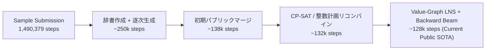

# 03. Code (公開コード & 最適化解法動向)

Kaggle公式ページ: [Santa 2026 - The Elf Calculator (Code)](https://www.kaggle.com/competitions/santa-2026/code)

---

## 1. 公開ノートブックの進化の歴史

本コンペティションの公開ノートブックコミュニティは、驚異的なスピードで進化を続けています。
初期のサンプル提出(1,490,379ステップ)から、現在では128,000台のSOTA公開コードまで短縮が進んでいます。

---

## 2. 主要な公開ノートブック一覧

コミュニティで高く評価されている重要ノートブックの解説です:

| ノートブック名 / 著者 | スコア | 主な特徴・貢献 |
|---|---|---|
| **[Santa 2026 \| Multi-Engine Frontier \| LB 128,221](https://www.kaggle.com/code/ozertuu/santa-2026-multi-engine-frontier-lb-128-221)** by Ertuğrul Özer | 128,221 | 複数の独立した探索エンジン(Frontier, Rewriter, Backward Beam)の出力をパズル単位でアンサンブルマージした公開最高峰ノートブック。 |
| **[Santa 2026 \| Fresh-Program Re-Search \| LB 128,241](https://www.kaggle.com/code/goodpjw2008/santa-2026-fresh-program-re-search-lb-128-241)** by goodpjw2008 | 128,241 | 既存解に頼らずゼロからの新鮮な探索(Fresh Search)を行い、局所解に陥っていたパズルの大幅短縮に成功。 |
| **[Santa 2026: Claude Coding \| LB: 128524](https://www.kaggle.com/code/wilanw/santa-2026-claude-coding-lb-128524)** by wilan | 128,524 | 177回におよぶ体系的実験ログを公開。「何が効いて何が効かなかったか(What worked and what did not)」の極めて価値の高い知見集。 |
| **[Santa 2026 Arithmetic Graph Rewrites](https://www.kaggle.com/code/bikrambasnet1/santa-2026-arithmetic-graph-rewrites)** by Bikram Basnet | ~130k | 計算グラフ(DAG)のノード書き換え手法。冗長な中間値の統合と枝刈りアルゴリズムを体系化。 |
| **[Santa 2026 \| LNS + CP-SAT Recombine \| LB 132,256](https://www.kaggle.com/code/goodpjw2008/santa-2026-lns-cp-sat-recombine-lb-132-256)** by goodpjw2008 | 132,256 | 大規模近傍探索(LNS)とGoogle OR-ToolsのCP-SATソルバーを組み合わせ、部分グラフの最適再結合を実現。 |
| **[Santa 2026: Fast Validator, EDA & SOTA Baseline](https://www.kaggle.com/code/amanatar/santa-2026-fast-validator-eda-sota-baseline)** by Aman Atar | - | 1,000問のプログラムをミリ秒単位で厳密検証するゼロトラスト・高速バリデータの実装。 |

---

## 3. 上位勢・公開SOTAの技術的アプローチ

トップ層(124k〜128k)が採用している主要なアルゴリズム構成要素は以下の通りです。

### (1) Value Graph (計算DAG) の抽象化
プログラムを命令のリストではなく、「値(Value)をノード、演算をエッジとする有向非巡回グラフ(DAG)」として扱います。
- スコアは本質的に「プログラムが計算するユニークな値の総数」に等しい。
- 命令の共有(Sharing)が短縮のすべて。1つのターゲット専用の長い直線チェーンを排除し、他のターゲットと中間値を最大限共有させます。

### (2) 大規模近傍探索 (Large Neighborhood Search: LNS)
最も劇的なスコア改善をもたらすメインエンジンです。
- **1手の手順**: ターゲットまたは中間ヘルパーノードを1〜2個選び、それが単独でサポートしているサブツリー(枝)をすべてグラフから削除。
- **再合成(Rebuild)**: 残された全有効ノードのプールから、1〜3手以内の四則演算で元のターゲットを再生成できるルートを全探索。
- **プラトー歩行(Plateau Walking)**: 短縮された場合だけでなく、「同じ長さの解」も積極的に受容して探索空間を広く脱出(改善への足がかりを作る)。

### (3) 後退ビームサーチ (Backward Beam Search)
40〜60ビットの巨大なランダムターゲット(Independentファミリー)に極めて有効。
- 初期値から前向きに作ろうとすると探索空間が爆発するため、**目標値から逆算**します。
- 目標値 $T$ に対し、既存のプール値 $v$ を用いて $T - v$ や $T \div v$ (割り切れる場合)を逆計算し、低ビットの基底プールに到達する最短経路を探索。

### (4) レジスタ割り当てと順序アニーリング (Register Allocation)
ノード数が最小のDAGを作っても、同時に生きている値の数が48個を超えると実行不可能です。
- トポロジカルソート順序の局所変更(Order Annealer)
- ペブルゲーム(Pebble Game)理論に基づくレジスタ再利用スケジューリング
- 線形走査法(Linear Scan Register Allocation)による48スロットへの最適パッキング

---

## 関連リンク
- **[02_data.md](./02_data.md)**: データ仕様と計算機ルール
- **[04_models.md](./04_models.md)**: 最適化モデルとソルバー
- **[PROJECT_DASHBOARD.md](../PROJECT_DASHBOARD.md)**: プロジェクトダッシュボード
