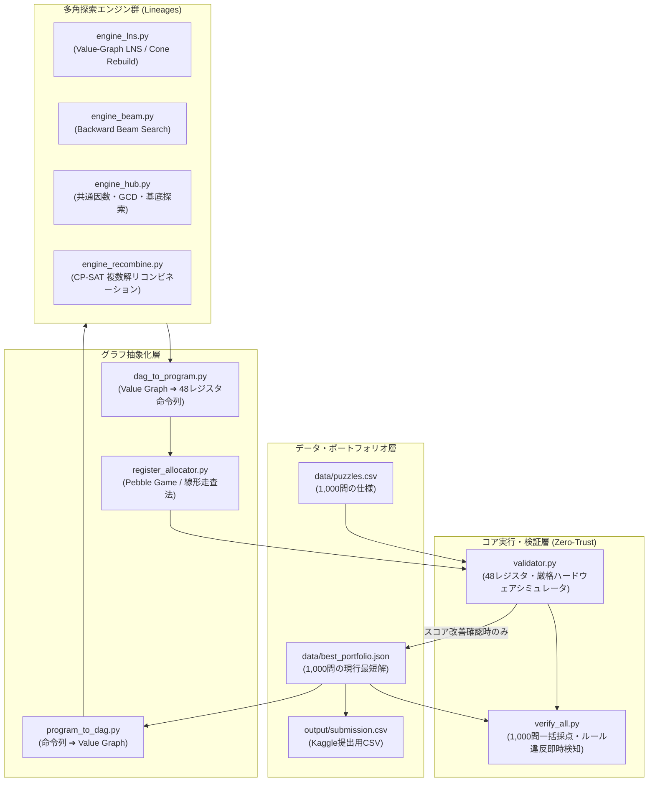

# システムアーキテクチャ設計書 (System Architecture)

本ドキュメントは、「Santa 2026 - The Elf Calculator」において、世界1位を獲得するためのソルバーアーキテクチャおよびデータパイプラインの全体設計を定義します。

---

## 1. 全体アーキテクチャ概要

---

## 2. モジュール構成と責務

1. **`src/validator.py` (計算機エミュレータ)**:
   - 48レジスタの仮想マシンを忠実に再現。
   - レジスタ範囲(0〜47)、未初期化参照、正の整数制約、除算の整除性($\pmod == 0$)、値上限($10^{18}$)、全ターゲット到達を検証。
2. **`src/portfolio.py` (ポートフォリオマネージャ)**:
   - 1,000パズルのベストプログラムを保持。
   - 新しい解が生成された際、検証器をパスし、かつ既存のステップ数より短い場合のみ該当パズルを置き換える。
   - 提出用CSV(`submission.csv`)の自動生成とJSONエクスポート。
3. **`src/dag.py` (Value Graph抽象化)**:
   - 命令列からレジスタ割り当ての依存を取り除き、純粋な値の依存関係(DAG)として表現。
4. **`src/reg_alloc.py` (レジスタアロケータ)**:
   - DAGのトポロジカルソート順を最適化し、最大同時生存値数を48個以下に抑えて具体的なレジスタ番号(0〜47)を割り当てる。

---

## 関連リンク
- **[02_optimization_strategy.md](./02_optimization_strategy.md)**: 最適化アルゴリズム戦略
- **[PROJECT_DASHBOARD.md](../PROJECT_DASHBOARD.md)**: プロジェクトダッシュボード
