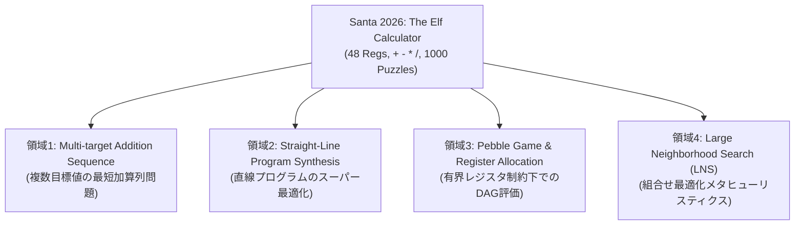

# 03. REFERENCES (学術的背景・関連学会・引用文献)

本コンペティション「**Santa 2026 - The Elf Calculator**」の数学的・計算機科学的本質を解明し、世界1位を獲得するための拠り所となる学術理論、関連学会・団体、および重要論文・先行研究の引用元を整理した体系的ナレッジベースです。

---

## 1. 本コンペティションの計算理論的分類

本課題は、計算複雑性理論および数理最適化において、以下の4つの確立された問題領域が複合したものです。

---

## 2. 関連する国際学会・学術団体

本問題に関連する最先端の研究成果は、主に以下の国際学会および学術団体から発表されています。

| 学会 / 団体略称 | 正式名称 | 関連分野・トピック |
|---|---|---|
| **ACM SIGACT / IEEE TCMF** | **STOC / FOCS** (Foundations of Computer Science) | 算術回路の複雑さ(Arithmetic Circuit Complexity)、最短プログラム探索の計算困難性 |
| **SIAM** | **SODA** (Symposium on Discrete Algorithms) / **SICOMP** | 加算連鎖の離散アルゴリズム、近似アルゴリズム |
| **ACP** | **CP** (International Conference on Principles and Practice of Constraint Programming) | CP-SATソルバー、制約プログラミングによるプログラム合成 |
| **INFORMS / CPAIOR** | **CPAIOR** (Integration of CP, AI, and Operations Research) | LNS(大規模近傍探索)、MILPとCPのハイブリッド最適化 |
| **ACM SIGPLAN** | **POPL / PLDI / ASPLOS** | スーパーオプティマイザ(Superoptimization)、コンパイラレジスタ割り当て |
| **IACR** | **CRYPTO / EUROCRYPT** | 高速多重冪乗算(Multi-exponentiation)のためのベクトル加算連鎖ヒューリスティクス |

---

## 3. 領域別の重要論文・文献引用 (Key Citations)

### 領域 1: 最短加算列 (Addition Chain) & 多重目標加算列 (Addition Sequence)
1つの初期値から最小の手順で指定目標値を作る問題。乗算・減算を含む一般化がなされています。

1. **Knuth, D. E. (1969/1997)**
   * *The Art of Computer Programming, Vol. 2: Seminumerical Algorithms*, Section 4.6.3 "Evaluation of Powers", Addison-Wesley.
   * **有用性**: 加算連鎖の理論的基礎、二進法、ウィンドウ法、因数分解法、星形連鎖(Star Chain)の性質を網羅。
2. **Yao, A. C.-C. (1976)**
   * "On the evaluation of powers", *SIAM Journal on Computing*, 5(1), 100-103.
   * **有用性**: 複数のターゲット数を同時に生成する「Addition Sequence」の概念を確立。漸近的下限を証明。
3. **Downey, P., Leong, B., & Sethi, R. (1981)**
   * "Computing Addition Chains with Minimum Number of Steps is NP-complete", *SIAM Journal on Computing*, 10(3), 638-646.
   * **有用性**: 指定された複数ターゲットに対する最短加算列問題が**NP完全**であることを証明。全探索では不可能な理由とヒューリスティクス・メタヒューリスティクスの必要性を数学的に裏付け。
4. **Bos, J., & Coster, M. (1989)**
   * "Addition Chain Heuristics", *Advances in Cryptology — CRYPTO '89*, LNCS 435, pp. 400-407.
   * **有用性**: 共通基底(ハブ)を抽出して共有するヒューリスティクスの原典。本コンペの「Sharedファミリー」攻略に直結。

---

### 領域 2: 直線プログラムの合成 (Straight-Line Programs & Superoptimization)
分岐やループのない最短命令列を自動探索するアルゴリズム。

1. **Massalin, H. (1987)**
   * "Superoptimizer: A tremendous runtime optimization tool", *ASPLOS II*, ACM, pp. 122-126.
   * **有用性**: 「最短の命令列を網羅的・枝刈り付き探索で自動発見する」スーパーオプティマイザの元祖。
2. **Gulwani, S., Jha, S., Tiwari, A., & Venkatesan, R. (2011)**
   * "Synthesis of Loop-Free Programs", *PLDI '11*, ACM, pp. 62-73.
   * **有用性**: 制約ソルバー(SMT/SAT)を用いて、入出力仕様から最短の直線プログラムを厳密に自動合成するフレームワーク。本コンペの1〜4手局所再構築の数理的基盤。
3. **Bansal, S., & Aiken, A. (2006)**
   * "Automatic generation of peephole superoptimizers", *ASPLOS XII*, ACM, pp. 394-403.
   * **有用性**: サブグラフの同値書き換え(Arithmetic Graph Rewriting)による命令短縮。

---

### 領域 3: ペブルゲーム理論 & レジスタ割り当て (Pebble Game & Register Allocation)
DAGの各ノードの計算順序をスケジューリングし、限られたレジスタ(48個)で実行可能にする理論。

1. **Sethi, R. (1975)**
   * "Complete Register Allocation Problems", *SIAM Journal on Computing*, 4(3), 226-248.
   * **有用性**: レジスタ数制限下でのDAGコード生成がNP完全であることを証明。
2. **Hopcroft, J., Paul, W., & Valiant, L. (1977)**
   * "On Time Versus Space", *Journal of the ACM*, 24(2), 332-337.
   * **有用性**: DAG上のペブルゲーム(Pebble Game)理論の金字塔。計算ノードの配置順序とピークメモリ(レジスタ使用量)の関係を数学的にモデル化。
3. **Poletto, M., & Sarkar, V. (1999)**
   * "Linear Scan Register Allocation", *ACM TOPLAS*, 21(5), 895-913.
   * **有用性**: 高速なレジスタ割り当てアルゴリズム。DAGのトポロジカル順序が定まった後に、48レジスタへ瞬時に彩色・マッピングする実装の基盤。

---

### 領域 4: 大規模近傍探索 (Large Neighborhood Search: LNS)
組合せ最適化において、現在の解の一部を破壊して再構築を繰り返す最強の局所探索フレームワーク。

1. **Shaw, P. (1998)**
   * "Using Constraint Programming and Local Search Methods to Solve Vehicle Routing Problems", *CP '98*, LNCS 1520, pp. 417-431.
   * **有用性**: LNS(大規模近傍探索)の原典論文。部分破壊(Destroy)と制約充足による修復(Repair)の反復サイクル。
2. **Pisinger, D., & Ropke, S. (2010)**
   * "Large Neighborhood Search", *Handbook of Metaheuristics*, Springer, pp. 399-419.
   * **有用性**: 適応的大規模近傍探索(ALNS)の体系化。同等長解の受容(プラトー歩行)や温度スケジューリングの有効性の理論。

---

## 4. 本コンペに直結する「筋のいい知見」の抽出まとめ

上記文献の知見から導き出される、本コンペで勝利するための核心的アプローチ：

1. **探索とレジスタ割り当ての直交化(分離)**:
   - レジスタ番号(0〜47)を考慮しながら探索すると状態空間が天文学的に爆発する。
   - まず「値の純粋なDAG(Value Graph)」の最小化に集中し、得られたDAGをペブルゲーム/Linear Scanで48レジスタにパッキングする(Poletto 1999, Hopcroft 1977)。
2. **共通ハブ抽出 (Bos-Coster Heuristic)**:
   - 目標値群の最大公約数(GCD)や小さな線形結合を先行探索し、共有ハブを先にプールに置く(Bos & Coster 1989)。
3. **破壊と修復のLNSループ (Shaw 1998)**:
   - 1つのターゲット専用の長い枝(Private Chain)を特定して削除(Destroy)し、既存プールから1〜3手以内で再合成(Repair)する。
4. **逆算展開 (Meet-in-the-middle / Backward Chain)**:
   - 巨大目標値(50〜60bit)は前向き探索では届かない。目標値から除算・減算で逆向きにプールへ落とし込む。

---

## 関連リンク
- **[01_system_architecture.md](./01_system_architecture.md)**: システムアーキテクチャ設計
- **[02_optimization_strategy.md](./02_optimization_strategy.md)**: 最適化アルゴリズム戦略
- **[001_Sprints/sprint_001.md](../001_Sprints/sprint_001.md)**: Sprint 001 スプリント計画
