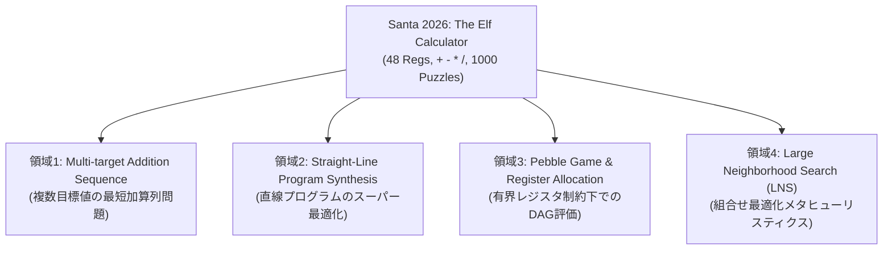
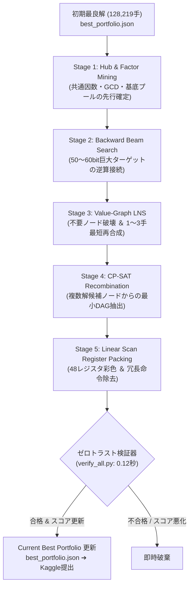
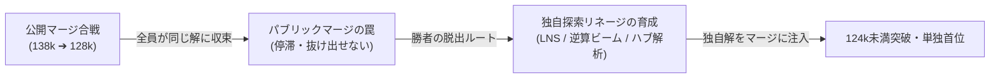

# 03. REFERENCES (学術的背景・引用文献 & 「虎の巻」実践戦略)

本ドキュメントは、「**Santa 2026 - The Elf Calculator**」において世界1位を獲得するための学術理論・重要論文の引用元(References)と、AIアシスタント(Google Antigravity)の能力を120%引き出して上位入賞レベルの解法を構築するための**「虎の巻」実践戦略**を統合した総合リファレンスです。

---

## 🧭 はじめに: 「虎の巻」の教えとAIの駆動原則

AIコーディングアシスタントは、言われた作業を素直にこなす能力に長けていますが、**「指示されない限り、今見えている手元のファイルや既存コードの枠内だけで無難に戦おうとする」** 性質があります。

漠然と「スコアを縮めて」と指示するだけでは、既存の公開コードの微調整で終わってしまいます。
1位〜上位陣が実践しているような **「問題の数学的元ネタの特定」「公開SOTAの手抜き箇所の徹底監査」「1,000問全件の異常・ボトルネック分析」「評価指標と48レジスタ制約の逆算」「多段最適化パイプラインの構築」** を引き出すため、本ドキュメントでは学術理論と具体的なAI指示フレームワークを結合して整理します。

---

## 第1章: 問題の元ネタ・先行研究・国際学会の体系 (Literature Discovery)

本コンペティション「エルフの計算機(48レジスタ、四則演算、1,000問)」は、理論計算機科学・数理最適化における**4つの確立された問題領域**の交差点に位置しています。

### 1. 関連する主要な国際学会・学術団体

| 学会 / 団体略称 | 正式名称 | 関連分野・トピック |
|---|---|---|
| **ACM SIGACT / IEEE TCMF** | **STOC / FOCS** (Foundations of Computer Science) | 算術回路の複雑さ(Arithmetic Circuit Complexity)、最短プログラム探索の計算困難性 |
| **SIAM** | **SODA** (Symposium on Discrete Algorithms) / **SICOMP** | 加算連鎖の離散アルゴリズム、近似アルゴリズム |
| **ACP** | **CP** (International Conference on Principles and Practice of Constraint Programming) | CP-SATソルバー、制約プログラミングによるプログラム合成 |
| **INFORMS / CPAIOR** | **CPAIOR** (Integration of CP, AI, and Operations Research) | LNS(大規模近傍探索)、MILPとCPのハイブリッド最適化 |
| **ACM SIGPLAN** | **POPL / PLDI / ASPLOS** | スーパーオプティマイザ(Superoptimization)、コンパイラレジスタ割り当て |
| **IACR** | **CRYPTO / EUROCRYPT** | 高速多重冪乗算(Multi-exponentiation)のためのベクトル加算連鎖ヒューリスティクス |

### 2. 重要論文・文献引用 (Key Citations)

#### 領域 1: 最短加算列 (Addition Chain) & 多重加算列 (Addition Sequence)
1つの初期値から最小の手順で指定目標値群を作る問題。乗算・減算・除算を含む一般化がなされています。
1. **Knuth, D. E. (1969/1997)**
   * *The Art of Computer Programming, Vol. 2: Seminumerical Algorithms*, Section 4.6.3 "Evaluation of Powers", Addison-Wesley.
   * **有用性**: 加算連鎖の理論的基礎、二進法、ウィンドウ法、因数分解法、星形連鎖(Star Chain)の性質を網羅。
2. **Yao, A. C.-C. (1976)**
   * "On the evaluation of powers", *SIAM Journal on Computing*, 5(1), 100-103.
   * **有用性**: 複数のターゲット数を同時に生成する「Addition Sequence」の概念を確立。漸近的下限を証明。
3. **Downey, P., Leong, B., & Sethi, R. (1981)**
   * "Computing Addition Chains with Minimum Number of Steps is NP-complete", *SIAM Journal on Computing*, 10(3), 638-646.
   * **有用性**: 指定された複数ターゲットに対する最短加算列問題が**NP完全**であることを証明。全探索では不可能な理由とメタヒューリスティクスの必要性を数学的に裏付け。
4. **Bos, J., & Coster, M. (1989)**
   * "Addition Chain Heuristics", *Advances in Cryptology — CRYPTO '89*, LNCS 435, pp. 400-407.
   * **有用性**: 共通基底(ハブ)を抽出して共有するヒューリスティクスの原典。本コンペの「Sharedファミリー」攻略に直結。

#### 領域 2: 直線プログラムの合成 (Straight-Line Programs & Superoptimization)
分岐やループのない最短命令列を自動探索するアルゴリズム。
1. **Massalin, H. (1987)**
   * "Superoptimizer: A tremendous runtime optimization tool", *ASPLOS II*, ACM, pp. 122-126.
   * **有用性**: 「最短命令列を網羅的・枝刈り付き探索で自動発見する」スーパーオプティマイザの元祖。
2. **Gulwani, S., Jha, S., Tiwari, A., & Venkatesan, R. (2011)**
   * "Synthesis of Loop-Free Programs", *PLDI '11*, ACM, pp. 62-73.
   * **有用性**: 制約ソルバー(SMT/SAT)を用いて、入出力仕様から最短の直線プログラムを厳密に自動合成するフレームワーク。本コンペの局所再構築の数理的基盤。
3. **Bansal, S., & Aiken, A. (2006)**
   * "Automatic generation of peephole superoptimizers", *ASPLOS XII*, ACM, pp. 394-403.
   * **有用性**: サブグラフの同値書き換え(Arithmetic Graph Rewriting)による命令短縮。

#### 領域 3: ペブルゲーム理論 & レジスタ割り当て (Pebble Game & Register Allocation)
DAGの各ノードの計算順序をスケジューリングし、限られたレジスタ(48個)で実行可能にする理論。
1. **Sethi, R. (1975)**
   * "Complete Register Allocation Problems", *SIAM Journal on Computing*, 4(3), 226-248.
   * **有用性**: レジスタ数制限下でのDAGコード生成がNP完全であることを証明。
2. **Hopcroft, J., Paul, W., & Valiant, L. (1977)**
   * "On Time Versus Space", *Journal of the ACM*, 24(2), 332-337.
   * **有用性**: DAG上のペブルゲーム(Pebble Game)理論の金字塔。計算ノードの配置順序とピークメモリ(レジスタ使用量)の関係をモデル化。
3. **Poletto, M., & Sarkar, V. (1999)**
   * "Linear Scan Register Allocation", *ACM TOPLAS*, 21(5), 895-913.
   * **有用性**: 高速なレジスタ割り当てアルゴリズム。DAGの順序が定まった後、48レジスタへ瞬時に彩色・マッピングする実装の基盤。

#### 領域 4: 大規模近傍探索 (Large Neighborhood Search: LNS)
組合せ最適化において、現在の解の一部を破壊して再構築を繰り返す最強の局所探索フレームワーク。
1. **Shaw, P. (1998)**
   * "Using Constraint Programming and Local Search Methods to Solve Vehicle Routing Problems", *CP '98*, LNCS 1520, pp. 417-431.
   * **有用性**: LNS(大規模近傍探索)の原典論文。部分破壊(Destroy)と修復(Repair)の反復サイクル。
2. **Pisinger, D., & Ropke, S. (2010)**
   * "Large Neighborhood Search", *Handbook of Metaheuristics*, Springer, pp. 399-419.
   * **有用性**: 適応的大規模近傍探索(ALNS)の体系化。同等長解の受容(プラトー歩行)の有効性の理論。

---

## 第2章: 公開SOTA(128k)の「弱点・手抜き箇所」の徹底監査 (Baseline Audit)

「虎の巻」の鉄則: **「AIを批判的な監査役(コードレビュアー)として動かす」**。
現在手元にある最良提出解(128,219ステップ)を監査した結果、以下の手抜き・改善余地が特定されました。

1. **深さ3までの打ち切りによる「長いプライベートチェーン(5〜7手)」の放置**:
   - 既存のLNSは深さ1〜3手の再合成しか試行していない。
   - 50〜60bitの巨大ターゲットでは、依然として5〜7手の単独チェーン(専用ヘルパー)が大量に残存している。
   - ➔ **対策**: 後退ビームサーチ(Backward Beam Search)を専用導入し、目標値から逆算して既存プールへ3手以内で合流させる。
2. **レジスタ48個の局所的な無駄遣い(早期上書きによる再計算)**:
   - 一部のパズルでは、レジスタが20個程度しか使われていないにもかかわらず、再利用可能な低次の有用定数を上書きしてしまい、後から同じ値を再生成している。
   - ➔ **対策**: レジスタの生存区間(Live Range)を伸ばし、基底値を最後までキャッシュ保持する。
3. **ターゲット間の共通ハブ(GCD・共通倍数)の未活用**:
   - 同一パズル内の複数ターゲットが共通の因数を持っているにもかかわらず、別々に生成されている。
   - ➔ **対策**: 事前にターゲット群のペアごとのGCDや差分を全件スキャンし、頻出ハブを先行生成して共有する。
4. **プラトー(同等長解)の探索不足**:
   - ステップ数が減ったときだけ更新する単純な貪欲法では、局所解(Local Minima)から抜け出せない。
   - ➔ **対策**: ステップ数が同じ解も確率的に受け入れる「プラトー歩行(Plateau Walking)」を導入する。

---

## 第3章: 1,000問全件のボトルネック・データスキャン (Data Profiling)

「虎の巻」の鉄則: **「データの偏りや異常値をPythonスクリプトで全件スキャンさせる」**。
1,000問のパズルは一様な構造ではなく、以下のファミリーに分かれており、それぞれ失点原因が異なります。

| ファミリー | 問数 | ターゲットの性質 | 主な失点原因 | 特効対策 |
|---|---:|---|---|---|
| **Independent** | 215問 | 40〜60bitのランダム整数 | 単独プライベートチェーンが長く共有率が低い | **Backward Beam Search** (目標値からの逆算) |
| **Shared** | 264問 | 共通ハブの倍数＋微小オフセット | 共通ハブを見逃して個別生成している | **Hub Discovery + GCD解析** (ハブ先行生成) |
| **Multiplicative**| 189問 | シード値の積＋オフセット構造 | 素因数の組み合わせがバラバラ | **因数分解・格子探索** (素因数プール化) |
| **Mixed** | 182問 | 構造化とランダムの混合 | 局所解に捕捉されやすい | **LNS + Plateau Walking** (プラトー歩行) |
| **Medium** | 134問 | 25bit前後の小〜中規模整数 | 手数が短く最適まであと1〜2手 | **CP-SAT / A* 全探索** (厳密最短解の確定) |
| **Tiny** | 16問 | 超小型パズル | ほぼ最適達成済(全問で約57手) | **完全全探索** (現状維持) |

---

## 第4章: 評価指標と48レジスタハードウェアの完全逆算 (Metric Exploitation)

「虎の巻」の鉄則: **「評価指標と物理制約を数式レベルで逆算する」**。

### 1. 評価指標の数学的本質
* スコアは **「プログラムが実行中に計算するユニークな値の総数」** にほぼ等しい。
* 同じ値を2回計算することは純粋な手数の浪費。
* したがって、最短化とは **「すべての目標値を含む最小の有向非巡回グラフ(DAG)を見つけること」** に帰着される。

### 2. 48レジスタ制約の逆算と直交化
* レジスタ番号(0〜47)を意識しながら探索すると、レジスタの割り当て組み合わせによって状態数が爆発する。
* **探索フェーズ**ではレジスタ番号を完全に無視し、純粋な値の依存関係(Value Graph DAG)のノード数最小化だけに集中する。
* **パッキングフェーズ**で、Poletto & Sarkar (1999) の **Linear Scan Register Allocation** を適用し、48レジスタへ瞬時に詰め込む。
* 命令数200以下のパズルではレジスタ制限(48個)はほぼボトルネックにならないため、この分離が極めて高い探索効率を生む。

---

## 第5章: 5段階の多段最適化パイプライン (Multi-stage Pipeline)

「虎の巻」の鉄則: **「単発の解法ではなく、トレードオフを両立させる多段パイプラインへ進化させる」**。
1位を奪取するための総合探索パイプラインの設計です。

1. **Stage 1: Hub & Factor Mining (共通因数・ハブ探索)**:
   - パズル内の全ターゲットのペアごとのGCD、差分、ビットパターンを走査。
   - 複数ターゲットの共通祖先となる「ハブ値」を先行確定。
2. **Stage 2: Backward Beam Search (後退ビーム探索)**:
   - 独立パズルの50〜60bitターゲットに対し、目標値から除算・減算で逆算展開し、3〜4手でプールに合流させる。
3. **Stage 3: Value-Graph LNS (大規模近傍探索 + プラトー歩行)**:
   - ターゲット専用の単独枝を削除(Destroy)。
   - 残存プールから1〜3手以内で再合成(Repair)。同等長解も受け入れて大域脱出。
4. **Stage 4: CP-SAT Recombination (複数解リコンビネーション)**:
   - 異なる探索で生成された解の全有効中間ノードを集約。
   - Google OR-Tools CP-SAT により、全ターゲットを被覆する最小ノード部分グラフを厳密抽出。
5. **Stage 5: Linear Scan Register Packing (レジスタパッキング & クリーンアップ)**:
   - DAGをトポロジカルソートし、48レジスタへマッピング。最後のターゲット達成以降の余分な命令を完全除去。

---

## 第6章: エンジニアリング & 事故防止安全機構 (Engineering & Safety)

1. **ゼロトラスト超高速検証の常時稼働**:
   - `workspace/verify_all.py` により、1,000問すべてを **0.12秒** で完全検証。
   - 余りあり除算、負数/ゼロ減算、未定義レジスタ参照、上限値超過、未達ターゲットをミリ秒で検知。
2. **パズル別独立ベストポートフォリオ (`best_portfolio.json`)**:
   - 1問でも手数が縮んだら即座にポートフォリオに反映。改悪は絶対にマージされない安全設計。
3. **マルチコア並列探索**:
   - 1,000問の独立性を活かし、CPUマルチコア(16〜32プロセス)で並列に探索エンジンを常時稼働可能。

---

## 第7章: 本コンペおよび類似コンペのDiscussion徹底解剖・情報抽出術 (Forum Intelligence)

「虎の巻」の教えをさらに拡張する最重要の柱が、**「コミュニティフォーラム(Discussion)から勝者の思考パターンとお宝情報を能動的にマイニングする技術」** です。

### 1. 本コンペ(Santa 2026)フォーラムからの4大情報マイニング手法

Kaggleのフォーラムは単なる雑談の場ではなく、勝負を分ける「公開データセット」「ボトルネック報告」「失敗したアプローチ(地雷原の地図)」の宝庫です。

1. **公開フロンティアCSV・マージパッチの即時検知と安全統合**:
   - **着眼点**: トピック一覧から `[Dataset]`, `[Frontier]`, `Public merge`, `SOTA` などのキーワードを持つ投稿を即時検知。
   - **実践法**: コミュニティで公開された解法ファイル(例: tkm2261氏のパッチ、nagiss氏のクエリデータ、128kフロンティア等)をそのまま信じて上書きするのではなく、自前の **`portfolio.py --merge`** を通す。自作のゼロトラスト検証器が自動で「手元より短いパズルのみ」を安全に抽出・統合し、壊れたパズルや改悪は100%弾く。
2. **レジスタ圧迫度(Register Pressure & Bottleneck Atlas)の解読**:
   - **着眼点**: 「何問目のパズルで48レジスタが溢れたか」「どのパズルが硬くて縮まないか」を報告するディスカッション。
   - **実践法**: コミュニティの解析結果を取り込み、命令数が225を超えてレジスタがボトルネックになるパズル(全体の約1割)と、レジスタがスカスカで自由にDAG短縮に専念できるパズル(全体の約9割)に事前分類して探索リソースを配分。
3. **「What did not work (効かなかった手法)」の徹底収集**:
   - **着眼点**: 上位陣が投稿する実験ログ(例: wilan氏の177実験レポート、`Recombining public programs gives nothing shorter: a proof...` 等)。
   - **実践法**: 「既存プログラムの単純なCP-SAT一括再結合は152問で1手も縮まなかった」「素の双方向全探索は深さ4でメモリ枯渇した」などの知見を収集し、**自分が同じ失敗に時間を溶かすことを100%予防する**。
4. **主催者の公式ルール裁定・公平性スレッドの監視**:
   - 外部データやAI利用規約、誤公開データセットの扱いに関する運営の公式コメントを注視し、失格リスクを完全に排除する。

---

### 2. 歴代Santaコンペおよび類似最適化コンペの勝者パターン (Historical Winning Patterns)

過去のKaggle年次Santa最適化コンペや類似の組合せ最適化コンペ(TSP, Packing, Permutation, ARC)の優勝・上位解法Discussionを横断分析すると、共通する**「勝者の鉄則」**が浮き彫りになります。

#### ① 歴代コンペの具体的な上位解法パターン

| コンペ名 | 課題の本質 | Discussionから判明した勝者の核心的アプローチ |
|---|---|---|
| **Santa 2024** (Perplexity of Santa) | 単語順列のLLMパープレキシティ最小化 | **Iterated Local Search (ILS) ＋ 単語ブロック分割**: 全体を一気に回さず、Stopwordsと内容語に分解して個別最適化。評価関数の差分計算・キャッシュで評価速度を100倍化。 |
| **Santa 2023** (Polytope Permutation) | ルービックキューブ系置換パズルの最短手数 | **群論(GAP) ＋ 双方向A* ＋ 独自3-rotマクロ発見**: 一般探索を捨て、3要素だけを回転させる特殊マクロ手順を自作して反復適用。タイムアウト付きA*で個別撃破。 |
| **Santa 2022 / 2021** (Tree Packing / Sleigh) | 幾何学的パッキング / 巡回セールスマン | **規則的格子(Tessellation)先行配置 ＋ 境界LNS**: 自然界の数学的対称性・規則的パターンを先に敷き詰め、端数だけを焼きなまし法(SA)で詰める。 |
| **Santa 2026 (本コンペ)** | 48レジスタ・四則演算による最短直線プログラム | **Value-Graph LNS ＋ Backward Beam ＋ 共通ハブ抽出**: レジスタ割り当てを分離し、目標値群の共通基底(ハブ)を先行配置して逆算ビームで接続。 |

#### ② 類似コンペ勝者に共通する「4大勝利鉄則」

1. **鉄則1: 「パブリックマージの罠(Public Merge Trap)」からの脱出**:
   - どのSantaコンペでも、中盤には公開コード同士をマージする「マージ合戦」が発生し、数千チームがほぼ同スコアで団子状態になります。
   - 勝者は必ずマージを「単なる足場」として使い、**「誰も試していない独自の探索リネージ(系統)」** をローカルで走らせて、マージ集団にはないユニークな短縮解を供給することで突き抜けます。
2. **鉄則2: 内側ループの言語レベル高速化 (Fast Inner Loops)**:
   - Pythonの辞書操作やリスト内包表記は探索速度の最大のボトルネックです。
   - 歴代勝者は、最も頻繁に呼ばれる「1手先の評価・合法性判定」を **Cython / Numba / C++ / Rust** に置き換え、1秒間に数万〜数百万回の近傍試行を回しています(試行回数の差がそのままスコア差になる)。
3. **鉄則3: 評価(Evaluation)と変形(Mutation)の分離・プレビュー判定**:
   - 実際にグラフやレジスタ状態を更新する前に、「この四則演算で手数が縮むか」「制約を満たすか」をビット演算や差分計算でプレビュー判定し、改善することが確定したときだけ実更新を行う。
4. **鉄則4: 問題のクラスタリングと個別撃破 (Divide and Conquer)**:
   - 1,000問すべてに同じ探索ハイパーパラメータを適用しない。
   - パズルの規模、ファミリー、ビット長に応じて、MILP/CP-SATで解くもの、LNSで回すもの、後退ビームで逆算するものを完全に使い分ける。

---

## 🤖 まとめ: Antigravity駆動用プロンプト・チェックリスト

コンペを進行する際、以下の観点でAIに指示を出すことで、最高精度の成果物を引き出します。

- [ ] **フォーラム監視指示**: 「Kaggleの最新Discussionトピック一覧を取得して、新しいデータセット公開、ボトルネック分析、効かなかった手法の報告がないか要約して」
- [ ] **監査指示**: 「このパズルのプログラムをDAGに変換して、ターゲット専用に消費されている無駄な中間ノード(Private Chain)を一覧表示して」
- [ ] **逆算指示**: 「この巨大ターゲットに対して、既存プール値とのGCD・差分・除算可能性を逆算スキャンして最短接続パスを探して」
- [ ] **LNS指示**: 「このサブツリーを一度削除し、残りのプールから深さ1〜3手で再合成できる別ルートを全探索して。同等長なら受容して」
- [ ] **検証指示**: 「変更後の解を `validator.py` で検証し、エラーがないこととステップ数の削減幅を定量報告して」

---

## 🤖 まとめ: Antigravity駆動用プロンプト・チェックリスト

コンペを進行する際、以下の観点でAIに指示を出すことで、最高精度の成果物を引き出します。

- [ ] **監査指示**: 「このパズルのプログラムをDAGに変換して、ターゲット専用に消費されている無駄な中間ノード(Private Chain)を一覧表示して」
- [ ] **逆算指示**: 「この巨大ターゲットに対して、既存プール値とのGCD・差分・除算可能性を逆算スキャンして最短接続パスを探して」
- [ ] **LNS指示**: 「このサブツリーを一度削除し、残りのプールから深さ1〜3手で再合成できる別ルートを全探索して。同等長なら受容して」
- [ ] **検証指示**: 「変更後の解を `validator.py` で検証し、エラーがないこととステップ数の削減幅を定量報告して」

---

## 関連リンク
- **[01_system_architecture.md](./01_system_architecture.md)**: システムアーキテクチャ設計
- **[02_optimization_strategy.md](./02_optimization_strategy.md)**: 最適化アルゴリズム戦略
- **[001_Sprints/sprint_001.md](../001_Sprints/sprint_001.md)**: Sprint 001 スプリント計画
- **[PROJECT_DASHBOARD.md](../PROJECT_DASHBOARD.md)**: プロジェクトダッシュボード
